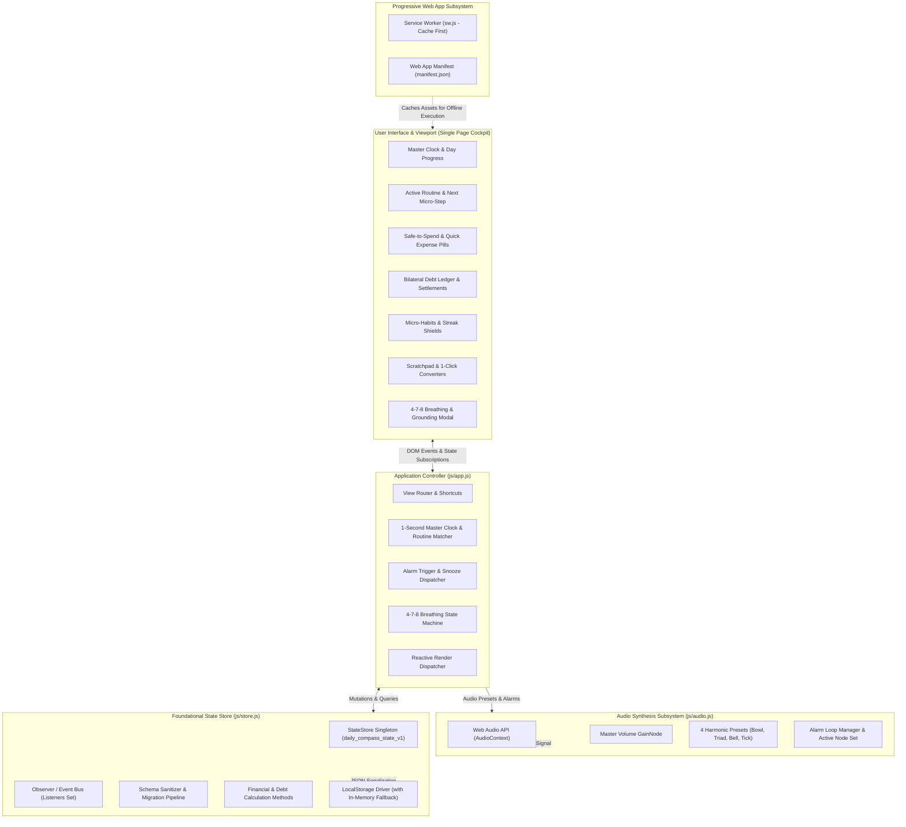
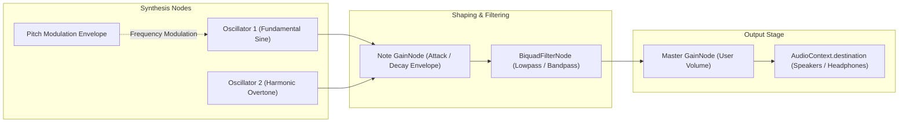
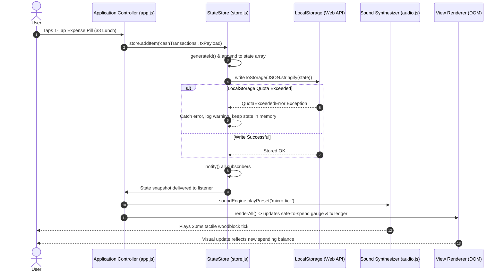

# 🏛️ Architecture & System Design
# Project: "Daily Compass"

**Document Version:** 1.0.0  
**Target Environment:** Local-First Web Application / Offline Progressive Web App (PWA)  
**Engineering Mindset:** Native Web Standards & Ponytail Simplicity  

---

## 1. System Overview & Architectural Vision

Daily Compass is engineered as a zero-dependency, local-first cognitive prosthetic and daily tracking cockpit. Its mission is to anchor disoriented, overwhelmed, or executive-dysfunctional users within 500 milliseconds of viewing the screen, while providing ultra-low tap friction ($\le 2$ taps) for all daily logging operations.

### High-Level Subsystem Topology

---

## 2. Core Subsystems

### 2.1 State Store Subsystem (`js/store.js`)

The store acts as the single source of truth for the entire application. It follows a predictable, observable, unidirectional data flow without relying on external state libraries like Redux or Zustand.

#### Key Characteristics
- **Singleton Instance:** Instantiated once and exported as `store` (with `window.DailyCompassStore` attached for debugging).
- **Default Schema & Seed Data:** Ships with rich, neurodivergent-friendly initial data so first-time users immediately see a functioning cockpit.
- **Deep Immutability:** `getState()` returns deep-cloned snapshots using `structuredClone()` (with JSON serialize/deserialize fallback) to prevent accidental state mutation outside store boundaries.
- **Micro Pub/Sub:** Allows UI controllers to subscribe via `store.subscribe(listener)`. Returns a clean unsubscribe function.

#### Schema Domains
1. **`settings` & `profile`:** Preferences including `currency`, `timeFormat` (`12h` or `24h`), `dailyBudgetCap`, `soundPreset`, `chimeVolume`, `theme`, and `streakShields`. Kept bidirectionally synchronized.
2. **`anchor`:** Grounding state, current active routine ID, active step ID, and last reset timestamps.
3. **`alarms`:** Array of scheduled alarms with target time (`HH:MM`), active day-of-week bitmasks, enabled toggle, and sound preset.
4. **`routines`:** Chronological routine blocks with start/end bounds (`HH:MM`), icons, colors, and sequential micro-steps.
5. **`cashTransactions`:** Ledger entries with date (`YYYY-MM-DD`), time, type (`expense` or `income`), amount, category, and notes.
6. **`debts`:** Bilateral debt records categorized as `they_owe_me` (lent) or `i_owe_them` (borrowed), tracking initial amount, remaining balance, due dates, and settlement logs.
7. **`habits`:** Micro-habits with category, icon, time-of-day tag, streak counter, `completedDates` array, and streak shield status.
8. **`scratchpad`:** Fleeting capture wall notes with tags (`Idea`, `To-Buy`, `To-Do`, `Later`) and creation timestamps.

#### Sanitization & Migration Pipeline
When data is loaded from storage or imported via JSON, it passes through `sanitizeAndMigrate(loadedState)`:
- Missing top-level module objects are restored with default schemas.
- Missing array modules are initialized to empty arrays.
- Backward compatibility aliases (e.g. `debtRecords` $\rightarrow$ `debts`, `scratchpadItems` $\rightarrow$ `scratchpad`) are automatically normalized.

---

### 2.2 Web Audio API Synthesis Engine (`js/audio.js`)

Conventional web applications rely on MP3, OGG, or WAV audio files. In Daily Compass, **zero external audio files exist**. All chimes, alerts, and tactile click sounds are generated procedurally using the browser's native **Web Audio API**.

#### Why Procedural Audio Synthesis?
1. **Zero Bandwidth & Latency:** No HTTP requests or decoding delays; sounds fire with sub-millisecond precision.
2. **No Broken Links:** Eliminates 404 errors, network timeouts, or asset caching failures.
3. **Calm, Acoustic Overtones:** Off-the-shelf sound effects and klaxons induce sensory alarm. Synthesized harmonic waves allow surgical control over acoustic envelopes (ADSR), frequencies, and harmonics.
4. **Offline Native:** Functions seamlessly completely disconnected from the internet.

#### Audio Graph Topology

#### Sound Presets Deep Dive

##### 1. `zen-bowl` (Tibetan Singing Bowl)
- **Acoustic Intent:** Grounding, soothing meditation tone for alarms and quick resets.
- **Synthesis:**
  - Fundamental Oscillator: Pure sine wave tuned to the calming concert pitch of **$432\text{ Hz}$**.
  - Harmonic Overtone: Sine wave at octave $864\text{ Hz} + 2.5\text{ Hz}$ detuning ($866.5\text{ Hz}$), generating a natural acoustic acoustic beating (interference throbbing) that mimics a physical hand-hammered bronze singing bowl.
  - Envelope: Gentle $80\text{ms}$ linear attack ramping to $0.7$, followed by a long $2.8\text{s}$ exponential decay down to $0.0001$.
  - Filter: $800\text{ Hz}$ lowpass filter ($Q=1.2$) removing harsh highs.

##### 2. `gentle-triad` (Ascending Bell Chime)
- **Acoustic Intent:** Uplifting notification for routine block completions and task finishes.
- **Synthesis:**
  - Polyphonic 3-note ascending C-major triad:
    - **C5:** $523.25\text{ Hz}$ at offset $0.00\text{s}$
    - **E5:** $659.25\text{ Hz}$ at offset $0.12\text{s}$
    - **G5:** $783.99\text{ Hz}$ at offset $0.24\text{s}$
  - Waveform: Triangle wave to provide mellow metallic bell harmonics.
  - Envelope: $20\text{ms}$ attack ramp followed by $1.2\text{s}$ exponential decay per note.

##### 3. `attentive-bell` (Clear Reminder Bell)
- **Acoustic Intent:** Crisp, attention-directing chime for scheduled calendar alarms.
- **Synthesis:**
  - Fundamental: Sine wave at $880\text{ Hz}$ (A5).
  - Harmonic: Sine wave at $1760\text{ Hz}$ (A6) at $35\%$ relative amplitude.
  - Envelope: Fast $15\text{ms}$ crisp attack with $1.5\text{s}$ exponential decay.

##### 4. `micro-tick` (Acoustic Woodblock Snap)
- **Acoustic Intent:** Tactile feedback for button taps, habit checkoffs, and filter selections.
- **Synthesis:**
  - Duration: $20\text{ms}$ ultra-short percussive burst.
  - Oscillator: Triangle wave with a rapid pitch envelope drop from $2400\text{ Hz}$ down to $600\text{ Hz}$ over $20\text{ms}$.
  - Filter: Tight bandpass filter centered at $2200\text{ Hz}$ ($Q=4.0$).
  - Envelope: $2\text{ms}$ linear attack, immediate exponential decay.

#### Browser Autoplay Policy Compliance
Modern browsers block Web Audio playback until the user interacts with the document. `AudioSynthesizer` handles this transparently:
- The `AudioContext` is lazily instantiated only upon initial demand.
- Global one-time event listeners (`click`, `touchstart`, `keydown`) invoke `unlock()`, which resumes suspended audio contexts upon the user's first natural interaction with the app.

---

### 2.3 Application Controller Subsystem (`js/app.js`)

`app.js` is the central coordinator connecting the state store, the Web Audio engine, and the DOM.

#### Key Architectural Responsibilities:
1. **View Routing:** Manages active views (`today`, `finance`, `debts`, `habits`, `scratchpad`, `settings`) without URL hashes or page reloads.
2. **Master Clock Loop (`initClockAndRoutines`):**
   - Runs on a 1-second interval (`setInterval`).
   - Updates real-time clock displays (`HH:MM:SS`) in 12h or 24h format.
   - Calculates real-time 24h day progress percentage.
   - Evaluates active routine blocks by matching current time against routine `start` and `end` boundaries.
   - Evaluates alarm trigger conditions: checks if `currentHHMM` matches an enabled alarm's scheduled time and active day bitmask. Uses `firedAlarmsToday` set to guarantee alarms ring only once per minute.
3. **4-7-8 Breathing Engine:**
   - Managed via a self-scheduling timeout state machine.
   - Phase 0: Inhale ($4\text{s}$) $\rightarrow$ Phase 1: Hold ($7\text{s}$) $\rightarrow$ Phase 2: Exhale ($8\text{s}$).
4. **Calculations & Business Logic:**
   - **Cash Safe-to-Spend:** Today's budget cap minus today's logged expenses.
   - **Zero Division Protection:** Gracefully handles budget cap $= 0$ without producing `NaN` or `Infinity`.
   - **Debt Summary & Settlement:** Computes net balance; clamps remaining debt balance to $0$ upon over-settlement and updates status to `settled`.
   - **Habit Streak Toggling:** Toggling a habit today increments streak and appends date string; unchecking decrements streak bounded at $0$.

---

## 3. Local-First Storage Data Flow

Daily Compass adheres to the **Local-First Software Principles** (Martin Kleppmann et al.):
1. **No network dependency:** The application is completely functional in airplane mode.
2. **Data resides on the local device:** User data is stored in the browser's `localStorage` (and cached assets via CacheStorage).
3. **Portability:** Export and import capabilities guarantee zero user lock-in.

### Storage Quota Resilience
Browsers enforce storage quotas on `localStorage` (typically 5MB).
- Daily Compass storage footprints are compact: 1,000 transactions and notes occupy $< 150\text{ KB}$ of JSON.
- If `setItem` throws `QuotaExceededError`, `store.writeToStorage` intercepts the exception, prevents app crashes, and preserves in-memory mutations.

---

## 4. The Ponytail Simplicity Rationale

This project was developed strictly adhering to the **Ponytail Senior Engineering Mindset**:

> *"The best code is the code you never had to write."*

### Evaluation Across the Ladder of Simplicity

| Simplicity Rung | Engineering Decision in Daily Compass |
| :--- | :--- |
| **1. Does this need to exist?** | Rejected complex multi-tier project trees, Kanban boards, and nested subtasks. Replaced with a single Focus Card: *"What is the 1 thing to do right now?"* |
| **2. Is it in the codebase?** | Reused `store.addItem`, `store.updateItem`, and `store.deleteItem` across all 6 modules instead of creating custom repository classes for each module. |
| **3. Does the standard library do it?** | Used native JavaScript `Date`, `Map`, `Set`, `filter`, `reduce`, and `structuredClone` instead of bringing in Lodash, Moment.js, or Dayjs. |
| **4. Does a native platform feature cover it?** | Used native HTML5 form validation (`type="number"`, `min="0"`, `required`, `pattern`), CSS custom properties, and native modal overlays rather than 3rd-party UI libraries. |
| **5. Does an existing dependency solve it?** | Zero npm runtime dependencies. Zero build step. |
| **6. Can it be a clean one-liner?** | Date formatting uses `toISOString().slice(0, 10)` or `toLocaleDateString()`; Safe-to-spend uses `(cap - spent).toFixed(2)`. |
| **7. Write the absolute minimum code.** | Entire application core is under 2,500 lines of highly legible, comment-annotated vanilla JavaScript. |

### Technical Benefits of Zero-Dependency Architecture
1. **Instant Cold Start:** No bundling, tree-shaking, or script compilation. HTML and CSS render instantaneously.
2. **Infinite Longevity:** No npm security advisories, broken transitive dependencies, or framework deprecations. The code running today will run unchanged 10 years from now.
3. **Effortless Deployment:** Can be hosted on any static web host, GitHub Pages, or directly off a local thumb drive.
