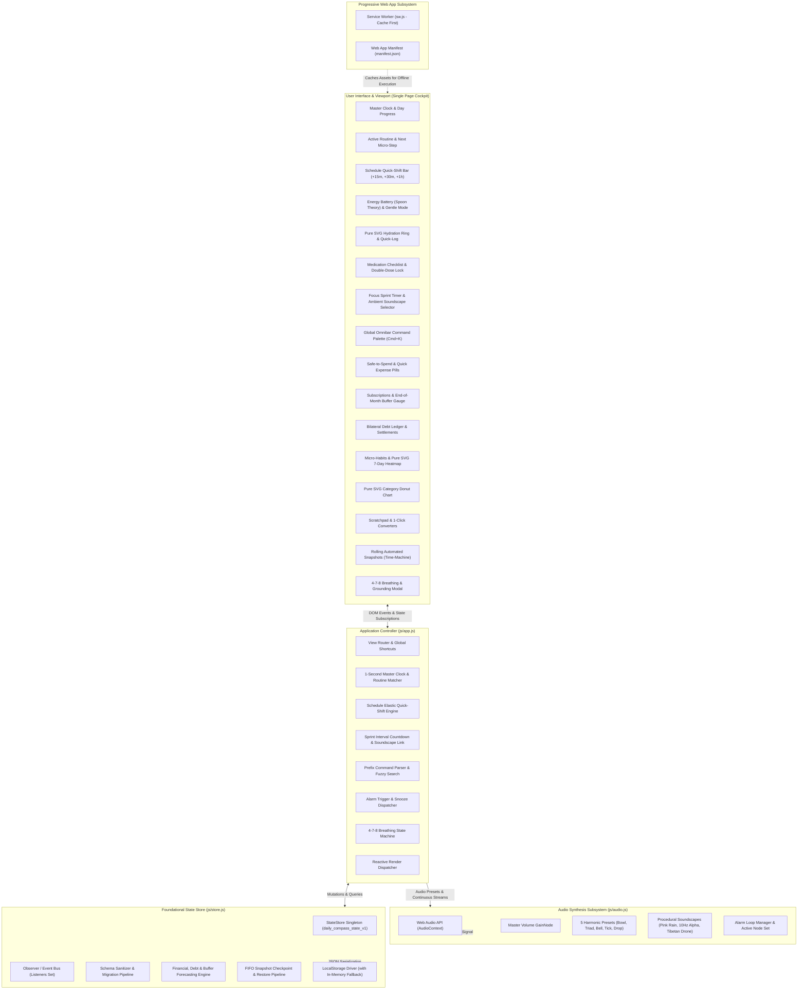
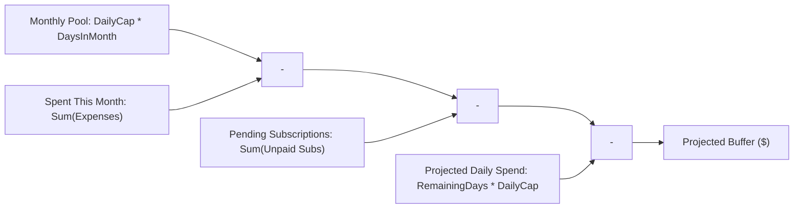
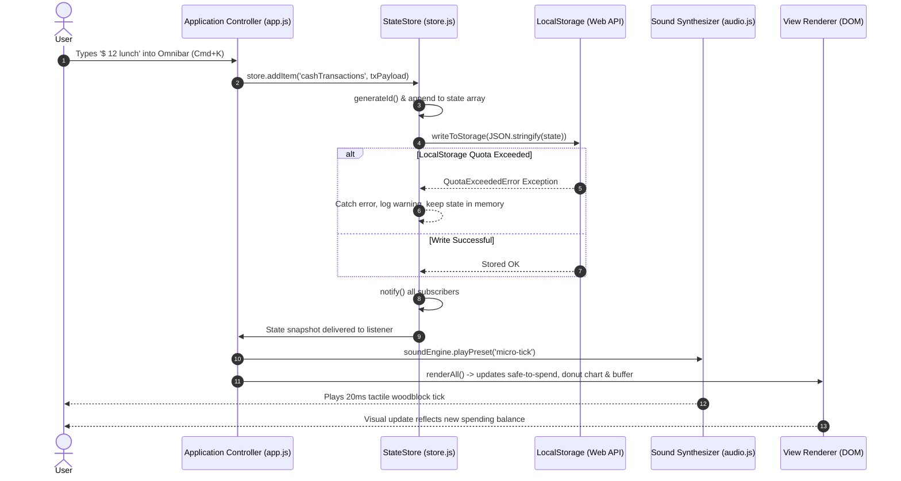

# 🏛️ Architecture & System Design
# Project: "Daily Compass v2.0 Pro Max"

**Document Version:** 2.0.0 Pro Max  
**Target Environment:** Local-First Web Application / Offline Progressive Web App (PWA)  
**Engineering Mindset:** Native Web Standards & Ponytail Simplicity  

---

## 1. System Overview & Architectural Vision

Daily Compass v2.0 Pro Max is engineered as a zero-dependency, local-first cognitive prosthetic and daily tracking cockpit. Its mission is to anchor disoriented, overwhelmed, or executive-dysfunctional users within 500 milliseconds of viewing the screen, while providing ultra-low tap friction ($\le 2$ taps) for all daily logging operations.

### High-Level Subsystem Topology



---

## 2. Core Subsystems

### 2.1 State Store Subsystem (`js/store.js`)

The store acts as the single source of truth for the entire application. It follows a predictable, observable, unidirectional data flow without relying on external state libraries like Redux or Zustand.

#### Key Characteristics
- **Singleton Instance:** Instantiated once and exported as `store` (with `window.DailyCompassStore` attached for console inspection and debugging).
- **Default Schema & Seed Data:** Ships with rich, neurodivergent-friendly initial data so first-time users immediately see a functioning cockpit.
- **Deep Immutability:** `getState()` returns deep-cloned snapshots using `structuredClone()` (with JSON serialize/deserialize fallback) to prevent accidental state mutation outside store boundaries.
- **Micro Pub/Sub:** Allows UI controllers to subscribe via `store.subscribe(listener)`. Returns a clean unsubscribe function.

#### Complete State Schema Domains (v2.0 Pro Max)

```javascript
{
  settings: {
    currency: '$',
    timeFormat: '12h' | '24h',
    focusMode: boolean,
    dailyBudgetCap: number,
    soundPreset: string,
    streakShields: number,
    chimeVolume: number,
    audioEnabled: boolean,
    theme: 'calm-dark'
  },
  profile: { ... },
  anchor: {
    activeTaskId: string | null,
    currentRoutineId: string,
    activeRoutineId: string,
    activeStepId: string,
    activeView: string,
    groundingState: { isInGroundingMode: boolean, ... }
  },
  alarms: [ { id, time, label, enabled, soundPreset, daysOfWeek, preChime, snoozeMinutes } ],
  routines: [ { id, title, start, end, category, icon, color, steps: [...] } ],
  cashTransactions: [ { id, date, time, timestamp, type, amount, category, note } ],
  debts: [ { id, type, direction, person, amount, remaining, status, history, settlements } ],
  habits: [ { id, title, icon, category, frequency, timeOfDay, streak, completedDates, streakShieldUsed, shieldActive } ],
  scratchpad: [ { id, text, tag, category, createdAt, status, convertedTo } ],
  
  // --- v2.0 Pro Max Expansion Subsystems ---
  hydration: {
    targetMl: number,
    currentMl: number,
    history: [ { id, amount, time, timestamp } ]
  },
  medications: [
    {
      id: string,
      name: string,
      dosage: string,
      timeSlot: 'morning' | 'afternoon' | 'evening',
      withFood: boolean,
      takenToday: boolean,
      lastTakenAt: string | null
    }
  ],
  energyBattery: {
    level: 20 | 60 | 100,
    isGentleMode: boolean,
    sensoryDrainers: string[],
    lastUpdated: string
  },
  focusSprint: {
    active: boolean,
    mode: 'pomodoro',
    durationMinutes: 15 | 25 | 50,
    remainingSeconds: number,
    soundscape: 'pink-rain' | 'alpha-waves' | 'tibetan-drone' | 'mute',
    isPaused: boolean
  },
  subscriptions: [
    {
      id: string,
      name: string,
      amount: number,
      billingDay: number,
      cycle: 'monthly',
      category: string,
      isPaidThisMonth: boolean
    }
  ],
  snapshots: [
    {
      id: string,
      timestamp: string,
      label: string,
      state: Object
    }
  ]
}
```

---

## 3. Mathematical Algorithms & Procedural Equations

### 3.1 Procedural Web Audio Synthesis Equations (`js/audio.js`)

In Daily Compass, **zero external MP3/WAV audio files exist**. All acoustic presets and continuous focus soundscapes are generated in real time using the browser's native **Web Audio API**.

#### 1. Pink Noise Filter (Paul Kellet's $-3\text{dB}/\text{octave}$ Algorithm)
White noise has equal energy per hertz, resulting in a harsh, bright hiss that causes sensory fatigue. Pink noise has equal energy per octave, dropping at $-3\text{dB}/\text{octave}$ across the frequency spectrum, mimicking natural rainfall.

The continuous sound generator creates an audio buffer filled with white noise $w \sim \mathcal{U}(-1, 1)$ processed through Paul Kellet's 6-pole infinite impulse response (IIR) filter network:

$$
\begin{aligned}
b_0^{(t)} &= 0.99886 \cdot b_0^{(t-1)} + 0.0555179 \cdot w^{(t)} \\
b_1^{(t)} &= 0.99332 \cdot b_1^{(t-1)} + 0.0750759 \cdot w^{(t)} \\
b_2^{(t)} &= 0.96900 \cdot b_2^{(t-1)} + 0.1538520 \cdot w^{(t)} \\
b_3^{(t)} &= 0.86650 \cdot b_3^{(t-1)} + 0.3104856 \cdot w^{(t)} \\
b_4^{(t)} &= 0.55000 \cdot b_4^{(t-1)} + 0.5329522 \cdot w^{(t)} \\
b_5^{(t)} &= -0.76160 \cdot b_5^{(t-1)} - 0.0168980 \cdot w^{(t)} \\
y^{(t)} &= \left( \sum_{k=0}^5 b_k^{(t)} + b_6^{(t-1)} + 0.5362 \cdot w^{(t)} \right) \times 0.08 \\
b_6^{(t)} &= 0.115926 \cdot w^{(t)}
\end{aligned}
$$

The pink noise stream is then routed through a 2nd-order lowpass biquad filter ($f_c = 1100\text{ Hz}$). A low-frequency oscillator (LFO) with $f_{\text{LFO}} = 0.08\text{ Hz}$ and gain amplitude $\Delta f = \pm 250\text{ Hz}$ continuously modulates the cutoff frequency:
$$f_{\text{cutoff}}(t) = 1100 + 250 \cdot \sin(2\pi \cdot 0.08 \cdot t)$$
This generates an organic, calming wind and rain swell.

#### 2. 10Hz Alpha Waves Binaural Synthesis
Binaural beat synthesis exploits the brainstem's superior olivary complex to induce cortical brainwave entrainment. When two sine waves with slightly different frequencies are delivered separately to each ear via stereo headphones, the brain perceives a rhythmic amplitude modulation at the difference frequency $\Delta f$.

$$\Delta f = |f_R - f_L|$$

In Daily Compass:
- **Left Ear Channel:** Sine wave oscillator at carrier $f_L = 200.0\text{ Hz}$, panned via `StereoPannerNode` to $\text{pan} = -0.9$.
- **Right Ear Channel:** Sine wave oscillator at carrier $f_R = 210.0\text{ Hz}$, panned via `StereoPannerNode` to $\text{pan} = +0.9$.
- **Resulting Beat:**
  $$\Delta f = 210.0\text{ Hz} - 200.0\text{ Hz} = 10.0\text{ Hz}$$
A frequency of $10.0\text{ Hz}$ falls directly in the center of the human **Alpha Band** ($8\text{–}12\text{ Hz}$), which neuroscience links to non-drowsy relaxed focus, decreased amygdala reactivity, and mitigation of ADHD sensory distraction.

#### 3. Quad-Layer Tibetan Singing Bowl Drone
The continuous Tibetan drone constructs an acoustic drone using a 4-tier harmonic overtone series based on the $108\text{ Hz}$ sacred acoustic proportion:

$$f_k = k \times 108.0\text{ Hz} + \delta_k, \quad k \in \{1, 2, 3, 4\}$$

where $\delta_k = (-1)^k \times 0.35\text{ Hz}$ introduces micro-detuning. This produces slow acoustic beating that prevents auditory habituation. The individual oscillator gains follow an inverse harmonic attenuation envelope:

$$A_k = \frac{0.18}{k} \implies A_1 = 0.180, \; A_2 = 0.090, \; A_3 = 0.060, \; A_4 = 0.045$$

#### 4. Hydration Water Droplet Synthesizer
The hydration log acoustic preset simulates a water droplet falling into a pool by executing rapid exponential pitch bends:
$$f_{\text{drop}}(t) = 
\begin{cases} 
600 \cdot e^{\frac{\ln(1400/600)}{0.04} t} & 0 \le t < 0.04\text{s} \\
1400 \cdot e^{\frac{\ln(800/1400)}{0.08} (t - 0.04)} & 0.04 \le t \le 0.16\text{s}
\end{cases}$$
The output passes through a bandpass filter centered at $1100\text{ Hz}$ ($Q = 4.0$) with a $180\text{ms}$ exponential gain decay.

---

### 3.2 Schedule Elastic Quick-Shift Algorithm (`js/store.js`)

When an ADHD individual falls behind schedule, rigid calendars trigger task abandonment. The Quick-Shift Engine dynamically recalculates routine boundaries while protecting end-of-day sleep hygiene.

#### Algorithm Steps:
1. **Time Conversion to Minutes from Midnight:**
   $$T(hh:mm) = h \times 60 + m, \quad T \in [0, 1439]$$
2. **Current Clock Horizon:**
   Evaluate local system time $T_{\text{now}}$.
3. **Selective Shift Filtering:**
   For every routine block $R_i \in \text{routines}$:
   $$\text{eligible}(R_i) \iff T_{\text{end}}(R_i) \ge T_{\text{now}}$$
   Past blocks remain undisturbed as historical record.
4. **Elastic Time Advancement:**
   For each eligible routine block $R_i$ and requested shift $\Delta t \in \{15, 30, 60\}$:
   $$T'_{\text{start}}(R_i) = \min(1439, T_{\text{start}}(R_i) + \Delta t)$$
   $$T'_{\text{end}}(R_i) = \min(1439, T_{\text{end}}(R_i) + \Delta t)$$
5. **Bedtime Sleep Clamp:**
   The function clamps $T \le 1439$ ($23:59$). Routine blocks cannot push into the next calendar day, preventing schedule creep from invading sleep hours.
6. **Reversible Undo Cache:**
   Before updating state, a deep clone of the current routines array is stored in memory (`this._lastShiftBackup`). Tapping **Undo** or the undo toast immediately restores previous boundaries.

---

### 3.3 End-of-Month Cash Buffer Forecast Formula

Rather than presenting complex multi-month spreadsheets, Daily Compass computes a single actionable forward cash buffer indicating whether the user is on track to end the calendar month with a surplus.



#### Formulation:
1. **Calendar Parameters:**
   Let $Y$ be the current year, $M$ be the current month index ($0\text{–}11$), and $D$ be today's date of month ($1\text{–}31$).
   $$\text{DaysInMonth} = \text{new Date}(Y, M + 1, 0).\text{getDate()}$$
   $$\text{RemainingDays} = \max(0, \text{DaysInMonth} - D)$$
2. **Monthly Allowance Pool:**
   $$\text{MonthlyPool} = C \times \text{DaysInMonth}$$
   where $C$ is `settings.dailyBudgetCap`.
3. **Cumulative Spending to Date:**
   $$\text{SpentThisMonth} = \sum_{tx \in \text{Tx}_{\text{currentMonth}}} \text{amount}(tx)$$
4. **Pending Recurring Liabilities:**
   $$\text{PendingSubs} = \sum_{sub \in \text{Subscriptions}_{\text{unpaid}}} \text{amount}(sub)$$
5. **Projected Future Daily Spend:**
   $$\text{ProjectedFutureDailySpend} = \text{RemainingDays} \times C$$
6. **Net Projected Buffer:**
   $$\text{ProjectedBuffer} = \text{MonthlyPool} - \text{SpentThisMonth} - \text{PendingSubs} - \text{ProjectedFutureDailySpend}$$
7. **Semantic Status Posture:**
   $$\text{Status} = 
   \begin{cases} 
   \text{"comfort"} & \text{if } \text{ProjectedBuffer} > C \\
   \text{"tight"} & \text{if } 0 \le \text{ProjectedBuffer} \le C \\
   \text{"deficit"} & \text{if } \text{ProjectedBuffer} < 0
   \end{cases}$$

---

### 3.4 FIFO Rolling Snapshot Rotation Pipeline

To provide time-machine safety without violating `localStorage` size quotas, snapshots follow a capped FIFO (First-In, First-Out) rotation queue:

1. **Snapshot Creation Payload:**
   ```javascript
   const newSnapshot = {
     id: generateId('snap'),
     timestamp: new Date().toISOString(),
     label: label || 'Manual Checkpoint',
     state: this.getState() // deep clone
   };
   ```
2. **FIFO Cap ($N = 12$):**
   $$\text{snapshots}_{t+1} = \left[ \text{newSnapshot}, \; s_1, \; s_2, \; \dots, \; s_k \right]_{0 \dots 11}$$
   - Retains 7 daily midnight baseline snapshots (representing the past week).
   - Retains up to 5 user checkpoints or pre-destructive mutation backups.
   - Any older snapshot beyond index 11 is automatically discarded.
3. **Storage Footprint:**
   Because each snapshot is $< 10\text{ KB}$ compressed as JSON, 12 snapshots consume $\approx 120\text{ KB}$, well within the browser's $5\text{MB}$ `localStorage` ceiling.

---

## 4. Pure SVG Graphics Architecture

Daily Compass adheres to zero external chart dependencies (e.g. Chart.js, D3). All data visualizations are rendered natively using inline Scalable Vector Graphics (SVG).

### 4.1 Pure SVG Donut Chart Calculation
The expense breakdown donut uses an SVG circle with `stroke-dasharray` and `stroke-dashoffset`:
- Circle Radius: $r = 50\text{px}$
- Circumference:
  $$C = 2 \pi r = 2 \pi (50) \approx 314.159265\text{px}$$
- For each category $i$ with fractional expense $p_i = \frac{\text{amount}_i}{\sum \text{amount}}$:
  $$\text{strokeDash}_i = p_i \times C$$
  $$\text{strokeDashoffset}_i = -\sum_{k=0}^{i-1} \text{strokeDash}_k$$
- Each SVG circle is rendered with `stroke-dasharray="strokeDash C"` and rotated $-90^\circ$ around center $(80, 80)$ so segments start at 12 o'clock.

### 4.2 Pure SVG Weekly Habit Heatmap
The 7-day rolling activity heatmap evaluates completions across offsets:
$$\text{OffsetDays} \in \{6, 5, 4, 3, 2, 1, 0\}$$
Each cell renders an accessible $24 \times 24\text{px}$ cell tagged with full date tooltips and high-contrast completion fills (`var(--accent-sage)` when completed, `var(--bg-card-subtle)` when resting).

---

## 5. Local-First Storage Data Flow

Daily Compass adheres to the **Local-First Software Principles** (Martin Kleppmann et al.):
1. **No network dependency:** The application is completely functional in airplane mode.
2. **Data resides on the local device:** User data is stored in the browser's `localStorage` (and cached assets via CacheStorage).
3. **Portability:** Export and import capabilities guarantee zero user lock-in.



---

## 6. The Ponytail Simplicity Rationale

This project was developed strictly adhering to the **Ponytail Senior Engineering Mindset**:

> *"The best code is the code you never had to write."*

### Evaluation Across the Ladder of Simplicity

| Simplicity Rung | Engineering Decision in Daily Compass v2.0 Pro Max |
| :--- | :--- |
| **1. Does this need to exist?** | Rejected complex multi-tier project trees and nested subtasks. Replaced with single Focus Card: *"What is the 1 thing to do right now?"* |
| **2. Is it in the codebase?** | Reused `store.addItem`, `store.updateItem`, and `store.deleteItem` across all modules instead of creating bespoke repository classes. |
| **3. Does the standard library do it?** | Used native JavaScript `Date`, `Map`, `Set`, `filter`, `reduce`, and `structuredClone` instead of bringing in Lodash, Moment.js, or Dayjs. |
| **4. Does a native platform feature cover it?** | Used native SVG circle dash-arrays for donut charts and CSS Grid for heatmaps rather than importing Chart.js or D3. |
| **5. Does an existing dependency solve it?** | Zero npm runtime dependencies. Zero build step. 100% native ES6 modules. |
| **6. Can it be a clean one-liner?** | Procedural pink noise in 15 lines of JavaScript math; cash buffer calculation in 5 lines of pure arithmetic. |
| **7. Write the absolute minimum code.** | Entire application core is under 3,500 lines of highly legible, comment-annotated vanilla JavaScript. |

### Technical Benefits of Zero-Dependency Architecture
1. **Instant Cold Start:** No bundling, tree-shaking, or script compilation. HTML and CSS render instantaneously ($< 15\text{ms}$).
2. **Infinite Longevity:** No npm security advisories, broken transitive dependencies, or framework deprecations. The code running today will run unchanged 10 years from now.
3. **Effortless Deployment:** Can be hosted on any static web host, GitHub Pages, or directly off a local thumb drive.
