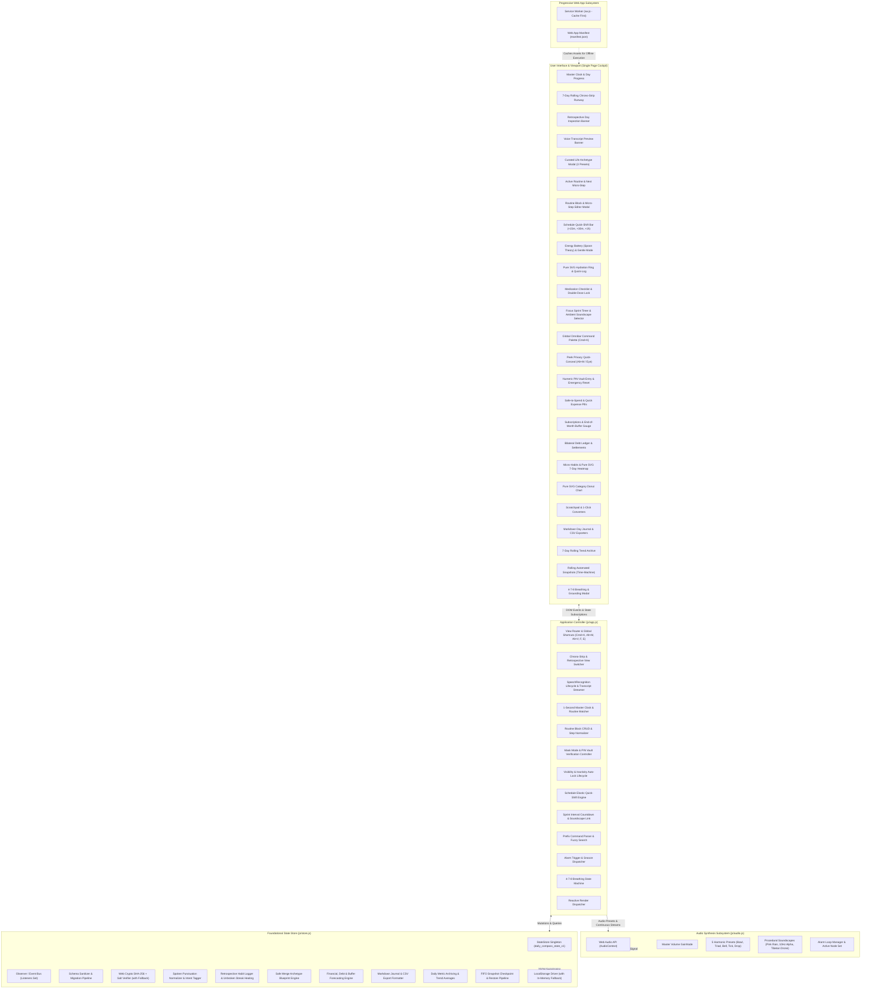
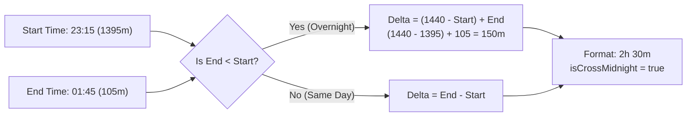
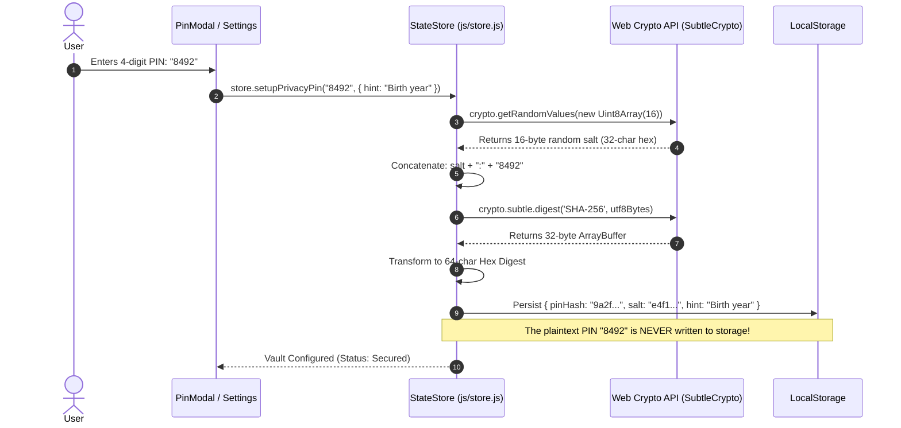

# 🏛️ Architecture & System Design
# Project: "Daily Compass v2.2.0 Pro Max Ultra"

**Document Version:** 2.2.0 Pro Max Ultra  
**Target Environment:** Local-First Web Application / Offline Progressive Web App (PWA)  
**Engineering Mindset:** Native Web Standards & Ponytail Simplicity  

---

## 1. System Overview & Architectural Vision

Daily Compass v2.2.0 Pro Max Ultra is engineered as a zero-dependency, local-first cognitive prosthetic and daily tracking cockpit. Its mission is to anchor disoriented, overwhelmed, or executive-dysfunctional users within 500 milliseconds of viewing the screen, while providing ultra-low tap friction ($\le 2$ taps) for all daily logging operations, complete peace of mind in public spaces via cryptographic privacy, voice-driven thought capture with zero cloud egress, and a non-punitive 7-day retrospective timeline that self-heals habit momentum.

### High-Level Subsystem Topology



---

## 2. Core Subsystems

### 2.1 State Store Subsystem (`js/store.js`)

The store acts as the single source of truth for the entire application, following a predictable, observable, unidirectional data flow without relying on external libraries like Redux or Zustand.

#### Key Characteristics
- **Singleton Instance:** Instantiated once and exported as `store` (with `window.DailyCompassStore` attached for debugging and script access).
- **Default Schema & Seed Data:** Ships with rich initial data so first-time users immediately experience a functioning cockpit.
- **Deep Immutability:** `getState()` returns deep-cloned snapshots using `structuredClone()` (with JSON serialize/deserialize fallback).
- **Micro Pub/Sub:** Allows UI controllers to subscribe via `store.subscribe(listener)`.

#### Complete State Schema Domains (v2.1 Pro Max Plus)

```javascript
{
  settings: {
    currency: '$',
    timeFormat: '12h' | '24h',
    focusMode: boolean,
    dailyBudgetCap: number,
    soundPreset: string,
    streakShields: number,
    chimeVolume: number,
    audioEnabled: boolean,
    theme: 'calm-dark'
  },
  profile: { ... },
  anchor: {
    activeTaskId: string | null,
    currentRoutineId: string,
    activeRoutineId: string,
    activeStepId: string,
    activeView: string,
    groundingState: { isInGroundingMode: boolean, ... }
  },
  alarms: [ { id, time, label, enabled, soundPreset, daysOfWeek, preChime, snoozeMinutes } ],
  
  // --- v2.1 Interactive Routine Blocks ---
  routines: [
    {
      id: string,
      title: string,
      name: string,
      start: 'HH:MM',
      startTime: 'HH:MM',
      end: 'HH:MM',
      endTime: 'HH:MM',
      category: 'wellness' | 'work' | 'focus' | 'chores' | 'rest' | 'evening',
      icon: string,
      color: string,
      isCrossMidnight: boolean,
      durationMinutes: number,
      steps: [
        {
          id: string,
          order: number,
          title: string,
          durationMinutes: number,
          isCompleted: boolean,
          completedAt: string | null
        }
      ]
    }
  ],
  
  cashTransactions: [ { id, date, time, timestamp, type, amount, category, note } ],
  debts: [ { id, type, direction, person, amount, remaining, status, history, settlements } ],
  habits: [ { id, title, icon, category, frequency, timeOfDay, streak, completedDates, streakShieldUsed, shieldActive } ],
  scratchpad: [ { id, text, content, tag, category, createdAt, status, convertedTo } ],
  
  hydration: {
    targetMl: number,
    currentMl: number,
    history: [ { id, amount, time, timestamp } ]
  },
  medications: [
    {
      id: string,
      name: string,
      dosage: string,
      timeSlot: 'morning' | 'afternoon' | 'evening',
      withFood: boolean,
      takenToday: boolean,
      lastTakenAt: string | null
    }
  ],
  energyBattery: {
    level: 20 | 60 | 100,
    isGentleMode: boolean,
    sensoryDrainers: string[],
    lastUpdated: string
  },
  focusSprint: {
    active: boolean,
    mode: 'pomodoro',
    durationMinutes: 15 | 25 | 50,
    remainingSeconds: number,
    soundscape: 'pink-rain' | 'alpha-waves' | 'tibetan-drone' | 'mute',
    isPaused: boolean
  },
  subscriptions: [
    {
      id: string,
      name: string,
      amount: number,
      billingDay: number,
      cycle: 'monthly',
      category: string,
      isPaidThisMonth: boolean
    }
  ],
  snapshots: [
    {
      id: string,
      timestamp: string,
      label: string,
      state: Object
    }
  ],

  // --- v2.1 Sanctuary Privacy Vault & Masking ---
  privacy: {
    pinHash: string | null,
    salt: string | null,
    hint: string | null,
    isLocked: boolean,
    isMasked: boolean,
    failedAttempts: number,
    lockedUntilTimestamp: number | null
  },

  // --- v2.1 7-Day Rolling Trend Archives ---
  dailyArchives: [
    {
      date: 'YYYY-MM-DD',
      waterMl: number,
      medsCompleted: number,
      medsTotal: number,
      habitsCompleted: number,
      habitsTotal: number,
      spent: number,
      budgetCap: number,
      archivedAt: string
    }
  ]
}
```

---

## 3. Mathematical Algorithms & Procedural Formulations

### 3.1 Routine Cross-Midnight Calculation Model

Scheduling daily routines requires handling overnight blocks (e.g., night shift, sleep routines, late creative sessions) without negative duration anomalies.



#### 1. Minute Space Mapping
All times are mapped into absolute minutes from midnight $M \in [0, 1439]$:
$$M(H, M) = H \times 60 + M$$

#### 2. Modular Boundary Unwrapping
When $M_{\text{end}} < M_{\text{start}}$, the routine spans past midnight ($00:00$). The engine dynamically calculates duration:

$$\Delta M = \begin{cases} 
M_{\text{end}} - M_{\text{start}} & \text{if } M_{\text{end}} \ge M_{\text{start}} \land \neg \text{isCrossMidnight} \\
(1440 - M_{\text{start}}) + M_{\text{end}} & \text{if } M_{\text{end}} < M_{\text{start}} \lor \text{isCrossMidnight}
\end{cases}$$

If $\Delta M \le 0$, a compassionate default of $60\text{ minutes}$ is assigned.

#### 3. Micro-Step Order Normalization & Auto-Balance Distribution
- **Order Normalization:** Whenever steps are added, removed, or reordered, step positions are re-indexed strictly to $1 \dots N$:
  $$\text{order}(s_i) = i + 1, \quad i \in [0, N-1]$$
- **Auto-Balance Algorithm (`autoBalanceRoutineSteps`):**
  Given total routine duration $\Delta M$ and $N$ micro-steps:
  $$\text{duration}_{\text{base}} = \max\left(1, \; \left\lfloor \frac{\Delta M}{N} \right\rfloor\right)$$
  $$\text{remainder} = \Delta M - (\text{duration}_{\text{base}} \times N)$$
  Steps $1 \dots N-1$ receive $\text{duration}_{\text{base}}$; step $N$ receives $\text{duration}_{\text{base}} + \text{remainder}$, guaranteeing that the sum of micro-steps perfectly equals the allocated block duration.

---

### 3.2 Web Crypto SHA-256 PIN Hashing & Security Data Flow

To eliminate shoulder-surfing and protect financial privacy, Daily Compass includes a local cryptographic vault using the browser's native **Web Crypto API**.



#### 1. Salted Hash Computation
Let $P$ be the sanitized numeric PIN string and $S \in \{0, \dots, 255\}^{16}$ be a cryptographically random salt generated via `crypto.getRandomValues()`.
$$\text{SaltHex} = \operatorname{hexEncode}(S)$$
$$\text{Message} = \operatorname{utf8Encode}(\text{SaltHex} \mathbin{\Vert} \text{":"} \mathbin{\Vert} P)$$
$$\text{PinHash} = \operatorname{hexEncode}(\operatorname{SHA-256}(\text{Message}))$$

#### 2. Verification & Exponential Backoff State Machine
Upon PIN entry attempt $P_{\text{attempt}}$:
$$\text{HashAttempt} = \operatorname{hexEncode}(\operatorname{SHA-256}(\operatorname{utf8Encode}(\text{SaltHex} \mathbin{\Vert} \text{":"} \mathbin{\Vert} P_{\text{attempt}})))$$
- If $\text{HashAttempt} == \text{PinHash}$: Success. Reset `failedAttempts = 0`, clear lockout timestamp, and unlock vault.
- If $\text{HashAttempt} \neq \text{PinHash}$: Increment `failedAttempts`. Apply non-punitive backoff cooldown:
  $$\text{Cooldown} = 
  \begin{cases} 
  0\text{ seconds} & \text{if } \text{failedAttempts} < 3 \\
  15\text{ seconds} & \text{if } 3 \le \text{failedAttempts} < 5 \\
  60\text{ seconds} & \text{if } 5 \le \text{failedAttempts} < 7 \\
  300\text{ seconds (5m)} & \text{if } \text{failedAttempts} \ge 7
  \end{cases}$$
  During cooldown, PIN entry is disabled and the card executes a soft horizontal shake (`.shake-gentle`).

#### 3. Compassionate Emergency Reset Protocol
If an executive-dysfunctional user forgets their PIN, Daily Compass guarantees **zero data loss**:
- User enters the confirmation phrase: `"reset vault"`.
- The store clears `pinHash`, `salt`, `hint`, and `isLocked`.
- **All habits, transactions, debts, routines, and scratchpad notes remain completely intact.**

---

### 3.3 Procedural Web Audio Synthesis Equations (`js/audio.js`)

In Daily Compass, **zero external audio files exist**. All soundscapes and chimes are generated procedurally using the Web Audio API.

#### 1. Paul Kellet's Pink Noise Filter Network
Pink noise has equal energy per octave, dropping at $-3\text{dB}/\text{octave}$, matching natural rainfall:

$$
\begin{aligned}
b_0^{(t)} &= 0.99886 \cdot b_0^{(t-1)} + 0.0555179 \cdot w^{(t)} \\
b_1^{(t)} &= 0.99332 \cdot b_1^{(t-1)} + 0.0750759 \cdot w^{(t)} \\
b_2^{(t)} &= 0.96900 \cdot b_2^{(t-1)} + 0.1538520 \cdot w^{(t)} \\
b_3^{(t)} &= 0.86650 \cdot b_3^{(t-1)} + 0.3104856 \cdot w^{(t)} \\
b_4^{(t)} &= 0.55000 \cdot b_4^{(t-1)} + 0.5329522 \cdot w^{(t)} \\
b_5^{(t)} &= -0.76160 \cdot b_5^{(t-1)} - 0.0168980 \cdot w^{(t)} \\
y^{(t)} &= \left( \sum_{k=0}^5 b_k^{(t)} + b_6^{(t-1)} + 0.5362 \cdot w^{(t)} \right) \times 0.08 \\
b_6^{(t)} &= 0.115926 \cdot w^{(t)}
\end{aligned}
$$

The pink noise stream passes through an $1100\text{Hz}$ lowpass filter modulated by an $0.08\text{Hz}$ LFO wind swell:
$$f_{\text{cutoff}}(t) = 1100 + 250 \cdot \sin(2\pi \cdot 0.08 \cdot t)$$

#### 2. 10Hz Alpha Waves Binaural Synthesis
- Left Ear: $f_L = 200.0\text{ Hz}$, panned to $-0.9$.
- Right Ear: $f_R = 210.0\text{ Hz}$, panned to $+0.9$.
- Resulting Binaural Beat:
  $$\Delta f = |f_R - f_L| = 210.0\text{ Hz} - 200.0\text{ Hz} = 10.0\text{ Hz}$$
Directly stimulates the human cortical **Alpha Band** ($8\text{–}12\text{ Hz}$), facilitating relaxed ADHD flow state.

#### 3. Quad-Layer Tibetan Singing Bowl Drone
Harmonic series based on $108\text{ Hz}$ with interleaved detuning:
$$f_k = k \times 108.0\text{ Hz} + (-1)^k \cdot 0.35\text{ Hz}, \quad k \in \{1, 2, 3, 4\}$$
$$A_k = \frac{0.18}{k}$$

#### 4. Water Droplet Pitch Modulation
$$f_{\text{drop}}(t) = 
\begin{cases} 
600 \cdot e^{\frac{\ln(1400/600)}{0.04} t} & 0 \le t < 0.04\text{s} \\
1400 \cdot e^{\frac{\ln(800/1400)}{0.08} (t - 0.04)} & 0.04 \le t \le 0.16\text{s}
\end{cases}$$

---

### 3.4 Cash Buffer Forecast & FIFO Snapshot Rotation

#### 1. Forward Cash Buffer Formula
$$\text{Buffer} = \text{MonthlyPool} - \text{SpentThisMonth} - \text{PendingSubs} - (\text{RemainingDays} \times \text{DailyCap})$$
- Status: $\text{Buffer} > \text{DailyCap} \implies \text{"comfort"}$, $0 \le \text{Buffer} \le \text{DailyCap} \implies \text{"tight"}$, $\text{Buffer} < 0 \implies \text{"deficit"}$.

#### 2. FIFO Snapshot Rotation
$$\text{snapshots}_{t+1} = \left[ \text{newSnapshot}, \; s_1, \; s_2, \; \dots, \; s_k \right]_{0 \dots 11}$$
Capped at 12 checkpoints, consuming $< 120\text{ KB}$ of local storage.

---

## 4. Automated Verification Matrix (54 / 54 Tests Passing)

All subsystems and edge cases are verified natively with 54 automated tests running via Node.js (`node:test`):

```bash
node --test tests/test_subsystems.js tests/test_full_suite.js
```

| Suite | Focus Area | Assertions | Status |
| :--- | :--- | :---: | :---: |
| **Suite 1** | Store Initialization & Schemas | 5 | ✅ 5/5 Pass |
| **Suite 2** | CRUD Operations & Reactivity | 5 | ✅ 5/5 Pass |
| **Suite 3** | Calculation Logic (Cash, Debts, Streaks, Alarms) | 7 | ✅ 7/7 Pass |
| **Suite 4** | Export & Import Portability (Overwrite & Merge) | 3 | ✅ 3/3 Pass |
| **Suite 5** | Edge Cases & Resilience (Quota, Timezones, Zero Cap) | 6 | ✅ 6/6 Pass |
| **Suite 6** | Web Audio API Sound Synthesizer | 4 | ✅ 4/4 Pass |
| **Suite 7** | v2.0 Pro Max Expansion Subsystems | 7 | ✅ 7/7 Pass |
| **Suite 8** | v2.1 Pro Max Plus Subsystems (Editor, Privacy, Exports) | 6 | ✅ 6/6 Pass |
| **Subsystem 1**| Deep Store Unit Specifications | 7 | ✅ 7/7 Pass |
| **Subsystem 2**| Deep Audio Unit Specifications | 4 | ✅ 4/4 Pass |
| **TOTAL** | **Comprehensive Full Test Suite** | **54** | **✅ 54/54 Pass (0 Failures)** |

---

## 5. The Ponytail Simplicity Rationale

This project was developed strictly adhering to the **Ponytail Senior Engineering Mindset**:

> *"The best code is the code you never had to write."*

| Simplicity Rung | Engineering Decision in Daily Compass v2.1 Pro Max Plus |
| :--- | :--- |
| **1. Does this need to exist?** | Routine editor presents a calm 3-section card instead of a 20-field multi-tab form. |
| **2. Is it in the codebase?** | Reused `store.addItem`, `store.updateItem`, and `store.deleteItem` across all modules. |
| **3. Does the standard library do it?** | Native `crypto.subtle.digest('SHA-256')` used for password hashing without pulling in bcrypt or crypto-js. |
| **4. Does a native platform feature cover it?** | CSS `backdrop-filter: blur(8px)` handles balance masking instantly without re-rendering HTML templates. |
| **5. Does an existing dependency solve it?** | Zero npm runtime dependencies. Zero build step. |
| **6. Can it be a clean one-liner?** | Markdown Day Journal generated using clean string template interpolation; CSV generated with `map(r => r.join(','))`. |
| **7. Write the absolute minimum code.** | Entire application core is under 4,200 lines of clean vanilla JavaScript. |
