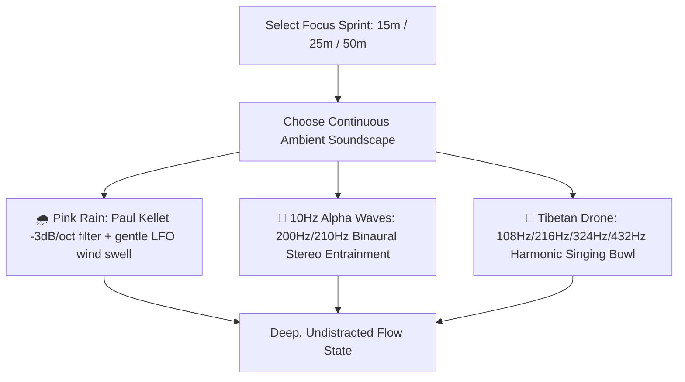

# 🧭 How to Never Get Lost
## The Daily Compass v2.1.0 Pro Max Plus Survival Manual for Overcoming Executive Dysfunction, Time Blindness & Cognitive Fatigue

---

> ### 💬 The Golden Rule
> **You are not broken.**  
> Traditional productivity tools were designed for neurotypical linear brains with infinite working memory. When you live with ADHD, chronic fatigue, anxiety paralysis, sensory overload, or time blindness, traditional apps make you feel guilty, behind, and exhausted.
> 
> **Daily Compass is different.** It was built from the ground up as an unshakeable ground truth. It never yells at you. It never flashes red reprimands. It always answers one simple question:  
> **"What is the single thing I should be doing right this second?"**

---

## 📖 Table of Contents
1. [Understanding Time Blindness & Interoceptive Lag](#1-understanding-time-blindness--interoceptive-lag)
2. [The Anatomy of Orientation (The 3-Second Check)](#2-the-anatomy-of-orientation-the-3-second-check)
3. [Sculpting Routines with Live Duration & Auto-Balance](#3-sculpting-routines-with-live-duration--auto-balance)
4. [Using Peek Privacy and Vault Lock (Public Grounding Safety)](#4-using-peek-privacy-and-vault-lock-public-grounding-safety)
5. [The Spoon Theory Energy Battery & Gentle Mode](#5-the-spoon-theory-energy-battery--gentle-mode)
6. [Somatic Grounding: Hydration & Medication Double-Dose Safety Lock](#6-somatic-grounding-hydration--medication-double-dose-safety-lock)
7. [The Schedule Quick-Shift Bar (Stopping the All-or-Nothing Domino Effect)](#7-the-schedule-quick-shift-bar-stopping-the-all-or-nothing-domino-effect)
8. [Focus Sprints & Ambient Soundscapes (Pink Rain & 10Hz Alpha Waves)](#8-focus-sprints--ambient-soundscapes-pink-rain--10hz-alpha-waves)
9. [Global Omnibar Command Palette (`Cmd+K` / `Ctrl+K`)](#9-global-omnibar-command-palette-cmdk--ctrlk)
10. [Exporting Daily Journals to Obsidian & Notion](#10-exporting-daily-journals-to-obsidian--notion)
11. [The 4-7-8 Grounding Engine ("Lost? Click to Center")](#11-the-4-7-8-grounding-engine-lost-click-to-center)
12. [The Daily Cash Compass & End-of-Month Buffer Forecast](#12-the-daily-cash-compass--end-of-month-buffer-forecast)
13. [Bilateral Debt Ledger ("Who Owes Who?")](#13-bilateral-debt-ledger-who-owes-who)
14. [Micro-Habits & Pure SVG Weekly Heatmap](#14-micro-habits--pure-svg-weekly-heatmap)
15. [The Brain Dump Wall (Working Memory Protection)](#15-the-brain-dump-wall-working-memory-protection)
16. [Rolling Automated Snapshots (Time-Machine Safety Net)](#16-rolling-automated-snapshots-time-machine-safety-net)
17. [Keyboard Shortcuts Reference Sheet](#17-keyboard-shortcuts-reference-sheet)
18. [A Day in the Life: From Morning to Night](#18-a-day-in-the-life-from-morning-to-night)

---

## 1. Understanding Time Blindness & Interoceptive Lag

For most neurodivergent minds, time does not feel like a continuous river; it exists in only two states:
- **NOW**
- **NOT NOW**

When you enter hyperfocus, 4 hours vanish in what felt like 15 minutes. When you emerge, disorientation sets in: *"Where did the day go? What was I supposed to be doing? It's 3:00 PM, I haven't eaten, and I have a headache."*

Along with time blindness comes **interoceptive lag**—a delayed awareness of physical body signals. You don't notice thirst until you are severely dehydrated; you don't notice exhaustion until you hit complete burnout.

Traditional productivity apps present an infinite list of 40 tasks. When you look at 40 tasks while disoriented, your brain experiences **cognitive overload** and freezes.

**Daily Compass solves this by collapsing the infinite to the immediate, pairing somatic physical care with gentle schedule orientation.**

---

## 2. The Anatomy of Orientation (The 3-Second Check)

Whenever you unlock your phone or switch to the Daily Compass tab, glance at the **Hero Card**:

```
+-----------------------------------------------------------------------------------------------+
|  [ 14:23:10 ]  Wednesday, November 5, 2026                 [ 60% of 24h cycle completed ]     |
|  ROUTINE BLOCK:  ⚡ Deep Focus Block 1 (Ends in 37 mins)                                       |
|  IMMEDIATE STEP: High-value creative implementation                                           |
|  [ ✓ STEP COMPLETE ]                                                                          |
+-----------------------------------------------------------------------------------------------+
```

Within 3 seconds, your brain absorbs three critical anchors:
1. **The Live Master Clock:** High-contrast, tabular time with gentle seconds ticking so you can physically sense the flow of the present moment.
2. **Current Routine Block:** Shows what broad mode you should be in (e.g. *Morning Anchor*, *Deep Focus*, *Lunch Reset*, *Evening Wind-Down*).
3. **The Immediate Micro-Step:** You do not need to figure out what to do next. The app presents the single upcoming physical micro-step. Do that one thing, tap **✓ Step Complete**, and listen to the soothing woodblock tick.

---

## 3. Sculpting Routines with Live Duration & Auto-Balance

Scheduling daily blocks should never feel like filling out a tax form. When faced with rigid calendar tools, executive dysfunction triggers task avoidance. In Daily Compass v2.1.0, routine creation is tactile, soothing, and completely flexible.

```
+-----------------------------------------------------------------------------------------------+
| ✏️ EDIT ROUTINE BLOCK                                                                   [ × ] |
+-----------------------------------------------------------------------------------------------+
| Routine Title:    [ Morning Awakening & Somatic Warmup                ]                       |
| Category Mode:    [🎯 Focus]  [🌿 Rest]  [🥗 Nourish]  [🔄 Routine]  [🎨 Creative]  [🏃 Move] |
| Time Bounds:      Start: [ 07:00 ]   End: [ 08:30 ]  -->  [ ⏱ 1h 30m Total Duration ]         |
| Overnight:        [ ] Crosses midnight into next day (e.g. 23:00 -> 01:30)                    |
+-----------------------------------------------------------------------------------------------+
| 📋 ORDERED MICRO-STEPS (Total: 70 min / 90 min allocated • 20 min buffer remaining)          |
|                                                                                               |
| 1. [::] Drink 500ml water & take vitamins      [ 10 min ]  [ ↑ ] [ ↓ ]  [ × Delete ]          |
| 2. [::] Gentle 10-minute spine stretch          [ 15 min ]  [ ↑ ] [ ↓ ]  [ × Delete ]          |
| 3. [::] High-protein breakfast & warm tea       [ 30 min ]  [ ↑ ] [ ↓ ]  [ × Delete ]          |
| 4. [::] Open Daily Compass & set Focus Anchor   [ 15 min ]  [ ↑ ] [ ↓ ]  [ × Delete ]          |
|                                                                                               |
| [ + Add Micro-Step ]    [ 🪄 Auto-Balance Durations ]                                         |
+-----------------------------------------------------------------------------------------------+
| [ 🗑️ Delete Routine ]                              [ Cancel ]   [ 💾 Save Routine Block ]      |
+-----------------------------------------------------------------------------------------------+
```

### How to Sculpt Your Routine:
1. **Open the Editor:** On the Today tab, click **✏️ Edit Routine Blocks** above your schedule stream.
2. **Live Duration Telemetry:** As you adjust start and end times, the **Duration Chip** automatically calculates total span (e.g. `⏱ 1h 30m`), eliminating manual time math.
3. **Cross-Midnight Overnight Blocks:** Scheduling a night shift or late wind-down? Set start to `23:15` and end to `01:45`. The engine automatically detects midnight rollover, calculates `2h 30m`, and flags the block with a crescent moon (`🌙 Overnight`).
4. **Category Mode Selector:** Assign a sensory mode pill:
   - 🎯 **Focus** (`#4a7bb0`) — High-energy deep work and analysis.
   - 🌿 **Rest** (`#60cd9b`) — Sensory decompression, rest, and meditation.
   - 🥗 **Nourishment** (`#e5a960`) — Mindful meals, cooking, and hydration.
   - 🔄 **Routine** (`#9aa5b5`) — Admin tasks, organizing, and chore checklists.
   - 🎨 **Creative** (`#bc8cff`) — Brainstorming, design, and writing.
   - 🏃 **Movement** (`#38bdf8`) — Walking, stretching, and physical activity.
5. **Decomposing into Micro-Steps:** Add individual actions so you never face ambiguous tasks. Reorder steps with drag-and-drop handles (`⋮⋮`) or touch-friendly `[↑]` / `[↓]` pills.
6. **🪄 1-Tap Auto-Balance Durations:** Unsure how to divide time? Click **🪄 Auto-Balance Durations**. The engine divides your total block time evenly across all micro-steps.
7. **Compassionate Guidance:** If your steps total $105\text{m}$ in a $90\text{m}$ block, a soft amber notice advises you of the buffer difference—it never blocks saving or punishes you.

---

## 4. Using Peek Privacy and Vault Lock (Public Grounding Safety)

Many neurodivergent individuals and remote workers use their laptops in public transit, coffee shops, coworking spaces, or around family. The dread of someone glancing over your shoulder at financial balances, debt ledgers, or private brain dumps induces acute anxiety and causes you to avoid opening your tracking cockpit.

### The 1-Keystroke "Peek Privacy" Cloak:
- **Keyboard Shortcut:** Press `Alt + M` from anywhere in the application.
- **Header Action:** Click the **Eye icon** (`👁️` / `🔒`) located next to the Master Clock in the sticky top bar.
- **Omnibar Command:** Type `+mask` in the Omnibar.

```
[ Normal View ]                      [ Peek Privacy Masked: Alt + M ]
SAFE TO SPEND: $34.50         -->    SAFE TO SPEND: [ ••••••••• ] (Blurred)
Sarah owes you: $45.00        -->    Sarah owes you: [ ••••••••• ] (Blurred)
Note: Personal ADHD note      -->    Note: [ •••••••••••••••••• ] (Blurred)
```

- All sensitive currency figures, debt totals, and private notes are instantly cloaked behind a frosted slate Gaussian blur (`backdrop-filter: blur(8px)`).
- **Hover-to-Peek:** Need to quickly check an amount? Simply hover your cursor over the blurred card—it temporarily clarifies without exposing the rest of the screen.

### Securing the Vault with a Local PIN:
To lock down the entire application when stepping away from your desk:
1. Navigate to **Settings $\rightarrow$ Privacy Vault**.
2. Enter a 4-to-8 digit numeric PIN (e.g. `8492`) and an optional hint.
3. The app hashes your PIN using the native **Web Crypto API** with a 16-byte cryptographically secure random salt. Plaintext PINs are never stored.
4. **Auto-Lock on Tab Switch:** Enable *"Auto-lock when tab is hidden"*. As soon as you switch browser tabs or close your laptop lid, the vault locks.
5. **Non-Punitive Exponential Backoff:** Entering an incorrect PIN does not trigger hostile klaxons. It triggers a gentle horizontal card shake. Cooldown timers protect against brute-forcing (15s after 3 attempts, 60s after 5, 300s after 7).
6. **The Emergency Reset Guarantee:** If you completely forget your PIN, click **Emergency Reset Vault** and type the phrase `"reset vault"`. The PIN is removed and the vault unlocks **without wiping your data**. Your routines, habits, and transactions are preserved 100%.

---

## 5. The Spoon Theory Energy Battery & Gentle Mode

### What is Spoon Theory?
Created by Christine Miserandino, **Spoon Theory** posits that individuals with chronic illness, neurodivergence, or fatigue start each day with a finite number of energetic units ("spoons"). Every single physical and cognitive task—showering, masking in a meeting, answering an email, deciding what to eat—costs spoons. When you run out of spoons, pushing forward causes severe crash or burnout.

### The 3 Battery Levels:
In Daily Compass, your energetic battery is visible right in the top header:

| Level | State | Meaning & Cognitive Capacity |
| :---: | :---: | :--- |
| **100%** | 🟢 **High Energy** | Full battery. You have the bandwidth for high-friction creative, analytical, or executive tasks. |
| **60%** | 🟡 **Medium Energy** | Moderate battery. Good for routine execution, admin tasks, and light focus. |
| **20%** | 🔴 **Low / Depleted** | Low battery. Cognitive reserves are depleted. Continuing to push triggers panic, tears, or paralysis. |

### What Happens in Gentle Mode?
When your battery drops to $\le 20\%$ (or when you manually toggle **Gentle Mode**):
1. **Suppression of Demands:** Non-essential routine steps and complex execution blocks are softened and collapsed.
2. **Visual Calming:** High-contrast visual accents are desaturated to reduce optical stimulus.
3. **Automatic Streak Shields:** Your active habit streaks are automatically protected by **Streak Shields**. You do not need to push through illness or burnout just to protect an app number.
4. **Somatic Prioritization:** The dashboard emphasizes only core survival essentials: hydration, medications, quiet rest, and diaphragmatic breathing.

> [!TIP]
> **Keyboard Shortcut:** Press `E` anywhere outside text fields to immediately cycle your Energy Battery from $100\% \to 60\% \to 20\% \to 100\%$.

---

## 6. Somatic Grounding: Hydration & Medication Double-Dose Safety Lock

### 💧 The Hydration Ring
Hyperfocus suppresses the sensation of thirst. Hours pass without drinking water, leading to tension headaches, mental fog, and afternoon crashes.

- **Visual SVG Progress Ring:** A vibrant circular progress bar displays your progress towards your daily goal (e.g. $1250 / 2000\text{ml}$).
- **1-Tap Quick-Log Pills:** Tap `+250ml` (a standard glass) or `+500ml` (a water bottle). 
- **Acoustic Water Droplet Confirmation:** Tapping plays a custom synthesized frequency-modulated water droplet sound ($600\text{Hz} \to 1400\text{Hz} \to 800\text{Hz}$) providing immediate auditory pleasure.
- **Undo Safety:** If you tap accidentally, click the **Undo** button to revert the last logged intake.
- **Safety Boundary Capping:** Input is automatically capped at $6,000\text{ml}$ to prevent accidental numeric overflow.

### 💊 Medication Checklist with Double-Dose Safety Lock
One of the most dangerous and anxiety-inducing aspects of ADHD working-memory deficits is the **Medication Loop**:
> *"I walked into the kitchen, drank water, and walked back to my desk. Wait... did I actually swallow my medication, or did I just think about taking it?"*

Accidentally taking a double dose of stimulant medication, blood pressure medication, or antidepressants can be physiologically dangerous. Conversely, skipping a dose causes withdrawal, brain fog, and severe executive dysfunction.

#### How the Safety Lock Works:
1. **Dosage & Time Slot:** View your medications organized by `Morning`, `Afternoon`, and `Evening`.
2. **1-Tap "Mark Taken":** When you swallow your pill, tap **Mark Taken**.
3. **Visual & Timestamp Lock:** 
   - The card instantly turns deep green and applies the `.taken` locked style.
   - The button transforms into an immutable checkmark: `✓ Taken`.
   - An exact timestamp is permanently recorded: `Taken at 07:15 AM`.
4. **Peace of Mind:** Next time your brain asks *"Did I take it?"*, simply open Daily Compass. The locked card and timestamp give you instant, unambiguous proof.
5. **Reversal Protection:** If you accidentally tapped the wrong medication, tapping again cleanly resets the taken status and timestamp.

---

## 7. The Schedule Quick-Shift Bar (Stopping the All-or-Nothing Domino Effect)

### The ADHD "All-or-Nothing" Trap
Neurodivergent individuals frequently suffer from rigid black-and-white thinking:
- You planned a *Morning Deep Focus Block* from 09:00 to 11:30.
- An unexpected phone call or executive freeze delays you until 09:45.
- **The Domino Effect:** Your brain thinks: *"Well, 09:00 is ruined. The whole day is off track. I might as well give up and scroll social media until 1:00 PM."*

### How Schedule Quick-Shift Solves This:
Instead of abandoning the day, Daily Compass lets you elastically shift reality forward with **one tap**:

```
+-----------------------------------------------------------------------------------------------+
|  ⏳ Running late or delayed? Shift remaining routine blocks:                                  |
|  [ +15m Shift ]   [ +30m Shift ]   [ +1h Shift ]   [ ⚡ Snap to Now ]                          |
+-----------------------------------------------------------------------------------------------+
```

1. **Chronological Elastic Push:**
   - Tap `+15m`, `+30m`, or `+1h`.
   - The engine identifies all active and upcoming routine blocks (e.g. 09:00–11:30 shifts to 09:30–12:00, lunch shifts to 12:30–13:30).
   - Past blocks remain untouched as historical records.
2. **Bedtime Sleep Clamp:**
   - Shifted blocks automatically clamp at **23:59**. Your schedule is never allowed to creep past midnight into the next day, protecting your sleep hygiene.
3. **Instant 5-Second Undo Toast:**
   - A floating toast notification appears: *"Schedule shifted +30 minutes [Undo]"*. If you tapped by accident, tap **Undo** to instantly restore your previous schedule.
4. **Snap to Now:**
   - Tap **Snap to Now** to forgive all morning blocks and align your immediate focus block to the current hour. Start completely fresh with zero guilt.

---

## 8. Focus Sprints & Ambient Soundscapes (Pink Rain & 10Hz Alpha Waves)

### The Neurobiology of ADHD Auditory Flow
ADHD brains are easily distracted by sudden room sounds (doors slamming, sirens, office chatter) and under-stimulated by dead silence. Standard music with lyrics causes linguistic distraction, while off-the-shelf white noise generators produce a harsh high-frequency hiss that induces tension headaches.

Daily Compass integrates a zero-dependency, mathematically synthesized continuous soundscape engine:



### The 3 Procedural Ambient Soundscapes:
1. 🌧️ **Pink Rain (Sensory Masking):**
   - Synthesized using Paul Kellet's $-3\text{dB}/\text{octave}$ 6-pole infinite impulse filter.
   - Mimics gentle rain hitting foliage.
   - An $1100\text{Hz}$ lowpass filter modulated by an $0.08\text{Hz}$ LFO generates natural wind swells.
   - *Best for:* Masking noisy coffee shops, barking dogs, or office conversations.
2. 🧠 **10Hz Alpha Waves (Binaural Focus Entrainment):**
   - Left ear receives $200.0\text{Hz}$; right ear receives $210.0\text{Hz}$.
   - The brainstem perceives a $10.0\text{Hz}$ binaural beat directly inside the human **Alpha Band** ($8\text{–}12\text{Hz}$).
   - Alpha waves stimulate relaxed wakefulness, reducing mind-wandering and hyperactivity without drowsiness.
   - *Requirement:* Use stereo headphones or earbuds for binaural entrainment to work.
3. 🧘 **Tibetan Drone (Somatic Centering):**
   - Quad-layer harmonic singing bowl drone based on $108\text{Hz}, 216\text{Hz}, 324\text{Hz}$, and $432\text{Hz}$.
   - Rich, warm overtone interference produces deep parasympathetic nervous system down-regulation.
   - *Best for:* Meditation, breathing exercises, and high-anxiety resets.

### Focus Sprint Modes:
- **15-Minute Sprint:** For overcoming severe task paralysis. *"I only have to work for 15 minutes."*
- **25-Minute Pomodoro:** Standard structured focus interval with a chime break.
- **50-Minute Deep Block:** Extended immersion for programming, writing, or creative design.

---

## 9. Global Omnibar Command Palette (`Cmd+K` / `Ctrl+K`)

For neurodivergent computer users, mouse navigation requires multiple eye movements and clicks, breaking working memory. The **Global Omnibar** brings desktop-class command palette speed to your entire cockpit.

### How to Open:
- Press `Cmd + K` (Mac) or `Ctrl + K` (Windows / Linux).
- Or click the **Omnibar** icon in the top header.

### Prefix Commands Reference:
| Prefix | Example | Instant Action |
| :--- | :--- | :--- |
| `$ [amt] [note]` | `$ 12.50 sushi` | Instantly logs a $\$12.50$ expense with note "sushi", plays woodblock tick, and updates budget. |
| `+h [ml]` | `+h 500` | Logs $500\text{ml}$ hydration, updates progress ring, and plays droplet sound. |
| `+shift [mins]` | `+shift 30` | Pushes active/upcoming routines forward by 30 minutes. |
| `+bat [level]` | `+bat low` | Sets energy battery to $20\%$ and triggers Gentle Mode (`low`, `med`, `high`). |
| `+mask` | `+mask` | Toggles Peek Privacy balance masking. |
| `+zen` | `+zen` | Instantly opens the 4-7-8 Diaphragmatic Breathing modal. |
| `[free text]` | `sarah` | Fuzzy searches across habits, debts, scratchpad notes, and routines. Press Enter to navigate. |

---

## 10. Exporting Daily Journals to Obsidian & Notion

For neurodivergent knowledge workers, personal knowledge management (PKM) in tools like **Obsidian**, **Notion**, **Logseq**, or **Roam Research** is vital. Daily Compass v2.1.0 allows you to bridge your real-time daily cockpit directly into your permanent digital notebook with **zero manual copy-pasting**.

### 1-Click Markdown Day Journal (`.md`):
1. In the **Scratchpad** view or **Settings**, click **📄 Export Day Journal (Markdown)**.
2. Daily Compass generates a complete, clean GitHub Flavored Markdown document titled `daily-compass-log-YYYY-MM-DD.md`.
3. It includes structured sections:
   - ⚡ **Energy & Grounding State:** Spoon capacity and Gentle Mode status.
   - 💧 **Hydration & Medications:** Exact water tally and checked medication checklist.
   - 📋 **Routines & Schedule Blocks:** Micro-step progress breakdown (`[x]` completed actions).
   - 🌿 **Habits & Activities:** Day checkoffs and current active streaks.
   - 💳 **Financial Ledger & Safety Buffer:** Cap, daily spend, safe-to-spend balance, and end-of-month forecast.
   - 📝 **Scratchpad Entries:** Timestamped brain dump notes.
4. Paste directly into your daily note in Obsidian or Notion for a permanent, searchable life archive.

### 1-Click CSV Financial Ledger (`.csv`):
- Click **📊 Export Transactions (CSV)** to download an RFC-4180 standard spreadsheet file (`Date,Time,Type,Category,Amount,Note`).
- Open instantly in **Microsoft Excel**, **Apple Numbers**, or **Google Sheets** for end-of-year tax review or personal accounting.

---

## 11. The 4-7-8 Grounding Engine ("Lost? Click to Center")

### When to Use It:
- You fell down an internet rabbit hole for 2 hours and feel sudden panic.
- You have task paralysis—staring at your screen unable to start.
- Sensory overload has made your chest tight.

### How It Works:
Tap the **Lost? Click to Center** button in the top header or sidebar. The app dims distractions and opens the **Grounding Sanctuary**:

```
            ╭────────────────────────────────────────╮
            │            (  BREATHE  )               │
            │           Breathe In (4s)              │
            │          Hold Gentle (7s)              │
            │          Slow Exhale (8s)              │
            ╰────────────────────────────────────────╯
```

#### The 4-7-8 Breathing Technique:
1. **Inhale (4 Seconds):** Breathe in gently through your nose as the visual circle expands.
2. **Hold (7 Seconds):** Retain your breath effortlessly. Notice that you are safe in this exact room.
3. **Exhale (8 Seconds):** Release your breath through your mouth with a soft whoosh. This prolonged exhale stimulates the **vagus nerve**, instantly slowing your heart rate and down-regulating fight-or-flight cortisol.

### The 3 Compassionate Re-Entry Buttons:
Once you take three grounding breaths, choose how you want to handle your day:
1. **⏳ 15-Minute Breather:** Delays upcoming alarms and gives you 15 uninterrupted minutes to drink water, stretch, or close your eyes. No guilt.
2. **⚡ Re-Align Schedule to Now:** Gently clears past unfinished routine steps and anchors your focus to the current hour. Start fresh right now.
3. **🌿 Enable Rest Mode:** Strips away complex work blocks and highlights only basic hydration and rest steps.

---

## 12. The Daily Cash Compass & End-of-Month Buffer Forecast

### Why Most Budget Apps Fail ADHD:
Traditional budgeting requires categorizing 30 transactions, entering bank logins, and navigating complex charts. After 3 days, friction causes avoidance. Worse, red warning banners when you overspend induce shame.

### The Safe-to-Spend Philosophy:
You don't need a 30-day forecast to know if you can buy lunch. You only need one number:  
**"How much safe cash do I have left today?"**

```
+-----------------------------------------------------------------------------------------------+
|  DAILY SPENDING CAP       SPENT TODAY                 SAFE TO SPEND TODAY                     |
|         $50.00              $20.00                          $30.00                            |
|  [==========================>                     ] 40% used (Sage Green)                     |
+-----------------------------------------------------------------------------------------------+
|  END-OF-MONTH CASH BUFFER FORECAST:  +$185.00  [ Comfort Zone ]                               |
|  At current daily burn rate, you will close the month with a surplus.                         |
+-----------------------------------------------------------------------------------------------+
```

- **Daily Cap:** Set your target daily allowance in Settings (e.g. $50/day).
- **Safe-to-Spend:** Automatically calculated as $\text{Daily Cap} - \text{Expenses Logged Today}$.
- **Color-Coded Budget Gauge:**
  - 🟢 **Sage Green ($< 80\%$):** You are well within your daily comfort zone.
  - 🟡 **Warm Amber ($80\%\text{–}100\%$):** You are nearing your daily cap.
  - 🔴 **Rose ($> 100\%$):** You have exceeded today's cap. No alarms sound; the number simply turns soft rose so you can gently pause extra spending until tomorrow.

### The 1-Tap Quick Expense Pills:
In the **Cash** tab, tap any quick pill:
- **☕ $3 Coffee**
- **🍔 $8 Lunch**
- **🍕 $15 Dinner**
- **🚌 $5 Transit**

One tap records the transaction, updates your Safe-to-Spend balance, updates the category breakdown chart, and plays a tactile woodblock click.

---

## 13. Bilateral Debt Ledger ("Who Owes Who?")

People with ADHD frequently lend money to friends or borrow small amounts for lunch and forget the details, leading to awkwardness or lost funds.

### The Clean Bilateral View:
- **"They Owe Me" Tab:** Track money you lent out. Shows debtor name, remaining amount, and due date.
- **"I Owe Them" Tab:** Track debts you owe to others.
- **Net Balance Banner:** Shows your overall posture (e.g., `Net Balance: +$40.00` if you are owed more than you owe).

### How to Settle a Debt:
1. Tap **Settle** on any debt card.
2. Enter the payback amount (defaults to the full remaining balance).
3. If partial payback is made, the remaining balance decreases automatically.
4. If full payback is made, the card moves to **Settled** status and leaves the active ledger.
5. Over-settlement is automatically clamped to $\$0.00$.

---

## 14. Micro-Habits & Pure SVG Weekly Heatmap

### The Flaw of "Don't Break the Chain":
Traditional habit apps punish you. If you maintain a 45-day meditation streak and catch the flu for one day, your streak resets to 0. This triggers the **"What-The-Hell Effect"**—you feel defeated and abandon the app entirely.

### The Daily Compass Shield & Heatmap System:
- **Zero-Shame Continuity:** Missing a day does not delete your effort.
- **Streak Shields:** Your profile comes equipped with **Streak Shields**. If you miss a day due to sensory exhaustion or illness, your shield activates automatically, preserving your streak.
- **Pure SVG 7-Day Heatmap:** View your 7-day rolling activity matrix at a glance:
  - High-contrast green dots for completed days.
  - Subtle dark dots for rest days.
  - Visual streak badges celebrating consistency over perfection.

---

## 15. The Brain Dump Wall (Working Memory Protection)

When you have ADHD, working memory is fragile. While working on a project, a random thought strikes: *"I need to order replacement water filters."*

If you don't record it, you panic about forgetting it. If you open a shopping app to buy it, you get derailed for an hour.

### The 3-Second Solution:
1. Press `Alt + N` (or tap the **Brain Dump** button in the header).
2. Type: `"Order replacement water filters"`.
3. Select a tag: `To-Buy`, `Idea`, `To-Do`, or `Later`.
4. Press Enter.

Your thought is safely anchored. Your working memory is cleared. You can return to your deep work immediately.

### 1-Click Conversion:
When reviewing your Scratchpad later:
- Tap **+ Habit** to instantly turn a note into a recurring daily habit.
- Tap **+ Expense** to convert a purchase note directly into the cash ledger.

---

## 16. Rolling Automated Snapshots (Time-Machine Safety Net)

Accidentally deleted a routine? Overwrote your preferences? Daily Compass includes a local **Time-Machine Safety Net**:
- **Automatic Midnight Baselines:** A snapshot of your entire database is automatically captured at the start of each day.
- **Pre-Mutation Checkpoints:** Whenever you delete a routine or make a major modification, an automated checkpoint is saved first.
- **FIFO 12-Slot Rolling Window:** Retains your 7 daily baselines plus up to 5 user checkpoints.
- **1-Click Restore:** Tap **Restore** on any snapshot in Settings to instantly roll back your entire state.

---

## 17. Keyboard Shortcuts Reference Sheet

Control your entire dashboard without touching the mouse:

| Shortcut Key | Action / Module | Description |
| :--- | :--- | :--- |
| <kbd>Alt</kbd> + <kbd>M</kbd> | **Peek Privacy Toggle** | Instantly cloaks/uncloaks financial balances and sensitive notes behind Gaussian blur. |
| <kbd>Cmd</kbd> + <kbd>K</kbd> / <kbd>Ctrl</kbd> + <kbd>K</kbd> | **Global Omnibar** | Opens command palette for instant searches and command execution (`$ 12 lunch`, `+h 500`, `+shift 30`, `+bat low`). |
| <kbd>F</kbd> | **Focus Mode Toggle** | Collapses headers, sidebar, and dock; isolates Master Clock, immediate micro-step, and safe-to-spend. |
| <kbd>E</kbd> | **Energy Battery Cycle** | Cycles Spoon Theory battery level ($100\% \to 60\% \to 20\% \to 100\%$) and toggles Gentle Mode. |
| <kbd>Alt</kbd> + <kbd>N</kbd> / <kbd>Cmd</kbd> + <kbd>N</kbd> | **Brain Dump Capture** | Immediately jumps focus to the Scratchpad input field for instant thought dumping. |
| <kbd>Esc</kbd> | **Exit & Dismiss** | Closes any active modal (Editor, Omnibar, Sprint, Grounding) or exits Focus Mode. |
| <kbd>Enter</kbd> (in Omnibar) | **Execute First Action** | Instantly runs the highlighted Omnibar action or search result. |

---

## 18. A Day in the Life: From Morning to Night

Here is how a calm, grounded day feels with Daily Compass v2.1.0 Pro Max Plus:

### 🌅 07:15 AM — Morning Wakeup & Somatic Anchoring
- Your gentle **Zen Singing Bowl** chime sounds softly at 07:00 AM without startling your nervous system.
- You glance at your phone: Daily Compass is open in full-screen PWA mode.
- You tap `+500ml` on the **Hydration Ring**—a pleasant water droplet chime confirms the log.
- You take your morning vitamins and tap **Mark Taken** on the medication card. The card turns soothing green, locks, and displays `Taken at 07:16 AM`. The panic of double dosing is permanently eliminated.
- You press `E` to verify your battery is at $100\%$.

### 🎯 09:30 AM — Overcoming Morning Delay
- A traffic delay makes you 25 minutes late for your 09:00 deep work block.
- Instead of abandoning the day, you press <kbd>Cmd+K</kbd>, type `+shift 30`, and press Enter.
- Your entire schedule shifts smoothly by 30 minutes. Your bedtime at 22:30 is safely clamped. Zero guilt. Zero stress.

### ☕ 11:00 AM — Coffee Shop Grounding & Peek Privacy
- You sit in a crowded coffee shop. A stranger sits right behind you.
- You press <kbd>Alt+M</kbd>. Instantly, your Safe-to-Spend balance and debt tallies blur into soft slate blocks. You browse your routines in total peace of mind.
- You hover your cursor over the coffee transaction to confirm it logged—it clarifies smoothly, then blurs when your mouse moves away.

### 🧠 02:00 PM — Entering Focus Sprint
- You click the **Focus Sprint** button and select the 25-minute block.
- You activate **Pink Rain** and put on your headphones. The gentle $-3\text{dB}/\text{octave}$ rainfall masks coffee shop chatter.
- A sudden thought hits you: *"Order replacement guitar strings."*
- You tap <kbd>Alt+N</kbd>, type `Order guitar strings [To-Buy]`, hit Enter, and immediately return to deep work.
- The sprint concludes with a soft **Gentle Triad** arpeggio.

### ✏️ 04:30 PM — Temporal Sculpting a Late Study Session
- Your evening plans change. You click **✏️ Edit Routine Blocks**, choose the **Focus** pill, and set a new block from `20:00` to `22:00`.
- You add 3 steps and tap **🪄 Auto-Balance Durations**. The 120 minutes are cleanly split into three 40-minute blocks.

### 🌙 09:30 PM — Evening Journal Export & Wind-Down
- You click **📄 Export Day Journal** in the Scratchpad.
- A clean, beautiful Markdown file is generated. You paste it directly into your **Obsidian** daily journal vault.
- The 24-hour day progress bar reaches $94\%$. You close your laptop knowing that your life is anchored, safe, and ready for tomorrow.

---

*Daily Compass v2.1.0 Pro Max Plus is 100% open source, local-first, and zero-dependency. Breathe easy and navigate your day.*
