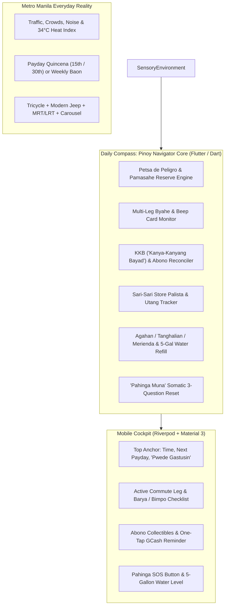
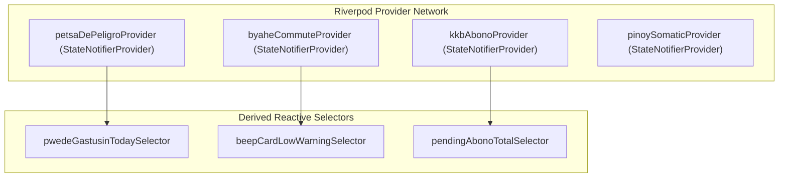

# 🧭 Daily Compass: Pinoy Navigator (Flutter & Dart Mobile Specs)
# The All-in-One Daily Grounding Cockpit for the Filipino Commuter, Student & Salaryman

**Document Version:** 3.0.0-FLUTTER-PINOY-SPEC  
**Target Platform:** Flutter 3.x / Dart 3.x (iOS & Android Mobile Applications)  
**Architecture Pattern:** Feature-First Clean Architecture + Riverpod 2.x Reactive State Store  
**Primary Language:** English with authentic, culturally grounding Filipino terminology (*"Petsa de Peligro"*, *"Pwede Gastusin"*, *"Pamasahe Reserve"*, *"Byahe"*, *"KKB & Abono"*, *"Bimpo & Barya"*)  
**Target User Profile:** Filipino college students (U-Belt, Diliman, Taft, Katipunan) and young corporate / BPO salary workers (Ortigas, Ayala Makati, BGC, Eastwood) navigating extreme urban commutes, tight financial quincenas, sensory heat fatigue, and executive dysfunction / ADHD.

---

## 1. Cultural Persona & System Vision

### 1.1 The Manila Reality: Executive Dysfunction in High-Friction Environments
Living as a commuter, student, or young professional in Metro Manila is an intense cognitive and sensory endurance test:
- **The Commute Tax ("Byahe"):** 2 to 4 hours per day spent across 3 to 4 transit legs (Tricycle $\rightarrow$ Jeepney $\rightarrow$ MRT-3 $\rightarrow$ Walk). Missing an exact coin (barya) or finding an empty Beep card triggers queue delays and anxiety.
- **The Financial Cycle ("Petsa de Peligro"):** Living paycheck to paycheck on a quincena cycle (15th and 30th) or weekly student baon. A sudden group lunch where you have to pay first (*abono*) can silently wipe out your fare money for the week.
- **Sensory Overload & Tropical Exhaustion:** 34°C heat index, tropical downpours, deafening engine noise, crowded train platforms, and sensory fatigue lead to chronic executive freeze and brain fog.
- **The Cultural Grounding Antidote ("Pahinga Muna, Dahan-Dahan Lang"):** Harsh corporate Western productivity apps demand maximum hustle and punish failure. *Daily Compass: Pinoy Navigator* provides compassionate scaffolding: *"Hinga nang malalim. May pamasahe ka pa. Dahan-dahan lang."* (Breathe deeply. You still have fare money. Take it step by step.)



---

## 2. Technical Stack & Clean Architecture

### 2.1 Technology Stack Selection
- **Framework:** Flutter 3.22+ (Targeting Android SDK 34+ and iOS 16+)
- **Language:** Dart 3.4+ (Utilizing pattern matching, sealed class hierarchies, records, and extension types)
- **State Management:** `flutter_riverpod: ^2.5.1` (Immutable state, auto-dispose providers, compile-time safety)
- **Local Database Persistence:** `isar: ^3.1.0` or `hive_flutter: ^1.1.0` (Fast, offline-first NoSQL database with zero server latency)
- **Procedural Sound & Haptics:** `audioplayers: ^6.0.0` combined with native Flutter `HapticFeedback`
- **Typography & Theme:** Google Fonts (`Plus Jakarta Sans` for clean UI numbers + `Inter` for body readability), customized with warm slate and calm tropical accents.

### 2.2 Directory Layout (Feature-First Clean Architecture)
```
lib/
├── app/
│   ├── app.dart                   # MaterialApp.router configuration
│   ├── routes.dart                # GoRouter navigation paths
│   └── theme/                     # Calming Nordic Twilight + Tropical Accents
├── core/
│   ├── constants/                 # Philippine holidays, quincena constants
│   ├── database/                  # Isar/Hive local storage singleton
│   ├── audio/                     # Soothing Web Audio synthesizer / soundscapes
│   └── utils/                     # Currency formatters (₱), time math
└── features/
    ├── petsa_de_peligro/          # Payday countdown, Pamasahe reserve, Pwede Gastusin
    ├── byahe_commute/             # Multi-leg transit, Beep card, survival checklist
    ├── kkb_abono/                 # Group meal splitting, GCash / Maya reminders
    ├── sari_sari_utang/           # Store credit palista & bilateral IOUs
    ├── somatic_rhythm/            # Agahan/Tanghalian/Merienda, 5-gal water cycle
    └── grounding_sos/             # 3-question "Pahinga Muna" emergency reset
```

---

## 3. Module 1: "Petsa de Peligro" Survival Engine & Cash Horizon

### 3.1 The Problem: The Quincena Trap
Corporate salarymen in the Philippines receive salaries on the **15th and 30th** (or last working day of the month). College students receive allowances (**baon**) weekly every Monday or monthly.
Between paydays lies **"Petsa de Peligro"** (the Danger Days, usually the 5 to 7 days before payout), where unmonitored spending causes users to run out of money for daily commute fares.

### 3.2 The Mathematical Reserve Engine

```
+---------------------------------------------------------------------------------------------------+
| 💰 PETSA DE PELIGRO COCKPIT                          [ PAYDAY IN: 4 DAYS (Nov 15) ]               |
+---------------------------------------------------------------------------------------------------+
| Total Wallet Balance (Cash + GCash + Maya):          ₱ 1,450.00                                   |
| Untouchable Pamasahe Reserve (4 days x ₱180/day):  - ₱   720.00  [ LOCKED 🔒 ]                    |
| Pending Fixed Bills (Prepaid Data / Water Refill):  - ₱   150.00                                   |
| -----------------------------------------------------------------                                 |
| Remaining Discretionary Pool:                        ₱   580.00                                   |
|                                                                                                   |
| 👉 PWEDE GASTUSIN TODAY (Safe-to-Spend):             ₱   145.00 / day                             |
| Status: [ 🟢 INGAT LANG - COMFORTABLE ]                                                           |
+---------------------------------------------------------------------------------------------------+
```

#### Mathematical Formulas
1. **Days Remaining until Next Payday ($D_{\text{rem}}$):**
   $$D_{\text{rem}} = \max\left(1, \text{TargetPaydayDate} - \text{CurrentDate}\right)$$
2. **Untouchable Pamasahe Reserve ($R_{\text{pamasahe}}$):**
   $$R_{\text{pamasahe}} = D_{\text{rem}} \times \text{DailyCommuteFareBenchmark}$$
   *(Default benchmark: ₱150 - ₱220 depending on route legs).*
3. **Daily "Pwede Gastusin" (Safe-to-Spend Today):**
   $$\text{Pwede Gastusin Today} = \frac{\text{Total Liquid Funds} - R_{\text{pamasahe}} - \sum \text{Bills}_{\text{pending}}}{D_{\text{rem}}} - \text{Expenses Logged Today}$$

#### Petsa de Peligro Severity Index
- **Level 1: Ayos Pa (Comfortable - Green):** $\text{Pwede Gastusin} \ge ₱200/\text{day}$. Discretionary budget allows coffee or casual dining.
- **Level 2: Ingat Lang (Caution - Amber):** $₱80 \le \text{Pwede Gastusin} < ₱200/\text{day}$. Stick to carinderia meals; avoid shopping.
- **Level 3: Petsa de Peligro Mode (Critical - Coral):** $\text{Pwede Gastusin} < ₱80/\text{day}$.
  - System triggers **Survival UI**:
  - Highlights untouchable commute reserve: *"Huwag galawin ang pamasahe! May ₱720 kang nakatabi para makapasok ka pa rin."* (Don't touch fare money! You have ₱720 set aside so you can still commute).
  - Offers low-cost food survival recommendations (Siomai rice, carinderia gulay).

---

## 4. Module 2: Multi-Leg Commute ("Byahe") & Survival Armor

### 4.1 Realities of the Philippine Urban Transit Chain
A single one-way trip to work or university rarely involves one vehicle. It is a multi-modal chain:
$$\text{Bahay} \xrightarrow{\quad\text{Tricycle (₱30)}\quad} \text{Kanto} \xrightarrow{\quad\text{Modern Jeep (₱15)}\quad} \text{MRT Station} \xrightarrow{\quad\text{Train (₱24)}\quad} \text{Ayala} \xrightarrow{\quad\text{Lakad (12m)}\quad} \text{Office}$$

### 4.2 Byahe Tracker & Beep Card Monitor
```
+---------------------------------------------------------------------------------------------------+
| 🚌 BYAHE COMMUTE TRACKER                                [ ROUTE: Bahay to BGC Market! Market! ]   |
+---------------------------------------------------------------------------------------------------+
| Leg 1: 🛺 Tricycle Toda (Bahay -> Bayan)         ₱ 25.00   [✓ Paid - Barya ]                      |
| Leg 2: 🚆 MRT-3 (Boni -> Guadalupe)              ₱ 16.00   [✓ Beep Card: Bal ₱142.00 ]           |
| Leg 3: 🚙 Modern Jeepney (Guadalupe -> BGC)       ₱ 15.00   [ Active Leg • Bayad muna ]           |
| Leg 4: 🚶 Lakad (500m to Office Building)         0 mins    [ Heat Index: 33°C • Payong ]         |
| ------------------------------------------------------------------------------------------------- |
| Total Commute Spent Today: ₱ 56.00 / ₱ 112.00 roundtrip target                                    |
+---------------------------------------------------------------------------------------------------+
| 🎒 PRE-BYAHE SENSORY SURVIVAL ARMOR (Swipe to check before leaving house):                       |
| [✓] Barya / Barya bills (₱20 / ₱50 coins ready for jeepney driver)                                |
| [✓] Beep Card (Balance: ₱142.00 - Good for 5 more train rides)                                    |
| [✓] Payong (Folding umbrella in bag - Ready for rain or sunburn)                                  |
| [✓] Bimpo / Panyo (Handkerchief for sweat and pollution)                                          |
| [✓] Earphones (Sensory shielding against engine noise and honking)                                |
| [✓] Powerbank (At least 50% charge for traffic delays)                                            |
+---------------------------------------------------------------------------------------------------+
```

### 4.3 Beep Card Auto-Threshold Warning
- Users maintain a Beep Card Stored Value tracker.
- If Beep card balance falls below **₱50.00** (less than 2 return train trips):
  - A friendly notice appears: *"Pa-load ka na sa kiosk bago humaba ang pila mamayang 5 PM."* (Top up at the station kiosk before the 5 PM queue builds up).

---

## 5. Module 3: KKB ("Kanya-Kanyang Bayad") & Abono Splitter

### 5.1 Cultural Context: "Ako Muna Mag-Abono"
During office lunches or barkada coffee runs, one person pays the whole bill with their credit card or cash (*nag-abono*). People promise to send payment via GCash or Maya.
Because of social anxiety or executive dysfunction, the person who paid feels uncomfortable asking for the money, or forgets who has paid, silently absorbing the loss.

### 5.2 Functional Specifications
1. **Quick-Split Bill Form:**
   - Total Bill Amount + Optional Tip / Service Charge.
   - Even split or individual custom item assignment.
2. **Participant List:**
   - Name, phone number / GCash handle, share amount.
   - Payment status: `PENDING`, `RECEIVED`, `LIBRE / WAIVED`.
3. **One-Tap Friendly GCash Request Generator:**
   - Tapping `[Copy Polite Reminder]` generates a friendly, non-awkward message for Messenger / Viber:
   > *"Hi [Name]! Share mo pala kanina for lunch sa [Restaurant] is ₱185.00. Pwede send sa GCash: 0917-XXX-XXXX ([Account Name]). Salamat! 🙏"*
4. **Reconciliation into Cash Ledger:**
   - Marking a person as `RECEIVED` automatically updates the user's GCash wallet balance and records an income reimbursement in Module 1.

---

## 6. Module 4: Sari-Sari Store & Bilateral Utang Ledger

### 6.1 Traditional Philippine Neighborhood Credit ("Palista")
In everyday Filipino life, small emergency purchases are made at the neighborhood sari-sari store on credit (*"Paki-lista muna, Aling Nena"*):
- Consumables: Eggs (itlog), sachet shampoo, 3-in-1 coffee, instant pancit canton, mineral water.
- These micro-debts pile up unseen unless tracked.

### 6.2 Bilateral Utang Ledger
- **"Palista / Utang Ko" (Payables):** Store credit or money borrowed from a friend.
- **"Pautang Ko / May Utang Sa Akin" (Receivables):** Money lent to barkada.
- **Settlement Ledger:** Tracks partial payments (e.g. paid ₱100 of ₱250 store debt) with timestamps and remaining balance.

---

## 7. Module 5: Somatic Cultural Grounding & Philippine Daily Rhythm

### 7.1 Meal Anchors & Filipino Daily Rhythm
Unlike Western schedules that ignore meals, the Filipino day revolves around nourishing food anchors:
- 🍳 **Agahan / Almusal (06:30 - 08:00):** Sinangag, itlog, hot coffee. Sets physical grounding before the grueling commute.
- 🍱 **Tanghalian (12:00 - 13:00):** Carinderia meal, rice, screen-free rest.
- 🥪 **Merienda (15:30 - 16:30):** Turon, banana cue, biscuits, cold water. Essential blood sugar boost to prevent mid-afternoon crash.
- 🍲 **Hapunan (19:30 - 21:00):** Warm dinner at home or dorm, debriefing the day.

### 7.2 The 5-Gallon Water Jug Cycle Tracker
In the Philippines, clean drinking water is purchased in 5-gallon blue jugs (slim or round dispenser bottles) from neighborhood water refilling stations (₱30 to ₱40 per refill):
- The app tracks water usage: *"Jug at ~20% remaining. Magpa-deliver na ng tubig bukas bago maubusan!"* (Order water delivery tomorrow before running dry).

### 7.3 "Pahinga Muna" Somatic 3-Question Reset
A tailored emergency de-escalation protocol for sensory overload caused by tropical heat and traffic:
1. **Tanong 1 (Katawan / Body):**  
   *"Nainitan ka ba sa byahe? Uminom ka na ba ng malamig na tubig?"*  
   (Were you overheated in transit? Have you had cold water?)  
   $\rightarrow$ `[Uminom ng tubig 💧]` `[Maghilamos / Wash face 🚰]` `[Okay naman katawan 🌿]`
2. **Tanong 2 (Isip / Mind):**  
   *"Sobrang ingay ba sa paligid o nag-freeze ang utak mo?"*  
   (Is it too noisy around you or has your brain frozen?)  
   $\rightarrow$ Automatically activates soft rain sound or turns on Gentle Mode.
3. **Tanong 3 (Kahit Isang Hakbang Lang / One Tiny Step):**  
   *"Huwag mo munang isipin ang buong araw. Ano ang isang maliit na bagay na kaya mong gawin sa susunod na 3 minuto?"*  
   (Don't think about the whole day yet. What is one tiny thing you can do in the next 3 minutes?)  
   $\rightarrow$ `[Umupo at magpahinga nang 5m]` `[Mag-unat ng katawan]` `[Pakinggan ang ulan]`

---

## 8. Complete Dart 3.x Data Models Catalog

All models are engineered as pure immutable Dart classes with serialization (`toJson` / `fromJson`), copying (`copyWith`), and compile-time immutability.

### 8.1 Petsa de Peligro & Wallet State Models
```dart
import 'package:flutter/foundation.dart';

enum PaydayCycleType {
  quincena1530,  // 15th and 30th / end of month
  weeklyBaon,    // Every Monday or Friday
  monthlySalary, // End of month only
  customDays,
}

enum PetsaSeverityLevel {
  ayosPa,       // Level 1: Comfortable (Safe-to-spend >= ₱200/day)
  ingatLang,    // Level 2: Caution (₱80 - ₱199/day)
  petsaDePeligro, // Level 3: Critical (< ₱80/day - Survival mode)
}

@immutable
class PetsaDePeligroState {
  final double totalLiquidCash;      // Physical wallet cash + GCash + Maya
  final double physicalCash;
  final double gcashBalance;
  final double mayaBalance;
  final double dailyCommuteBenchmark; // e.g. ₱180.00 / day
  final PaydayCycleType cycleType;
  final DateTime nextPaydayDate;
  final List<PendingFixedBill> pendingBills;

  const PetsaDePeligroState({
    required this.totalLiquidCash,
    required this.physicalCash,
    required this.gcashBalance,
    required this.mayaBalance,
    required this.dailyCommuteBenchmark,
    required this.cycleType,
    required this.nextPaydayDate,
    this.pendingBills = const [],
  });

  int get daysUntilPayday {
    final now = DateTime.now();
    final today = DateTime(now.year, now.month, now.day);
    final target = DateTime(nextPaydayDate.year, nextPaydayDate.month, nextPaydayDate.day);
    final diff = target.difference(today).inDays;
    return diff <= 0 ? 1 : diff;
  }

  double get untouchablePamasaheReserve {
    return daysUntilPayday * dailyCommuteBenchmark;
  }

  double get totalPendingBillsAmount {
    return pendingBills.fold(0.0, (sum, b) => sum + b.amount);
  }

  double get pwedeGastusinToday {
    final remainingPool = totalLiquidCash - untouchablePamasaheReserve - totalPendingBillsAmount;
    if (remainingPool <= 0) return 0.0;
    return remainingPool / daysUntilPayday;
  }

  PetsaSeverityLevel get severityLevel {
    final daily = pwedeGastusinToday;
    if (daily >= 200.0) return PetsaSeverityLevel.ayosPa;
    if (daily >= 80.0) return PetsaSeverityLevel.ingatLang;
    return PetsaSeverityLevel.petsaDePeligro;
  }

  PetsaDePeligroState copyWith({
    double? totalLiquidCash,
    double? physicalCash,
    double? gcashBalance,
    double? mayaBalance,
    double? dailyCommuteBenchmark,
    PaydayCycleType? cycleType,
    DateTime? nextPaydayDate,
    List<PendingFixedBill>? pendingBills,
  }) {
    return PetsaDePeligroState(
      totalLiquidCash: totalLiquidCash ?? this.totalLiquidCash,
      physicalCash: physicalCash ?? this.physicalCash,
      gcashBalance: gcashBalance ?? this.gcashBalance,
      mayaBalance: mayaBalance ?? this.mayaBalance,
      dailyCommuteBenchmark: dailyCommuteBenchmark ?? this.dailyCommuteBenchmark,
      cycleType: cycleType ?? this.cycleType,
      nextPaydayDate: nextPaydayDate ?? this.nextPaydayDate,
      pendingBills: pendingBills ?? this.pendingBills,
    );
  }
}

@immutable
class PendingFixedBill {
  final String id;
  final String name; // e.g. "Prepaid Data / Magic Data 99", "Water Refill ₱35"
  final double amount;
  final DateTime dueDate;

  const PendingFixedBill({
    required this.id,
    required this.name,
    required this.amount,
    required this.dueDate,
  });
}
```

---

### 8.2 Multi-Leg Byahe & Transit Checklist Models
```dart
enum TransitMode {
  tricycle,     // Toda regular or special
  traditionalJeep,
  modernJeep,
  mrtLrtTrain,  // MRT-3, LRT-1, LRT-2
  edsaCarousel, // City bus
  motorcycleTaxi, // Angkas, JoyRide, Move It
  grabCarTaxi,
  walkingLeg,
}

@immutable
class CommuteLeg {
  final String id;
  final String title;         // e.g. "MRT-3 Boni to Ayala"
  final TransitMode mode;
  final double estimatedFare;
  final bool isPaid;
  final String paymentMethod; // "Cash", "Beep Card", "GCash"
  final int estimatedMinutes;

  const CommuteLeg({
    required this.id,
    required this.title,
    required this.mode,
    required this.estimatedFare,
    this.isPaid = false,
    this.paymentMethod = 'Cash',
    this.estimatedMinutes = 15,
  });

  CommuteLeg copyWith({bool? isPaid, String? paymentMethod}) {
    return CommuteLeg(
      id: id,
      title: title,
      mode: mode,
      estimatedFare: estimatedFare,
      isPaid: isPaid ?? this.isPaid,
      paymentMethod: paymentMethod ?? this.paymentMethod,
      estimatedMinutes: estimatedMinutes,
    );
  }
}

@immutable
class ByaheSurvivalKit {
  final bool hasBarya;       // Exact coins for driver
  final bool hasBeepCard;    // Card with at least ₱50 balance
  final double beepCardBalance;
  final bool hasPayong;      // Folding umbrella
  final bool hasBimpo;       // Handkerchief for sweat/pollution
  final bool hasEarphones;   // Noise barrier
  final bool hasPowerbank;

  const ByaheSurvivalKit({
    this.hasBarya = false,
    this.hasBeepCard = true,
    this.beepCardBalance = 120.0,
    this.hasPayong = false,
    this.hasBimpo = false,
    this.hasEarphones = false,
    this.hasPowerbank = false,
  });

  bool get isReadyToLeave =>
      hasBarya && hasPayong && hasBimpo && (beepCardBalance >= 50.0);

  ByaheSurvivalKit copyWith({
    bool? hasBarya,
    bool? hasBeepCard,
    double? beepCardBalance,
    bool? hasPayong,
    bool? hasBimpo,
    bool? hasEarphones,
    bool? hasPowerbank,
  }) {
    return ByaheSurvivalKit(
      hasBarya: hasBarya ?? this.hasBarya,
      hasBeepCard: hasBeepCard ?? this.hasBeepCard,
      beepCardBalance: beepCardBalance ?? this.beepCardBalance,
      hasPayong: hasPayong ?? this.hasPayong,
      hasBimpo: hasBimpo ?? this.hasBimpo,
      hasEarphones: hasEarphones ?? this.hasEarphones,
      hasPowerbank: hasPowerbank ?? this.hasPowerbank,
    );
  }
}
```

---

### 8.3 KKB & Abono Group Splitter Models
```dart
enum AbonoPaymentStatus {
  pending,
  receivedViaGcash,
  receivedViaMaya,
  receivedCash,
  libreWaived,
}

@immutable
class KkbSplitItem {
  final String id;
  final String participantName;
  final String? phoneNumber;
  final double shareAmount;
  final AbonoPaymentStatus status;
  final DateTime? settledAt;

  const KkbSplitItem({
    required this.id,
    required this.participantName,
    this.phoneNumber,
    required this.shareAmount,
    this.status = AbonoPaymentStatus.pending,
    this.settledAt,
  });

  bool get isSettled => status != AbonoPaymentStatus.pending;

  String generatePoliteReminderMessage({
    required String occasionTitle,
    required String userGcashNumber,
    required String userGcashName,
  }) {
    return 'Hi $participantName! Share mo pala kanina for $occasionTitle is ₱${shareAmount.toStringAsFixed(2)}. '
        'Pwede pa-send sa GCash: $userGcashNumber ($userGcashName). Salamat nang marami! 🙏';
  }
}

@immutable
class KkbAbonoEvent {
  final String id;
  final String title; // e.g. "Jollibee Team Lunch", "Starbucks Coffee Run"
  final double totalBill;
  final DateTime eventDate;
  final List<KkbSplitItem> participants;

  const KkbAbonoEvent({
    required this.id,
    required this.title,
    required this.totalBill,
    required this.eventDate,
    required this.participants,
  });

  double get totalCollected => participants
      .where((p) => p.isSettled && p.status != AbonoPaymentStatus.libreWaived)
      .fold(0.0, (sum, p) => sum + p.shareAmount);

  double get totalPending => participants
      .where((p) => !p.isSettled)
      .fold(0.0, (sum, p) => sum + p.shareAmount);
}
```

---

### 8.4 Somatic Rhythm & Water Jug Models
```dart
enum PinoyMealType {
  agahanAlmusal,  // 06:00 - 08:30
  tanghalian,     // 12:00 - 13:30
  merienda,       // 15:30 - 16:30
  hapunan,        // 19:30 - 21:00
}

@immutable
class PinoySomaticState {
  final Map<PinoyMealType, bool> mealsLoggedToday;
  final double waterJugRemainingPercent; // e.g. 0.35 (35% left of 5-gallon jug)
  final int waterDrankMlToday;           // Target: 2,500ml in tropical climate
  final bool isSafeHarborActive;
  final DateTime? safeHarborExpiresAt;

  const PinoySomaticState({
    required this.mealsLoggedToday,
    this.waterJugRemainingPercent = 0.60,
    this.waterDrankMlToday = 0,
    this.isSafeHarborActive = false,
    this.safeHarborExpiresAt,
  });

  bool get needsWaterDelivery => waterJugRemainingPercent <= 0.25;
}
```

---

## 9. Riverpod 2.x State Architecture & Providers



### Provider Implementation Examples
```dart
import 'package:flutter_riverpod/flutter_riverpod.dart';

final petsaDePeligroProvider =
    StateNotifierProvider<PetsaDePeligroNotifier, PetsaDePeligroState>((ref) {
  return PetsaDePeligroNotifier();
});

class PetsaDePeligroNotifier extends StateNotifier<PetsaDePeligroState> {
  PetsaDePeligroNotifier()
      : super(PetsaDePeligroState(
          totalLiquidCash: 1450.0,
          physicalCash: 450.0,
          gcashBalance: 850.0,
          mayaBalance: 150.0,
          dailyCommuteBenchmark: 180.0,
          cycleType: PaydayCycleType.quincena1530,
          nextPaydayDate: DateTime(2026, 11, 15),
          pendingBills: [
            PendingFixedBill(
              id: 'bill-1',
              name: 'Magic Data 99 (Prepaid)',
              amount: 99.0,
              dueDate: DateTime(2026, 11, 13),
            ),
          ],
        ));

  void recordExpense(double amount, {bool isCommute = false}) {
    if (isCommute) {
      // Deducts from wallet without reducing discretionary pool twice
      state = state.copyWith(totalLiquidCash: state.totalLiquidCash - amount);
    } else {
      state = state.copyWith(totalLiquidCash: state.totalLiquidCash - amount);
    }
  }

  void updateWalletBalances({double? cash, double? gcash, double? maya}) {
    final newCash = cash ?? state.physicalCash;
    final newGcash = gcash ?? state.gcashBalance;
    final newMaya = maya ?? state.mayaBalance;
    state = state.copyWith(
      physicalCash: newCash,
      gcashBalance: newGcash,
      mayaBalance: newMaya,
      totalLiquidCash: newCash + newGcash + newMaya,
    );
  }
}
```

---

## 10. Flutter UI Blueprints & Screen Layouts

### 10.1 Cockpit Home Screen (`PinoyCockpitHomeScreen`)
```
+-------------------------------------------------------------------------+
| [🧭 PINOY NAVIGATOR]    14:32 Wed, Nov 5    [ 🔋 60% ]   [ 👁️ Mask: OFF ]|
+-------------------------------------------------------------------------+
| 💰 PETSA DE PELIGRO WATCH: Next Payday in 4 Days (Nov 15 Quincena)       |
| Wallet: ₱1,450.00  |  Pamasahe Locked: ₱720.00 🔒  |  Pending: ₱99.00    |
|                                                                         |
| 👉 PWEDE GASTUSIN TODAY: ₱ 145.00  [ STATUS: 🟢 AYOS PA / INGAT LANG ]  |
+-------------------------------------------------------------------------+
| 🚌 ACTIVE BYAHE: 🚙 Modern Jeepney Leg 2 (Guadalupe -> BGC)             |
| Fare: ₱15.00 [ Bayad Na ✓ ]  •  Beep Card: ₱142.00 (Good)               |
| Survival Armor: [✓ Barya] [✓ Payong] [✓ Bimpo] [✓ Earphones]            |
+-------------------------------------------------------------------------+
| 🍱 SOMATIC NOURISHMENT ANCHORS:                                         |
| [✓] Agahan (Sinangag & Kape)       [✓] Tanghalian (Carinderia gulay)     |
| [⭕] Merienda: Turon / Cold Water   [ ] Hapunan (Dinner)                 |
| Water Today: 1,750ml / 2,500ml  •  5-Gal Jug: 60% (Refill not needed)   |
+-------------------------------------------------------------------------+
| 🤝 PENDING ABONO TO COLLECT: ₱ 350.00 (2 friends pending GCash)         |
| • Mark: ₱185.00 lunch [ Tap to remind ]  • Bea: ₱165.00 coffee          |
+-------------------------------------------------------------------------+
| [ 🧘 PAHINGA MUNA (SOS Reset) ]      [ ⚡ Quick Log: ₱15 Pamasahe / Food ]|
+-------------------------------------------------------------------------+
```

### 10.2 "Pahinga Muna" Somatic 3-Question Reset Modal
```
+-------------------------------------------------------------------------+
| 🌿 PAHINGA MUNA, DAHAN-DAHAN LANG                      [ ✕ Isara / Esc ]|
+-------------------------------------------------------------------------+
|                                                                         |
|       ((  ~ ~ ~ ∿ ∿ ∿ Hinga nang malalim ∿ ∿ ∿ ~ ~ ~  ))                 |
|             [ 4s Inhale . . . 6s Exhale ]                               |
|                                                                         |
| 1. KUMUSTA ANG KATAWAN MO? (Physical Check):                            |
|    "Nainitan ka ba sa byahe? Baka gutom o nauuhaw ka na?"               |
|    [ 💧 Uminom ng malamig na tubig ]    [ 🚰 Maghilamos sa banyo ]      |
|    [ 🥪 Kumain ng meryenda ]           [ 🌿 Maayos naman ang katawan ]  |
|                                                                         |
| 2. GAANO KALAKAS ANG INGAY SA ISIP MO? (Sensory Overload Check):         |
|    [ 🌪️ Sobrang ingay / Traffic ]  --> (Auto-play soft rain audio)       |
|    [ 🌫️ Lutang / Brain fog ]        --> (Auto-play 10Hz focus tone)      |
|    [ 🔋 Ubos na ang battery ]       --> (Activate Gentle Mode + 20%)     |
|                                                                         |
| 3. KAHIT ISANG MALIIT NA BAGAY LANG (One Gentle Micro-Step):            |
|    "Huwag munang isipin ang buong trabaho. Isa lang:"                   |
|    [ 🛋️ Umupo nang nakapikit nang 5 minuto nang walang istorbo ]         |
|    [ 🪟 Tumitig sa labas nang 60 seconds ]                              |
|    [ 📝 I-type ang nasa isip sa Scratchpad ]                            |
|                                                                         |
| [ 🌿 I-activate ang Safe Harbor (30m Walang Istorbo) ]                  |
+-------------------------------------------------------------------------+
```

---

## 11. Verification Matrix & Acceptance Test Suite

| Test ID | Module | Scenario / Input | Expected System Behavior & Validation |
| :--- | :--- | :--- | :--- |
| **TC-PDP-01** | Petsa de Peligro | Wallet ₱1,450, 4 days to payday, commute ₱180/day, bill ₱99 | Reserve locked at ₱720.00. Pwede Gastusin calculated as $(1450 - 720 - 99)/4 = ₱157.75/\text{day}$. Severity: Ingat Lang (Amber). |
| **TC-PDP-02** | Petsa de Peligro | Wallet drops to ₱400, 3 days to payday, commute ₱150/day | Reserve needs ₱450. Pwede Gastusin reaches ₱0.00. Critical Petsa de Peligro mode triggers: warns user not to spend commute funds. |
| **TC-BYA-01** | Byahe Commute | Beep card balance set to ₱42.00 | Threshold warning triggers: *"Pa-load ka na sa kiosk bago humaba ang pila."* |
| **TC-BYA-02** | Byahe Commute | Tap Payong, Bimpo, and Barya checkboxes | Survival kit registers ready state. Readiness badge turns green. |
| **TC-KKB-01** | KKB Abono | Mark pays ₱185 for lunch via GCash | User taps `[Mark Received via GCash]`. GCash balance increases by ₱185.00, item marked settled. |
| **TC-KKB-02** | KKB Abono | Generate reminder for Bea (₱165 coffee) | Clipboard copies polite reminder string formatted with user's GCash details. |
| **TC-SOS-01** | Pahinga Muna | User selects "Nainitan sa byahe" + "Ubos battery" | App automatically logs 250ml water, turns on Gentle Mode, lowers sound volume by 40%, enters 30-minute Safe Harbor. |

---
**End of Specification — Daily Compass: Pinoy Navigator (Flutter & Dart)**
