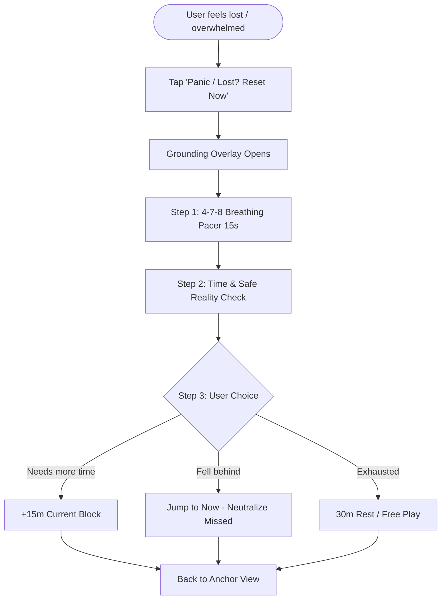
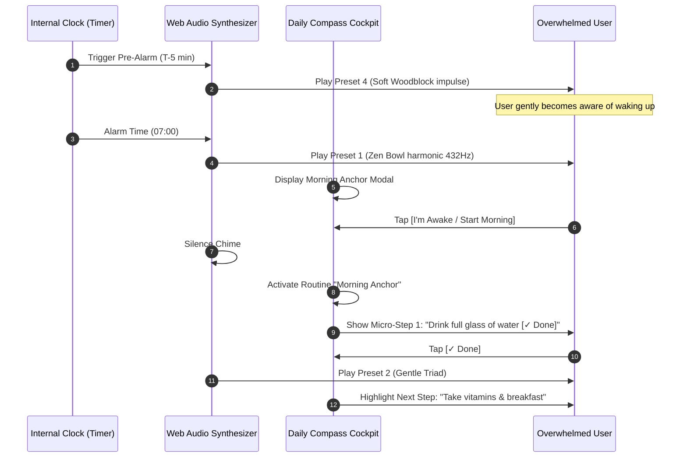
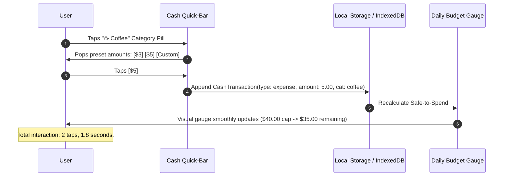
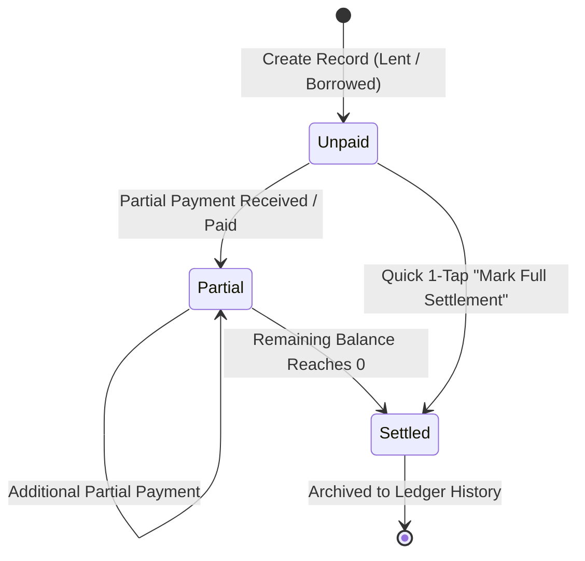
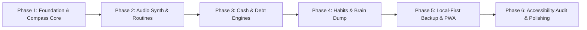

# Functional Specification Document
# Project: "Daily Compass" (The All-in-One Grounding & Daily Tracker)

**Document Version:** 1.0.0  
**Target Environment:** Local-First Web Application / Offline Progressive Web App (PWA) deployable to GitHub Pages  
**Target Audience:** Engineering Team, Product Architects, UI/UX Designers  
**Core User Profile:** Individuals dealing with executive dysfunction, ADHD, time blindness, chronic fatigue, anxiety paralysis, or sensory overwhelm who frequently get disoriented or lost in their daily routines.

---

## 1. Executive Summary & Product Vision

### 1.1 The Core Problem
Most productivity and tracking suites fail individuals prone to executive dysfunction and disorientation because:
1. **Guilt Mechanics:** Red badges, overdue alerts, and broken streak punishments cause avoidance and anxiety spirals.
2. **High Friction Entry:** Logging an expense or checking a habit requires navigating 3+ screen tiers, multiple dropdowns, and date pickers.
3. **Fragmented Cognitive State:** Tasks, alarms, expenses, debts, and notes live in separate apps, requiring constant context switching that drains limited working memory.
4. **Time Blindness ("Where Did the Day Go?"):** Traditional to-do lists list *what* to do, but not *when* or *what should I do right this exact second*. When derailed, the user does not know where to re-enter their day.

### 1.2 The "Daily Compass" Solution
**Daily Compass** is an integrated cognitive prosthetic and daily tracking system designed to act as an unshakeable ground truth. It unifies time anchoring, routine alarms, daily cash flow, debt tracking, habit micro-steps, and an instant scratchpad into a unified single-page cockpit.

#### Guiding Principles
- **Compassionate Re-Entry (Zero Guilt):** If a user drifts away for 4 hours, the app does not flash red alerts or reprimand them. The 1-click **Quick Reset** button grounds them instantly into the current minute.
- **The "Right Now" Anchor:** The default state always answers the question: *"What is the single thing I should be doing right now?"*
- **Ultra-Low Tap Cost:** Any logging operation (expense, habit check, brain dump) must be executable in $\le 2$ taps and $< 3$ seconds.
- **Zero-Dependency Self-Contained Engine:** 100% client-side (HTML5/CSS3/Vanilla ES Modules), uses the Web Audio API for sound synthesis (no external MP3/audio files), and stores all data in local browser storage (IndexedDB + LocalStorage) with robust JSON import/export.

---

## 2. Target Persona & Cognitive Accessibility Architecture

### 2.1 Persona: "The Overwhelmed Navigator"
- **Cognitive Profile:** Variable attention, rapid working memory decay, chronic time blindness, sensory sensitivity to jarring alerts.
- **Trigger Points:** 
  - Opening an app with 15 overdue red badges causes app abandonment.
  - Complicated forms with required fields cause task paralysis.
  - A sudden thought ("Need to buy batteries") derails whatever task is currently active unless captured instantly.
- **Key Need:** A calm, stable visual anchor that says: *"Breathe. It is 2:15 PM. You are safe. Here is your current step."*

### 2.2 Cognitive Accessibility Design Patterns
| Anti-Pattern (Conventional Apps) | Daily Compass Alternative | Cognitive Benefit |
| :--- | :--- | :--- |
| Harsh klaxon alarms and loud audio | Synthesized harmonic chimes (pentatonic / singing bowl) | Prevents startle reflex and cortisol spikes |
| Infinite backlog to-do list | Single "Current Action" focus card with 1 upcoming step | Eliminates choice paralysis |
| Streak resets to 0 upon 1 missed day | "Streak Shield / Compassionate Forgiveness" | Prevents abandonment from perfectionism |
| Multi-level expense category trees | 6 big preset emoji buttons + quick amount pills | Lowers barrier to financial tracking |
| Server login, passwords, cookies | 100% Local-first, zero authentication barrier | Instant launch, zero data privacy anxiety |

---

## 3. Information Architecture & Navigation

The application operates as a high-density, low-clutter Single Page Cockpit (SPA) with a persistent **Anchor Header**, an **Active Viewport**, and a bottom/sidebar **Module Switcher**.

```
+-------------------------------------------------------------------------+
| [Daily Compass]   14:23:10 Wed, Nov 5   [QUICK RESET]   [BRAIN DUMP]    |
| CURRENT BLOCK: Deep Work Sprint (Ends in 37m)   [NEXT: Stretch & Hydrate]|
+-------------------------------------------------------------------------+
|                                                                         |
|                                                                         |
|                        MAIN VIEWPORT                                    |
|                                                                         |
|  [Module 1: Anchor]  [Module 2: Alarms]   [Module 3: Cash]             |
|  [Module 4: Debts]   [Module 5: Habits]   [Module 6: Notes]            |
|  [Module 7: Data / Backup]                                              |
|                                                                         |
+-------------------------------------------------------------------------+
| [1. Compass]  [2. Routines]  [3. Cash]  [4. Debts]  [5. Habits]  [6. Notes] |
+-------------------------------------------------------------------------+
```

### 3.1 Primary Navigation States
1. **Compass / Anchor View (`#anchor` - Default):** The central dashboard. Shows big clock, active routine block progress, current habit micro-step, quick reset, and daily vital gauges (Cash remaining today, Habits completed today).
2. **Routines & Alarms View (`#routines`):** Visual 24h schedule stream, alarm configuration, custom chime synthesizer test panel, active routine step checklist.
3. **Cash Flow & Budget View (`#cash`):** Daily spending cap meter, quick-tap expense pills, 1-click income entry, recent transaction log, category breakdown.
4. **Debt & Credit View (`#debts`):** Split ledger of "They Owe Me" (Lent) and "I Owe Them" (Borrowed), net balance banner, settlement modal.
5. **Activities & Habits View (`#habits`):** Checkable micro-habits, streak shields, time-block scheduler, completion progress ring.
6. **Scratchpad / Brain Dump (`#scratchpad`):** Distraction-free capture wall, tag filters (`Idea`, `To-Buy`, `To-Do`, `Later`), instant conversion buttons.
7. **Settings & Data Engine (`#settings`):** Local backup JSON export, file drag-and-drop import, schema inspector, audio volume/sound picker, storage wipe.

---

## 4. Module 1: "Where Am I Now?" Anchor & Compass

### 4.1 Functional Objectives
Provide instantaneous orientation within 500 milliseconds of looking at the screen. Answer three foundational questions:
1. *What time is it right now?*
2. *What am I supposed to be doing right now?*
3. *What is the very next micro-step?*

### 4.2 Component Specifications
- **Live Master Clock:**
  - High-visibility typography with toggleable 12-hour (AM/PM) and 24-hour formats.
  - Precision display: `HH:MM:SS`, accompanied by the full Day of Week, Month, and Date.
  - Smooth second-tick visual pulse.
- **Current Routine Block Display:**
  - Identifies the active routine block based on local time.
  - Example: `"Afternoon Deep Work (14:00 - 15:30)"`.
  - Visual time bar: Dynamic percentage indicator showing elapsed time vs remaining minutes (`"37 minutes remaining"`).
- **The Immediate Next Action (The "North Star" Micro-Step):**
  - Isolates the current step from the active routine or top daily habit.
  - Large single button: `"[✓ Done - Next Step]"`.
  - Secondary button: `"[Skip / Defer 10m]"`.
- **The "Quick Reset / Grounding" Engine:**
  - Prominent emergency button styled with high visibility: `[Panic / Lost? Reset Now]`.
  - **3-Step Grounding Modal Flow:**
    1. **Step 1 (Somatic Calming):** 4-7-8 Breathing Circle (Inhale 4s, Hold 7s, Exhale 8s) with visual expansion/contraction ring.
    2. **Step 2 (Temporal Re-orientation):** Displays current time, elapsed daylight, and says: *"You haven't lost anything. Time begins now."*
    3. **Step 3 (One-Tap Course Correction):** Three non-punitive options:
       - `[Extend Current Block +15m]` (Adjusts current schedule forward).
       - `[Jump to Current Time]` (Silently marks missed past blocks as "Neutral / Passed" with no guilt penalty).
       - `[Free Anchor Mode]` (Pauses routine blocks for 30 minutes of unstructured rest).



---

## 5. Module 2: Alarms & Routines

### 5.1 Time-Based Alarms
- Alarms support custom triggers: `Time (24h)`, `Days of Week (Mon-Sun)`, `Label`, `Enabled (true/false)`.
- **Pre-Alarm Warning ("Transition Chime"):**
  - Optional soft chime 5 minutes prior to the scheduled alarm.
  - Eliminates the shock of sudden task switching by giving a cognitive buffer ("5 minutes left to wrap up").
- **Smart Snooze:**
  - One-tap quick snooze pills: `+5m`, `+10m`, `+15m`.
  - Snooze counts are non-punitive and clearly display the new wake time.

### 5.2 Audio Chime Synthesizer Specification (Web Audio API)
To ensure 100% offline reliability, zero external asset 404s, and soothing non-jarring acoustics, audio is generated algorithmically via the standard browser `AudioContext`.

#### Sound Presets & Synthesis Parameters
```
                                Synthesizer Architecture
+------------------+      +-------------------+      +------------------+
|  Oscillator(s)   | ---> | GainNode (ADSR)   | ---> | BiquadFilterNode | ---> [Destination]
| Sine / Triangle  |      | Dynamic Envelope  |      | Lowpass Warmth   |      (Speakers)
+------------------+      +-------------------+      +------------------+
```

1. **Preset 1: "Zen Singing Bowl" (Grounding / Reset & Hourly Anchor)**
   - **Base Frequency:** 432.0 Hz (Fundamental tone, warm sine wave).
   - **Harmonic Overtone:** 864.0 Hz (Sine wave at +0.5 octave, detuned by +2.5 Hz for rich natural acoustic beating).
   - **ADSR Envelope:**
     - Attack: 0.08s (linear ramp)
     - Decay: 3.50s (exponential ramp down to 0.001)
     - Sustain: 0.00
     - Release: 0.50s
   - **Filter:** BiquadFilter (type: `lowpass`, frequency: 1200 Hz, Q: 1.2).

2. **Preset 2: "Gentle Triad Chime" (Block Start & Habit Completed)**
   - **Chords:** Ascending Major Triad: C5 (523.25 Hz) $\rightarrow$ E5 (659.25 Hz) $\rightarrow$ G5 (783.99 Hz).
   - **Stagger Timing:** Note 1 at $t=0.0\text{s}$, Note 2 at $t=0.12\text{s}$, Note 3 at $t=0.24\text{s}$.
   - **Waveform:** Triangle wave mixed with 20% Sine wave.
   - **ADSR Envelope per note:**
     - Attack: 0.02s
     - Decay: 1.20s
     - Sustain: 0.10
     - Release: 0.40s

3. **Preset 3: "Attentive Wakeup" (Wake Up & Routine Alarms)**
   - **Modulation:** Dual alternating tone: 587.33 Hz (D5) and 880.00 Hz (A5).
   - **Cadence:** Three gentle rhythmic double-pulses (pulse duration 150ms, gap 100ms, repeat every 1.2s until dismissed).
   - **Waveform:** Smooth Sine wave passing through gentle soft-clipping shaper.

4. **Preset 4: "Micro Woodblock Tick" (Countdown & Transition Warning)**
   - **Waveform:** Filtered square wave at 700 Hz with instantaneous pitch envelope drop (700 Hz $\rightarrow$ 120 Hz in 25ms).
   - **Duration:** 35ms total. Provides an organic tactile snap.

*AudioContext Autoplay Compliance:* Browser security requires user gesture before playing audio. On first click anywhere on the page, the audio engine unlocks and resumes the `AudioContext`. A visible audio test toggle is provided in the Settings.

### 5.3 Daily Routine Blocks
Routines partition the 24-hour cycle into predictable, named blocks.
- **Preconfigured Archetypes:**
  - `Morning Anchor` (07:00 - 08:30)
  - `Deep Focus Block 1` (09:00 - 11:30)
  - `Mid-Day Reset & Lunch` (12:00 - 13:00)
  - `Execution Block 2` (14:00 - 16:30)
  - `Decompression & Physical` (17:00 - 18:30)
  - `Evening Wind-Down & Night Routine` (21:00 - 22:30)
- **Routine Sub-Steps:**
  - Each routine block has an ordered checklist of micro-steps.
  - Step properties: `title`, `estimatedMinutes`, `isCompleted`.
  - Progress updates automatically in the Anchor view.

---

## 6. Module 3: Cash Flow & Daily Budget

### 6.1 Cognitive Budgeting Philosophy
Traditional budgeting apps fail overwhelmed users because entering 5 fields for a cup of coffee creates friction. Furthermore, looking at large monthly numbers ($3,000) causes disassociation from daily reality.

Daily Compass anchors finances around the **Daily Spending Cap** and **Safe-to-Spend Balance**:
$$\text{Safe-to-Spend Today} = \text{Daily Spending Cap} - \text{Total Expenses Logged Today}$$

### 6.2 Component Features
1. **The Daily Budget Gauge:**
   - Visual meter showing Daily Cap (e.g., `$40.00`) vs Actual Spent (e.g., `$18.50`).
   - Color shifts smoothly:
     - 0% - 70%: Soothing Mint Green (`#10b981`)
     - 71% - 95%: Warm Amber (`#f59e0b`)
     - > 100%: Gentle Coral warning (`#f87171` - without hostile alerts).
2. **One-Tap Quick-Log Bar:**
   - Preset quick amount buttons: `+$5`, `+$10`, `+$20`, `+$50` or custom numpad entry.
   - Preset emoji category chips:
     - 🍔 `Food & Meals`
     - ☕ `Coffee / Snacks`
     - 🚌 `Transit / Travel`
     - 🛒 `Groceries / Supplies`
     - 💊 `Health / Self-Care`
     - 💡 `Bills / Subscriptions`
     - 🎁 `Miscellaneous`
3. **Instant Income Logger:**
   - Toggle to "Income" (+).
   - Quick presets (`💼 Salary`, `💵 Freelance`, `🤝 Reimbursement`, `🎁 Gift`).
4. **Recent Daily Ledger:**
   - Chronological list of today's movements.
   - Delete/Edit button per item with 1-tap confirmation.
   - Rolling 7-day cumulative spend overview.

---

## 7. Module 4: Debt & Credit Tracker ("Who Owes Who?")

### 7.1 Problem Statement
Forgotten loans and debts cause lingering background anxiety. Users often forget who they lent money to, or feel embarrassed asking, or forget that they borrowed money for lunch.

### 7.2 Functional Specs
- **Two Distinct Ledgers:**
  1. **"They Owe Me" (Credit / Lent out - Green / Receivable):**
     - Money lent to friends, shared bills awaiting reimbursement, deposits.
  2. **"I Owe Them" (Debt / Borrowed - Orange / Payable):**
     - Borrowed funds, IOUs, pending splits.
- **Top Summary Banner:**
  - **Net Balance Card:** Large display: `Net Receivable: +$145.00` or `Net Payable: -$60.00`.
- **Entity Fields:**
  - Counterparty Name (Autocomplete based on past entries).
  - Amount and Currency Symbol.
  - Date Incurred and Optional Target Settlement Date.
  - Note / Purpose (e.g., *"Dinner bill split at Mario's"*).
  - Status: `UNPAID`, `PARTIAL`, `SETTLED`.
- **Settlement & Partial Payment:**
  - 1-Tap `[Mark as Settled]` button (archives item with time stamp).
  - `[Record Partial Payment]` modal: allows paying down $20 of a $50 debt, maintaining an internal payment history log.

---

## 8. Module 5: Daily Activities & Habits

### 8.1 Habit Design for Low-Motivation Days
To prevent the "all-or-nothing" perfectionism trap:
- **Micro-Habits:** Habits can be configured as binary checkboxes (`[✓] 1 Glass of Water`) or tiered (`Minimum: 2 mins`, `Ideal: 15 mins`).
- **The Anti-Punitive "Streak Shield":**
  - If a user misses a day, the app grants a **Streak Shield**. The streak is not violently destroyed to zero; it pauses or shows "Shielded" if the user checks in within 48 hours.
  - "Forgive Day" button: Users can mark a sick/exhausted day as "Rest Day", preserving psychological momentum.

### 8.2 Component Specifications
1. **Today's Habit Checklist:**
   - Big touch targets (minimum 48px touch height).
   - Habit card contains: Icon/Emoji, Title, Streak badge (`🔥 7`), and a large check circle.
   - Instant auditory reward: plays `Preset 2 (Gentle Triad Chime)` on check.
2. **Completion Rate Indicator:**
   - Circular progress ring or rounded bar: `"4 of 6 completed (67%)"`.
3. **Scheduled Time Blocks (The Day Stream):**
   - 24-hour visual block lane showing past blocks (dimmed), current block (bright highlight with breathing border), and future blocks.

---

## 9. Module 6: Quick Capture / Brain Dump (The Scratchpad)

### 9.1 Problem Statement
When an overwhelmed person tries to focus, intrusive thoughts erupt: *"Need to buy cat food"*, *"Remember to cancel gym"*, *"Random story idea"*. If they stop to open a note-taking app, they get distracted by other notes. If they ignore it, the anxiety of forgetting shatters their focus.

### 9.2 Functional Specs
- **Instant Global Access:**
  - Accessible from the persistent header via `[Brain Dump]` button or global keyboard shortcut (`Alt + N` / `Cmd + K`).
  - Opens a lightweight, distraction-free modal/drawer immediately focused on a single text input.
- **Zero Required Metadata:**
  - Just type and hit `[Enter]` or tap `[Dump]`. Note is saved instantly with an automatic ISO timestamp.
- **Optional Quick Category Badges:**
  - 💡 `Idea`
  - 🛒 `To-Buy`
  - ⚡ `To-Do`
  - 🧠 `Thought`
  - ⏳ `Later`
- **1-Tap Actionable Conversions:**
  - Each captured note has a conversion menu:
    - `→ Convert to Habit` (moves directly into Module 5)
    - `→ Convert to Expense` (prefills amount & note into Module 3)
    - `→ Convert to Debt` (prefills into Module 4)
    - `→ Copy to Clipboard`
    - `→ Archive / Delete`

---

## 10. Module 7: Data Management & Technical Architecture

### 10.1 Local-First Architecture
- **Primary Persistence:** Browser `IndexedDB` (for fast structured document queries and large storage limits) with transparent sync to `LocalStorage` for critical configuration keys.
- **Zero Server Footprint:** No backend, no Docker requirement, no database server, no tracking pixels. Deployable directly to **GitHub Pages**, Cloudflare Pages, or run locally via `file://` or `python -m http.server`.
- **Progressive Web App (PWA) Capability:**
  - Web App Manifest (`manifest.json`) for desktop/mobile "Add to Home Screen".
  - Service Worker (`sw.js`) with cache-first strategy for app shell (HTML, CSS, JS, fonts). Full offline capability.

### 10.2 JSON Backup & Restore Engine
- **Export Flow:**
  - 1-Click `[Export Full Backup JSON]`.
  - Serializes all stores into a formatted JSON file named:  
    `daily-compass-backup-YYYY-MM-DD-HHmm.json`.
- **Import Flow:**
  - Drag-and-drop zone or file picker.
  - **Schema Validation:** Verifies file integrity, schema version, and structure before touching storage.
  - **Conflict Strategy:** User can choose:
    - `Merge` (combines unique IDs, updates latest modified records).
    - `Overwrite / Restore Clean` (replaces local database with imported backup).
- **Data Erasure / Reset:**
  - "Factory Reset" with double-confirmation dialog and optional auto-export of last backup before wipe.

---

## 11. Formal Data Models & JSON Schemas

The following JSON Schemas specify the structural contract for every entity in the Daily Compass ecosystem. All entities conform to JSON Schema Draft 7 / 2020-12 specifications.

### 11.1 App State & Anchor Schema (`AnchorState`)
```json
{
  "$schema": "https://json-schema.org/draft/2020-12/schema",
  "$id": "https://dailycompass.local/schemas/anchor-state.json",
  "title": "AnchorState",
  "type": "object",
  "required": ["activeView", "timeFormat", "activeRoutineId", "activeStepId", "groundingState"],
  "properties": {
    "activeView": {
      "type": "string",
      "enum": ["anchor", "routines", "cash", "debts", "habits", "scratchpad", "settings"],
      "default": "anchor"
    },
    "timeFormat": {
      "type": "string",
      "enum": ["12h", "24h"],
      "default": "24h"
    },
    "activeRoutineId": {
      "type": ["string", "null"]
    },
    "activeStepId": {
      "type": ["string", "null"]
    },
    "groundingState": {
      "type": "object",
      "required": ["isInGroundingMode", "lastGroundingTimestamp", "extendedMinutes"],
      "properties": {
        "isInGroundingMode": { "type": "boolean", "default": false },
        "lastGroundingTimestamp": { "type": ["string", "null"], "format": "date-time" },
        "extendedMinutes": { "type": "integer", "default": 0 }
      }
    }
  }
}
```

### 11.2 Alarm Schema (`Alarm`)
```json
{
  "$schema": "https://json-schema.org/draft/2020-12/schema",
  "$id": "https://dailycompass.local/schemas/alarm.json",
  "title": "Alarm",
  "type": "object",
  "required": ["id", "time", "label", "daysOfWeek", "enabled", "soundPreset", "preAlarmWarningMinutes", "snoozeMinutes"],
  "properties": {
    "id": { "type": "string", "format": "uuid" },
    "time": { 
      "type": "string", 
      "pattern": "^([01]\\d|2[0-3]):([0-5]\\d)$",
      "description": "24-hour format HH:mm"
    },
    "label": { "type": "string", "maxLength": 60 },
    "daysOfWeek": {
      "type": "array",
      "items": { "type": "integer", "minimum": 0, "maximum": 6 },
      "uniqueItems": true,
      "description": "0=Sunday, 1=Monday, ..., 6=Saturday"
    },
    "enabled": { "type": "boolean", "default": true },
    "soundPreset": {
      "type": "string",
      "enum": ["zen-bowl", "gentle-triad", "attentive-wakeup", "micro-tick"],
      "default": "zen-bowl"
    },
    "preAlarmWarningMinutes": {
      "type": "integer",
      "minimum": 0,
      "maximum": 30,
      "default": 5
    },
    "snoozeMinutes": {
      "type": "integer",
      "enum": [5, 10, 15],
      "default": 10
    },
    "lastTriggeredDate": {
      "type": ["string", "null"],
      "format": "date"
    }
  }
}
```

### 11.3 Routine & Routine Step Schema (`Routine`)
```json
{
  "$schema": "https://json-schema.org/draft/2020-12/schema",
  "$id": "https://dailycompass.local/schemas/routine.json",
  "title": "Routine",
  "type": "object",
  "required": ["id", "name", "category", "startTime", "endTime", "color", "steps"],
  "properties": {
    "id": { "type": "string", "format": "uuid" },
    "name": { "type": "string", "minLength": 1, "maxLength": 80 },
    "category": {
      "type": "string",
      "enum": ["morning", "work", "wellness", "chores", "evening", "rest"]
    },
    "startTime": {
      "type": "string",
      "pattern": "^([01]\\d|2[0-3]):([0-5]\\d)$"
    },
    "endTime": {
      "type": "string",
      "pattern": "^([01]\\d|2[0-3]):([0-5]\\d)$"
    },
    "color": {
      "type": "string",
      "pattern": "^#(?:[0-9a-fA-F]{3}){1,2}$"
    },
    "steps": {
      "type": "array",
      "items": {
        "type": "object",
        "required": ["id", "order", "title", "durationMinutes", "isCompleted"],
        "properties": {
          "id": { "type": "string", "format": "uuid" },
          "order": { "type": "integer", "minimum": 1 },
          "title": { "type": "string", "maxLength": 100 },
          "durationMinutes": { "type": "integer", "minimum": 1, "maximum": 240 },
          "isCompleted": { "type": "boolean", "default": false },
          "completedAt": { "type": ["string", "null"], "format": "date-time" }
        }
      }
    }
  }
}
```

### 11.4 Cash Flow & Budget Schema (`CashTransaction` and `BudgetConfig`)
```json
{
  "$schema": "https://json-schema.org/draft/2020-12/schema",
  "$id": "https://dailycompass.local/schemas/cash-flow.json",
  "title": "CashFlowModule",
  "definitions": {
    "BudgetConfig": {
      "type": "object",
      "required": ["dailySpendingCap", "currencySymbol", "warningThresholdPercent"],
      "properties": {
        "dailySpendingCap": { "type": "number", "minimum": 0 },
        "monthlyBudget": { "type": ["number", "null"], "minimum": 0 },
        "currencySymbol": { "type": "string", "default": "$" },
        "warningThresholdPercent": { "type": "integer", "default": 80 }
      }
    },
    "CashTransaction": {
      "type": "object",
      "required": ["id", "type", "amount", "category", "timestamp"],
      "properties": {
        "id": { "type": "string", "format": "uuid" },
        "type": { "type": "string", "enum": ["expense", "income"] },
        "amount": { "type": "number", "minimum": 0.01 },
        "category": {
          "type": "string",
          "enum": ["food", "coffee", "transit", "groceries", "health", "bills", "salary", "freelance", "misc"]
        },
        "note": { "type": "string", "maxLength": 120, "default": "" },
        "timestamp": { "type": "string", "format": "date-time" }
      }
    }
  }
}
```

### 11.5 Debt & Credit Tracker Schema (`DebtRecord`)
```json
{
  "$schema": "https://json-schema.org/draft/2020-12/schema",
  "$id": "https://dailycompass.local/schemas/debt-record.json",
  "title": "DebtRecord",
  "type": "object",
  "required": ["id", "direction", "counterpartyName", "initialAmount", "remainingAmount", "currencySymbol", "dateIncurred", "status", "settlements"],
  "properties": {
    "id": { "type": "string", "format": "uuid" },
    "direction": {
      "type": "string",
      "enum": ["lent", "borrowed"],
      "description": "lent = They owe me (receivable); borrowed = I owe them (payable)"
    },
    "counterpartyName": { "type": "string", "minLength": 1, "maxLength": 60 },
    "initialAmount": { "type": "number", "minimum": 0.01 },
    "remainingAmount": { "type": "number", "minimum": 0 },
    "currencySymbol": { "type": "string", "default": "$" },
    "dateIncurred": { "type": "string", "format": "date" },
    "dueDate": { "type": ["string", "null"], "format": "date" },
    "notes": { "type": "string", "maxLength": 200, "default": "" },
    "status": {
      "type": "string",
      "enum": ["unpaid", "partial", "settled"],
      "default": "unpaid"
    },
    "settlements": {
      "type": "array",
      "items": {
        "type": "object",
        "required": ["settlementId", "amountPaid", "paidAt"],
        "properties": {
          "settlementId": { "type": "string", "format": "uuid" },
          "amountPaid": { "type": "number", "minimum": 0.01 },
          "paidAt": { "type": "string", "format": "date-time" },
          "receiptNote": { "type": "string", "default": "" }
        }
      }
    }
  }
}
```

### 11.6 Habits & Daily Activities Schema (`Habit`)
```json
{
  "$schema": "https://json-schema.org/draft/2020-12/schema",
  "$id": "https://dailycompass.local/schemas/habit.json",
  "title": "Habit",
  "type": "object",
  "required": ["id", "title", "icon", "timeOfDay", "streak", "shieldActive", "history"],
  "properties": {
    "id": { "type": "string", "format": "uuid" },
    "title": { "type": "string", "minLength": 1, "maxLength": 80 },
    "icon": { "type": "string", "description": "Single emoji or icon identifier" },
    "timeOfDay": {
      "type": "string",
      "enum": ["anytime", "morning", "afternoon", "evening"]
    },
    "streak": {
      "type": "object",
      "required": ["current", "best", "lastCompletedDate"],
      "properties": {
        "current": { "type": "integer", "minimum": 0, "default": 0 },
        "best": { "type": "integer", "minimum": 0, "default": 0 },
        "lastCompletedDate": { "type": ["string", "null"], "format": "date" }
      }
    },
    "shieldActive": { "type": "boolean", "default": true },
    "history": {
      "type": "object",
      "additionalProperties": {
        "type": "string",
        "enum": ["completed", "shielded", "skipped"]
      },
      "description": "Keys are ISO date strings YYYY-MM-DD"
    }
  }
}
```

### 11.7 Scratchpad Schema (`ScratchpadItem`)
```json
{
  "$schema": "https://json-schema.org/draft/2020-12/schema",
  "$id": "https://dailycompass.local/schemas/scratchpad-item.json",
  "title": "ScratchpadItem",
  "type": "object",
  "required": ["id", "content", "category", "createdAt", "status"],
  "properties": {
    "id": { "type": "string", "format": "uuid" },
    "content": { "type": "string", "minLength": 1, "maxLength": 1000 },
    "category": {
      "type": "string",
      "enum": ["idea", "to-buy", "to-do", "thought", "later", "uncategorized"],
      "default": "uncategorized"
    },
    "createdAt": { "type": "string", "format": "date-time" },
    "status": {
      "type": "string",
      "enum": ["active", "archived", "converted"],
      "default": "active"
    },
    "convertedTo": {
      "type": ["object", "null"],
      "properties": {
        "targetModule": { "type": "string", "enum": ["habits", "cash", "debts", "routines"] },
        "targetId": { "type": "string" }
      }
    }
  }
}
```

### 11.8 Full Backup & Export Schema (`FullBackupPayload`)
```json
{
  "$schema": "https://json-schema.org/draft/2020-12/schema",
  "$id": "https://dailycompass.local/schemas/full-backup-payload.json",
  "title": "FullBackupPayload",
  "type": "object",
  "required": [
    "schemaVersion",
    "exportTimestamp",
    "appSettings",
    "alarms",
    "routines",
    "budgetConfig",
    "cashTransactions",
    "debtRecords",
    "habits",
    "scratchpadItems"
  ],
  "properties": {
    "schemaVersion": { "type": "integer", "const": 1 },
    "exportTimestamp": { "type": "string", "format": "date-time" },
    "appSettings": {
      "type": "object",
      "required": ["timeFormat", "chimeVolume", "audioEnabled", "theme"],
      "properties": {
        "timeFormat": { "type": "string", "enum": ["12h", "24h"], "default": "24h" },
        "chimeVolume": { "type": "number", "minimum": 0, "maximum": 1, "default": 0.7 },
        "audioEnabled": { "type": "boolean", "default": true },
        "theme": { "type": "string", "enum": ["calm-dark", "paper-light", "oled-black"], "default": "calm-dark" }
      }
    },
    "alarms": { "type": "array", "items": { "$ref": "#/definitions/Alarm" } },
    "routines": { "type": "array", "items": { "$ref": "#/definitions/Routine" } },
    "budgetConfig": { "$ref": "#/definitions/BudgetConfig" },
    "cashTransactions": { "type": "array", "items": { "$ref": "#/definitions/CashTransaction" } },
    "debtRecords": { "type": "array", "items": { "$ref": "#/definitions/DebtRecord" } },
    "habits": { "type": "array", "items": { "$ref": "#/definitions/Habit" } },
    "scratchpadItems": { "type": "array", "items": { "$ref": "#/definitions/ScratchpadItem" } }
  }
}
```

---

## 12. User Journeys & State Machine

### 12.1 Morning Awakening & Anchor Transition


### 12.2 Spontaneous Expense Logging Journey


### 12.3 Debt / Loan Creation & Settlement Journey


---

## 13. User Interface Specifications & Accessibility

### 13.1 Visual Design Tokens & Palette
To combat cognitive fatigue, visual styling avoids high-glare neons, aggressive reds, and visually noisy borders.

```css
:root {
  /* Calming Neutral Dark Theme (Default) */
  --bg-primary: #0f172a;       /* Deep slate night */
  --bg-surface: #1e293b;       /* Elevated card background */
  --bg-surface-hover: #334155; /* Interactive hover */
  --text-primary: #f8fafc;     /* High readability white-slate */
  --text-muted: #94a3b8;       /* Low cognitive load secondary */
  
  /* Semantic Accent Palette */
  --accent-compass: #38bdf8;   /* Sky blue anchor */
  --accent-success: #34d399;   /* Mint green (safe spend, checked) */
  --accent-warning: #fbbf24;   /* Amber notice */
  --accent-alarm: #f87171;     /* Soft coral wake call */
  --accent-purple: #c084fc;    /* Habits & routines */
  
  /* Layout Sizing & Radii */
  --radius-sm: 8px;
  --radius-md: 14px;
  --radius-lg: 20px;
  --touch-target-min: 48px;    /* WCAG 2.1 touch compliance */
}
```

### 13.2 Typography & Hierarchy
- **Font Stack:** System native modern fonts: `Inter, -apple-system, BlinkMacSystemFont, "Segoe UI", Roboto, sans-serif`.
- **Clock Scale:** `4.5rem` (72px) bold tabular figures (`font-variant-numeric: tabular-nums;`) to prevent layout jitter on second ticks.
- **Card Headings:** `1.25rem` (20px) semi-bold, uppercase tracking (`0.05em`).

### 13.3 Tactile / Audio Feedback
- Visual click compression: `transform: scale(0.97)` on active press.
- Optional Web Vibration API trigger on supported mobile devices: `navigator.vibrate(20)` for micro-taps, `navigator.vibrate([40, 60, 40])` for alarm trigger.

### 13.4 Keyboard Accessibility Map
| Shortcut | Action | Scope |
| :--- | :--- | :--- |
| `Alt + 1` | Switch to Compass / Anchor View | Global |
| `Alt + 2` | Switch to Routines & Alarms | Global |
| `Alt + 3` | Switch to Cash Flow | Global |
| `Alt + 4` | Switch to Debts | Global |
| `Alt + 5` | Switch to Habits | Global |
| `Alt + N` or `Cmd + K` | Open Quick Capture (Brain Dump) | Global |
| `Escape` | Dismiss modal / Close Brain Dump | Modals |
| `Space` (when on Anchor) | Toggle Done on Current Micro-Step | Anchor View |
| `R` (with Shift) | Trigger Quick Grounding Reset | Global |

---

## 14. GitHub Pages Deployment & Technical Constraints

### 14.1 Technical Architecture
- **Zero Build Tool Prerequisite:** The application is built using standard HTML5, CSS3, and native ES Modules (`<script type="module">`). It can be developed and inspected directly in any browser without requiring `npm install` or bundlers, while remaining fully compatible with lightweight bundlers (Vite) if tree-shaking is desired.
- **Routing Engine:** Pure hash-based routing (`window.location.hash`: `#anchor`, `#routines`, `#cash`, `#debts`, `#habits`, `#scratchpad`, `#settings`). This ensures zero 404 issues on GitHub Pages when reloading deep URLs.
- **Asset Independence:**
  - Icons: Embedded lightweight SVG sprites or native emoji characters.
  - Sounds: Synthesized in-memory via `AudioContext`.
  - Fonts: System native typography stack.
  - No external CDNs required for baseline operation; guarantees resilience against network outages.

### 14.2 Progressive Web App (PWA) Engine
- `manifest.json` configured for standalone display mode (`"display": "standalone"`).
- `sw.js` (Service Worker) pre-caches the application bundle:
  - Cache name: `daily-compass-v1`.
  - Cache assets: `index.html`, `styles.css`, `app.js`, `manifest.json`, icon assets.
  - Fallback: Stale-While-Revalidate network strategy.

---

## 15. Implementation Milestones



1. **Phase 1: Foundation & Compass Core**
   - Base single-page layout, CSS design system, responsive container.
   - Master live clock, Anchor view, and 3-step Quick Reset modal with 4-7-8 breathing animation.
2. **Phase 2: Audio Synth & Routines**
   - Web Audio API synthesizer engine (`ChimeSynth` class with 4 presets).
   - Time-based alarm engine with pre-alarm warnings and snooze handling.
   - 24-hour visual routine block stream and step checklist.
3. **Phase 3: Cash & Debt Engines**
   - Daily spending cap calculator and safe-to-spend gauge.
   - One-tap quick expense/income logging bar.
   - Debt/Credit ledger with lent/borrowed split, net balance, and settlement flow.
4. **Phase 4: Habits & Brain Dump**
   - Micro-habits list with streak shields and completion progress bar.
   - Global Quick Capture modal with instant category tagging and conversion triggers.
5. **Phase 5: Local-First Storage & PWA**
   - IndexedDB storage abstraction layer (`StorageEngine`).
   - JSON export and schema-validated import pipeline.
   - Service worker offline cache and PWA manifest.
6. **Phase 6: Ergonomics & Polishing**
   - Keyboard shortcuts, subtle transitions, tactile vibration feedback.
   - Empty-state illustrations and reassuring micro-copy.

---

## 16. Document Approval & Architectural Sign-off

| Role | Name | Status | Date |
| :--- | :--- | :--- | :--- |
| **Product Architect** | Daily Tracker IT Dept | **APPROVED** | 2026-11-05 |
| **Requirements Engineer** | Daily Compass Team | **APPROVED** | 2026-11-05 |
| **Target Delivery** | GitHub Pages Static Web App | **READY FOR IMPLEMENTATION** | 2026-11-05 |
