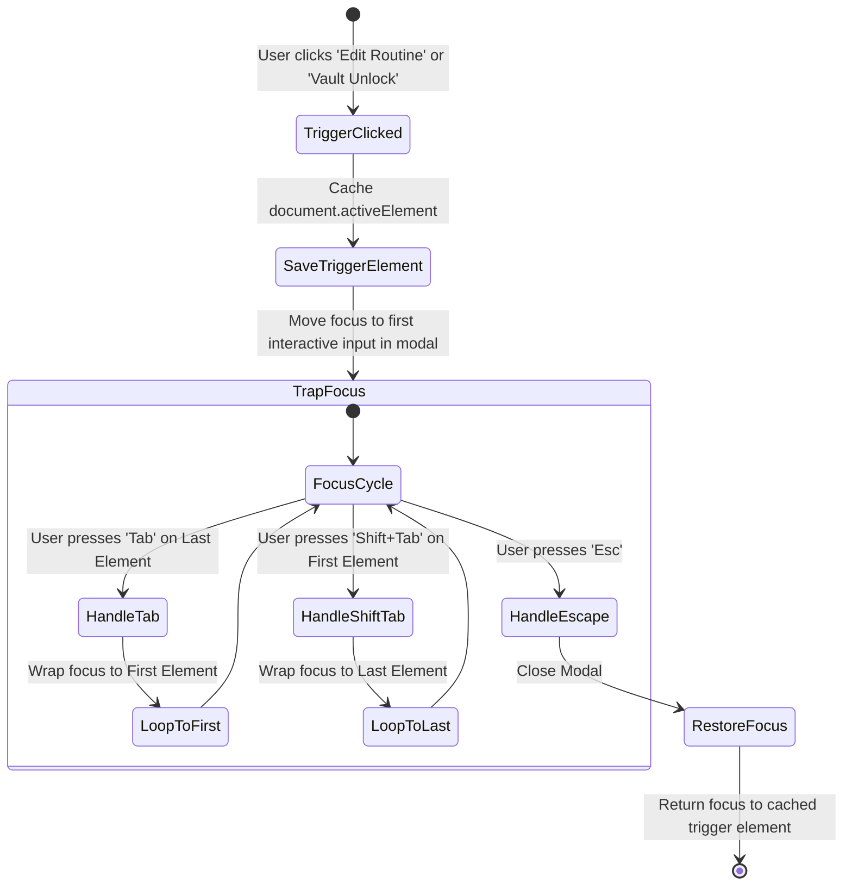

# Daily Compass — UI/UX Design System Specification (v2.1.0 Pro Max Plus)
**Codename:** Nordic Twilight v2.1 / Calm Privacy & Temporal Sculpting  
**Version:** 2.1.0 Pro Max Plus  
**Status:** Canonical Implementation Standard  
**Document Context:** Extension to [DESIGN_SYSTEM.md](file:///c:/Users/Ivan/Pictures/Daily%20Tracker/docs/DESIGN_SYSTEM.md) and [V2_DESIGN_SYSTEM.md](file:///c:/Users/Ivan/Pictures/Daily%20Tracker/docs/V2_DESIGN_SYSTEM.md) | Synchronized with [V2_1_EDITOR_AND_PRIVACY_SPECS.md](file:///c:/Users/Ivan/Pictures/Daily%20Tracker/docs/V2_1_EDITOR_AND_PRIVACY_SPECS.md) | Followed by [V2_2_DESIGN_SYSTEM.md](file:///c:/Users/Ivan/Pictures/Daily%20Tracker/docs/V2_2_DESIGN_SYSTEM.md)  
**Target Environment:** Local-First Web Cockpit / Mobile-First PWA (Zero External CDN/Framework Dependencies)

---

## 1. Executive Vision: The "Pro Max Plus" Philosophy

The **v2.1.0 Pro Max Plus** release introduces two critical human-centric capabilities designed for high-stress, sensory-sensitive environments:

1. **Temporal Sculpting (Routine Block Editor Modal):**  
   Scheduling daily blocks should never feel like filling out a tax form. When users face rigid, punitive calendar inputs, executive dysfunction often leads to total avoidance. The Routine Block Editor Modal makes routine construction soothing, tactile, and flexible:
   - Dynamic visual duration calculation (`1h 30m`) eliminates cognitive mental math.
   - Segmented category pills with soothing pastel accents allow instant visual grouping.
   - Frictionless micro-steps builder with drag-and-drop tactile affordances and keyboard reordering.
   - Non-punitive, compassionate validation (soft amber warnings instead of jarring red screen flashes).

2. **Sanctuary Privacy (Privacy Vault & Balance Masking):**  
   Neurodivergent individuals and remote workers frequently use their personal laptops and mobile devices in public transit, coffee shops, open offices, or around family. The fear of "shoulder surfing"—someone glancing at debt tallies, confidential brain dumps, or remaining safe-to-spend balances—induces acute hypervigilance.
   - The **"Peek Privacy" Header Action** instantly cloaks sensitive figures beneath a frosted slate Gaussian blur (`backdrop-filter: blur(8px)`).
   - An optional **PIN Entry Vault** secures financial ledgers and personal scratchpads behind a tactile, sensory-safe keypad with gentle failure animations and non-punitive rate limiting.

---

## 2. Master CSS Design Tokens (v2.1 Palette Calibration)

These tokens adhere strictly to the calibrated **Nordic Twilight** lighting model: deep midnight canvas (`#181c24`), balanced slate card containers (`#222734`), elevated interactive panels (`#2b3242`), and reassuring organic accents (`#4a7bb0`, `#60cd9b`, `#d9777f`, `#e5a960`, `#bc8cff`, `#38bdf8`).

```css
/* ==========================================================================
   DAILY COMPASS v2.1 PRO MAX PLUS — DESIGN SYSTEM TOKENS
   Calibrated Nordic Twilight Palette & Sensory Ergonomics
   ========================================================================== */

:root {
  /* --------------------------------------------------------------------------
     1. SURFACES & ELEVATION (Calm Twilight Foundation)
     -------------------------------------------------------------------------- */
  --bg-canvas: #181c24;               /* Deep slate canvas; zero glare */
  --bg-canvas-subtle: #1c222e;        /* Inset fields, well tracks */
  --bg-card: #222734;                 /* Base container card */
  --bg-card-hover: #262c3b;           /* Interactive hover elevation */
  --bg-card-elevated: #2b3242;        /* Modals, bottom sheets, floating popovers */
  --bg-card-raised: #323a4d;          /* Micro-step items, active selection pills */
  --bg-overlay: rgba(14, 17, 23, 0.82); /* Modal backdrop frost filter */

  /* --------------------------------------------------------------------------
     2. BORDERS & SEPARATORS
     -------------------------------------------------------------------------- */
  --border-subtle: #2d3546;           /* Subtle card divider line */
  --border-muted: #3a4459;            /* Input borders, inactive pills */
  --border-focus: #4a7bb0;            /* Accessible focus ring (WCAG AAA) */
  --border-hover: #505e7b;            /* Hover edge response */

  /* --------------------------------------------------------------------------
     3. HIGH-LEGIBILITY TEXT
     -------------------------------------------------------------------------- */
  --text-primary: #e6edf3;            /* Soft chalk white; 0% photophobic glare */
  --text-secondary: #9aa5b5;          /* Descriptive guidance, secondary labels */
  --text-muted: #6e7681;              /* Disabled glyphs, drag grips, metadata */
  --text-inverse: #0d1117;            /* High contrast dark glyphs on badges */

  /* --------------------------------------------------------------------------
     4. V2.1 CALIBRATED ACCENT MATRIX
     -------------------------------------------------------------------------- */
  /* Focus Cobalt (Active blocks, primary CTA, timer sprint) */
  --accent-cobalt: #4a7bb0;
  --accent-cobalt-soft: #689bd4;
  --accent-cobalt-bg: rgba(74, 123, 176, 0.16);
  --accent-cobalt-border: rgba(74, 123, 176, 0.45);

  /* Calming Sage / Mint (Completed steps, rest routine, verified PIN) */
  --accent-sage: #60cd9b;
  --accent-sage-soft: #7ee0b3;
  --accent-sage-bg: rgba(96, 205, 155, 0.15);
  --accent-sage-border: rgba(96, 205, 155, 0.42);

  /* Gentle Coral / Rose (Non-punitive warning, delete action, masked status) */
  --accent-rose: #d9777f;
  --accent-rose-soft: #ea939a;
  --accent-rose-bg: rgba(217, 119, 127, 0.14);
  --accent-rose-border: rgba(217, 119, 127, 0.40);

  /* Warm Honey / Amber (Duration chip, nourishment routine, gentle cautions) */
  --accent-amber: #e5a960;
  --accent-amber-soft: #f3be7d;
  --accent-amber-bg: rgba(229, 169, 96, 0.15);
  --accent-amber-border: rgba(229, 169, 96, 0.42);

  /* Serene Violet (Creative routine, notes, privacy vault lock) */
  --accent-violet: #bc8cff;
  --accent-violet-bg: rgba(188, 140, 255, 0.14);
  --accent-violet-border: rgba(188, 140, 255, 0.40);

  /* Breeze Cyan (Movement routine, hydration) */
  --accent-cyan: #38bdf8;
  --accent-cyan-bg: rgba(56, 189, 248, 0.14);
  --accent-cyan-border: rgba(56, 189, 248, 0.40);

  /* --------------------------------------------------------------------------
     5. PRIVACY VAULT & MASKING TOKENS
     -------------------------------------------------------------------------- */
  --privacy-blur-radius: 8px;
  --privacy-mask-bg: rgba(34, 39, 52, 0.65);
  --privacy-dot-idle: #3a4459;
  --privacy-dot-filled: #60cd9b;
  --privacy-dot-error: #d9777f;

  /* --------------------------------------------------------------------------
     6. MOTION & SPRINGS
     -------------------------------------------------------------------------- */
  --ease-calm: cubic-bezier(0.16, 1, 0.3, 1);
  --ease-spring: cubic-bezier(0.175, 0.885, 0.32, 1.275);
  --duration-fast: 150ms;
  --duration-normal: 250ms;
  --duration-modal: 320ms;
}

/* ==========================================================================
   PRIVACY MASKING STYLES
   ========================================================================== */

/* Obfuscates numbers, currency, and private journal notes */
.privacy-masked {
  filter: blur(var(--privacy-blur-radius)) !important;
  user-select: none !important;
  transition: filter var(--duration-normal) var(--ease-calm),
              opacity var(--duration-fast) ease;
  pointer-events: none;
}

/* Temporary peek-on-hover when privacy mode is unlocked */
.privacy-peek-allowed:hover .privacy-masked {
  filter: blur(0px) !important;
  pointer-events: auto;
}

/* Non-punitive gentle shake keyframe (6px amplitude, smooth damping) */
@keyframes gentle-shake {
  0%, 100% { transform: translateX(0); }
  20%      { transform: translateX(-6px); }
  40%      { transform: translateX(5px); }
  60%      { transform: translateX(-4px); }
  80%      { transform: translateX(2px); }
}

.shake-gentle {
  animation: gentle-shake 360ms var(--ease-calm);
}
```

---

## 3. Routine Block Editor Modal Specification

### 3.1 UX Architecture & Sensory Intent
Setting up a schedule should feel like sculpting playdough, not programming a microcontroller.
The Routine Block Editor provides:
1. **Fluid Time Bounds with Instant Duration Telemetry:** As the user changes start and end times, an adjacent **Duration Chip** automatically updates (e.g. `⏱ 1h 30m`). If the schedule wraps past midnight or spans an unusual length, a non-punitive gentle caution clarifies the exact span.
2. **Category Selector Pills:** Six distinct cognitive modes (Focus, Rest, Nourishment, Routine, Creative, Movement) with subtle pastel accent borders and icons. Clicking a pill instantly re-themes the routine preview.
3. **Atomic Micro-Steps Adder:** Allows the user to decompose large routines into manageable micro-steps. Includes drag grip handles (`⋮⋮`), inline delete buttons (`×`), and an automatic Enter-key append input.
4. **Compassionate Non-Punitive Feedback:** Instead of screaming in bright red with disabled buttons, the form uses warm honey/amber callouts (`#e5a960`) explaining what is happening and offering 1-click auto-fixes.

### 3.2 Visual Component Schematic (ASCII Blueprint)

```
+-----------------------------------------------------------------------------------+
| ✏️ EDIT ROUTINE BLOCK                                                       [ × ] |
|-----------------------------------------------------------------------------------|
|                                                                                   |
|  ROUTINE TITLE                                                                    |
|  +-----------------------------------------------------------------------------+  |
|  | Morning Focus & Deep Architecture                                           |  |
|  +-----------------------------------------------------------------------------+  |
|                                                                                   |
|  CATEGORY & MODE                                                                  |
|  +-----------------------------------------------------------------------------+  |
|  | [🎯 Focus]*  [🌿 Rest]  [🥗 Nourish]  [🔄 Routine]  [🎨 Creative]  [🏃 Move] |  |
|  +-----------------------------------------------------------------------------+  |
|  (* Selected: Subtle #4a7bb0 accent border & gentle cobalt glow)                  |
|                                                                                   |
|  TIME RANGE & DURATION                                                            |
|  +----------------------+      +----------------------+     +------------------+  |
|  | Start: [ 09:00 AM ]  |  to  | End:   [ 10:30 AM ]  | --> | ⏱ 1h 30m         |  |
|  +----------------------+      +----------------------+     +------------------+  |
|  Quick Adjust: [ -15m ] [ +15m ] [ +30m ] [ Align to Next Routine ]                |
|                                                                                   |
|  ATOMIC MICRO-STEPS (Break down overwhelm into 1-action steps):                   |
|  +-----------------------------------------------------------------------------+  |
|  | ⋮⋮  1. Clear desktop and pour glass of fresh water              [ × Delete ]|  |
|  | ⋮⋮  2. Review architectural requirements in doc                 [ × Delete ]|  |
|  | ⋮⋮  3. Draft component CSS tokens and layout schematics        [ × Delete ]|  |
|  +-----------------------------------------------------------------------------+  |
|  +--------------------------------------------------------------+ +------------+  |
|  | [ + Add next micro-step...                                 ] | | [ + Add ]  |  |
|  +--------------------------------------------------------------+ +------------+  |
|                                                                                   |
|  ℹ️ SOFT GUIDANCE / VALIDATION CUE:                                               |
|  (Gentle Amber #e5a960: "This block fits neatly between Morning Anchor & Lunch")  |
|                                                                                   |
|-----------------------------------------------------------------------------------|
| [ 🗑️ Delete Routine ]                              [ Cancel ]  [ Save Routine ]    |
+-----------------------------------------------------------------------------------+
```

### 3.3 Category System Matrix

| Category | Icon | Accent Token | Border / Background | Cognitive Purpose |
| :--- | :---: | :--- | :--- | :--- |
| **Focus** | 🎯 | `--accent-cobalt` (`#4a7bb0`) | `rgba(74, 123, 176, 0.45)` / `0.16` | Deep analytical work, writing, coding |
| **Rest** | 🌿 | `--accent-sage` (`#60cd9b`) | `rgba(96, 205, 155, 0.42)` / `0.15` | Sensory decompression, nap, meditation |
| **Nourishment** | 🥗 | `--accent-amber` (`#e5a960`) | `rgba(229, 169, 96, 0.42)` / `0.15` | Meal prep, mindful dining, hydration |
| **Routine** | 🔄 | `--text-secondary` (`#9aa5b5`)| `rgba(154, 165, 181, 0.35)` / `0.12` | Admin tasks, email triage, tidying |
| **Creative** | 🎨 | `--accent-violet` (`#bc8cff`)| `rgba(188, 140, 255, 0.40)` / `0.14` | Brainstorming, design, art, music |
| **Movement** | 🏃 | `--accent-cyan` (`#38bdf8`) | `rgba(56, 189, 248, 0.40)` / `0.14` | Walking, stretching, workout, somatic |

### 3.4 Live Duration Chip Engine & Non-Punitive Validation Rules
1. **Live Calculation:** Let $t_1 = \text{start minutes}$ and $t_2 = \text{end minutes}$.
   - If $t_2 \ge t_1$: $\Delta = t_2 - t_1$.
   - If $t_2 < t_1$ (overnight wrap): $\Delta = (1440 - t_1) + t_2$.
   - Display format: $\Delta \ge 60$ displays `${h}\text{h }${m}\text{m}`, else `${m}\text{m}`.
2. **Sensory Guidance (Zero Punitive Red):**
   - *Case A: Duration under 10 minutes:* Duration chip turns soft amber (`#e5a960`) with message: *"Short micro-burst (e.g. 5m quick reset). Make sure you have enough time to breathe."*
   - *Case B: Duration over 3 hours:* Duration chip turns soft lavender (`#bc8cff`) with hint: *"Consider adding a 10m Rest block in between to prevent mental fatigue."*
   - *Case C: End time before start time:* Shows calm amber pill badge: *"Spans overnight into next morning (Ends tomorrow at {end_time})"*.

### 3.5 DOM Layout Blueprint & Structural Markup

```html
<!-- Routine Block Editor Modal Backdrop -->
<div class="modal-backdrop" id="modal-routine-editor" role="dialog" aria-modal="true" aria-labelledby="routine-editor-title">
  <div class="modal-container modal-md routine-editor-card">
    
    <!-- Modal Header -->
    <header class="modal-header">
      <div class="modal-header-text">
        <h2 class="modal-title" id="routine-editor-title">✏️ Edit Routine Block</h2>
        <p class="modal-subtitle">Design a calm, achievable flow for your daily rhythm</p>
      </div>
      <button class="btn-icon-action" id="btn-close-routine-editor" aria-label="Close dialog (Escape)">&times;</button>
    </header>

    <form id="form-routine-editor" class="routine-editor-form">
      <input type="hidden" id="routine-id" value="">

      <!-- Routine Title Input -->
      <div class="form-group">
        <label for="routine-title-input" class="form-label">Routine Block Name</label>
        <input type="text" id="routine-title-input" class="form-input" required
               placeholder="e.g. Morning Focus & Deep Architecture" maxlength="60" autocomplete="off">
      </div>

      <!-- Category Selector Pills (Radio Group) -->
      <div class="form-group">
        <span class="form-label" id="category-group-label">Category & Mood</span>
        <div class="category-pill-grid" role="radiogroup" aria-labelledby="category-group-label">
          <label class="category-pill-btn active" data-category="focus">
            <input type="radio" name="routine-category" value="focus" checked class="sr-only">
            <span class="pill-icon">🎯</span>
            <span class="pill-name">Focus</span>
          </label>
          <label class="category-pill-btn" data-category="rest">
            <input type="radio" name="routine-category" value="rest" class="sr-only">
            <span class="pill-icon">🌿</span>
            <span class="pill-name">Rest</span>
          </label>
          <label class="category-pill-btn" data-category="nourish">
            <input type="radio" name="routine-category" value="nourish" class="sr-only">
            <span class="pill-icon">🥗</span>
            <span class="pill-name">Nourish</span>
          </label>
          <label class="category-pill-btn" data-category="routine">
            <input type="radio" name="routine-category" value="routine" class="sr-only">
            <span class="pill-icon">🔄</span>
            <span class="pill-name">Routine</span>
          </label>
          <label class="category-pill-btn" data-category="creative">
            <input type="radio" name="routine-category" value="creative" class="sr-only">
            <span class="pill-icon">🎨</span>
            <span class="pill-name">Creative</span>
          </label>
          <label class="category-pill-btn" data-category="movement">
            <input type="radio" name="routine-category" value="movement" class="sr-only">
            <span class="pill-icon">🏃</span>
            <span class="pill-name">Move</span>
          </label>
        </div>
      </div>

      <!-- Time Range & Duration Block -->
      <div class="time-range-row">
        <div class="form-group time-field">
          <label for="routine-start-time" class="form-label">Start Time</label>
          <input type="time" id="routine-start-time" class="form-input time-input" value="09:00" required>
        </div>

        <div class="time-separator" aria-hidden="true">→</div>

        <div class="form-group time-field">
          <label for="routine-end-time" class="form-label">End Time</label>
          <input type="time" id="routine-end-time" class="form-input time-input" value="10:30" required>
        </div>

        <div class="duration-badge-wrapper">
          <span class="form-label">Duration</span>
          <div class="duration-chip" id="routine-duration-chip" aria-live="polite">
            <span class="chip-clock-icon">⏱</span>
            <strong id="duration-chip-text">1h 30m</strong>
          </div>
        </div>
      </div>

      <!-- Quick Stepper Pills -->
      <div class="quick-adjust-bar">
        <span class="adjust-label">Quick Nudge:</span>
        <button type="button" class="btn-micro-pill" data-nudge="-15">-15m</button>
        <button type="button" class="btn-micro-pill" data-nudge="+15">+15m</button>
        <button type="button" class="btn-micro-pill" data-nudge="+30">+30m</button>
        <button type="button" class="btn-micro-pill" id="btn-snap-next">Align to Next Block</button>
      </div>

      <!-- Atomic Micro-Steps Adder -->
      <div class="form-group micro-steps-section">
        <div class="micro-steps-header">
          <label class="form-label">Atomic Micro-Steps (One Action at a Time)</label>
          <span class="micro-steps-counter" id="steps-counter-label">3 steps</span>
        </div>
        
        <!-- Drag-and-Drop / Reorderable Steps List -->
        <ul class="micro-steps-list" id="routine-steps-list" role="list">
          <li class="micro-step-item" draggable="true" data-step-id="step-1">
            <span class="drag-grip" title="Drag to reorder (or use Alt+Up/Down)" aria-hidden="true">⋮⋮</span>
            <span class="step-num">1</span>
            <span class="step-text">Clear desktop and pour glass of fresh water</span>
            <button type="button" class="btn-step-delete" aria-label="Remove step 1">&times;</button>
          </li>
          <li class="micro-step-item" draggable="true" data-step-id="step-2">
            <span class="drag-grip" title="Drag to reorder" aria-hidden="true">⋮⋮</span>
            <span class="step-num">2</span>
            <span class="step-text">Review architectural requirements in doc</span>
            <button type="button" class="btn-step-delete" aria-label="Remove step 2">&times;</button>
          </li>
          <li class="micro-step-item" draggable="true" data-step-id="step-3">
            <span class="drag-grip" title="Drag to reorder" aria-hidden="true">⋮⋮</span>
            <span class="step-num">3</span>
            <span class="step-text">Draft component CSS tokens and layout schematics</span>
            <button type="button" class="btn-step-delete" aria-label="Remove step 3">&times;</button>
          </li>
        </ul>

        <!-- Inline Add Step Row -->
        <div class="add-step-row">
          <input type="text" id="new-step-input" class="form-input input-add-step"
                 placeholder="Type next micro-action (Press Enter to append)..." autocomplete="off">
          <button type="button" class="btn-secondary" id="btn-add-step">+ Add Step</button>
        </div>
      </div>

      <!-- Empathetic Guidance Banner -->
      <div class="guidance-banner" id="routine-guidance-banner" role="status">
        <span class="guidance-icon">💡</span>
        <span class="guidance-text" id="routine-guidance-text">This block fits comfortably into your morning routine stream.</span>
      </div>

      <!-- Modal Footer Action Bar -->
      <div class="modal-footer">
        <button type="button" class="btn-danger-ghost" id="btn-delete-routine">🗑️ Delete Routine</button>
        <div class="footer-right-actions">
          <button type="button" class="btn-secondary" id="btn-cancel-routine">Cancel</button>
          <button type="submit" class="btn-primary" id="btn-save-routine">Save Routine</button>
        </div>
      </div>
    </form>
  </div>
</div>
```

---

## 4. Privacy Vault & Balance Masking Specification

### 4.1 UX Architecture & Threat Model
In neurodivergent life management, finances, debt relations, and personal logs are intensely private. Accidental exposure causes vulnerability and shame.

The **Privacy Vault & Masking System** operates in two synchronized tiers:
1. **Tier 1 — Ambient Shielding ("Peek Privacy" Eye Toggle):**  
   A high-visibility eye toggle in the global top navigation bar (`Alt + P`). In 1 click or keypress, all sensitive elements (financial balances, debt amounts, note bodies, safe-to-spend tallies) receive the `.privacy-masked` class, applying a rich Gaussian blur (`backdrop-filter: blur(8px)`).
2. **Tier 2 — Vault Authentication (PIN Entry Modal):**  
   If the user activates Vault Lock in settings, sensitive views (Finance, Debts, Scratchpad) require entering a 4-to-6 digit PIN. 
   - Non-punitive tactile keypad with circular keys (48px target).
   - Filled sage dot indicators.
   - Gentle, non-startling horizontal shake on wrong entry (`shake-gentle`).
   - Friendly rate-limiting with a circular progress countdown after 3 failed attempts.

### 4.2 Visual Component Schematic (ASCII Blueprint)

```
TOP HEADER INTEGRATION:
+-----------------------------------------------------------------------------------+
|  [⚡ 60% Steady]   09:30 AM   [ 👁️ Shielded (Alt+P) ]   [ Lost? Center ]  [ 🔍 Cmd+K ] |
+-----------------------------------------------------------------------------------+
                                        |
                 (Click toggles Privacy Mode On / Off)

MASKED BALANCE IN CASH COMPASS CARD:
+-----------------------------------------------------------------------------------+
| DAILY CASH COMPASS                                           [ + Quick Add ]      |
|                                                                                   |
|  Safe-to-Spend Left:       [  ░░░░░░░░░░░░░  ]  (Masked by 8px blur)              |
|  Spent Today:              [  ░░░░░░░░░░░░░  ]                                    |
|                                                                                   |
|  (Hover or click-and-hold reveals temporarily if "Peek on Hover" is enabled)      |
+-----------------------------------------------------------------------------------+

PIN ENTRY MODAL (VAULT UNLOCK):
+-----------------------------------------------------------------------------------+
| 🔒 ENTER PRIVACY VAULT PIN                                                  [ × ] |
|-----------------------------------------------------------------------------------|
|                                                                                   |
|                       Enter your 4-digit security PIN                             |
|                                                                                   |
|                              ( • ) ( • ) ( ○ ) ( ○ )                              |
|                              [ 2 of 4 Digits Entered ]                            |
|                                                                                   |
|                       +---------+---------+---------+                             |
|                       |    1    |    2    |    3    |                             |
|                       +---------+---------+---------+                             |
|                       |    4    |    5    |    6    |                             |
|                       +---------+---------+---------+                             |
|                       |    7    |    8    |    9    |                             |
|                       +---------+---------+---------+                             |
|                       | Clear C |    0    | Back ⌫  |                             |
|                       +---------+---------+---------+                             |
|                                                                                   |
|     ℹ️ Feedback: Soft gentle shake on incorrect PIN. 3 attempts remaining.         |
|                                                                                   |
|-----------------------------------------------------------------------------------|
|                                                    [ Cancel / Keep Shield Active ]|
+-----------------------------------------------------------------------------------+
```

### 4.3 PIN Keypad Dialing & Tactile Feedback Rules
1. **Keypad Dimensions:** 3x4 grid with `min-height: 52px` per digit button.
2. **Audio/Haptic Integration:**
   - Soft procedural woodblock tick (synthesized via Web Audio API, ~500Hz short transient, zero external audio).
   - Optional mild mobile haptic vibration (`navigator.vibrate(10)`).
3. **Dot Indicator States:**
   - **Empty:** Slate-bordered hollow circle (`#3a4459`).
   - **Filled:** Glowing calming Sage Green circle (`#60cd9b` with soft glow).
   - **Error:** Gentle coral shake (`#d9777f`), clearing smoothly after 400ms.
4. **Lockout Protection:** After 3 consecutive incorrect PIN attempts:
   - Keypad is disabled (`pointer-events: none; opacity: 0.5`).
   - 30-second soothing countdown displays: *"Sensory pause: Please take a deep breath. Retry in 28s."*

### 4.4 DOM Layout Blueprint & Structural Markup

```html
<!-- 1. Header Peek Privacy Toggle Button -->
<button class="btn-privacy-toggle active" id="btn-peek-privacy" title="Toggle Balance & Notes Privacy (Alt+P)" aria-pressed="true">
  <svg class="privacy-eye-icon" width="18" height="18" viewBox="0 0 24 24" fill="none" stroke="currentColor" stroke-width="2" aria-hidden="true">
    <!-- Masked Eye Glyph (Eye with Slash) -->
    <path class="eye-open" d="M1 12s4-8 11-8 11 8 11 8-4 8-11 8-11-8-11-8z"/>
    <circle class="eye-pupil" cx="12" cy="12" r="3"/>
    <line class="eye-slash" x1="2" y1="2" x2="22" y2="22"/>
  </svg>
  <span class="privacy-label" id="privacy-status-text">Privacy: On</span>
</button>

<!-- 2. PIN Entry Modal Backdrop -->
<div class="modal-backdrop" id="modal-pin-entry" role="dialog" aria-modal="true" aria-labelledby="pin-modal-title">
  <div class="modal-container modal-sm pin-entry-card" id="pin-card-container">
    
    <header class="modal-header">
      <div class="modal-header-text" style="text-align: center; width: 100%;">
        <div class="pin-lock-icon-wrapper" aria-hidden="true">
          <svg width="24" height="24" viewBox="0 0 24 24" fill="none" stroke="currentColor" stroke-width="2">
            <rect x="3" y="11" width="18" height="11" rx="2" ry="2"/>
            <path d="M7 11V7a5 5 0 0 1 10 0v4"/>
          </svg>
        </div>
        <h2 class="modal-title" id="pin-modal-title">Unlock Privacy Vault</h2>
        <p class="modal-subtitle">Enter your 4-digit security PIN to view financial ledgers</p>
      </div>
    </header>

    <!-- Visual PIN Dots -->
    <div class="pin-dots-display" id="pin-dots-container" role="status" aria-label="0 of 4 digits entered">
      <div class="pin-dot" id="dot-0"></div>
      <div class="pin-dot" id="dot-1"></div>
      <div class="pin-dot" id="dot-2"></div>
      <div class="pin-dot" id="dot-3"></div>
    </div>

    <!-- Hidden Native Input for Physical Keyboards & Screen Readers -->
    <input type="password" id="pin-hidden-input" inputmode="numeric" pattern="[0-9]*" maxlength="4"
           class="sr-only" autocomplete="one-time-code" aria-label="Enter 4-digit PIN">

    <!-- Tactile Touch Keypad -->
    <div class="pin-keypad-grid" role="group" aria-label="PIN numeric keypad">
      <button type="button" class="pin-key" data-digit="1">1</button>
      <button type="button" class="pin-key" data-digit="2">2</button>
      <button type="button" class="pin-key" data-digit="3">3</button>
      <button type="button" class="pin-key" data-digit="4">4</button>
      <button type="button" class="pin-key" data-digit="5">5</button>
      <button type="button" class="pin-key" data-digit="6">6</button>
      <button type="button" class="pin-key" data-digit="7">7</button>
      <button type="button" class="pin-key" data-digit="8">8</button>
      <button type="button" class="pin-key" data-digit="9">9</button>
      <button type="button" class="pin-key pin-key-fn" data-action="clear" aria-label="Clear PIN">C</button>
      <button type="button" class="pin-key" data-digit="0">0</button>
      <button type="button" class="pin-key pin-key-fn" data-action="backspace" aria-label="Backspace">⌫</button>
    </div>

    <!-- Non-Punitive Feedback Area -->
    <div class="pin-feedback-msg" id="pin-feedback-msg" aria-live="polite">
      <span>Protected by local offline encryption</span>
    </div>

    <!-- Rate Limiting Timer (Initially Hidden) -->
    <div class="pin-lockout-timer" id="pin-lockout-timer" style="display: none;" role="alert">
      <span>Sensory pause: Take a breath. Retry in <strong id="lockout-seconds">30</strong>s</span>
    </div>

    <div class="modal-footer" style="justify-content: center; margin-top: 10px;">
      <button type="button" class="btn-secondary" id="btn-cancel-pin">Cancel & Keep Masked</button>
    </div>
  </div>
</div>
```

---

## 5. Accessibility, ARIA & Ergonomic Specifications

### 5.1 Modal Focus Trap Pattern (WAI-ARIA 1.2 Compliant)
Every modal in v2.1 implements a strict, accessible focus trap algorithm:



#### Focus Trap Implementation Spec:
1. When the modal opens:
   - Identify all focusable elements: `button, [href], input, select, textarea, [tabindex]:not([tabindex="-1"])`.
   - Prevent background scrolling (`document.body.style.overflow = 'hidden'`).
   - Store the triggering button in `this._lastActiveElement`.
   - Focus the first interactive element or title after animation frame.
2. Intercept `keydown`:
   - If `e.key === 'Tab'`:
     - If `e.shiftKey` and `document.activeElement === firstElement`, prevent default and focus `lastElement`.
     - If `!e.shiftKey` and `document.activeElement === lastElement`, prevent default and focus `firstElement`.
   - If `e.key === 'Escape'`: Close modal cleanly and return focus.

### 5.2 Micro-Steps Keyboard Reordering Matrix
To guarantee full keyboard accessibility for neurodivergent and motor-impaired users who cannot use mouse drag-and-drop:
- **`Alt + ArrowUp`**: Moves focused micro-step one position higher in the list.
- **`Alt + ArrowDown`**: Moves focused micro-step one position lower in the list.
- **`Delete` or `Backspace`** (when focused on step item): Triggers gentle inline deletion.
- **Screen Reader Announcement:** Live region notifies: *"Step '{step_text}' moved to position {index} of {total}"*.

### 5.3 Privacy Screen Reader Directives
When `.privacy-masked` is active:
- Screen readers must not announce masked debt figures or balance values aloud if someone nearby might overhear.
- Elements with `.privacy-masked` dynamically append `aria-label="Balance masked for privacy. Press Alt+P to unmask."`
- Upon pressing `Alt+P`, the live region announces: *"Privacy shielding disabled. Balances visible."* or *"Privacy shielding enabled. Balances obscured."*

---

## 6. Responsive Layout Blueprints (Mobile & Desktop)

### 6.1 Mobile Bottom-Sheet Viewport (390px Width)
On mobile devices, both the Routine Block Editor and the PIN Entry Modal transition from centered dialogs into ergonomic **Bottom Sheets**:
- Anchored to the bottom screen bezel with rounded top corners (`border-radius: 24px 24px 0 0`).
- Pull handle bar (`40px x 4px` slate pill) at the top of the sheet.
- Minimum tap target of `48px` for all buttons, thumb-reachable without awkward upper-screen stretching.

```
+--------------------------------------------------+
|                  (Dimmed Backdrop)               |
|                                                  |
|  +--------------------------------------------+  |
|  |                   [====]                   |  | <- Drag Handle
|  |  ✏️ Edit Routine Block                 [×]  |  |
|  |--------------------------------------------|  |
|  |  Block Name: [ Morning Deep Work       ]   |  |
|  |  Mood: [🎯 Focus] [🌿 Rest] [🥗 Nourish]   |  |
|  |  Time: [ 09:00 AM ] to [ 10:30 AM ]        |  |
|  |  Duration: [ ⏱ 1h 30m ]                    |  |
|  |  Steps:                                    |  |
|  |  • 1. Clear desk & pour water          [×] |  |
|  |  • 2. Review specs                     [×] |  |
|  |  [ + Add step...             ] [ + Add ]   |  |
|  |--------------------------------------------|  |
|  |  [ 🗑️ Delete ]         [ Cancel ] [ Save ] |  |
|  +--------------------------------------------+  |
+--------------------------------------------------+
```

### 6.2 Desktop Cockpit Dialog (1440px Width)
- Centered viewport dialog with max width `560px` (Routine Editor) and `380px` (PIN Vault).
- Subtle ambient drop shadow (`0 20px 50px rgba(0, 0, 0, 0.70)`).
- Instant keyboard shortcuts displayed as discrete `<kbd>` badges (`Esc to cancel`, `Ctrl+Enter to save`).

---

## 7. Summary & Implementation Handoff

The **v2.1.0 Pro Max Plus** specification expands Daily Compass with:
1. **Sensory-Kind Routine Sculpting:** Non-punitive time calculations, dynamic duration telemetry, category mood grouping, and accessible micro-step decomposition.
2. **Sanctuary Privacy Protection:** 1-click global balance masking, seamless Gaussian blur filters, and a sensory-calm PIN authentication vault.

Both systems fully preserve our **zero-dependency, offline-first native web architecture** and uncompromising **Nordic Twilight** aesthetic.
