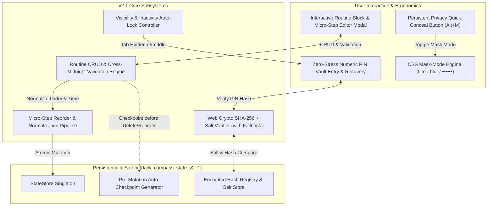
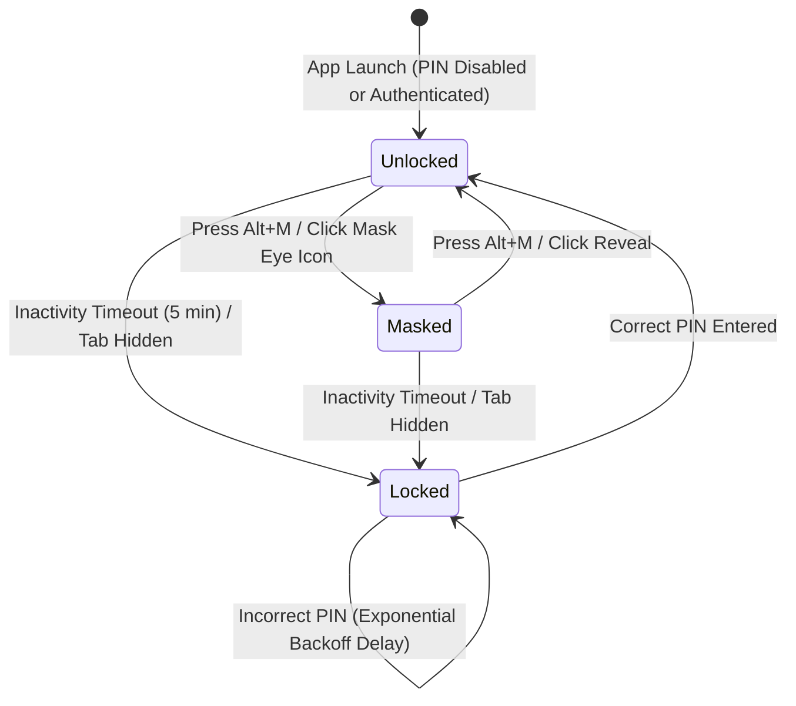

# 🧭 Daily Compass v2.1.0 Pro Max Plus — Formal Specifications
# Interactive Routine & Activity Block Editor + Privacy Vault & Local PIN / Balance Masking

**Document Version:** 2.1.0-PRO-PLUS-SPEC  
**Status:** Canonical Engineering Specification  
**Target Environment:** Local-First Web Application / Offline Progressive Web App (PWA)  
**Core Principles:** Ponytail Simplicity, Zero External Dependencies, Native Web APIs (Web Crypto API, CSS Filter/Attr, Vanilla ES Modules), Cognitive Accessibility for Executive Dysfunction & ADHD.

---

## 1. Executive Summary & System Overview

Daily Compass v2.1.0 ("Pro Max Plus") addresses two vital friction points identified in user research with neurodivergent individuals:
1. **The Routine Edit Paralysis:** In v1.0 and v2.0, routine blocks and micro-steps were largely pre-configured with limited in-app structural reconfiguration. Users whose lives change (e.g. shift workers, students, fluctuating sleep schedules) experience severe anxiety when unable to tailor their routine blocks, reorder micro-steps, or resolve overlapping schedules without editing raw JSON.
2. **The Public Vulnerability Dilemma ("Shoulder-Surfing Anxiety"):** Overwhelmed users frequently track finances (daily cash cap, safe-to-spend, debt balances) and private brain dumps in public spaces (coffee shops, public transit, shared offices, family living rooms). The dread of someone glancing at their screen causes app avoidance at the exact moment they need grounding.



---

## 2. Interactive Routine & Activity Block Editor

### 2.1 Mental Model & Cognitive Pacing for ADHD
Users with ADHD, autism, or executive dysfunction suffer from **"blank canvas paralysis"** and **"form intimidation"**:
- **Anti-Overwhelm Progressive Disclosure:** The editor never presents a wall of 15 input fields. It opens in a calm 3-section card:
  1. *Identity & Timing* (Name, category pill, start/end time, color picker).
  2. *Micro-Step Stream* (Drag-or-tap reordering, inline atomic micro-steps, duration tally).
  3. *Contextual Safety Summary* (Calculated duration vs sum of steps, cross-midnight badge, collision status).
- **Template Starters:** Instead of forcing creation from scratch, the modal offers 1-tap archetypes:
  - 🌅 `Morning Awakening & Somatic Warmup` (45m)
  - 🎯 `Pomodoro Deep Work Sprint` (90m)
  - 🥗 `Screen-Free Mid-Day Fuel` (45m)
  - 🧘 `Sensory Decompression & Walk` (30m)
  - 🌙 `Night Wind-Down & Sleep Hygiene` (60m)
- **Inline Safety Warnings, Zero Hostile Blockers:** If a routine overlaps another or micro-steps exceed the block's duration, the editor displays a calm amber informational badge rather than disabling the save button or flashing red error alerts.

### 2.2 Component Hierarchy & Visual Wireframe
```
+---------------------------------------------------------------------------------------------------+
| ✏️ EDIT ROUTINE BLOCK                                                    [ ✕ Close / Discard ]    |
+---------------------------------------------------------------------------------------------------+
| Routine Title:    [ Morning Awakening & Somatic Warmup                ]                           |
| Category:         ( ) Wellness  (•) Focus  ( ) Chores  ( ) Rest  ( ) Evening                      |
| Time Bounds:      Start: [ 07:00 ]   End: [ 08:30 ]   Total Duration: 90 min                      |
| Block Color:      [ 🔵 Sky ]  [ 🟣 Lavender ]  [ 🟢 Sage ]  [ 🟠 Amber ]  [ 🔴 Rose ]             |
| Cross-Midnight:   [ ] Block crosses midnight into next day (e.g. 23:00 -> 01:30)                  |
+---------------------------------------------------------------------------------------------------+
| 📋 ORDERED MICRO-STEPS (Total: 70 min / 90 min allocated • 20 min buffer remaining)              |
|                                                                                                   |
| 1. [::] Drink 500ml water & take vitamins      [ 10 min ]  [ ↑ ] [ ↓ ]  [ 🗑️ ]                    |
| 2. [::] Gentle 10-minute spine stretch          [ 15 min ]  [ ↑ ] [ ↓ ]  [ 🗑️ ]                    |
| 3. [::] High-protein breakfast & warm tea       [ 30 min ]  [ ↑ ] [ ↓ ]  [ 🗑️ ]                    |
| 4. [::] Open Daily Compass & set Focus Anchor   [ 15 min ]  [ ↑ ] [ ↓ ]  [ 🗑️ ]                    |
|                                                                                                   |
| [ + Add Micro-Step ]    [ 🪄 Auto-Balance Durations ]                                             |
+---------------------------------------------------------------------------------------------------+
| [ 🗑️ Delete Routine ]                              [ ↶ Revert Changes ]   [ 💾 Save Routine Block ]|
+---------------------------------------------------------------------------------------------------+
```

### 2.3 Time Boundary Validation & Cross-Midnight Mathematics

#### 2.3.1 Minute Space Mapping
All time boundary validation is executed in **Absolute Minutes from Midnight** ($M \in [0, 1439]$):
$$M(H, M) = H \times 60 + M$$

#### 2.3.2 Cross-Midnight Duration Logic
When a routine crosses midnight (e.g., $T_{\text{start}} = \text{"23:00"}$, $T_{\text{end}} = \text{"01:30"}$), standard arithmetic ($M_{\text{end}} - M_{\text{start}} = 90 - 1380 = -1290$) produces a negative value.  
The engine handles this via modular boundary unwrapping:

$$\Delta M = \begin{cases} 
M_{\text{end}} - M_{\text{start}} & \text{if } M_{\text{end}} \ge M_{\text{start}} \land \neg \text{isCrossMidnight} \\
(1440 - M_{\text{start}}) + M_{\text{end}} & \text{if } M_{\text{end}} < M_{\text{start}} \lor \text{isCrossMidnight}
\end{cases}$$

**Validation Invariants:**
1. $\Delta M > 0$: Every block must have a strictly positive duration. Zero-minute blocks ($T_{\text{start}} == T_{\text{end}}$ without `isCrossMidnight`) are rejected.
2. $\Delta M \le 720$: Maximum block duration is capped at 12 hours (720 minutes) to prevent infinite or runaway blocks.
3. If $M_{\text{end}} < M_{\text{start}}$, the system automatically infers `isCrossMidnight = true` and updates the UI toggle with a gentle notice: `"Auto-detected overnight block (crosses 00:00 midnight)"`.

#### 2.3.3 Overlap Detection Matrix
Overlap detection differentiates between **Direct Collisions** and **Contiguous Handoffs**:
- Two blocks $A$ and $B$ are **Contiguous** (Valid) if $A_{\text{end}} == B_{\text{start}}$ (e.g. Block 1 ends at 08:30, Block 2 starts at 08:30).
- An **Overlap Conflict** occurs when:
$$\max(A_{\text{start}}, B_{\text{start}}) < \min(A_{\text{end}}, B_{\text{end}})$$
*(Evaluated across 24-hour circular space for cross-midnight blocks).*

**Non-Punitive Conflict Resolution Policy:**
Overlaps do not hard-crash or prevent saving. In neurodivergent life, routines often run in parallel (e.g., "Laundry in Background" while "Focus Block" is active). If overlapping routines exist:
- The editor highlights the conflict with an informational pill: `"Overlaps with 'Evening Chill' by 15m"`.
- In the Anchor cockpit, the active routine matcher uses the following **Deterministic Disambiguation Priority**:
  1. Block with the most recent user step activity.
  2. Block with the smaller total duration (more granular micro-task).
  3. First block ordered in the schedule array.

### 2.4 Micro-Step Manipulation & Order Normalization Algorithm

#### 2.4.1 Ordered Step Manipulation Invariants
1. **Explicit Order Normalization:** Steps maintain an integer `order: 1, 2, 3, ... N`. Whenever a step is added, deleted, or shifted, the store executes `_normalizeStepOrders(steps)`:
```javascript
function normalizeStepOrders(steps) {
  return steps.map((step, idx) => ({
    ...step,
    order: idx + 1
  }));
}
```
2. **Empty Micro-Step Guard:**
   - If a user taps `[+ Add Micro-Step]` but leaves the title blank upon save, the engine:
     - Applies fallback title: `"Micro-Action ${step.order}"` if duration $> 0$.
     - Auto-prunes the item if both title is empty and duration is 0, preventing phantom checkboxes.
3. **Dual Interaction Modes for Motor Accessibility:**
   - **Pointer/Touch Reordering:** Ergonomic `[↑]` (Move Up) and `[↓]` (Move Down) touch targets ($\ge 44\text{px}$) for users on mobile or with tremors.
   - **HTML5 Drag and Drop:** Drag handle `[::]` with visual drop insertion line for desktop trackpad/mouse users.
4. **Auto-Balance Durations Helper:**
   - A 1-tap utility button: `"🪄 Auto-Balance Durations"`.
   - Divides the block's total available duration evenly across all micro-steps without manual calculation:
     $$\text{duration}_{\text{step}} = \left\lfloor \frac{\Delta M_{\text{routine}}}{N_{\text{steps}}} \right\rfloor$$
     *(Remainder minutes are assigned to the final decompression step).*

### 2.5 Method Signatures: Routine & Step Store Contracts

```typescript
interface RoutineEditorMethods {
  /**
   * Creates a new routine block and commits to store.
   * Generates a pre-mutation auto-snapshot before saving.
   */
  createRoutine(payload: RoutineInputPayload): Routine;

  /**
   * Updates an existing routine's metadata, time bounds, or color.
   */
  updateRoutine(routineId: string, partial: Partial<RoutineInputPayload>): Routine;

  /**
   * Deletes a routine block.
   * Creates safety snapshot 'pre_routine_delete'.
   * Reassigns activeRoutineId in Anchor state if deleted block was active.
   */
  deleteRoutine(routineId: string): boolean;

  /**
   * Appends or inserts a micro-step into a specific routine.
   */
  addRoutineStep(routineId: string, stepPayload: StepInputPayload, insertAtIndex?: number): RoutineStep;

  /**
   * Updates a single micro-step's title, durationMinutes, or completion status.
   */
  updateRoutineStep(routineId: string, stepId: string, partial: Partial<StepInputPayload>): RoutineStep;

  /**
   * Deletes a micro-step and renormalizes remaining step orders.
   */
  deleteRoutineStep(routineId: string, stepId: string): boolean;

  /**
   * Reorders micro-steps within a routine using an ordered array of step IDs.
   */
  reorderRoutineSteps(routineId: string, orderedStepIds: string[]): RoutineStep[];

  /**
   * Validates time bounds for validity, duration, and conflicts.
   */
  validateRoutineTimeBounds(
    startTime: string,
    endTime: string,
    isCrossMidnight: boolean,
    ignoreRoutineId?: string
  ): TimeValidationResult;
}
```

### 2.6 Edge Cases & Defensive Engineering
| Edge Case Scenario | System Behavior & Defensive Mitigation |
| :--- | :--- |
| **Cross-Midnight Routine (e.g. 23:00 - 01:30)** | Handled smoothly via modular boundary unwrapping. Displayed in timeline with a crescent icon (`🌙 Overnight`). Anchor engine properly identifies active state across midnight rollover without crashing. |
| **All Micro-Steps Deleted (Empty Routine)** | Routine remains valid with 0 steps. Anchor View displays a friendly placeholder: `"[+ Add first micro-step or take unstructured focus]"`. |
| **Sum of Micro-Steps Exceeds Routine Duration** | Allowed non-punitively. UI displays a soft amber advisory badge: `"Steps total 105m in a 90m block (+15m overflow)"`. No form submission blocking. |
| **Deletion of the Active Routine** | Pre-mutation checkpoint taken. Anchor state immediately scans remaining routines for the next chronological block. If none active, defaults to `"Free Anchor Mode"`. |
| **Accidental Modal Dismissal (Unsaved Changes)** | If dirty state exists and user clicks backdrop or Escape, a calm inline confirmation bar appears: `"Discard unsaved changes? [Keep Editing] [Discard]"`. |

### 2.7 Formal JSON Schema: Routine Editor & Micro-Steps

```json
{
  "$schema": "https://json-schema.org/draft/2020-12/schema",
  "$id": "https://dailycompass.local/schemas/v2-1/routine-editor.json",
  "title": "RoutineEditorModuleV21",
  "definitions": {
    "RoutineStepV21": {
      "type": "object",
      "required": ["id", "order", "title", "durationMinutes", "isCompleted"],
      "properties": {
        "id": { "type": "string", "format": "uuid" },
        "order": { "type": "integer", "minimum": 1 },
        "title": { "type": "string", "minLength": 1, "maxLength": 120 },
        "durationMinutes": { "type": "integer", "minimum": 0, "maximum": 360, "default": 10 },
        "isCompleted": { "type": "boolean", "default": false },
        "completedAt": { "type": ["string", "null"], "format": "date-time" }
      }
    },
    "RoutineV21": {
      "type": "object",
      "required": ["id", "title", "category", "startTime", "endTime", "color", "isCrossMidnight", "steps"],
      "properties": {
        "id": { "type": "string", "format": "uuid" },
        "title": { "type": "string", "minLength": 1, "maxLength": 80 },
        "category": {
          "type": "string",
          "enum": ["wellness", "work", "focus", "chores", "rest", "evening", "custom"],
          "default": "focus"
        },
        "startTime": {
          "type": "string",
          "pattern": "^([01]\\d|2[0-3]):([0-5]\\d)$"
        },
        "endTime": {
          "type": "string",
          "pattern": "^([01]\\d|2[0-3]):([0-5]\\d)$"
        },
        "isCrossMidnight": {
          "type": "boolean",
          "default": false,
          "description": "True if block starts on day D and ends on day D+1"
        },
        "color": {
          "type": "string",
          "pattern": "^#(?:[0-9a-fA-F]{3}){1,2}$",
          "default": "#58a6ff"
        },
        "icon": { "type": "string", "default": "🎯" },
        "steps": {
          "type": "array",
          "items": { "$ref": "#/definitions/RoutineStepV21" }
        }
      }
    }
  }
}
```

---

## 3. Privacy Vault & Local PIN / Balance Masking

### 3.1 Threat Model & Cognitive Safety
- **Target Threat (Shoulder Surfing & Casual Glance):** A colleague walking behind the user's laptop, a partner looking over their shoulder in bed, or a stranger on the subway glancing at net worth numbers or deeply personal ADHD scratchpad thoughts.
- **Out of Scope (Adversarial Hardware Access):** Nation-state actors with root access to the browser's raw SQLite database. Daily Compass remains an offline-first, client-side app; physical memory dumping is not the design threat.
- **Cognitive Requirement:** Activating privacy must be **instantaneous ($\le 1$ keystroke / 1 tap)** and reversible without stress.



### 3.2 Balance & Entity Masking Engine (CSS Mask Mode)

#### 3.2.1 Global Mask State (`.privacy-masked`)
When Mask Mode is active, the application sets `data-privacy-masked="true"` on the `<html>` document root.

```css
/* ==========================================================================
   PRIVACY MASKING CSS ENGINE
   ========================================================================== */

/* 1. Numerical & Balance Obfuscation */
[data-privacy-masked="true"] .privacy-sensitive-value {
  filter: blur(8px);
  user-select: none;
  pointer-events: none;
  transition: filter 0.15s cubic-bezier(0.4, 0, 0.2, 1);
}

/* 2. Alternative Bullet Replacement */
[data-privacy-masked="true"] .privacy-obscure-text {
  font-family: monospace;
  letter-spacing: 0.2em;
  color: var(--text-muted) !important;
}

/* 3. Hover-to-Peek (Optional Accessibility Setting) */
[data-privacy-masked="true"] .privacy-sensitive-value.allow-hover-peek:hover {
  filter: blur(0px);
  pointer-events: auto;
}

/* 4. Tap-to-Peek on Touch Devices */
[data-privacy-masked="true"] .privacy-sensitive-value.is-peeking {
  filter: blur(0px);
}
```

#### 3.2.2 Masking Scopes
Users can customize which modules participate in Mask Mode:
1. `maskCashBalances`: Masks Daily Spending Cap, Safe-to-Spend Balance, and Recent Transaction Amounts.
2. `maskDebts`: Masks "They Owe Me" and "I Owe Them" ledger amounts and counterparty names.
3. `maskSubscriptions`: Masks monthly recurring prices and cash buffer projection.
4. `maskPrivateNotes`: Masks scratchpad items tagged `#private` or `#secret`.

#### 3.2.3 Quick-Conceal Triggers
- **Keyboard Shortcut:** `Alt + M` (macOS/Windows) or `Cmd + Shift + P`.
- **Persistent Header Mask Button:** Eye icon with slash (`👁️` / `🔒`) located next to the Master Clock in the sticky top bar.
- **Omnibar Command:** `+mask` or `privacy` toggles mask state instantly.

---

### 3.3 Local PIN Vault Architecture (Web Crypto SHA-256 + Salt)

#### 3.3.1 Cryptographic Schema
When a user sets up a 4-to-6 digit numeric PIN (or optional alphanumeric passphrase):
1. **Cryptographically Secure Salt Generation:**
   - 16-byte cryptographically secure random salt generated via `crypto.getRandomValues(new Uint8Array(16))`.
   - Converted to a 32-character hexadecimal string.
2. **Key Derivation & Hashing via Web Crypto API:**
   - Raw string concatenated: `saltedInput = salt + ":" + pinString`.
   - Encoded as UTF-8 bytes via `TextEncoder`.
   - Processed via `crypto.subtle.digest('SHA-256', utf8Bytes)`.
   - Digest transformed into a 64-character hex hash string.
3. **Storage:**
   - Only `pinSalt` and `pinHash` are persisted in `daily_compass_state_v2_1.privacyVault`.
   - **The plaintext PIN is never written to LocalStorage, IndexedDB, or session logs.**

```
[ User Enters PIN: "8492" ]
           |
           v
[ Generate 16-byte Salt: "e4f1a9b2c8d7..." ]
           |
           v
[ Concatenate: "e4f1a9b2c8d7...:8492" ]
           |
           v
[ Web Crypto API: crypto.subtle.digest('SHA-256') ]
           |
           v
[ Compute 64-char Hash: "9a2f7c...5e1" ]
           |
           v
[ Persist to Store: { pinEnabled: true, pinSalt: "...", pinHash: "..." } ]
```

#### 3.3.2 Web Crypto Graceful Fallback Engine
In non-HTTPS local development or legacy sandboxed environments where `window.crypto.subtle` is undefined, the vault uses a pure JavaScript fallback implementation of SHA-256 (32-bit bitwise rotation array algorithm).
- The store tags the record with `cryptoEngine: 'web-crypto-native'` or `cryptoEngine: 'js-sha256-fallback'`.
- Upon upgrading to a secure origin, the app seamlessly upgrades hash verification without requiring PIN re-entry.

---

### 3.4 Inactivity Timer & Tab-Switch Auto-Lock Lifecycle
To protect unattended devices:
1. **Configurable Auto-Lock Thresholds:**
   - `immediate` (locks as soon as tab loses focus)
   - `1_minute`
   - `5_minutes` (Default)
   - `15_minutes`
   - `never` (manual lock only)
2. **Activity Event Watcher:**
   - Listens to throttled user interactions: `keydown`, `pointerdown`, `touchstart`.
   - Resets internal countdown timestamp `_lastActiveTimestamp = Date.now()`.
3. **Page Visibility Lifecycle (`visibilitychange`):**
   - When the user switches tabs or minimizes the browser, `document.visibilityState === 'hidden'` triggers an instant evaluation.
   - If `lockOnTabHidden === true`, vault locks instantly without waiting for the timer.

---

### 3.5 Rate Limiting & Exponential Backoff State Machine
To prevent automated brute-forcing while remaining compassionate to ADHD users who enter wrong digits due to typos:

| Failed Attempts | System Response | Lockout Penalty |
| :--- | :--- | :--- |
| **1 - 2 Fails** | Soft horizontal card shake + Preset 4 micro-tick sound. | None. Prompt: *"Incorrect PIN. Try again."* |
| **3 - 4 Fails** | Soft warning + Displays hint if user configured one. | 15-second cooldown timer countdown. |
| **5 - 6 Fails** | Yellow advisory + Haptic buzz. | 60-second cooldown timer countdown. |
| **7+ Fails** | Deep safety lockdown. | 300-second (5 min) cooldown + Offers Emergency Reset. |

#### Emergency Reset Protocol (Zero Hostile Trap)
If an ADHD user completely forgets their PIN:
- The app offers `[Emergency Reset Vault]`.
- To prevent accidental execution, requires typing the confirmation phrase: `"reset vault"`.
- **Compassionate Reset Guarantee:** Resetting the PIN **only clears the PIN protection and reveals the data**. It does *not* wipe or delete habits, routines, or transactions. The user is never punished with data loss for forgetting a password.

---

### 3.6 Method Signatures: Privacy Vault Contracts

```typescript
interface PrivacyVaultMethods {
  /**
   * Sets up or updates the local PIN vault with SHA-256 hash and unique salt.
   */
  setupPrivacyPin(pinString: string, options?: { hint?: string }): Promise<boolean>;

  /**
   * Verifies an entered PIN against the stored hash.
   * Updates failed attempt counters and backoff timestamps.
   */
  verifyPrivacyPin(pinString: string): Promise<boolean>;

  /**
   * Completely removes PIN protection (requires entering existing PIN).
   */
  removePrivacyPin(currentPinString: string): Promise<boolean>;

  /**
   * Toggles global visual mask mode (blurred amounts / masked digits).
   */
  toggleMaskMode(forceState?: boolean): boolean;

  /**
   * Immediately locks the application vault.
   */
  lockVault(): void;

  /**
   * Unlocks the vault if correct PIN is provided.
   */
  unlockVault(pinString: string): Promise<boolean>;

  /**
   * Emergency PIN reset without destroying user data.
   */
  emergencyResetPin(confirmationPhrase: string): boolean;

  /**
   * Returns current privacy and lock state (without exposing salt or hash).
   */
  getPrivacyStatus(): PrivacyPublicStatus;
}
```

### 3.7 Formal JSON Schema: Privacy Vault

```json
{
  "$schema": "https://json-schema.org/draft/2020-12/schema",
  "$id": "https://dailycompass.local/schemas/v2-1/privacy-vault.json",
  "title": "PrivacyVaultModuleV21",
  "type": "object",
  "required": ["isPinEnabled", "isLocked", "isMaskModeActive", "autoLockTimeout", "scopes"],
  "properties": {
    "isPinEnabled": { "type": "boolean", "default": false },
    "isLocked": { "type": "boolean", "default": false },
    "isMaskModeActive": { "type": "boolean", "default": false },
    "pinSalt": { "type": ["string", "null"], "pattern": "^[0-9a-fA-F]{32}$" },
    "pinHash": { "type": ["string", "null"], "pattern": "^[0-9a-fA-F]{64}$" },
    "pinHint": { "type": ["string", "null"], "maxLength": 60 },
    "autoLockTimeout": {
      "type": "string",
      "enum": ["immediate", "1_minute", "5_minutes", "15_minutes", "never"],
      "default": "5_minutes"
    },
    "lockOnTabHidden": { "type": "boolean", "default": false },
    "failedAttempts": { "type": "integer", "minimum": 0, "default": 0 },
    "lockedUntilTimestamp": { "type": ["string", "null"], "format": "date-time" },
    "scopes": {
      "type": "object",
      "required": ["maskCashBalances", "maskDebts", "maskSubscriptions", "maskPrivateNotes"],
      "properties": {
        "maskCashBalances": { "type": "boolean", "default": true },
        "maskDebts": { "type": "boolean", "default": true },
        "maskSubscriptions": { "type": "boolean", "default": true },
        "maskPrivateNotes": { "type": "boolean", "default": true }
      }
    }
  }
}
```

---

## 4. State Store Integration & Migration to `daily_compass_state_v2_1`

### 4.1 State Tree Delta
The state store evolves from `v2.0` to `v2.1` with the following structural additions:

```javascript
// Additions in DEFAULT_STATE for v2.1.0
{
  // ... existing v2.0 keys ...

  // NEW: Privacy Vault Subsystem
  privacyVault: {
    isPinEnabled: false,
    isLocked: false,
    isMaskModeActive: false,
    pinSalt: null,
    pinHash: null,
    pinHint: null,
    autoLockTimeout: '5_minutes',
    lockOnTabHidden: false,
    failedAttempts: 0,
    lockedUntilTimestamp: null,
    scopes: {
      maskCashBalances: true,
      maskDebts: true,
      maskSubscriptions: true,
      maskPrivateNotes: true
    }
  }
}
```

### 4.2 Backward-Compatible Sanitizer Hooks
In `js/store.js`, the `sanitizeAndMigrate(loadedState)` method is extended:
- Preserves all v1.0 and v2.0 routines while ensuring `isCrossMidnight: false` is backfilled if absent.
- Preserves all routine steps while ensuring `order: 1..N` normalization is applied.
- Initializes default `privacyVault` if missing from older backups or storage.
- Ensures `exportToJSON()` includes `privacyVault` with sensitive hash/salt intact for seamless backups.

---

## 5. Cognitive Accessibility & Ergonomics Evaluation Matrix

| Design Principle | Implementation in Routine Editor | Implementation in Privacy Vault |
| :--- | :--- | :--- |
| **Zero Fear of Failure** | Pre-mutation auto-checkpoints taken before any deletion or reordering. 1-tap Undo always available. | Emergency reset never wipes personal habits or routines. Forgotten PIN is treated with compassion. |
| **Instant Sensory Grounding** | Visual progress bar shows exactly how many minutes remain in the block without math anxiety. | Alt+M provides immediate relief from shoulder-surfing in public. |
| **Non-Punitive Guidance** | Overlapping routines or step duration overflow produce calm amber notices, never disabled buttons. | Failed PIN entries trigger soft haptic/woodblock ticks, not hostile klaxons. |
| **Motor & Tremor Accessibility** | Both drag-and-drop handles and 48px `[↑]` / `[↓]` touch pills provided for micro-step reordering. | Large numeric keypad pills (min 56px height) with high contrast for mobile touch. |

---

## 6. Implementation Verification Matrix & Acceptance Test Cases

| Test ID | Subsystem | Action / Scenario | Expected Verification Criteria |
| :--- | :--- | :--- | :--- |
| **TC-ED-01** | Routine Editor | Create routine 08:00 to 09:30 with 3 micro-steps | Routine successfully stored with `durationMinutes: 90`, steps assigned `order: 1, 2, 3`. Anchor cockpit reflects new routine. |
| **TC-ED-02** | Routine Editor | Create overnight block 23:00 to 01:30 | Engine automatically sets `isCrossMidnight: true`, calculates duration as 150 minutes, and renders correctly on the 24h stream. |
| **TC-ED-03** | Routine Editor | Tap `🪄 Auto-Balance Durations` on 60m block with 3 steps | Steps assigned 20m, 20m, 20m respectively. Total duration reconciles to 60m. |
| **TC-ED-04** | Routine Editor | Delete active routine block | Auto-checkpoint created in IndexedDB `snapshots`. Next upcoming block becomes active Anchor. |
| **TC-PV-01** | Privacy Vault | Toggle Mask Mode via `Alt + M` | Document root receives `data-privacy-masked="true"`. All cash balances and debt values blur with 8px Gaussian blur. |
| **TC-PV-02** | Privacy Vault | Setup 4-digit PIN "8492" | 16-byte random salt generated, SHA-256 hash stored. Plaintext "8492" is nowhere in `localStorage`. |
| **TC-PV-03** | Privacy Vault | Enter incorrect PIN 3 times | Cooldown timer activates for 15s. Card softly shakes. Inputs disabled until timer expires. |
| **TC-PV-04** | Privacy Vault | Switch tab with `lockOnTabHidden: true` | Immediate `visibilitychange` trigger locks vault. Returning requires PIN unlock. |
| **TC-PV-05** | Privacy Vault | Execute Emergency PIN Reset | User types "reset vault". PIN protection removed, all routines, transactions, and habits preserved intact. |

---
**End of Specification — Daily Compass v2.1.0 Pro Max Plus**
