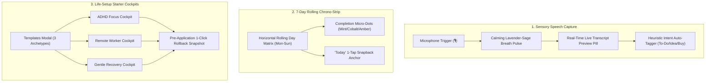

# Daily Compass — UI/UX Design System Specification (v2.2.0 Pro Max Ultra)
**Codename:** Nordic Twilight v2.2 / Sensory Speech, Chrono-Strips & Archetypes  
**Version:** 2.2.0 Pro Max Ultra  
**Status:** Canonical Implementation Standard  
**Document Context:** Extension to [DESIGN_SYSTEM.md](file:///c:/Users/Ivan/Pictures/Daily%20Tracker/docs/DESIGN_SYSTEM.md), [V2_DESIGN_SYSTEM.md](file:///c:/Users/Ivan/Pictures/Daily%20Tracker/docs/V2_DESIGN_SYSTEM.md), and [V2_1_DESIGN_SYSTEM.md](file:///c:/Users/Ivan/Pictures/Daily%20Tracker/docs/V2_1_DESIGN_SYSTEM.md) | Synchronized with [V2_2_VOICE_AND_TEMPLATES_SPECS.md](file:///c:/Users/Ivan/Pictures/Daily%20Tracker/docs/V2_2_VOICE_AND_TEMPLATES_SPECS.md)  
**Target Environment:** Local-First Web Cockpit / Mobile-First PWA (Zero External CDN/Framework Dependencies)

---

## 1. Executive Vision: The "Pro Max Ultra" Philosophy

Daily Compass **v2.2.0 ("Pro Max Ultra")** expands the anti-overwhelm paradigm into three dimensions where cognitive fatigue is most acute:



1. **Sensory Speech Capture (Voice Scratchpad):**  
   Typing on a small mobile keyboard or opening a note editor while overwhelmed introduces motor and executive friction. Voice dictation is natural, yet conventional dictation UIs trigger "mic fright" with aggressive pulsing red recording dots and flashing timers. Daily Compass introduces a **sensory-kind voice dictation state** featuring a breathing lavender-to-sage gradient glow, an inline transcript pill, and heuristic intent parsing.
2. **Temporal Situational Awareness (7-Day Rolling Chrono-Strip):**  
   Users with ADHD and time-blindness frequently struggle to orient themselves within the week. A full monthly calendar grid is visually intimidating and information-dense. The **7-Day Rolling Calendar Strip** provides a frictionless horizontal runway showing day initials, dates, completion telemetry micro-dots, and a 1-tap "Today" snapback button.
3. **Overcoming Blank-Canvas Paralysis (Life-Setup Templates):**  
   When opening a life tracker for the first time—or restarting after burnout—facing an empty dashboard causes acute decision fatigue. Daily Compass provides **3 research-grounded Life-Setup Archetypes** (ADHD Focus, Remote Worker, Gentle Recovery) that populate routines, habits, and budgets in a single tap with guaranteed 1-click snapshot reversibility.

---

## 2. Master CSS Design Tokens (v2.2 Ultra Calibration)

These tokens expand the calibrated **Nordic Twilight** aesthetic, introducing speech synthesis and chronometric components while preserving dark-slate luminance balance (WCAG 2.2 AAA compliant).

```css
/* ==========================================================================
   DAILY COMPASS v2.2 PRO MAX ULTRA — MASTER DESIGN TOKENS
   Sensory Voice, Chrono-Strips & Archetype Cockpits
   ========================================================================== */

:root {
  /* --------------------------------------------------------------------------
     1. SURFACES & ELEVATION (Deep Twilight Foundation)
     -------------------------------------------------------------------------- */
  --bg-canvas: #181c24;               /* Ultra-low glare slate base */
  --bg-canvas-subtle: #1c222e;        /* Inset tracks, day-strip backing */
  --bg-card: #222734;                 /* Primary component card */
  --bg-card-hover: #272d3c;           /* Hover elevation */
  --bg-card-elevated: #2b3242;        /* Modals, floating voice pill, active chips */
  --bg-card-glass: rgba(34, 39, 52, 0.85); /* Frosted glass transcript backdrop */
  --bg-overlay: rgba(14, 17, 23, 0.82); /* Modal backdrop frost */

  /* --------------------------------------------------------------------------
     2. BORDERS & ACCENT GLOWS
     -------------------------------------------------------------------------- */
  --border-subtle: #2d3546;           /* Structural dividers */
  --border-muted: #3a4459;            /* Inactive chip borders */
  --border-focus: #4a7bb0;            /* Accessible focus ring */
  --border-active-glow: rgba(96, 205, 155, 0.45);

  /* --------------------------------------------------------------------------
     3. HIGH-CONTRAST READABILITY TYPOGRAPHY
     -------------------------------------------------------------------------- */
  --text-primary: #e6edf3;            /* Soft chalk white (13.8:1 contrast) */
  --text-secondary: #9aa5b5;          /* Secondary descriptive (6.4:1 contrast) */
  --text-muted: #6e7681;              /* Inactive labels, micro-metadata */
  --text-inverse: #0d1117;            /* Dark text on light accent chips */

  /* --------------------------------------------------------------------------
     4. VOICE DICTATION & SENSORY GLOW TOKENS
     -------------------------------------------------------------------------- */
  --voice-lavender: #bc8cff;          /* Primary listening aura */
  --voice-sage: #60cd9b;              /* Active transcription clarity */
  --voice-ambient-bg: rgba(188, 140, 255, 0.12);
  --voice-border-active: rgba(188, 140, 255, 0.45);
  --voice-glow-pulse: 0 0 20px rgba(188, 140, 255, 0.35), 0 0 40px rgba(96, 205, 155, 0.20);
  --voice-bar-color: #d2a8ff;

  /* --------------------------------------------------------------------------
     5. CHRONO-STRIP TELEMETRY TOKENS
     -------------------------------------------------------------------------- */
  --chrono-chip-bg: #202634;
  --chrono-chip-hover: #262e3e;
  --chrono-chip-active: #2b3548;
  --chrono-chip-border-active: #58a6ff;
  --chrono-dot-complete: #60cd9b;     /* Mint/Sage for 100% completion */
  --chrono-dot-partial: #58a6ff;      /* Sky Cobalt for in-progress */
  --chrono-dot-rest: #e5a960;         /* Honey/Amber for Gentle Rest */
  --chrono-dot-empty: #3a4459;        /* Slate for neutral/untracked */

  /* --------------------------------------------------------------------------
     6. ARCHETYPE TEMPLATE ACCENTS
     -------------------------------------------------------------------------- */
  --arch-adhd-accent: #f0883e;        /* Amber Gold (Flow & Excitement) */
  --arch-adhd-bg: rgba(240, 136, 62, 0.12);
  --arch-adhd-border: rgba(240, 136, 62, 0.38);

  --arch-remote-accent: #4a7bb0;      /* Calm Cobalt (Structure & Boundaries) */
  --arch-remote-bg: rgba(74, 123, 176, 0.12);
  --arch-remote-border: rgba(74, 123, 176, 0.38);

  --arch-recovery-accent: #60cd9b;    /* Calming Mint (Healing & Gentleness) */
  --arch-recovery-bg: rgba(96, 205, 155, 0.12);
  --arch-recovery-border: rgba(96, 205, 155, 0.38);

  /* --------------------------------------------------------------------------
     7. MOTION, TIMING & SPRINGS
     -------------------------------------------------------------------------- */
  --ease-calm: cubic-bezier(0.16, 1, 0.3, 1);
  --ease-spring: cubic-bezier(0.175, 0.885, 0.32, 1.275);
  --duration-fast: 150ms;
  --duration-normal: 250ms;
  --duration-breath: 2800ms;           /* 2.8s calm human resting breath cycle */
}

/* ==========================================================================
   CALM VOICE BREATHING ANIMATION KEYFRAMES (ZERO HARSH FLASHING)
   ========================================================================== */

@keyframes calm-voice-breath {
  0% {
    box-shadow: 0 0 0 0 rgba(188, 140, 255, 0.40),
                0 0 0 0 rgba(96, 205, 155, 0.20);
    border-color: rgba(188, 140, 255, 0.50);
    transform: scale(1);
  }
  50% {
    box-shadow: 0 0 16px 4px rgba(188, 140, 255, 0.35),
                0 0 28px 8px rgba(96, 205, 155, 0.25);
    border-color: rgba(96, 205, 155, 0.65);
    transform: scale(1.03);
  }
  100% {
    box-shadow: 0 0 0 0 rgba(188, 140, 255, 0.40),
                0 0 0 0 rgba(96, 205, 155, 0.20);
    border-color: rgba(188, 140, 255, 0.50);
    transform: scale(1);
  }
}

/* Simulated Audio Waveform Bar Oscillations */
@keyframes voice-wave-bar {
  0%, 100% { height: 6px; }
  50%      { height: 18px; }
}

.voice-recording-active {
  animation: calm-voice-breath var(--duration-breath) infinite ease-in-out;
}

@media (prefers-reduced-motion: reduce) {
  .voice-recording-active {
    animation: none;
    border-color: var(--voice-lavender);
    box-shadow: 0 0 10px rgba(188, 140, 255, 0.3);
  }
}
```

---

## 3. Feature 1: Voice Scratchpad Audio Dictation

### 3.1 Cognitive Ergonomics & "Anti-Mic Fright"
Traditional dictation systems induce sensory anxiety:
- Flashing red "REC" icons trigger autonomic fight-or-flight reactions.
- Deadlines or sudden speech cutoffs pressure users to speak hurriedly, increasing stuttering or mental blockages.
- In Daily Compass, voice dictation is designed as a **gentle listener**:
  - **No Red Indicators:** The active state is rendered in **Nordic Lavender (`#bc8cff`) and Sage Green (`#60cd9b`)**.
  - **Breathing Visual Cadence:** The button expands and contracts softly on a 2.8-second cycle, matching natural human respiration.
  - **Instant Live Transcript Preview:** Words populate smoothly inside a frosted preview pill with a typewriter cursor, allowing immediate visual confirmation.
  - **Heuristic Auto-Tagging:** When the dictation concludes, simple heuristic keywords automatically select the appropriate Scratchpad category (`"buy groceries"` $\rightarrow$ `To-Buy`, `"remember to call"` $\rightarrow$ `To-Do`, `"idea about"` $\rightarrow$ `Idea`).

### 3.2 Visual Component Schematic (ASCII Blueprint)

```
HEADER QUICK TRIGGER:
+-----------------------------------------------------------------------------------+
|  [⚡ 60% Steady]   09:30 AM   [ 🎙️ Voice Note ]   [ 👁️ Privacy ]   [ 🔍 Cmd+K ]     |
+-----------------------------------------------------------------------------------+
                                       |
                   (Click opens Voice Capture Dock)

VOICE SCRATCHPAD CAPTURE DOCK (ACTIVE LISTENING STATE):
+-----------------------------------------------------------------------------------+
| 🎙️ SENSORY VOICE CAPTURE (Web Speech API)                                    [ × ] |
|-----------------------------------------------------------------------------------|
|                                                                                   |
|                                .---''''---.                                       |
|                             .'   || | ||   '.                                     |
|                            /     || | ||     \    <- 2.8s Breathing Wave          |
|                           |      [ 🎙️ ]      |       (Lavender #bc8cff to         |
|                            \     || | ||     /        Sage #60cd9b Glow)          |
|                             '.   || | ||   .'                                     |
|                                '---....---'                                       |
|                                                                                   |
|                         "Listening... Speak freely."                              |
|                                                                                   |
|  +-----------------------------------------------------------------------------+  |
|  | LIVE TRANSCRIPT PREVIEW:                                                    |  |
|  | "Remember to review the utility invoice before 2 PM and drink water |"      |  |
|  +-----------------------------------------------------------------------------+  |
|  Suggested Tag: [ ✅ To-Do (Auto-Detected) ]    Confidence: 94%                    |
|                                                                                   |
|  [ ✓ Save as Scratchpad Note ]       [ ↺ Retry Voice ]       [ ⌨️ Edit as Text ]   |
+-----------------------------------------------------------------------------------+
```

### 3.3 DOM Blueprint & Structural Markup

```html
<!-- Voice Dictation Modal / Floating Sheet -->
<div class="modal-backdrop" id="modal-voice-dictation" role="dialog" aria-modal="true" aria-labelledby="voice-modal-title">
  <div class="modal-container modal-sm voice-dictation-card">
    
    <header class="modal-header">
      <div class="modal-header-text">
        <h2 class="modal-title" id="voice-modal-title">🎙️ Voice Thought Capture</h2>
        <p class="modal-subtitle">Speak freely at your own pace. Zero hurry, zero pressure.</p>
      </div>
      <button class="btn-icon-action" id="btn-close-voice" aria-label="Close voice capture (Escape)">&times;</button>
    </header>

    <div class="voice-center-stage">
      <!-- Breathing Orb Button -->
      <button class="voice-orb-btn voice-recording-active" id="btn-voice-orb" aria-label="Toggle voice listening">
        <div class="voice-wave-bars" aria-hidden="true">
          <span class="bar bar-1"></span>
          <span class="bar bar-2"></span>
          <span class="bar bar-3"></span>
          <span class="bar bar-4"></span>
        </div>
        <svg class="mic-icon" width="28" height="28" viewBox="0 0 24 24" fill="none" stroke="currentColor" stroke-width="2">
          <path d="M12 1a3 3 0 0 0-3 3v8a3 3 0 0 0 6 0V4a3 3 0 0 0-3-3z"/>
          <path d="M19 10v2a7 7 0 0 1-14 0v-2"/>
          <line x1="12" y1="19" x2="12" y2="23"/>
          <line x1="8" y1="23" x2="16" y2="23"/>
        </svg>
      </button>
      <div class="voice-status-label" id="voice-status-text" aria-live="polite">Listening... Speak when you are ready.</div>
    </div>

    <!-- Live Transcript Preview Pill -->
    <div class="transcript-preview-box" id="transcript-container">
      <div class="transcript-header">
        <span class="transcript-tag">Live Transcript</span>
        <span class="transcript-confidence" id="transcript-confidence-label">High Clarity</span>
      </div>
      <p class="transcript-text" id="live-transcript-text">
        <span class="transcript-interim">Say something like "Remember to buy almond milk" or "Idea for project"...</span>
        <span class="typewriter-cursor" aria-hidden="true"></span>
      </p>
    </div>

    <!-- Suggested Tag Pill -->
    <div class="suggested-tag-row" id="suggested-tag-container" style="display: none;">
      <span class="tag-label">Auto-Detected Tag:</span>
      <span class="badge-tag-pill" id="detected-tag-badge">✅ To-Do</span>
    </div>

    <!-- Footer Controls -->
    <div class="voice-footer-actions">
      <button type="button" class="btn-primary" id="btn-save-voice-note" disabled>
        <span>✓ Save Note</span>
      </button>
      <button type="button" class="btn-secondary" id="btn-retry-voice">
        <span>↺ Retry</span>
      </button>
      <button type="button" class="btn-secondary" id="btn-switch-text">
        <span>⌨️ Type Instead</span>
      </button>
    </div>
  </div>
</div>
```

---

## 4. Feature 2: 7-Day Rolling Calendar Strip

### 4.1 Cognitive Ergonomics: Temporal Runway without Clutter
Traditional monthly calendar grids suffer from three flaws:
1. **Visual Density:** 35+ day squares cause cognitive sensory overload.
2. **Context Fragmentation:** Navigating weeks shifts focus away from "Right Now".
3. **Broken Streak Shame:** Empty squares from missed weeks stare down judgmentally.

The **7-Day Rolling Calendar Strip** replaces this with an empathetic 7-day horizontal runway:
- Positioned directly above the Master Anchor Hero Card.
- Displays 7 adjacent days (e.g., past 3 days, **Today**, next 3 days, or Monday through Sunday).
- Each chip contains:
  1. Day Name (`Mon`, `Tue`, `Wed`).
  2. Date Number (`5`).
  3. **Completion Telemetry Micro-Dot:**
     - **Mint/Sage (`#60cd9b`):** All habits and hydration targets met.
     - **Sky Cobalt (`#58a6ff`):** Partially completed / in-progress.
     - **Honey Amber (`#e5a960`):** Gentle Mode / Rest Shield active.
     - **Muted Slate (`#3a4459`):** Upcoming or neutral.
- **"Today" Snapback Pill:** Whenever the user inspects a past day, a discreet floating pill `[ Return to Today ↺ ]` illuminates, allowing 1-tap re-grounding.

### 4.2 Visual Component Schematic (ASCII Blueprint)

```
7-DAY ROLLING CALENDAR STRIP (Above Today Focus Anchor):
+-----------------------------------------------------------------------------------+
|  [ < Prev Week ]                                                  [ Next Week > ] |
|                                                                                   |
|   MON 02       TUE 03       WED 04     [ THU 05 ]*     FRI 06       SAT 07    SUN 08|
|    ( • )        ( • )        ( • )        ( • )         ( ○ )        ( ○ )     ( ○ )|
|    Mint         Mint         Mint         Cobalt        Slate        Slate     Amber|
|   100%         100%         80%          Today         Upcoming     Upcoming   Rest |
|                                                                                   |
|  [ * Currently Viewing: THURSDAY, NOV 05 (Today) ]    [ Return to Today ↺ ]       |
+-----------------------------------------------------------------------------------+
```

### 4.3 DOM Blueprint & Structural Markup

```html
<!-- 7-Day Rolling Calendar Strip Component -->
<nav class="chrono-strip-wrapper" aria-label="7-Day Rolling Calendar Strip">
  <div class="chrono-strip-header">
    <div class="chrono-title-group">
      <span class="chrono-icon">📅</span>
      <span class="chrono-range-label" id="chrono-current-range">Nov 02 — Nov 08, 2026</span>
    </div>
    <button class="btn-snap-today active" id="btn-chrono-today-snap" title="Jump to Today's Focus Anchor">
      <span>Today</span>
      <span class="today-indicator-dot"></span>
    </button>
  </div>

  <div class="chrono-days-scroll-container" id="chrono-scroll-track" role="tablist">
    <!-- Day Chip 1 (Past) -->
    <button class="chrono-day-chip" role="tab" aria-selected="false" data-date="2026-11-02">
      <span class="chip-day-name">Mon</span>
      <span class="chip-day-num">02</span>
      <span class="chip-status-dot dot-complete" title="100% Habits & Water completed"></span>
    </button>

    <!-- Day Chip 2 (Past) -->
    <button class="chrono-day-chip" role="tab" aria-selected="false" data-date="2026-11-03">
      <span class="chip-day-name">Tue</span>
      <span class="chip-day-num">03</span>
      <span class="chip-status-dot dot-complete" title="100% completed"></span>
    </button>

    <!-- Day Chip 3 (Past) -->
    <button class="chrono-day-chip" role="tab" aria-selected="false" data-date="2026-11-04">
      <span class="chip-day-name">Wed</span>
      <span class="chip-day-num">04</span>
      <span class="chip-status-dot dot-partial" title="80% completed"></span>
    </button>

    <!-- Day Chip 4 (TODAY - ACTIVE) -->
    <button class="chrono-day-chip active is-today" role="tab" aria-selected="true" data-date="2026-11-05">
      <span class="chip-today-badge">TODAY</span>
      <span class="chip-day-name">Thu</span>
      <span class="chip-day-num">05</span>
      <span class="chip-status-dot dot-in-progress" title="In Progress"></span>
    </button>

    <!-- Day Chip 5 (Upcoming) -->
    <button class="chrono-day-chip" role="tab" aria-selected="false" data-date="2026-11-06">
      <span class="chip-day-name">Fri</span>
      <span class="chip-day-num">06</span>
      <span class="chip-status-dot dot-empty" title="Upcoming"></span>
    </button>

    <!-- Day Chip 6 (Upcoming) -->
    <button class="chrono-day-chip" role="tab" aria-selected="false" data-date="2026-11-07">
      <span class="chip-day-name">Sat</span>
      <span class="chip-day-num">07</span>
      <span class="chip-status-dot dot-empty" title="Upcoming"></span>
    </button>

    <!-- Day Chip 7 (Rest Day) -->
    <button class="chrono-day-chip is-rest-day" role="tab" aria-selected="false" data-date="2026-11-08">
      <span class="chip-day-name">Sun</span>
      <span class="chip-day-num">08</span>
      <span class="chip-status-dot dot-rest" title="Scheduled Gentle Rest Day"></span>
    </button>
  </div>
</nav>
```

---

## 5. Feature 3: Life-Setup Templates Modal ("Starter Cockpits")

### 5.1 Cognitive Rationale: Eliminating Blank Canvas Paralysis
When users install Daily Compass or reset their system, an empty configuration induces acute paralysis: *"What should my routines be? How much water? What should my daily spending cap be?"*
Rather than expecting users to architect an entire lifestyle system from scratch, the **Life-Setup Templates Modal** provides **3 proven neurodivergent archetypes**:

```
+-----------------------------------------------------------------------------------+
| 🌟 LIFE-SETUP TEMPLATES & STARTER COCKPITS                                  [ × ] |
|-----------------------------------------------------------------------------------|
|  Select a foundational template to seed your cockpit. Your current data will be   |
|  automatically saved in a 1-click snapshot first.                                 |
|                                                                                   |
|  +-----------------------------------------------------------------------------+  |
|  | 🎯 ARCHETYPE 1: ADHD FOCUS COCKPIT                                          |  |
|  | Built for dopamine regulation, time-blindness support & atomic sprints.      |  |
|  | • Routines: Low-Dopamine Morning Launch, 2x 45m Focus Sprints, Sunset Dump    |  |
|  | • Habits: 2000ml Water, Dopamine Walk, Screen-Free Winddown                    |  |
|  | • Financials: $40/day Safe-to-Spend Cap (Impulse delay buffer)                 |  |
|  | Badges: [ 4 Routines ]  [ 5 Habits ]  [ $40/day ]  [ Amber/Cobalt Theme ]   |  |
|  |                                                        [ Apply ADHD Focus ] |  |
|  +-----------------------------------------------------------------------------+  |
|                                                                                   |
|  +-----------------------------------------------------------------------------+  |
|  | 💻 ARCHETYPE 2: REMOTE WORKER COCKPIT                                       |  |
|  | Built for solid home-work boundaries, screen breaks & posture ergonomics.    |  |
|  | • Routines: Virtual Commute Walk, Deep Block (10-12), 17:30 Hard Shutdown   |  |
|  | • Habits: Ergonomic Stretch, 2500ml Hydration, Lunch Away from Screen       |  |
|  | • Financials: $55/day Safe-to-Spend Cap (Meal prep & utility balances)       |  |
|  | Badges: [ 3 Routines ]  [ 6 Habits ]  [ $55/day ]  [ Cobalt/Mint Theme ]    |  |
|  |                                                     [ Apply Remote Worker ] |  |
|  +-----------------------------------------------------------------------------+  |
|                                                                                   |
|  +-----------------------------------------------------------------------------+  |
|  | 🌿 ARCHETYPE 3: GENTLE RECOVERY COCKPIT                                     |  |
|  | Built for burnout recovery, chronic fatigue, illness or low-energy seasons.   |  |
|  | • Routines: Slow Awakening, Restorative Rest Hour, Evening Gratitude        |  |
|  | • Habits: 1-Glass Hydration, Gentle Medication, 10m Sunlight, Zero-Guilt Rest|  |
|  | • Financials: $30/day Safe-to-Spend Cap (Auto-activates Gentle Mode)         |  |
|  | Badges: [ 3 Routines ]  [ 4 Habits ]  [ $30/day ]  [ Gentle Mode Active ]   |  |
|  |                                                    [ Apply Gentle Recovery ]|  |
|  +-----------------------------------------------------------------------------+  |
|                                                                                   |
|-----------------------------------------------------------------------------------|
| [ 📦 Restore Past Snapshot ]                                          [ Close ]   |
+-----------------------------------------------------------------------------------+
```

### 5.2 The 3 Archetype Specifications

| Attribute | Archetype 1: ADHD Focus | Archetype 2: Remote Worker | Archetype 3: Gentle Recovery |
| :--- | :--- | :--- | :--- |
| **Primary Need** | Dopamine, momentum, anti-distraction | Work/life boundary, shutdown ritual | Burnout recovery, zero guilt, gentle pacing |
| **Accent Theme** | Amber Gold & Sky Cobalt (`#f0883e`, `#58a6ff`)| Calm Cobalt & Sage Mint (`#4a7bb0`, `#60cd9b`)| Soft Lavender & Warm Amber (`#bc8cff`, `#cca05a`)|
| **Routine Blocks** | • Morning Launch (30m)<br>• Deep Sprint 1 (45m)<br>• Deep Sprint 2 (45m)<br>• Evening Brain Dump (20m) | • Virtual Commute Walk (30m)<br>• Deep Work Block (2h)<br>• Hard Shutdown Ritual (25m) | • Slow Soft Morning (45m)<br>• Restorative Nap/Rest (1h)<br>• Candlelight Winddown (30m) |
| **Habits & Meds** | • 2000ml Hydration<br>• Focus Vitamin/Meds<br>• Dopamine Walk<br>• 1-Minute Desk Tidy | • 2500ml Hydration Ring<br>• Posture & Eye Stretch<br>• Screen-Free Lunch<br>• Workspace Tidy | • 1500ml Gentle Water<br>• Daily Medication<br>• 10m Gentle Sunlight<br>• Zero-Guilt Rest Shield |
| **Daily Cash Cap** | $40.00 / day | $55.00 / day | $30.00 / day |
| **Default Mode** | Standard Focus Anchor | Standard Focus Anchor | **Gentle Mode (Active by Default)** |

### 5.3 DOM Blueprint & Structural Markup

```html
<!-- Life-Setup Templates Modal -->
<div class="modal-backdrop" id="modal-life-templates" role="dialog" aria-modal="true" aria-labelledby="templates-modal-title">
  <div class="modal-container modal-lg templates-modal-card">
    
    <header class="modal-header">
      <div class="modal-header-text">
        <h2 class="modal-title" id="templates-modal-title">🌟 Starter Life-Setup Cockpits</h2>
        <p class="modal-subtitle">Pick a proven neurodivergent blueprint. 1-click snapshot rollback guaranteed.</p>
      </div>
      <button class="btn-icon-action" id="btn-close-templates" aria-label="Close dialog">&times;</button>
    </header>

    <div class="templates-grid">
      <!-- Card 1: ADHD Focus -->
      <div class="archetype-card card-adhd" data-template-id="adhd_focus">
        <div class="archetype-badge-top" style="background: var(--arch-adhd-bg); color: var(--arch-adhd-accent); border: 1px solid var(--arch-adhd-border);">
          <span>🎯 Flow & Executive Support</span>
        </div>
        <h3 class="archetype-title">ADHD Focus Cockpit</h3>
        <p class="archetype-desc">Engineered for time-blindness, momentum generation, and low-friction dopamine pacing.</p>
        
        <div class="archetype-specs">
          <div class="spec-item"><span class="spec-label">Routines:</span> Morning Launch, 2x 45m Sprints, Sunset Dump</div>
          <div class="spec-item"><span class="spec-label">Habits:</span> 2,000ml Water, Dopamine Walk, Desk Reset</div>
          <div class="spec-item"><span class="spec-label">Cash Cap:</span> $40.00 / day (Impulse buffer)</div>
        </div>

        <div class="archetype-pill-badges">
          <span class="mini-pill">4 Routines</span>
          <span class="mini-pill">5 Habits</span>
          <span class="mini-pill">$40 Budget</span>
        </div>

        <button class="btn-primary btn-apply-template" data-template="adhd_focus" style="background: var(--arch-adhd-accent);">
          <span>Apply ADHD Focus Cockpit</span>
        </button>
      </div>

      <!-- Card 2: Remote Worker -->
      <div class="archetype-card card-remote" data-template-id="remote_worker">
        <div class="archetype-badge-top" style="background: var(--arch-remote-bg); color: var(--arch-remote-accent); border: 1px solid var(--arch-remote-border);">
          <span>💻 Boundaries & Balance</span>
        </div>
        <h3 class="archetype-title">Remote Worker Cockpit</h3>
        <p class="archetype-desc">Separates personal life from work with strict virtual commute rituals and shutdown anchors.</p>
        
        <div class="archetype-specs">
          <div class="spec-item"><span class="spec-label">Routines:</span> Virtual Commute, 10-12 Deep Work, 17:30 Shutdown</div>
          <div class="spec-item"><span class="spec-label">Habits:</span> 2,500ml Hydration, Posture Stretch, Screen-Free Lunch</div>
          <div class="spec-item"><span class="spec-label">Cash Cap:</span> $55.00 / day</div>
        </div>

        <div class="archetype-pill-badges">
          <span class="mini-pill">3 Routines</span>
          <span class="mini-pill">6 Habits</span>
          <span class="mini-pill">$55 Budget</span>
        </div>

        <button class="btn-primary btn-apply-template" data-template="remote_worker" style="background: var(--arch-remote-accent);">
          <span>Apply Remote Worker Cockpit</span>
        </button>
      </div>

      <!-- Card 3: Gentle Recovery -->
      <div class="archetype-card card-recovery" data-template-id="gentle_recovery">
        <div class="archetype-badge-top" style="background: var(--arch-recovery-bg); color: var(--arch-recovery-accent); border: 1px solid var(--arch-recovery-border);">
          <span>🌿 Burnout & Healing</span>
        </div>
        <h3 class="archetype-title">Gentle Recovery Cockpit</h3>
        <p class="archetype-desc">Designed for chronic illness, severe burnout, or high sensory fatigue. Zero guilt, total calm.</p>
        
        <div class="archetype-specs">
          <div class="spec-item"><span class="spec-label">Routines:</span> Soft Awakening, Restorative Rest Hour, Winddown</div>
          <div class="spec-item"><span class="spec-label">Habits:</span> 1,500ml Water, Medication, 10m Sunlight, Rest Shield</div>
          <div class="spec-item"><span class="spec-label">Cash Cap:</span> $30.00 / day (Gentle Mode Active)</div>
        </div>

        <div class="archetype-pill-badges">
          <span class="mini-pill">3 Routines</span>
          <span class="mini-pill">4 Habits</span>
          <span class="mini-pill">Gentle Mode</span>
        </div>

        <button class="btn-primary btn-apply-template" data-template="gentle_recovery" style="background: var(--arch-recovery-accent);">
          <span>Apply Gentle Recovery Cockpit</span>
        </button>
      </div>
    </div>

    <div class="modal-footer">
      <button class="btn-secondary" id="btn-open-snapshots-from-templates">📦 Restore from Snapshot instead</button>
      <button class="btn-secondary" id="btn-dismiss-templates">Close</button>
    </div>
  </div>
</div>
```

---

## 6. Accessibility & Keyboard Navigation Matrix (v2.2 Standards)

### 6.1 Keyboard Navigation Directives
- **Voice Dictation:** `Alt + V` toggles voice listening on and off.
- **7-Day Chrono-Strip:**
  - `ArrowLeft` and `ArrowRight`: Navigate horizontally across adjacent day chips.
  - `Home`: Selects the first day chip in the strip.
  - `End`: Selects the last day chip in the strip.
  - `Enter` / `Space`: Activates the selected day chip and updates the schedule view.
  - `Alt + T`: Immediately triggers the **Today Snapback** anchor.
- **Templates Modal:** `Tab` and `Shift + Tab` cycle focus cleanly between template cards; `Esc` dismisses the modal without changes.

### 6.2 Screen Reader Announcements
1. **Voice Listening State:**
   - On activation: `aria-live="polite"` announces: *"Microphone active. Listening for your thought. Speak whenever you're ready."*
   - During speech: Interim results update `aria-label="Transcribing..."`.
   - On completion: *"Dictation complete: '{transcript_text}'. Tagged as {detected_tag}."*
2. **Chrono-Strip Navigation:**
   - Focused day announcement: *"Thursday, November 5, 2026. Today. Routine status: in progress. 4 habits scheduled."*

---

## 7. Responsive Viewport Adaptations

### 7.1 Mobile Viewport (390px Width — iPhone & Android)
- **7-Day Strip:** Converts into an ergonomic touch-snap track (`scroll-snap-type: x mandatory`). Each day chip measures `46px x 58px`, easily tap-accessible for thumbs.
- **Voice Modal:** Operates as a rounded bottom-sheet drawer with a 64px central breathing orb.
- **Templates Modal:** Stacks the 3 archetype cards vertically with full-width primary action buttons.

### 7.2 Desktop Cockpit (1440px Width)
- **7-Day Strip:** Spans the upper section of the Today view with generous spacing and instant hover telemetry tooltips.
- **Templates Modal:** Displays all 3 archetypes side-by-side in a balanced 3-column layout.

---

## 8. Summary & Handoff Checklist

Daily Compass **v2.2.0 Pro Max Ultra** integrates:
- [x] **Sensory Voice Scratchpad** with zero red panic dots, lavender/sage breathing glow, and real-time live transcript preview.
- [x] **7-Day Rolling Chrono-Strip** with status micro-dots, accessible tablist semantics, and a 1-tap "Today" snapback button.
- [x] **3 Life-Setup Starter Archetypes** (ADHD Focus, Remote Worker, Gentle Recovery) with pre-application 1-click snapshot rollbacks.

All components maintain strict adherence to the **Nordic Twilight** aesthetic, local-first zero-CDN resilience, and neurodivergent-kind cognitive ergonomics.
