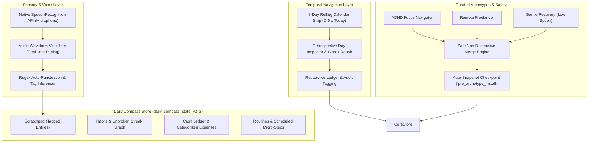
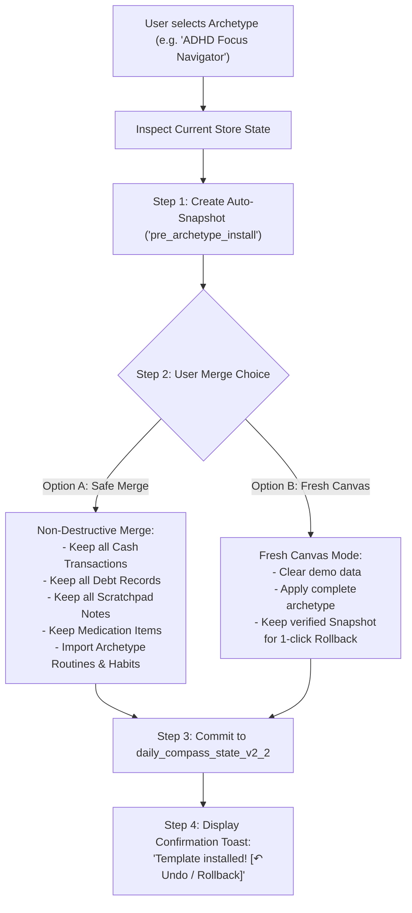

# 🧭 Daily Compass v2.2.0 Pro Max Ultra — Formal Specifications
# Sensory Audio Dictation, Retrospective 7-Day Time Machine, & Curated Life Archetypes

**Document Version:** 2.2.0-ULTRA-SPEC  
**Status:** Canonical Engineering Specification  
**Target Environment:** Local-First Web Application / Offline Progressive Web App (PWA)  
**Core Mindset:** Native Web APIs, Zero External Dependencies, Ponytail Simplicity, Sensory & Cognitive Accessibility for Executive Dysfunction & ADHD.

---

## 1. Executive Summary & Architectural Overview

Daily Compass v2.2.0 ("Pro Max Ultra") expands the cognitive scaffolding system into three high-impact sensory and temporal domains:
1. **Native Web Speech Recognition Audio Dictation ("Voice Scratchpad"):** A zero-dependency, private speech-to-text capture tool using the native browser `SpeechRecognition` API. Features client-side auto-punctuation, grammar cleanup, automatic tag inferencing (`#To-Buy`, `#To-Do`, `#Idea`, `#Later`, `#Thought`), and non-punitive permission error handling.
2. **7-Day Rolling Calendar Strip & Retrospective Day Inspection:** A horizontal temporal strip providing past-day inspection and retroactive logging for habits, cash transactions, and scratchpad items without breaking streaks or incurring perfectionist shame.
3. **Curated Life-Setup Archetype Templates:** Three turnkey cognitive operational templates (*ADHD Focus Navigator*, *Remote Freelancer*, *Gentle Recovery / Low Spoon*) paired with a **Safe Merge Protocol** that protects custom user data and provides automatic snapshot checkpoints.



---

## 2. Capability 1: Native Web Speech Recognition Audio Dictation ("Voice Scratchpad")

### 2.1 The Cognitive Problem & Sensory Rationale
- **Working Memory Decay:** For ADHD and overwhelmed minds, an insight, chore, or shopping item exists in working memory for approximately 10 to 15 seconds. Having to unlock the device, locate a text field, and type on a cramped keyboard creates enough friction that the thought vanishes, resulting in lingering background anxiety.
- **Microphone Hesitancy & Fear of Error:** Cloud-based voice recorders introduce network latency, subscription billing, and privacy worries. Traditional voice assistants punish silent pauses with abrupt cutoffs or fail on noisy speech.
- **The Voice Scratchpad Solution:** 100% on-device speech transcription using the native browser `SpeechRecognition` (or `webkitSpeechRecognition`) engine. Zero audio leaves the user's device, zero external libraries are loaded, and continuous real-time text feedback anchors the user.

### 2.2 Component Hierarchy & Visual Wireframe
```
+---------------------------------------------------------------------------------------------------+
| 🎙️ VOICE SCRATCHPAD (Audio Dictation)                                     [ ✕ Close / Esc ]       |
+---------------------------------------------------------------------------------------------------+
|                                                                                                   |
|    ((  ~ ~ ~ ∿ ∿ ∿ ∿ ∿ ∿ ∿ ∿ ∿ ∿ ∿ ∿ ∿ ∿ ~ ~ ~  ))                                              |
|    [ Soft Living Audio Waveform — Listening to your thoughts... ]                                  |
|                                                                                                   |
| Transcript:                                                                                       |
| "Remember to pick up oat milk and ground coffee from the grocery store tomorrow."                 |
|                                                                                                   |
| Inferred Tags:   [ 🛒 #To-Buy ]   [ ⚡ #To-Do ]     (Click to add: [ 💡 #Idea ] [ ⏳ #Later ])    |
+---------------------------------------------------------------------------------------------------+
| Auto-Punctuation: [ON]   Filler Word Clean: [ON]   Auto-Capture on Silence (2.5s): [ON]          |
|                                                                                                   |
| [ ⏹ Stop & Save Note (Enter) ]       [ ↶ Clear / Retry ]       [ ⌨️ Switch to Keyboard Entry ]     |
+---------------------------------------------------------------------------------------------------+
```

### 2.3 Client-Side Auto-Punctuation & Grammar Cleaning Pipeline

Standard speech recognition engines emit unpunctuated, run-on token streams. The Voice Scratchpad processes interim and final results through a multi-pass client-side normalization pipeline:

```mermaid
flowchart LR
    RawAudio["Spoken Words"] --> Engine["SpeechRecognition API"]
    Engine --> RawTokens["Raw Unpunctuated Tokens"]
    RawTokens --> Pass1["Pass 1: Spoken Punctuation Replacement"]
    Pass1 --> Pass2["Pass 2: Silence & Conjunction Punctuation"]
    Pass2 --> Pass3["Pass 3: Capitalization & Formatting"]
    Pass3 --> Pass4["Pass 4: Rule-Based Tag Inferencer"]
    Pass4 --> CleanNote["Structured Scratchpad Note"]
```



#### Pass 1: Spoken Punctuation Mapping
Users may speak punctuation commands naturally:
```javascript
const SPOKEN_PUNCTUATION = [
  { regex: /\b(period|full stop)\b/gi, replacement: '.' },
  { regex: /\b(comma)\b/gi, replacement: ',' },
  { regex: /\b(question mark)\b/gi, replacement: '?' },
  { regex: /\b(exclamation mark|exclamation point)\b/gi, replacement: '!' },
  { regex: /\b(new line|next line)\b/gi, replacement: '\n' }
];
```

#### Pass 2: Conversational Silence & Conjunction Heuristic
- **Boundary Pause ($\Delta t \ge 750\text{ms}$):** If speech halts for $\ge 750\text{ms}$ before the next phrase and does not end with punctuation, append a period (`.`).
- **Inquisitive Sentence Starters:** Phrases starting with `"can I"`, `"should I"`, `"what if"`, `"why is"`, `"how do I"`, `"could we"` are automatically closed with a question mark (`?`) rather than a period.
- **Filler Word Trimming:** When enabled in settings, conversational fillers (`\b(um|uh|err|like|you know)\b`) are pruned when flanked by pauses.

#### Pass 3: Casing Normalization
- Capitalizes first letter of every sentence after `[.?!]`, after newlines, and at index 0.
- Preserves uppercase for common abbreviations: `ADHD`, `PWA`, `JSON`, `API`, `USD`, `AM`, `PM`.
- Always capitalizes the standalone pronoun `"I"`.

### 2.4 Rule-Based Semantic Tag Inferencing Engine

The transcript is scanned via deterministic regular expressions to automatically categorize the note into the existing Daily Compass Scratchpad taxonomy:

| Category Tag | Primary Keyword Triggers | Example Spoken Input | Inferred Tag |
| :--- | :--- | :--- | :--- |
| **`#To-Buy`** | `\b(buy\|purchase\|pick up\|get\|order\|groceries\|milk\|eggs\|coffee\|store\|amazon)\b` | *"Pick up oat milk and eggs on the way home"* | `🛒 #To-Buy` |
| **`#To-Do`** | `\b(remember to\|need to\|must\|call\|email\|schedule\|submit\|finish\|clean\|send\|fix)\b` | *"Remember to email Sarah the project specs"* | `⚡ #To-Do` |
| **`#Idea`** | `\b(what if\|idea\|concept\|maybe we could\|thought about\|invention\|feature idea)\b` | *"Idea what if we add a binaural audio beat to the focus timer"* | `💡 #Idea` |
| **`#Later`** | `\b(someday\|eventually\|next week\|next month\|later on\|down the road\|explore)\b` | *"Someday look into solar panel installation"* | `⏳ #Later` |
| **`#Thought`** | *Default fallback* when self-reflective words appear: `\b(feel\|feeling\|wonder\|reflect\|realized)\b` | *"Feeling much calmer after the morning walk"* | `🧠 #Thought` |

*Cognitive Safety:* Inferred tags appear as pre-selected interactive pills. Users can click any pill to deselect it or select another in a single tap before saving.

### 2.5 Non-Punitive Permission & Hardware Fallback
- **Denied Permission Handling:**
  - If `err.error === 'not-allowed'` or `'permission-denied'`:
    - The app **never** displays an alarming red error dialog.
    - Displays a calm lavender banner:  
      `"Microphone is resting. Voice dictation is completely optional. [Tap to Enable Mic] or [Switch to Keyboard]."`
- **Hardware Absence:**
  - If no audio input device is detected, the `[🎙️ Voice Dump]` button gracefully morphs into `[⌨️ Quick Text Dump]`.
- **Browser Incompatibility:**
  - If `window.SpeechRecognition` and `window.webkitSpeechRecognition` are undefined (e.g. Firefox desktop without speech flag), the button displays an informational tooltip:  
    `"Voice Scratchpad is supported in Chromium browsers and Safari. Standard keyboard entry is active."`

### 2.6 Method Signatures & Controller Contract

```typescript
interface VoiceScratchpadController {
  /**
   * Initializes the browser SpeechRecognition instance with event listeners.
   */
  initSpeechEngine(options?: { lang?: string; continuous?: boolean }): boolean;

  /**
   * Starts listening to audio stream and triggers visual wave animation.
   */
  startListening(): Promise<void>;

  /**
   * Stops listening, finalizes text transcription, applies tag inferencing.
   */
  stopListening(): Promise<VoiceScratchpadResult>;

  /**
   * Aborts listening without saving.
   */
  cancelListening(): void;

  /**
   * Cleans raw text, applies punctuation rules, and trims filler words.
   */
  cleanTranscript(rawTranscript: string, options?: CleaningOptions): string;

  /**
   * Detects semantic category tags from transcribed text.
   */
  inferTags(cleanText: string): ScratchpadTag[];

  /**
   * Directly commits the voice transcription into Module 6 (Scratchpad).
   */
  commitToScratchpad(result: VoiceScratchpadResult): ScratchpadItem;
}
```

### 2.7 Formal JSON Schema: Voice Scratchpad Payload

```json
{
  "$schema": "https://json-schema.org/draft/2020-12/schema",
  "$id": "https://dailycompass.local/schemas/v2-2/voice-scratchpad.json",
  "title": "VoiceScratchpadModuleV22",
  "type": "object",
  "required": ["sessionId", "rawTranscript", "cleanTranscript", "inferredTags", "confidence", "timestamp"],
  "properties": {
    "sessionId": { "type": "string", "format": "uuid" },
    "rawTranscript": { "type": "string" },
    "cleanTranscript": { "type": "string", "minLength": 1 },
    "inferredTags": {
      "type": "array",
      "items": {
        "type": "string",
        "enum": ["to-buy", "to-do", "idea", "later", "thought", "uncategorized"]
      }
    },
    "confidence": { "type": "number", "minimum": 0, "maximum": 1 },
    "durationSeconds": { "type": "number", "minimum": 0 },
    "cleaningOptions": {
      "type": "object",
      "properties": {
        "autoPunctuate": { "type": "boolean", "default": true },
        "removeFillers": { "type": "boolean", "default": true },
        "spokenPunctuation": { "type": "boolean", "default": true }
      }
    },
    "timestamp": { "type": "string", "format": "date-time" }
  }
}
```

---

## 3. Capability 2: 7-Day Rolling Calendar Strip & Retrospective Day Inspection

### 3.1 The Psychology of Yesterday's Guilt
Standard habit trackers punish users for the simple act of falling asleep:
- If a user completed all habits on Tuesday evening but forgot to open the app before midnight, Wednesday morning greets them with a broken streak, red zero badges, and shame.
- Overwhelmed users will frequently abandon the tracking app entirely rather than confront the broken streak.

The **7-Day Rolling Calendar Strip & Retrospective Day Inspection Engine** provides a 7-day cognitive grace window ($[T-6, T_0]$), enabling retroactive inspection and safe backfilling.

### 3.2 Visual Wireframe & Ergonomics
```
+---------------------------------------------------------------------------------------------------+
| 🧭 DAILY COMPASS                   14:35:10 Wed, Nov 5                     [ 🔋 60% ]  [ 🔍 Cmd+K ]|
+---------------------------------------------------------------------------------------------------+
| 📅 7-DAY ROLLING STRIP:                                                                           |
| [ Thu 30 ]  [ Fri 31 ]  [ Sat 1 ]  [ Sun 2 ]  [ Mon 3 ]  [ Tue 4 (Yesterday) ]  [★ Wed 5 (TODAY)]  |
|   5/5 🟢      4/5 🟢      3/5 🟡      5/5 🟢     2/5 🟡          4/5 🟢                 2/5 🔵         |
|   $34.00      $18.50      $52.00      $12.00     $44.00          $28.00                 $15.00         |
+---------------------------------------------------------------------------------------------------+
| 👁️ RETROSPECTIVE MODE: You are inspecting Tuesday, Nov 4 (Yesterday)            [ ↶ Return to Now ]|
| All actions logged in this mode will be recorded under Nov 4 with audit integrity preserved.     |
+---------------------------------------------------------------------------------------------------+
```

### 3.3 Functional Architecture & Invariants

#### 3.3.1 Temporal Day Boundaries
The strip always displays exactly 7 days:
$$D_k = \text{Date}(\text{today} - (6 - k)) \quad \text{for } k \in [0, 6]$$
- $k = 6$: **Today** (The active Anchor day, indicated by a prominent star icon and sky-blue highlight).
- $k = 5$: **Yesterday** (Convenient 1-tap re-entry).
- $k \in [0, 4]$: Past 2 to 6 days.

#### 3.3.2 Non-Punitive Retrospective Logging
When an inspection day $D_k$ is selected ($k < 6$):
1. **Viewport Shift:** The main viewport renders the state of $D_k$:
   - Habit checkboxes reflect completion on $D_k$.
   - Cash ledger filters to transactions incurred on $D_k$.
   - Scratchpad displays notes dumped on $D_k$.
2. **Backfilling a Missed Habit:**
   - Tapping an unchecked habit on $D_k$ records `completedDates: [...completedDates, D_k]`.
   - **Unbroken Streak Self-Healing:** The streak engine re-evaluates the streak graph backwards from today:
     - If Mon was completed, Tue was missing, and Wed was completed, checking Tue retroactively heals the chain, updating `streak.current` to 3 without consuming a Streak Shield!
3. **Backfilling a Cash Transaction:**
   - Tapping `[+ Log Expense]` while inspecting $D_k$ pre-populates `date: D_k` and assigns the transaction timestamp to $D_k\text{T23:59:59}$.
   - The Daily Budget Gauge for $D_k$ immediately recalculates Safe-to-Spend for that day.
4. **Audit Integrity Invariant:**
   - Any entity created or modified retroactively is tagged with audit metadata:
     `{ isRetroactive: true, loggedAt: ISOString, targetDate: D_k }`.
   - Prevents accidental confusion while keeping historical records authentic.

### 3.4 Method Signatures: Retrospective Inspection Contracts

```typescript
interface RetrospectiveDayEngine {
  /**
   * Retrieves summary telemetry for each day in the rolling 7-day strip.
   */
  getRollingCalendarStrip(): CalendarDaySummary[];

  /**
   * Switches cockpit into Retrospective Mode for a specific past date.
   */
  selectInspectionDate(targetDateISO: string): void;

  /**
   * Returns cockpit to current live Anchor mode (Today).
   */
  returnToToday(): void;

  /**
   * Retroactively toggles a habit completion status for an inspected day.
   * Recalculates unbroken streak momentum.
   */
  retroactiveToggleHabit(habitId: string, targetDateISO: string): Habit;

  /**
   * Injects an expense transaction into an inspected past day.
   */
  retroactiveAddCashTransaction(transactionPayload: CashTransactionInput, targetDateISO: string): CashTransaction;

  /**
   * Evaluates if a target date is within the legal 7-day rolling window.
   */
  isValidInspectionWindow(targetDateISO: string): boolean;
}
```

### 3.5 Formal JSON Schema: 7-Day Calendar Strip & Retroactive Audit

```json
{
  "$schema": "https://json-schema.org/draft/2020-12/schema",
  "$id": "https://dailycompass.local/schemas/v2-2/rolling-calendar-retro.json",
  "title": "RollingCalendarAndRetroactiveModuleV22",
  "type": "object",
  "required": ["activeInspectionDate", "isRetrospectiveMode", "rollingWindowDays"],
  "properties": {
    "activeInspectionDate": { "type": "string", "format": "date" },
    "isRetrospectiveMode": { "type": "boolean", "default": false },
    "rollingWindowDays": { "type": "integer", "default": 7, "minimum": 3, "maximum": 14 },
    "daySummaries": {
      "type": "array",
      "items": {
        "type": "object",
        "required": ["date", "dayOfWeek", "habitsTotal", "habitsCompleted", "cashSpent", "dailyBudgetCap"],
        "properties": {
          "date": { "type": "string", "format": "date" },
          "dayOfWeek": { "type": "string" },
          "isToday": { "type": "boolean" },
          "habitsTotal": { "type": "integer" },
          "habitsCompleted": { "type": "integer" },
          "cashSpent": { "type": "number" },
          "dailyBudgetCap": { "type": "number" },
          "batteryLevel": { "type": ["integer", "null"] },
          "waterMl": { "type": ["integer", "null"] }
        }
      }
    },
    "auditRecord": {
      "type": "object",
      "properties": {
        "isRetroactive": { "type": "boolean", "default": false },
        "loggedAtTimestamp": { "type": "string", "format": "date-time" },
        "originalTargetDate": { "type": "string", "format": "date" }
      }
    }
  }
}
```

---

## 4. Capability 3: Curated Life-Setup Archetype Templates

### 4.1 Onboarding & Setup Fatigue Elimination
Setting up routines, habits, and budgets from scratch induces immediate executive paralysis.
Daily Compass v2.2.0 introduces **Three Curated Life Archetypes** engineered for neurodivergent stability, plus a mathematically safe merge protocol that guarantees **zero accidental loss of existing personal data**.

### 4.2 Archetype Preset Specifications

```
                     Curated Archetype Selection Deck
+----------------------------+----------------------------+----------------------------+
| 🎯 ADHD Focus Navigator    | 💻 Remote Freelancer       | 🌿 Gentle Recovery         |
| "Structure, Dopamine &     | "Boundary Protection &     | "Low Spoon, Burnout &      |
|  Sprint-Based Momentum"    |  Deep Client Execution"    |  Somatic Healing"          |
+----------------------------+----------------------------+----------------------------+
| • 6 Dynamic Time Blocks    | • 5 Boundary Time Blocks   | • 4 Low-Pacing Blocks      |
| • 5 Dopamine Micro-Habits  | • 4 Work-Life Micro-Habits | • 5 Self-Forgiveness Steps |
| • Pink Rain Focus Default  | • 10Hz Alpha Binaural Wave | • 432Hz Tibetan Drone      |
| • $45.00/day Budget Cap    | • $60.00/day Budget Cap    | • $30.00/day Budget Cap    |
| • Battery: Medium (60%)    | • Battery: High (100%)     | • Battery: Low (Gentle On) |
+----------------------------+----------------------------+----------------------------+
```

#### Archetype 1: "ADHD Focus Navigator"
- **Mission:** High-distractibility support, dopamine scaffolding, and hyperfocus-burnout prevention.
- **Routines:**
  1. `🌅 Morning Dopamine Anchor` (07:30 - 08:30): Drink 500ml water, sunlight exposure, take meds, define 1 North Star.
  2. `🎯 High-Impact Sprint 1` (09:00 - 11:30): 25m Pomodoro cycles, pink noise rain, instant scratchpad brain dumps.
  3. `🥗 Mid-Day Fuel & Reset` (12:00 - 13:00): Protein lunch, 15m somatic walk, zero screens.
  4. `⚡ Tactical Execution 2` (14:00 - 16:30): Admin, quick reviews, short sprint wrap-ups.
  5. `🏃 Movement & Social Reboot` (17:30 - 19:00): Physical activity, personal projects, connection.
  6. `🌙 Sleep Runway & Reflection` (21:30 - 22:30): Dock phone, low-contrast reading, wind-down.
- **Habits:**
  - 💧 `Drink 500ml upon waking` (Morning)
  - 💊 `Take morning meds/vitamins` (Morning)
  - ☀️ `10 minutes outside daylight` (Morning)
  - 📝 `Capture 1 brain dump note` (Afternoon)
  - 🧘 `4-7-8 Evening Centering` (Evening)
- **Settings:** Daily Budget Cap: `$45.00`, Audio: `pink-rain`, Theme: `calm-dark`.

#### Archetype 2: "Remote Freelancer / Deep Worker"
- **Mission:** Work-life boundary defense, preventing pajama drift, and guarding client deep work.
- **Routines:**
  1. `🚶 Fake Commute & Kickoff` (08:30 - 09:15): Coffee, brisk morning walk around block, review deliverables.
  2. `💻 Deep Client Execution` (09:30 - 12:30): 50m deep work sprints, 10 Hz Alpha wave binaural audio.
  3. `🥗 True Lunch Break` (12:30 - 13:30): Leave home office space, nourish, rest eyes.
  4. `📬 Comms, Invoicing & Admin` (14:00 - 16:30): Email batching, billing check, debt settlement.
  5. `🚪 Hard Stop & Shutdown Ritual` (17:00 - 17:30): Close all work tabs, sync scratchpad, physical closure.
- **Habits:**
  - 🚪 `Hard shutdown of work tabs at 17:00` (Evening)
  - 💧 `Hydrate 2.5L throughout day` (Anytime)
  - 💰 `Review subscriptions & invoices` (Midday)
  - 👟 `Step away from desk during lunch` (Midday)
- **Settings:** Daily Budget Cap: `$60.00`, Audio: `alpha-binaural`, Theme: `calm-dark`.

#### Archetype 3: "Gentle Recovery / Low Spoon"
- **Mission:** Burnout recovery, chronic fatigue, depressive episodes, or sensory overload days.
- **Routines:**
  1. `🛌 Soft Gentle Awakening` (08:30 - 10:00): Warm water in bed, take meds, zero rush, no expectations.
  2. `🥣 Low-Energy Sustenance` (11:00 - 12:30): Simple nourishing food, sit near window for gentle light.
  3. `🎧 Passive Rest & Sound Pad` (13:30 - 15:30): Lie down with 432 Hz Tibetan singing bowl drone, eyes closed.
  4. `🌱 One Tiny Atomic Action` (16:30 - 17:30): Complete 1 single micro-step (e.g. text 1 friend, open 1 window).
  5. `🛁 Comfort Evening & Sleep` (19:30 - 21:30): Warm bath/shower, dim lights, restorative rest.
- **Habits:**
  - 💧 `Sip 1 glass of water` (Morning)
  - 💊 `Take essential meds` (Morning)
  - 🥣 `One nourishing bite of food` (Midday)
  - 🧘 `3 deep somatic sighs` (Anytime)
  - 🕊️ `Forgive myself for resting today` (Evening)
- **Settings:** Battery: `Low (20%)`, Gentle Mode: `Active`, Audio: `tibetan-drone`, Daily Budget Cap: `$30.00`.

---

### 4.3 Safe Merge Protocol (Data Preservation Guarantee)

When a user selects an archetype template, the system **NEVER blindly overwrites** their data store. It executes the following strict **Safe Merge Pipeline**:



#### Merge Invariants:
1. **Financial Ledger Immunity:** `cashTransactions`, `budgetConfig`, and `debts` are never deleted during a merge.
2. **Scratchpad Immunity:** All existing scratchpad notes and fleeting thoughts are 100% preserved.
3. **Routine Re-alignment:** If existing routines have the same title or ID, they are updated with the template's micro-steps. Distinct custom user routines are retained.
4. **Instant Rollback Toast:** Following template installation, a toast notification is displayed for 60 seconds:  
   `"Archetype applied. Your previous setup is saved in snapshots. [↶ Rollback]"`.

### 4.4 Formal JSON Schema: Archetype Template & Merge Payload

```json
{
  "$schema": "https://json-schema.org/draft/2020-12/schema",
  "$id": "https://dailycompass.local/schemas/v2-2/archetype-template.json",
  "title": "ArchetypeTemplateModuleV22",
  "type": "object",
  "required": ["id", "title", "description", "targetPersona", "routines", "habits", "settingsPatch"],
  "properties": {
    "id": {
      "type": "string",
      "enum": ["archetype-adhd-navigator", "archetype-remote-freelancer", "archetype-gentle-recovery"]
    },
    "title": { "type": "string" },
    "description": { "type": "string" },
    "targetPersona": { "type": "string" },
    "routines": {
      "type": "array",
      "items": { "$ref": "https://dailycompass.local/schemas/v2-1/routine-editor.json#/definitions/RoutineV21" }
    },
    "habits": {
      "type": "array",
      "items": { "$ref": "https://dailycompass.local/schemas/habit.json" }
    },
    "settingsPatch": {
      "type": "object",
      "properties": {
        "dailyBudgetCap": { "type": "number" },
        "soundPreset": { "type": "string" },
        "theme": { "type": "string" },
        "batteryLevel": { "type": "integer", "enum": [20, 60, 100] },
        "isGentleMode": { "type": "boolean" }
      }
    },
    "mergeOptions": {
      "type": "object",
      "required": ["strategy", "createSafetySnapshot"],
      "properties": {
        "strategy": {
          "type": "string",
          "enum": ["safe_merge", "fresh_canvas"],
          "default": "safe_merge"
        },
        "createSafetySnapshot": { "type": "boolean", "default": true }
      }
    }
  }
}
```

---

## 5. Unified State Store Evolution: `daily_compass_state_v2_2`

### 5.1 Store Architecture Additions
The `DEFAULT_STATE` in `js/store.js` expands to support v2.2 capabilities seamlessly:

```javascript
// Additions for v2.2.0 in DEFAULT_STATE
{
  // ... existing v2.0 & v2.1 keys ...

  // v2.2 Voice Scratchpad Config
  voiceScratchpadConfig: {
    autoPunctuate: true,
    removeFillers: true,
    spokenPunctuation: true,
    silenceTimeoutMs: 2500,
    preferredLang: 'en-US'
  },

  // v2.2 Retrospective Calendar State
  calendarStrip: {
    activeInspectionDate: null, // null = live today, or 'YYYY-MM-DD'
    isRetrospectiveMode: false,
    rollingDays: 7
  },

  // v2.2 Archetype Metadata
  installedArchetypeId: 'archetype-adhd-navigator'
}
```

### 5.2 Sanitization & Zero-Downtime Migration
When loading from LocalStorage, `sanitizeAndMigrate(loadedState)` ensures:
- Existing v1.0, v2.0, and v2.1 states are upgraded cleanly without losing any user entries.
- If `voiceScratchpadConfig` or `calendarStrip` are missing, defaults are populated.
- Pre-existing habit entries with missing `auditRecord` properties are backfilled with `{ isRetroactive: false }`.

---

## 6. Implementation Verification Matrix & Acceptance Test Cases

| Test ID | Capability | Action / Scenario | Expected Verification Criteria |
| :--- | :--- | :--- | :--- |
| **TC-VC-01** | Voice Scratchpad | Dictate: *"buy eggs and almond milk period"* | Transcribes to `"Buy eggs and almond milk."`, automatically assigns tag `🛒 #To-Buy`. |
| **TC-VC-02** | Voice Scratchpad | Dictate question: *"what if we start at 9 am"* | Pipeline capitalizes first word and appends `?` (`"What if we start at 9 AM?"`), assigns tag `💡 #Idea`. |
| **TC-VC-03** | Voice Scratchpad | Microphone permission rejected by user | Non-punitive banner displayed. Zero red alerts. 1-tap fallback to keyboard entry enabled. |
| **TC-RT-01** | Calendar Strip | Tap `[ Tue 4 (Yesterday) ]` on calendar strip | Viewport transitions to Retrospective Mode, displays calm orange banner, loads Nov 4 state. |
| **TC-RT-02** | Calendar Strip | Retroactively check missed habit on Yesterday | Habit marked completed for Nov 4. Unbroken streak recalculates through Today without consuming shield. Item tagged `isRetroactive: true`. |
| **TC-RT-03** | Calendar Strip | Tap `[ ↶ Return to Now ]` | Cockpit immediately restores live anchor mode for Today without full page reload. |
| **TC-AT-01** | Archetypes | Select *"Gentle Recovery / Low Spoon"* with Safe Merge | Pre-action snapshot checkpoint taken. Preserves all cash transactions and notes. Sets battery to 20%, enables Gentle Mode, installs 4 calm routines. |
| **TC-AT-02** | Archetypes | Tap `[↶ Rollback]` after template install | Snapshot Time Machine restores previous state perfectly with zero data loss. |

---
**End of Specification — Daily Compass v2.2.0 Pro Max Ultra**
