# Daily Compass — UI/UX Design System Specification (v2.3.0 Pro Max Quantum)
**Codename:** Nordic Twilight v2.3 / Temporal Scrubbing, Synaptic Habit Chains & Cognitive Grounding  
**Version:** 2.3.0 Pro Max Quantum  
**Status:** Canonical Implementation Standard  
**Document Context:** Extension to [DESIGN_SYSTEM.md](file:///c:/Users/Ivan/Pictures/Daily%20Tracker/docs/DESIGN_SYSTEM.md), [V2_DESIGN_SYSTEM.md](file:///c:/Users/Ivan/Pictures/Daily%20Tracker/docs/V2_DESIGN_SYSTEM.md), [V2_1_DESIGN_SYSTEM.md](file:///c:/Users/Ivan/Pictures/Daily%20Tracker/docs/V2_1_DESIGN_SYSTEM.md), and [V2_2_DESIGN_SYSTEM.md](file:///c:/Users/Ivan/Pictures/Daily%20Tracker/docs/V2_2_DESIGN_SYSTEM.md) | Synchronized with [V2_3_TEMPORAL_AND_FINANCIAL_SPECS.md](file:///c:/Users/Ivan/Pictures/Daily%20Tracker/docs/V2_3_TEMPORAL_AND_FINANCIAL_SPECS.md)  
**Target Environment:** Local-First Web Cockpit / Mobile-First PWA (Zero External Dependencies)

---

## 1. Executive Vision: The "Pro Max Quantum" Philosophy

Where earlier versions built the baseline structure, Daily Compass **v2.3.0 ("Pro Max Quantum / Sensory Flow")** introduces **dynamic temporal awareness, relational habit flow, and somatic grounding safety nets**:

```mermaid
flowchart TD
    subgraph Subsystem_1["1. Day Replay & Scrubbing Engine"]
        ScrubSlider["Horizontal 24h Scrub Runway (00:00 - 23:59)"] --> LiveReconstruct["Live State Reconstruction Pipeline"]
        LiveReconstruct --> TimeCapsule["Synchronized 'Time Capsule' Visual Card"]
        LiveReconstruct --> SnapNow["'Return to Now' Instant Re-grounding Pill"]
    end

    subgraph Subsystem_2["2. Synaptic Habit Stacking Chains"]
        AnchorHabit["Anchor Habit (e.g. Morning Coffee)"] --> SynapticPath[".habit-chain-connector (SVG Glowing Circuit)"]
        SynapticPath --> StackStep1["Stacked Step 1 (Hydration 250ml)"]
        StackStep1 --> StackStep2["Stacked Step 2 (Medication / Stretch)"]
        StackStep2 --> CalmCelebration["Harmonic Major Triad Audio Feedback"]
    end

    subgraph Subsystem_3["3. What-If Debt & Cash Impact Simulator"]
        SliderInput["Interactive Settlement Slider ($)"] --> DualGauge["Dual Telemetry Engine"]
        DualGauge --> DailyImpact["Today's Safe-to-Spend Delta"]
        DualGauge --> MonthBuffer["End-of-Month Buffer Safety Gauge"]
        DualGauge --> MicroSplit["Split-Payment Reassurance Recommender"]
    end

    subgraph Subsystem_4["4. Brain Fog 3-Question Emergency Reset"]
        ParalysisTrigger["Overwhelm / Brain Fog Trigger Button"] --> Q1["Question 1: Somatic Foundation (Water/Body)"]
        Q1 --> Q2["Question 2: Sensory Environment (Audio/Light)"]
        Q2 --> Q3["Question 3: Atomic 2-Min Action (No Ticking Clocks)"]
        Q3 --> CenteredState["Safe Return to Focus Anchor"]
    end
```



### Core Ergonomic Principles in v2.3:
1. **Reconstructive Temporal Memory (Day Replay Engine):**  
   Users with ADHD, time-blindness, or episodic memory deficits frequently reach evening experiencing "lost day dread" ("What did I even do all day? Did I take my pills?"). Scrubbing through the day like a media timeline restores agency and reassures the mind without judgmental logging overhead.
2. **Relational Momentum (Synaptic Habit Chains):**  
   Isolated checkboxes fail because the brain does not naturally execute isolated routines. Habits adhere to **synaptic triggers** (BJ Fogg / James Clear habit stacking). Visually connecting anchor habits to sequential micro-steps with an illuminated circuit reinforces associative neural pathways.
3. **Financial Relief & Threat De-escalation (What-If Debt Simulator):**  
   Financial decisions trigger autonomic fight-or-flight responses. Simulating debt payments before committing funds allows the user to see proof that their daily groceries and end-of-month buffer will remain safe.
4. **Emergency Cognitive Grounding (Brain Fog 3-Question Reset):**  
   During executive paralysis or sensory overload, complex interfaces must vanish. A clean, zero-clock, 3-question sequence walks the user back from freeze state to baseline.

---

## 2. Master CSS Design Tokens (v2.3 Quantum Calibration)

```css
/* ==========================================================================
   DAILY COMPASS v2.3 PRO MAX QUANTUM — DESIGN SYSTEM TOKENS
   Sensory Scrubbing, Synaptic Habit Circuits & Cognitive Grounding
   ========================================================================== */

:root {
  /* --------------------------------------------------------------------------
     1. SURFACES & ELEVATION (Calm Twilight Foundation)
     -------------------------------------------------------------------------- */
  --bg-canvas: #181c24;               /* Primary low-luminance slate */
  --bg-canvas-subtle: #1c212c;        /* Inset runway wells, track backgrounds */
  --bg-card: #222734;                 /* Core card container */
  --bg-card-hover: #262c3b;           /* Interactive card hover */
  --bg-card-elevated: #2a3142;        /* Time Capsule, Reset modals, floating popovers */
  --bg-card-glass: rgba(34, 39, 52, 0.88); /* Frosted glass overlay */
  --bg-overlay: rgba(14, 17, 23, 0.84); /* Deep focus backdrop */

  /* --------------------------------------------------------------------------
     2. BORDERS & CIRCUITS
     -------------------------------------------------------------------------- */
  --border-subtle: #2d3546;           /* Quiet dividers */
  --border-muted: #3a4459;            /* Unlit habit connectors, slider tracks */
  --border-focus: #4a7bb0;            /* Accessible focus boundary */
  --border-circuit-lit: #60cd9b;      /* Active illuminated habit circuit */

  /* --------------------------------------------------------------------------
     3. HIGH-LEGIBILITY READABILITY TEXT
     -------------------------------------------------------------------------- */
  --text-primary: #e6edf3;            /* Soft chalk white (13.8:1 contrast) */
  --text-secondary: #9aa5b5;          /* Calming instructional guidance (6.4:1) */
  --text-muted: #6e7681;              /* Timeline hour markers, inactive stamps */
  --text-inverse: #0d1117;            /* Dark glyphs on glowing badges */

  /* --------------------------------------------------------------------------
     4. QUANTUM ACCENT MATRIX
     -------------------------------------------------------------------------- */
  --accent-sage: #60cd9b;             /* Habit completion, illuminated circuits */
  --accent-sage-soft: #7ee0b3;
  --accent-sage-glow: 0 0 16px rgba(96, 205, 155, 0.35);

  --accent-cobalt: #4a7bb0;           /* Temporal scrubber thumb, routine block active */
  --accent-cobalt-soft: #689bd4;
  --accent-cobalt-glow: 0 0 16px rgba(74, 123, 176, 0.35);

  --accent-amber: #e5a960;            /* Rest periods, budget caution, gentle warm prompt */
  --accent-amber-soft: #f3be7d;
  --accent-amber-glow: 0 0 16px rgba(229, 169, 96, 0.35);

  --accent-lavender: #bc8cff;         /* Grounding question flow, time capsule aura */
  --accent-rose: #d9777f;             /* Subtle financial delta warning */
  --accent-cyan: #38bdf8;             /* Hydration markers in timeline scrub */

  /* --------------------------------------------------------------------------
     5. SCRUB RUNWAY & TIME CAPSULE TOKENS
     -------------------------------------------------------------------------- */
  --scrub-track-bg: #1e2430;
  --scrub-thumb-color: #58a6ff;
  --scrub-marker-routine: #4a7bb0;
  --scrub-marker-water: #38bdf8;
  --scrub-marker-med: #bc8cff;
  --scrub-marker-expense: #e5a960;

  /* --------------------------------------------------------------------------
     6. SYNAPTIC HABIT CONNECTOR CIRCUITS
     -------------------------------------------------------------------------- */
  --chain-wire-unlit: #2e3648;
  --chain-wire-lit: #60cd9b;
  --chain-pulse-glow: 0 0 14px rgba(96, 205, 155, 0.50);

  /* --------------------------------------------------------------------------
     7. MOTION, TIMING & SPRINGS
     -------------------------------------------------------------------------- */
  --ease-calm: cubic-bezier(0.16, 1, 0.3, 1);
  --ease-spring: cubic-bezier(0.175, 0.885, 0.32, 1.275);
  --duration-fast: 150ms;
  --duration-normal: 250ms;
  --duration-circuit: 450ms;          /* Fluid electrical flow along connector */
}

/* ==========================================================================
   SYNAPTIC CIRCUIT FLOW KEYFRAME ANIMATION
   ========================================================================== */

@keyframes circuit-flow {
  0% {
    stroke-dashoffset: 40;
    opacity: 0.4;
  }
  50% {
    opacity: 1;
    filter: drop-shadow(0 0 6px var(--accent-sage));
  }
  100% {
    stroke-dashoffset: 0;
    opacity: 1;
  }
}

.habit-chain-connector.lit {
  stroke: var(--chain-wire-lit) !important;
  filter: drop-shadow(0 0 8px rgba(96, 205, 155, 0.6));
  transition: stroke var(--duration-circuit) var(--ease-calm);
}

.habit-chain-connector.animating {
  animation: circuit-flow var(--duration-circuit) ease-out forwards;
}

@media (prefers-reduced-motion: reduce) {
  .habit-chain-connector.animating {
    animation: none;
    stroke: var(--chain-wire-lit) !important;
  }
}
```

---

## 3. Feature 1: Day Replay & Scrubbing Engine UI

### 3.1 UX Architecture & Cognitive Intent
Traditional tracking apps are forward-looking task lists or static backward-looking ledgers. When an individual with ADHD experiences "time-slippage," looking at a list of checkmarks does not answer the somatic question: *"Where did my energy go today?"*

The **Day Replay Engine** provides a **24-Hour Scrub Runway (`00:00` to `23:59`)** directly within the Today view:
1. **Interactive Scrub Track:** An ergonomic thumb slider gliding across 1,440 minutes of the day.
2. **Timeline Marker Pins:** Miniature color-coded visual dots indicating when events happened:
   - `💧` Water pours (Cyan `#38bdf8`)
   - `💊` Medication logs (Lavender `#bc8cff`)
   - `💵` Cash transactions (Amber `#e5a960`)
   - `🎯` Active routine blocks (Cobalt `#4a7bb0`)
3. **Synchronized Time Capsule Card:** As the user drags the slider, the card updates smoothly ($\le 16\text{ms}$ frame render) showing:
   - Clock time scrubbed (`14:35 PM`).
   - Active routine block at that moment (e.g. *"Deep Architecture Sprint"*).
   - Somatic state: Cumulative water intake up to that exact minute (`1,250 / 2,500 ml`).
   - Financial ledger: Cumulative safe-to-spend balance at that moment (`$28.50`).
   - Reassurance banner: If the scrubbed time was unstructured, displays warm guidance: *"Restorative open space. No tasks scheduled — your mind was recharging."*
4. **"Return to Now" Anchor Pill:** A pulsing return button snaps the view and state instantly back to the live clock.

### 3.2 Visual Component Schematic (ASCII Blueprint)

```
+-----------------------------------------------------------------------------------+
| ⏱️ DAY REPLAY & TEMPORAL SCRUB RUNWAY                                              |
|                                                                                   |
|  [ 00:00 ]                  [ SCRUB: 14:30 PM ]                      [ 23:59 ]    |
|  +---------------------------------[ O ]---------------------------------------+  |
|  |     |         |     |     |      ▲       |      |         |     |         |  |
|  |    06:00     08:00 09:30 11:00  14:30  16:00  18:00     20:00 22:00       |  |
|  |     💧        💊     🎯    💵     [NOW]                                     |  |
|  +-----------------------------------------------------------------------------+  |
|  Ticks: 💧 Water (+250ml)  💊 Meds Taken  💵 Lunch ($12)  🎯 Deep Sprint Active   |
|                                                                                   |
|  +-----------------------------------------------------------------------------+  |
|  | 📦 TIME CAPSULE AT 14:30 PM:                                                |  |
|  | • Active Routine: Deep Work Sprint 2 (13:30 - 15:00)                         |  |
|  | • Hydration to this moment: 1,250 ml (50% of 2.5L goal)                    |  |
|  | • Medication: Morning Vit D (Taken) | Afternoon Omega-3 (Taken at 13:10)    |  |
|  | • Cash Spent: $18.50  |  Safe-to-Spend Left: $31.50                         |  |
|  | 🌿 Note: "Completed database index refactor. Feeling steady."               |  |
|  +-----------------------------------------------------------------------------+  |
|                                                                                   |
|  [ ↺ Return to Present Time (19:20 PM) ]             [ Replay Day Sequence ▶ ]    |
+-----------------------------------------------------------------------------------+
```

### 3.3 DOM Blueprint & Structural Markup

```html
<!-- Day Replay & Scrubbing Engine Widget -->
<section class="card day-replay-card" id="day-replay-engine" aria-label="Day Replay and Temporal Scrubber">
  <div class="card-header">
    <div class="card-title">
      <span class="header-icon">⏱️</span>
      <span>24-Hour Day Replay & Scrub Runway</span>
    </div>
    <button class="btn-snap-now active" id="btn-scrub-snap-now" title="Snap back to current live time">
      <span class="live-pulse-dot"></span>
      <span>Live Present (Snap to Now)</span>
    </button>
  </div>

  <!-- The Horizontal Scrub Runway -->
  <div class="scrub-runway-container">
    <div class="scrub-time-readout">
      <span class="scrub-label">Scrubbed Time:</span>
      <strong class="scrub-digits" id="scrub-time-display">14:30 PM</strong>
      <span class="scrub-delta" id="scrub-delta-display">(-4h 50m ago)</span>
    </div>

    <div class="scrub-track-wrapper">
      <!-- Event Marker Pin Overlay -->
      <div class="scrub-markers-layer" id="scrub-markers-layer" aria-hidden="true">
        <span class="scrub-marker marker-water" style="left: 31%;" title="07:30 AM: Water 500ml">💧</span>
        <span class="scrub-marker marker-med" style="left: 34%;" title="08:15 AM: Morning Meds">💊</span>
        <span class="scrub-marker marker-routine" style="left: 39%;" title="09:30 AM: Deep Work 1">🎯</span>
        <span class="scrub-marker marker-expense" style="left: 52%;" title="12:30 PM: Lunch $12.50">💵</span>
        <span class="scrub-marker marker-current-now" style="left: 80%;" title="Current Time">📍</span>
      </div>

      <!-- Native Range Input for Fluid Touch/Keyboard Control -->
      <input type="range" min="0" max="1440" step="5" value="870"
             class="scrub-slider" id="scrub-time-slider"
             aria-label="Scrub through day minutes from 00:00 to 23:59"
             aria-valuetext="14:30 PM, Deep Work Sprint 2 active">
    </div>

    <div class="scrub-hours-ruler">
      <span>00:00</span>
      <span>04:00</span>
      <span>08:00</span>
      <span>12:00</span>
      <span>16:00</span>
      <span>20:00</span>
      <span>23:59</span>
    </div>
  </div>

  <!-- Synchronized Time Capsule Card -->
  <div class="time-capsule-card" id="time-capsule-display" role="status" aria-live="polite">
    <div class="capsule-header">
      <div class="capsule-title-row">
        <span class="capsule-badge" id="capsule-routine-badge">Routine: Deep Work Sprint 2</span>
        <span class="capsule-time-tag" id="capsule-time-bounds">13:30 — 15:00</span>
      </div>
    </div>

    <div class="capsule-telemetry-grid">
      <div class="capsule-metric">
        <span class="metric-icon">💧</span>
        <div>
          <div class="metric-title">Hydration at 14:30</div>
          <div class="metric-num" id="capsule-water-val">1,250 ml (50%)</div>
        </div>
      </div>

      <div class="capsule-metric">
        <span class="metric-icon">💊</span>
        <div>
          <div class="metric-title">Medication Status</div>
          <div class="metric-num" id="capsule-med-val">Morning & Midday Taken</div>
        </div>
      </div>

      <div class="capsule-metric">
        <span class="metric-icon">💵</span>
        <div>
          <div class="metric-title">Safe Spend Balance</div>
          <div class="metric-num" id="capsule-cash-val">$31.50 remaining</div>
        </div>
      </div>

      <div class="capsule-metric">
        <span class="metric-icon">📝</span>
        <div>
          <div class="metric-title">Logged Thought</div>
          <div class="metric-num" id="capsule-note-val">"Database schema refactor done"</div>
        </div>
      </div>
    </div>

    <!-- Empathetic Reassurance Note -->
    <div class="capsule-reassurance" id="capsule-reassurance-msg">
      <span>🌿 <strong>Compassionate Timeline:</strong> Your flow at this hour was focused and steady.</span>
    </div>
  </div>
</section>
```

---

## 4. Feature 2: Anchor Habit Stacking Chains UI

### 4.1 Concept: Neural Synapses as Visual Circuits
Habit formation research demonstrates that stacking a new behavior onto an already ingrained **Anchor Habit** reduces cognitive activation energy by over 70%.
When habits are shown as isolated rows in a checklist:
- Users forget the chronological trigger.
- Motivation wanes between step 1 and step 2.

The **Synaptic Habit Chain** visually connects micro-habits into a unified circuit:
1. **The Anchor Habit:** An already automatic routine (e.g., `Morning Coffee / Tea ☕`).
2. **The Synaptic Connector Path (`.habit-chain-connector`):** An SVG curved pathway linking Step 1 to Step 2.
3. **The Illumination Effect:**
   - When the Anchor is checked, the connector wire illuminates with an animated Sage Green current (`#60cd9b`) and a gentle acoustic tone.
   - The user’s attention is effortlessly directed to the next link in the chain: *"While coffee brews, drink 250ml water"*.
   - When the full chain is completed, a gentle major triad harmonic chime plays (procedural Web Audio, zero MP3s).

### 4.2 Visual Component Schematic (ASCII Blueprint)

```
SYNAPTIC HABIT STACKING CHAIN: "MORNING AWAKENING PROTOCOL"
+-----------------------------------------------------------------------------------+
|  [⚡ Habit Chain 1: Morning Awakening ]            [ 3 of 3 Completed (Lit) 🌿 ] |
|-----------------------------------------------------------------------------------|
|                                                                                   |
|  +---------------------------------------------+                                  |
|  | [x] 1. ANCHOR: Brew Morning Coffee / Tea ☕ | <-Ingrained Baseline Anchor      |
|  +---------------------------------------------+                                  |
|                         |                                                         |
|                         |  <- ILLUMINATED CIRCUIT CONNECTOR                       |
|                         |     (Glowing Sage Green SVG Flow #60cd9b)               |
|                         v                                                         |
|  +---------------------------------------------+                                  |
|  | [x] 2. STACK: Pour & Drink 250ml Water 💧   | <- "While coffee is brewing..."  |
|  +---------------------------------------------+                                  |
|                         |                                                         |
|                         |  <- ILLUMINATED CIRCUIT CONNECTOR                       |
|                         v                                                         |
|  +---------------------------------------------+                                  |
|  | [x] 3. STACK: Take Daily Vitamin & Meds 💊  | <- "With the first sip..."       |
|  +---------------------------------------------+                                  |
|                                                                                   |
|  Chain Momentum: 100% Complete  •  Daily Streak: 12 Days  [ 🛡️ Shield Protected ] |
+-----------------------------------------------------------------------------------+
```

### 4.3 DOM Blueprint & SVG Circuit Structure

```html
<!-- Synaptic Habit Stacking Chain Component -->
<div class="habit-chain-card card" id="habit-chain-morning">
  <div class="card-header">
    <div>
      <div class="card-title">⚡ Morning Synaptic Chain</div>
      <div class="card-subtitle">Trigger: "Right after I turn on the kitchen kettle..."</div>
    </div>
    <span class="chain-status-badge lit" id="chain-morning-badge">3/3 Complete 🌿</span>
  </div>

  <div class="habit-chain-nodes">
    <!-- Node 1: The Anchor -->
    <div class="chain-node anchor-node completed" id="node-morning-1">
      <div class="node-badge">Anchor</div>
      <label class="node-checkbox-label">
        <input type="checkbox" checked class="sr-only node-checkbox" id="check-morning-1">
        <span class="custom-node-check">✓</span>
        <div class="node-content">
          <strong class="node-title">Brew Morning Coffee / Tea ☕</strong>
          <span class="node-cue">Automatic physical anchor</span>
        </div>
      </label>
    </div>

    <!-- SVG Circuit Connector 1 -> 2 -->
    <div class="circuit-wire-wrapper" aria-hidden="true">
      <svg class="circuit-svg" width="40" height="36" viewBox="0 0 40 36">
        <path class="habit-chain-connector lit" d="M 20 0 L 20 36" stroke-width="4" stroke-linecap="round" />
      </svg>
      <span class="connector-hint">"While coffee brews..."</span>
    </div>

    <!-- Node 2: First Stacked Action -->
    <div class="chain-node stack-node completed" id="node-morning-2">
      <div class="node-badge">Stack 1</div>
      <label class="node-checkbox-label">
        <input type="checkbox" checked class="sr-only node-checkbox" id="check-morning-2">
        <span class="custom-node-check">✓</span>
        <div class="node-content">
          <strong class="node-title">Drink 250ml Fresh Water 💧</strong>
          <span class="node-cue">Immediate hydration boost</span>
        </div>
      </label>
    </div>

    <!-- SVG Circuit Connector 2 -> 3 -->
    <div class="circuit-wire-wrapper" aria-hidden="true">
      <svg class="circuit-svg" width="40" height="36" viewBox="0 0 40 36">
        <path class="habit-chain-connector lit" d="M 20 0 L 20 36" stroke-width="4" stroke-linecap="round" />
      </svg>
      <span class="connector-hint">"With the first sip..."</span>
    </div>

    <!-- Node 3: Second Stacked Action -->
    <div class="chain-node stack-node completed" id="node-morning-3">
      <div class="node-badge">Stack 2</div>
      <label class="node-checkbox-label">
        <input type="checkbox" checked class="sr-only node-checkbox" id="check-morning-3">
        <span class="custom-node-check">✓</span>
        <div class="node-content">
          <strong class="node-title">Take Morning Vitamin D3 & Meds 💊</strong>
          <span class="node-cue">Daily neurological foundation</span>
        </div>
      </label>
    </div>
  </div>
</div>
```

---

## 5. Feature 3: Debt Payback & Cash Impact Simulator Modal UI

### 5.1 Concept: "What-If" Financial Tranquility
For individuals with financial anxiety or ADHD, settling a debt (e.g. paying back a friend $60 for dinner) causes intense dread: *"If I send this right now, will I run out of money for food before payday?"*
The **Debt Payback & Cash Impact Simulator** provides **pre-commitment clarity**:
- An interactive slider tests payment sums in real-time ($10, $25, $50, Full).
- **Dual Visual Impact Telemetry:**
  1. **Today's Safe-to-Spend:** Shows current safe spend vs. post-settlement safe spend.
  2. **End-of-Month Buffer Safety Gauge:** Shows remaining safety cushion at the end of the month.
  3. **Reassuring Status Badges:**
     - **Sage Green (`#60cd9b`):** *"Comfortable buffer — you remain safe to spend $28/day."*
     - **Soft Amber (`#e5a960`):** *"Buffer is tight. We recommend a 2-part split ($30 now, $30 next week)."*
- **1-Click Split Payment Button:** Splits the debt into gentle installments without social awkwardness or mathematical stress.

### 5.2 Visual Component Schematic (ASCII Blueprint)

```
+-----------------------------------------------------------------------------------+
| 🤝 DEBT SETTLEMENT & CASH IMPACT SIMULATOR                                  [ × ] |
|-----------------------------------------------------------------------------------|
|  Debt: Pay Sarah for Weekend Grocery Share                                        |
|  Total Balance Due: $80.00                                                        |
|                                                                                   |
|  SIMULATE PAYMENT AMOUNT:                                                         |
|  +-----------------------------------------------------------------------------+  |
|  |  Amount to Pay: [ $40.00 ]          (Paying 50% of Balance)                 |  |
|  |  [===== $10 =====][==== $25 ====][==== $40 ====][==== $80 (Full) ====]       |  |
|  +-----------------------------------------------------------------------------+  |
|                                                                                   |
|  DUAL IMPACT TELEMETRY:                                                           |
|                                                                                   |
|  1. TODAY'S SAFE-TO-SPEND IMPACT:                                                 |
|     Current: $45.00  ──>  After Payment: $25.00   (-$20 today amortized)          |
|     [======================================........] Safe & Balanced              |
|                                                                                   |
|  2. END-OF-MONTH PROJECTED BUFFER:                                                |
|     Current Buffer: $320.00  ──>  Post-Payment Buffer: $280.00                    |
|     [==============================================.] Comfortable Resilience      |
|                                                                                   |
|  🌿 TRANQUILITY BADGE:                                                            |
|  "Safe to proceed. Your groceries and daily living are 100% protected."          |
|                                                                                   |
|-----------------------------------------------------------------------------------|
| [ ⚡ Split in 2 Parts ($40 x 2) ]          [ Cancel ]  [ Confirm $40.00 Payment ] |
+-----------------------------------------------------------------------------------+
```

### 5.3 DOM Blueprint & Structural Markup

```html
<!-- Debt Payback Simulator Modal -->
<div class="modal-backdrop" id="modal-debt-simulator" role="dialog" aria-modal="true" aria-labelledby="debt-sim-title">
  <div class="modal-container modal-md debt-simulator-card">
    
    <header class="modal-header">
      <div class="modal-header-text">
        <h2 class="modal-title" id="debt-sim-title">🤝 Debt Payback & Cash Impact Simulator</h2>
        <p class="modal-subtitle">Simulate real-world financial impact before committing any money</p>
      </div>
      <button class="btn-icon-action" id="btn-close-debt-sim" aria-label="Close dialog">&times;</button>
    </header>

    <div class="sim-content-body">
      <!-- Debt Target Overview -->
      <div class="sim-target-overview">
        <div>
          <span class="sim-label">Recipient:</span>
          <strong class="sim-target-name" id="sim-person-name">Sarah (Groceries Share)</strong>
        </div>
        <div>
          <span class="sim-label">Outstanding Balance:</span>
          <strong class="sim-target-balance" id="sim-total-balance">$80.00</strong>
        </div>
      </div>

      <!-- Payment Slider Input -->
      <div class="sim-slider-block">
        <div class="sim-slider-header">
          <label for="sim-amount-slider" class="form-label">Simulated Payment Amount</label>
          <div class="sim-amount-readout">
            <span class="currency-symbol">$</span>
            <input type="number" step="1" min="1" max="80" value="40" class="sim-number-input" id="sim-amount-input">
          </div>
        </div>

        <input type="range" min="5" max="80" step="5" value="40" class="sim-range-track" id="sim-amount-slider">

        <div class="sim-quick-presets">
          <button type="button" class="btn-micro-pill" data-preset="10">$10</button>
          <button type="button" class="btn-micro-pill" data-preset="25">$25</button>
          <button type="button" class="btn-micro-pill active" data-preset="40">$40 (50%)</button>
          <button type="button" class="btn-micro-pill" data-preset="80">$80 (Full)</button>
        </div>
      </div>

      <!-- Dual Impact Telemetry Gauges -->
      <div class="sim-telemetry-gauges">
        <!-- Gauge 1: Today's Safe Spend -->
        <div class="telemetry-gauge-card">
          <div class="gauge-header">
            <span class="gauge-title">Today's Safe-to-Spend</span>
            <span class="gauge-delta delta-safe" id="gauge-safe-delta">$45.00 → $25.00</span>
          </div>
          <div class="progress-track">
            <div class="progress-fill fill-sage" id="gauge-safe-fill" style="width: 55%;"></div>
          </div>
          <span class="gauge-status" id="gauge-safe-status">Safe: Covers meals & transit</span>
        </div>

        <!-- Gauge 2: End-of-Month Buffer -->
        <div class="telemetry-gauge-card">
          <div class="gauge-header">
            <span class="gauge-title">End-of-Month Reserve Buffer</span>
            <span class="gauge-delta delta-buffer" id="gauge-buffer-delta">$320.00 → $280.00</span>
          </div>
          <div class="progress-track">
            <div class="progress-fill fill-cobalt" id="gauge-buffer-fill" style="width: 87%;"></div>
          </div>
          <span class="gauge-status" id="gauge-buffer-status">Comfortable: Resilience intact</span>
        </div>
      </div>

      <!-- Empathetic Tranquility Banner -->
      <div class="sim-tranquility-banner" id="sim-tranquility-badge">
        <span class="banner-icon">🌿</span>
        <span class="banner-text" id="sim-tranquility-text">Your finances are safe. Paying $40 leaves ample buffer for daily living.</span>
      </div>
    </div>

    <!-- Modal Footer Actions -->
    <div class="modal-footer">
      <button type="button" class="btn-secondary" id="btn-suggest-split">⚡ Split in 2 Parts ($40 x 2)</button>
      <div class="footer-right-actions">
        <button type="button" class="btn-secondary" id="btn-cancel-sim">Cancel</button>
        <button type="button" class="btn-primary" id="btn-execute-payment">Confirm $40.00 Settlement</button>
      </div>
    </div>
  </div>
</div>
```

---

## 6. Feature 4: Brain Fog 3-Question Emergency Reset UI

### 6.1 Concept: Zero-Friction Cognitive Waypoint
During sensory meltdown, panic attacks, or severe executive freeze, standard productivity tools make things worse by displaying 30 checkboxes and colorful dashboards.
The **Brain Fog 3-Question Reset** is triggered via the header *"Lost? Center"* button or keyboard shortcut `Space` / `F`. It replaces the entire viewport with an uncluttered, soothing sanctuary:
- **Zero Ticking Clocks:** No timers counting down; zero urgency.
- **Generous Visual Breathing Room:** 60px padding, large soft-touch interactive choice cards (min 56px height).
- **The 3 Binary Waypoints:**
  1. **Step 1 (Somatic Hydration):** *"Have you had a sip of water recently?"*  
     `[ 💧 Yes, I am hydrated ]` or `[ 🥛 Help me take 1 sip now (Plays gentle bowl chime) ]`
  2. **Step 2 (Sensory Atmosphere):** *"Is your space too bright or noisy?"*  
     `[ 🌿 Environment is calm ]` or `[ 🌧️ Turn on Rain Audio & Dim Screen ]`
  3. **Step 3 (The Single 2-Minute Choice):** *"What would feel kindest to your mind right now?"*  
     `[ 🎯 Just one small 2-min task ]` or `[ 🧘 2 minutes of 4-7-8 breathing ]` or `[ 🛋️ Give myself permission to rest ]`

### 6.2 Visual Component Schematic (ASCII Blueprint)

```
+-----------------------------------------------------------------------------------+
| 🌿 COGNITIVE GROUNDING SANCTUARY (ZERO HURRY, ZERO PRESSURE)                [ Esc ] |
|                                                                                   |
|                                                                                   |
|                              STEP 1 OF 3: SOMATIC BASELINE                         |
|                                                                                   |
|                 "Have you had a sip of fresh water in the last 2 hours?"          |
|                                                                                   |
|     +-----------------------------------+   +----------------------------------+  |
|     |  💧 Yes, I am reasonably hydrated |   |  🥛 Help me take 1 slow sip now  |  |
|     |     (Proceed to Step 2)           |   |     (Plays gentle singing bowl)  |  |
|     +-----------------------------------+   +----------------------------------+  |
|                                                                                   |
|                                                                                   |
|       "You are doing okay. Take all the time you need. Nothing is urgent."        |
|                                                                                   |
+-----------------------------------------------------------------------------------+
```

### 6.3 DOM Blueprint & Structural Markup

```html
<!-- Brain Fog 3-Question Emergency Reset Sanctuary -->
<div class="grounding-sanctuary-overlay" id="sanctuary-overlay" role="dialog" aria-modal="true" aria-labelledby="sanctuary-step-title">
  <div class="sanctuary-stage-card">
    
    <!-- Stage Header -->
    <div class="sanctuary-header">
      <div class="sanctuary-step-indicator" id="sanctuary-step-pill">Step 1 of 3: Somatic Baseline</div>
      <button class="btn-sanctuary-exit" id="btn-exit-sanctuary" aria-label="Exit sanctuary (Escape)">&times; Close</button>
    </div>

    <!-- Active Question Container -->
    <div class="sanctuary-question-wrapper" id="sanctuary-question-block">
      <h2 class="sanctuary-question-title" id="sanctuary-step-title">Have you taken a sip of fresh water recently?</h2>
      <p class="sanctuary-question-subtitle">Executive dysfunction is often an early biological signal of dehydration.</p>

      <!-- Large Soft Interactive Choice Cards -->
      <div class="sanctuary-choices-grid" id="sanctuary-choices">
        <button class="sanctuary-choice-btn" data-choice="hydrated">
          <span class="choice-icon">💧</span>
          <div class="choice-text">
            <strong>Yes, I am hydrated</strong>
            <span>Move to environmental check</span>
          </div>
        </button>

        <button class="sanctuary-choice-btn" data-choice="sip_water">
          <span class="choice-icon">🥛</span>
          <div class="choice-text">
            <strong>Help me take 1 sip now</strong>
            <span>Take a slow sip while listening to a soft chime</span>
          </div>
        </button>
      </div>
    </div>

    <!-- Calming Grounding Footer -->
    <footer class="sanctuary-footer">
      <div class="sanctuary-breathing-pill">
        <span class="pulse-dot"></span>
        <span>You are safe. Nothing is burning. Take your time.</span>
      </div>
      <button class="btn-sanctuary-center" id="btn-sanctuary-return-center">Return to Today's Anchor</button>
    </footer>
  </div>
</div>
```

---

## 7. Responsive Viewport Schematics & Accessibility Standards

### 7.1 Mobile Viewport Adaptations (390px Width)
- **Scrub Runway:** Thumb slider expands to 100% viewport width with touch target height `48px`. The Time Capsule card snaps to an ergonomic bottom drawer.
- **Synaptic Chains:** Habit nodes stack vertically with a centered `36px` SVG connecting stroke.
- **Debt Simulator:** Range slider has large fingertip handles (`32px` diameter) with pre-set buttons aligned in a 2x2 grid.
- **Grounding Sanctuary:** Stacks choice buttons vertically with minimum `58px` height per card.

### 7.2 Accessibility & WCAG 2.2 AAA Standards
1. **Focus Trap:** All modals implement strict focus isolation, cycling focus between interactive elements with `Tab` / `Shift+Tab`, restoring previous element focus on `Esc`.
2. **Keyboard Navigation:**
   - Scrub Runway: `ArrowLeft` / `ArrowDown` steps -5 minutes; `ArrowRight` / `ArrowUp` steps +5 minutes; `PageDown` steps -30m; `PageUp` steps +30m.
   - Habit Chains: `Space` or `Enter` checks/unchecks nodes; live region announces *"Habit chain step 1 completed. Step 2 circuit illuminated."*
3. **Contrast Verification:**
   - Active circuit sage (`#60cd9b`) on container card (`#222734`): **6.2:1** (Exceeds AA 4.5:1).
   - Time capsule readout chalk-white (`#e6edf3`) on elevated slate (`#2a3142`): **11.4:1** (Exceeds AAA 7.0:1).
4. **Reduced Motion:**
   - Circuit flows instantly transition to solid illuminated sage without SVG path drawing.
   - Grounding sanctuary eliminates all pulse/fade transitions.

---

## 8. Summary & Implementation Handoff

Daily Compass **v2.3.0 Pro Max Quantum** provides the complete visual, spatial, and interaction blueprint for:
- [x] **Day Replay & Scrubbing Engine** with 24-hour time runway and synchronized Time Capsule.
- [x] **Synaptic Habit Stacking Chains** with glowing SVG circuit illumination.
- [x] **What-If Debt & Cash Impact Simulator** with dual telemetry safety gauges.
- [x] **Brain Fog 3-Question Emergency Reset** with zero ticking clocks and generous sensory whitespace.

All elements maintain strict fidelity to the **Nordic Twilight** aesthetic, native local-first execution, and empathetic neurodivergent ergonomics.
