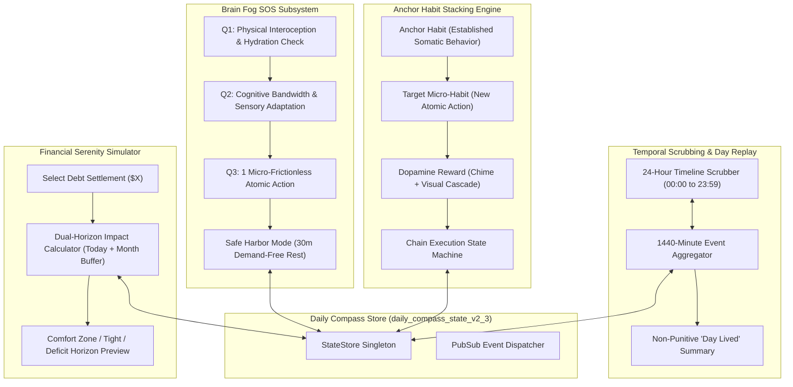
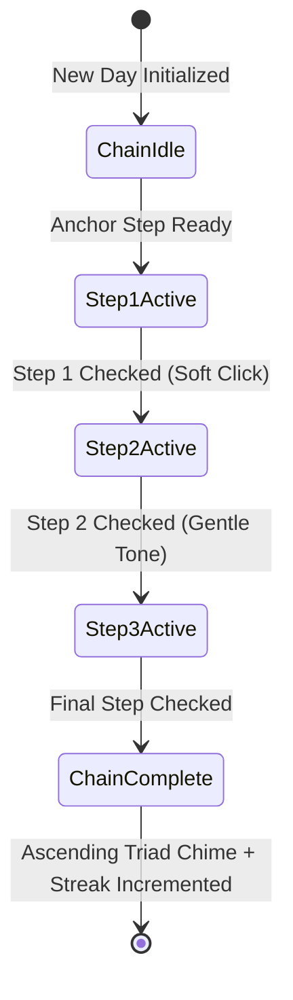
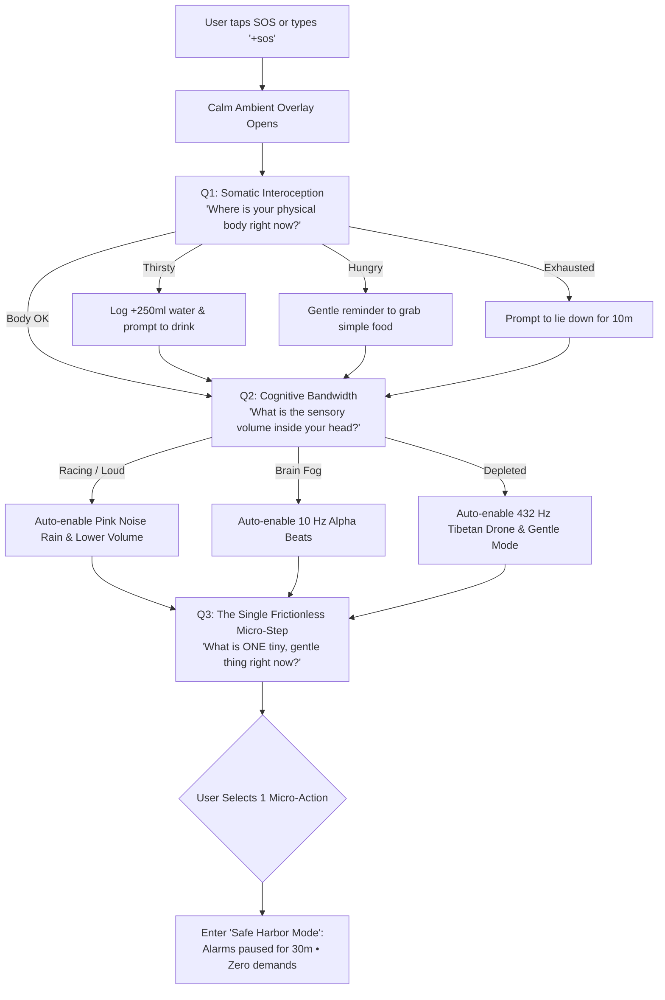

# 🧭 Daily Compass v2.3.0 Pro Max Quantum — Formal Specifications
# Temporal Scrub Engine, Anchor Habit Chains, Financial Serenity Simulator, & Brain Fog SOS

**Document Version:** 2.3.0-QUANTUM-SPEC  
**Status:** Canonical Engineering Specification  
**Target Architecture:** Local-First Web Application / Offline Progressive Web App (PWA)  
**Core Principles:** Ponytail Simplicity, Zero External Dependencies, Native Web Standards (Web Audio API, SVG, Vanilla ES Modules), Cognitive Somatic Safety for ADHD & Executive Dysfunction.

---

## 1. Executive Summary & System Architecture

Daily Compass v2.3.0 ("Pro Max Quantum / Sensory Flow") introduces four transformative cognitive scaffolding capabilities:
1. **Day Replay & Scrubbing Engine ("Temporal Scrub"):** An interactive 24-hour continuous time scrubber ($M \in [0, 1439]$) that reconstructs the day's events, routines, hydration logs, medications, and expenses, replacing time blindness and self-blame with a non-punitive, visual narrative of lived experience.
2. **Anchor Habit Stacking Chains:** Grounded in BJ Fogg's behavior design, allowing habits to be linked into sequential micro-chains ($\text{Anchor} \rightarrow \text{Trigger} \rightarrow \text{Reward}$) with cascading completion visuals and harmonic audio feedback.
3. **Debt Payback & Cash Impact Simulator ("Financial Serenity"):** A predictive "What-If" preview engine that models the exact mathematical effect of debt repayments on today's Safe-to-Spend and the End-of-Month Cash Buffer before committing real money.
4. **Compassionate 3-Question Emergency Reboot ("Brain Fog SOS"):** An interoceptive somatic grounding flow for severe ADHD paralysis, autistic shutdown, or sensory panic that safely de-escalates the user into a 30-minute demand-free "Safe Harbor".



---

## 2. Capability 1: Day Replay & Scrubbing Engine ("Temporal Scrub")

### 2.1 The Psychology of Time Blindness & The "Lost Day" Spiral
Individuals with ADHD and executive dysfunction frequently reach late evening in a state of acute emotional distress:
- *"Where did the whole day go? I feel like I did nothing."*
- When unable to recall the sequence of the day, working memory fills the vacuum with guilt, assuming time was "wasted".
- Traditional habit trackers show a binary list of incomplete tasks, reinforcing failure.

The **Temporal Scrub Engine** reframes time tracking from *judgment* into *compassionate observation*. It allows users to smoothly scrub across the 24 hours of their day, visually illuminating where their energy went.

### 2.2 Component Visual Wireframe & Interaction Design
```
+---------------------------------------------------------------------------------------------------+
| 🕰️ TEMPORAL SCRUB & DAY REPLAY                                            [ ✕ Close / Esc ]       |
+---------------------------------------------------------------------------------------------------+
| SCRUB POSITION: 14:30 (02:30 PM)  •  ACTIVE BLOCK: Execution Block 2 (14:00 - 16:30)             |
|                                                                                                   |
| 00:00        04:00        08:00        12:00        16:00        20:00        23:59               |
| |------------|------------|====[████]===|===[████]===|====[●]====|------------|                   |
|                           🌅 Morning   🎯 Focus 1    ⚡ Now      🌙 Night                         |
|                           💧+250ml     💊 Meds       💸 $14 lunch                                 |
|                                                                                                   |
| [ ⏪ -15m ]   [ ▶ Play Day Replay (12s) ]   [ ⏸ Pause ]   [ ⏩ +15m ]   [ ⚡ Jump to Current Time ] |
+---------------------------------------------------------------------------------------------------+
| 🔍 INSPECTOR AT 14:30:                                                                           |
| • Active Routine:  Execution Block 2 ("Wrap core project milestones")                            |
| • Nearby Events:   14:15 - Logged $14.50 expense (Food: "Sandwich & sparkling water")             |
|                    14:00 - Drank 250ml water (Daily total reached: 1,500ml)                       |
| • Battery State:   Medium (60%) • Sensory load manageable                                         |
+---------------------------------------------------------------------------------------------------+
| 🌿 COMPASSIONATE DAY RECAP:                                                                       |
| "Today you drank 1,750ml water, completed 2 focus sprints (50m total), logged 3 expenses, and     |
|  took your morning medication. Your time was lived."                                              |
+---------------------------------------------------------------------------------------------------+
```

### 2.3 Mathematical Model & Event Aggregation
The day is modeled as a continuous discrete domain of **1440 minutes**:
$$\mathcal{T} = \{ m \in \mathbb{Z} \mid 0 \le m \le 1439 \}$$
Where minute index $m$ is derived from time string `HH:MM`:
$$m(H, M) = H \times 60 + M$$

#### Event Aggregation Matrix
Every tracked action is mapped into a discrete temporal event node:
$$E = (m_e, \text{type}, \text{label}, \text{payload})$$
Types:
1. `routine_block`: $\text{interval } [m_{\text{start}}, m_{\text{end}}]$ with color and micro-steps.
2. `hydration`: $m_e$ with amount in ml.
3. `medication`: $m_e$ with medicine name and dosage.
4. `cash_transaction`: $m_e$ with amount, type (`expense` or `income`), and category.
5. `habit_check`: $m_e$ with habit title and streak.
6. `focus_sprint`: $\text{interval } [m_{\text{start}}, m_{\text{end}}]$ with mode and audio preset.

#### Inspector Lookup Algorithm: $\mathcal{O}(1)$ via Minute Bucket Index
```javascript
function getEventsAtMinute(minuteIndex, dayEvents, windowRadius = 15) {
  const minBound = Math.max(0, minuteIndex - windowRadius);
  const maxBound = Math.min(1439, minuteIndex + windowRadius);
  
  return {
    activeRoutine: dayEvents.routines.find(r => 
      r.isCrossMidnight 
        ? (minuteIndex >= r.startMins || minuteIndex <= r.endMins)
        : (minuteIndex >= r.startMins && minuteIndex <= r.endMins)
    ) || null,
    nearbyEvents: dayEvents.points.filter(pt => pt.minute >= minBound && pt.minute <= maxBound),
    cumulativeWater: dayEvents.hydration
      .filter(h => h.minute <= minuteIndex)
      .reduce((sum, h) => sum + h.amount, 0),
    cumulativeSpend: dayEvents.expenses
      .filter(x => x.minute <= minuteIndex)
      .reduce((sum, x) => sum + x.amount, 0)
  };
}
```

### 2.4 Day Replay Mode (Zero-Cognitive Playback)
- **Playback Animation:** User taps `[▶ Play Day Replay]`. The engine animates the scrubber from $m = 0$ to $m = m_{\text{now}}$ over 12.0 seconds (120 minutes per second).
- **Acoustic Haptic Feedback:** As the playhead crosses an event node:
  - Hydration node: Sounds a soft synthesized water droplet tick (800 Hz sine impulse).
  - Habit completion: Sounds Preset 2 Gentle Triad.
  - Expense node: Sounds a subtle tactile woodblock tick.
- **Safety Invariant:** Scrubbing or replaying is strictly **read-only**. It never alters historical state or shifts active alarms.

### 2.5 Method Signatures: Temporal Scrub Engine
```typescript
interface TemporalScrubEngine {
  /**
   * Compiles all activities of a given date (default today) into the 1440-minute event timeline.
   */
  compileDayTimeline(targetDateISO?: string): DayTimeline;

  /**
   * Sets current scrub position in minutes (0 to 1439) and returns the inspector telemetry.
   */
  setScrubMinute(minuteIndex: number): TimelineInspectorState;

  /**
   * Starts or pauses the animated 12-second day replay.
   */
  toggleReplay(onTick?: (state: TimelineInspectorState) => void): boolean;

  /**
   * Generates a compassionate, non-punitive summary text string of the day's lived actions.
   */
  generateCompassionateRecap(timeline: DayTimeline): string;
}
```

### 2.6 Formal JSON Schema: Temporal Scrub Timeline

```json
{
  "$schema": "https://json-schema.org/draft/2020-12/schema",
  "$id": "https://dailycompass.local/schemas/v2-3/temporal-scrub.json",
  "title": "TemporalScrubModuleV23",
  "type": "object",
  "required": ["date", "currentScrubMinute", "events", "recap"],
  "properties": {
    "date": { "type": "string", "format": "date" },
    "currentScrubMinute": { "type": "integer", "minimum": 0, "maximum": 1439 },
    "isPlaying": { "type": "boolean", "default": false },
    "events": {
      "type": "object",
      "required": ["routines", "hydrationPoints", "medicationPoints", "cashPoints", "habitPoints"],
      "properties": {
        "routines": {
          "type": "array",
          "items": {
            "type": "object",
            "properties": {
              "id": { "type": "string" },
              "title": { "type": "string" },
              "startMins": { "type": "integer" },
              "endMins": { "type": "integer" },
              "color": { "type": "string" }
            }
          }
        },
        "hydrationPoints": {
          "type": "array",
          "items": {
            "type": "object",
            "properties": { "minute": { "type": "integer" }, "amountMl": { "type": "integer" } }
          }
        },
        "medicationPoints": {
          "type": "array",
          "items": {
            "type": "object",
            "properties": { "minute": { "type": "integer" }, "name": { "type": "string" } }
          }
        },
        "cashPoints": {
          "type": "array",
          "items": {
            "type": "object",
            "properties": { "minute": { "type": "integer" }, "amount": { "type": "number" }, "type": { "type": "string" } }
          }
        },
        "habitPoints": {
          "type": "array",
          "items": {
            "type": "object",
            "properties": { "minute": { "type": "integer" }, "title": { "type": "string" } }
          }
        }
      }
    },
    "recap": {
      "type": "object",
      "required": ["text", "totalWaterMl", "totalSpent", "habitsDoneCount", "focusMinutesCount"],
      "properties": {
        "text": { "type": "string" },
        "totalWaterMl": { "type": "integer" },
        "totalSpent": { "type": "number" },
        "habitsDoneCount": { "type": "integer" },
        "focusMinutesCount": { "type": "integer" }
      }
    }
  }
}
```

---

## 3. Capability 2: Anchor Habit Stacking Chains

### 3.1 Behavior Design Science: The BJ Fogg Micro-Chain
Starting an isolated habit demands high activation energy ($\Delta G_{\text{activation}}$).
Habit Stacking overcomes this by tethering the target habit to an existing involuntary neural pathway (an "Anchor"):

$$\text{Anchor Habit (Trigger)} \xrightarrow{\quad\text{Immediate Physical Context}\quad} \text{Target Micro-Habit} \xrightarrow{\quad\text{Sensory Gratification}\quad} \text{Reward}$$

**Example:**
- **Step 1 (Somatic Anchor):** "Start morning coffee brew"
- **Step 2 (Target Micro-Habit):** "Drink full glass of water while machine brews"
- **Step 3 (Immediate Reward):** "Take first warm sip of coffee + play Gentle Triad chime"

### 3.2 Visual Component Wireframe & Chain Cascade
```
+---------------------------------------------------------------------------------------------------+
| 🔗 ANCHOR HABIT STACK: "Morning Spark Chain"                         [ Streak: 🔥 8 Days ]        |
+---------------------------------------------------------------------------------------------------+
|                                                                                                   |
|  [✓ 1. Brew Morning Coffee]                                                                       |
|             |                                                                                     |
|             | ~ ~ ~ (Connected glowing filament) ~ ~ ~                                            |
|             v                                                                                     |
|  [✓ 2. Drink 500ml Water & Vitamins]                                                              |
|             |                                                                                     |
|             | ~ ~ ~ (Next in cascade) ~ ~ ~                                                       |
|             v                                                                                     |
|  [⭕ 3. Open Daily Compass Focus Anchor]  <-- CURRENT ACTIVE STEP [✓ Done - Complete Stack]       |
|                                                                                                   |
| Progress: [==========================>          ] 2 of 3 steps completed (67%)                    |
+---------------------------------------------------------------------------------------------------+
```

### 3.3 Cascade Completion State Machine & Ergonomics



#### Cascade Invariants
1. **Linear & Flexible Progression:** Checking Step 1 immediately spotlights Step 2 with a pulsing lavender focus ring. However, if a user needs to complete Step 2 first (e.g. drank water before coffee), they are permitted to do so without validation blockage.
2. **Harmonic Audio Progression:**
   - Step 1 check: Web Audio fundamental note (C5 - 523 Hz).
   - Step 2 check: Major third note (E5 - 659 Hz).
   - Step 3 (Final) check: Fifth note (G5 - 784 Hz) + Full Gentle Triad arpeggio with celebratory soft sparkle particle visual.
3. **Chain Streak Self-Healing:** The streak increments when all steps in the chain are satisfied. If 1 step is missed on day $D$, the chain is granted a Streak Shield rather than zeroing out.
4. **Recursive Cycle Prevention:** A habit cannot link to itself or form circular dependencies ($A \rightarrow B \rightarrow A$). The validation engine verifies directed acyclic graph (DAG) invariants prior to saving.

### 3.4 Method Signatures: Habit Stacking Contracts
```typescript
interface HabitStackEngine {
  /**
   * Creates a new habit chain linking ordered habit IDs.
   */
  createHabitChain(payload: HabitChainInput): HabitChain;

  /**
   * Appends or removes habit links in an existing chain.
   */
  updateHabitChain(chainId: string, partial: Partial<HabitChainInput>): HabitChain;

  /**
   * Executes completion of a step within a chain. Handles cascade progression and audio chords.
   */
  advanceChainStep(chainId: string, habitId: string): ChainProgressResult;

  /**
   * Verifies DAG invariants ensuring no circular habit stack dependencies exist.
   */
  validateChainGraph(chainSteps: string[]): boolean;
}
```

### 3.5 Formal JSON Schema: Habit Stacking Chain

```json
{
  "$schema": "https://json-schema.org/draft/2020-12/schema",
  "$id": "https://dailycompass.local/schemas/v2-3/habit-stack.json",
  "title": "HabitStackChainModuleV23",
  "type": "object",
  "required": ["id", "title", "anchorHabitId", "steps", "streak", "isCompletedToday"],
  "properties": {
    "id": { "type": "string", "format": "uuid" },
    "title": { "type": "string", "minLength": 1, "maxLength": 80 },
    "description": { "type": "string", "default": "" },
    "anchorHabitId": { "type": "string", "description": "The established foundational habit ID" },
    "steps": {
      "type": "array",
      "minItems": 2,
      "maxItems": 6,
      "items": {
        "type": "object",
        "required": ["habitId", "order", "rewardText", "isCompleted"],
        "properties": {
          "habitId": { "type": "string" },
          "order": { "type": "integer", "minimum": 1 },
          "rewardText": { "type": "string", "default": "" },
          "isCompleted": { "type": "boolean", "default": false },
          "completedAt": { "type": ["string", "null"], "format": "date-time" }
        }
      }
    },
    "streak": {
      "type": "object",
      "required": ["current", "best", "lastCompletedDate"],
      "properties": {
        "current": { "type": "integer", "default": 0 },
        "best": { "type": "integer", "default": 0 },
        "lastCompletedDate": { "type": ["string", "null"], "format": "date" }
      }
    },
    "isCompletedToday": { "type": "boolean", "default": false }
  }
}
```

---

## 4. Capability 3: Debt Payback & Cash Impact Simulator ("Financial Serenity")

### 4.1 The Cognitive Dilemma: Settlement Hesitation & Shame
When an executive-dysfunctional user owes money ($40 to a friend for dinner) or is owed money, they often freeze:
- *"If I transfer $40 right now, will I overdraw today's daily budget? Will I run out of cash before the 30th?"*
- Because math causes anxiety, they postpone payment, leading to social friction and persistent background shame.

The **Financial Serenity Simulator** eliminates this fear through a zero-commitment **"What-If?" Horizon Preview**.

### 4.2 Visual Component Wireframe
```
+---------------------------------------------------------------------------------------------------+
| 🧮 DEBT SETTLEMENT & CASH HORIZON SIMULATOR                               [ ✕ Cancel ]           |
+---------------------------------------------------------------------------------------------------+
| Debt Target:    Alex (Hardware store supplies)   •   Outstanding Balance: $30.00                  |
| Direction:      I Owe Them (Payable Debt)                                                         |
+---------------------------------------------------------------------------------------------------+
| SIMULATED SETTLEMENT AMOUNT:  [ $ 30.00 ]                                                         |
| Quick Options:   [ Pay Full $30.00 ]   [ Pay Half $15.00 ]   [ Custom Amount ]                    |
|                                                                                                   |
| PREDICTIVE IMPACT PREVIEW (If you pay $30.00 right now):                                          |
|                                                                                                   |
| 1. TODAY'S DAILY SPENDING CAP:                                                                    |
|    Current Safe-to-Spend:  $ 35.00                                                                |
|    Simulated After Pay:    $  5.00  (Comfortably positive • Safe 🟢)                              |
|                                                                                                   |
| 2. END-OF-MONTH CASH BUFFER:                                                                      |
|    Current Forecast:       +$151.03 (Safe Cushion)                                                |
|    Simulated Forecast:     +$121.03 (Cushion remains intact • Above 15% margin 🟢)                 |
|                                                                                                   |
| 🌿 VERDICT: You are completely safe to settle this debt right now.                                |
+---------------------------------------------------------------------------------------------------+
| [ ↶ Cancel / Don't Pay Yet ]                         [ 🤝 Confirm & Apply Settlement ($30.00) ]  |
+---------------------------------------------------------------------------------------------------+
```

### 4.3 Mathematical Simulation Formulation

#### Variables
- $S_{\text{today}}$: Today's current Safe-to-Spend balance.
- $B_{\text{forecast}}$: Projected End-of-Month Cash Buffer.
- $P$: Simulated settlement amount ($P \in [0.01, \text{remainingAmount}]$).
- $D_{\text{remaining}}$: Days remaining in the calendar month.
- $C_{\text{daily}}$: Daily spending cap.

#### Dual-Horizon Formulations
1. **For Debts I Owe ("I Owe Them" / Payable Outflow):**
   $$S_{\text{today}}^{\text{sim}} = S_{\text{today}} - P$$
   $$B_{\text{forecast}}^{\text{sim}} = B_{\text{forecast}} - P$$

2. **For Debts They Owe Me ("They Owe Me" / Receivable Inflow):**
   $$S_{\text{today}}^{\text{sim}} = S_{\text{today}} + P$$
   $$B_{\text{forecast}}^{\text{sim}} = B_{\text{forecast}} + P$$

#### Safety Horizon Evaluation Engine
$$\text{Horizon Status} = \begin{cases} 
\text{COMFORTABLE (Green)} & \text{if } S_{\text{today}}^{\text{sim}} \ge 0 \land B_{\text{forecast}}^{\text{sim}} \ge 0.15 \times \text{MonthlyPool} \\
\text{TIGHT MARGIN (Amber)} & \text{if } S_{\text{today}}^{\text{sim}} \ge 0 \land 0 \le B_{\text{forecast}}^{\text{sim}} < 0.15 \times \text{MonthlyPool} \\
\text{DEFICIT RISK (Coral)} & \text{if } S_{\text{today}}^{\text{sim}} < 0 \lor B_{\text{forecast}}^{\text{sim}} < 0 
\end{cases}$$

- If status is **Deficit Risk**, the simulator calculates an **Adaptive Daily Pacing Recommendation**:
  $$C_{\text{adjusted}} = \frac{B_{\text{forecast}}^{\text{sim}} + (D_{\text{remaining}} \times C_{\text{daily}})}{D_{\text{remaining}}}$$
  *"If you pay this debt today, adjusting your daily cap to $\$28.00$ (from $\$40.00$) will keep you balanced to month-end."*

### 4.4 Method Signatures: Financial Simulator Contracts
```typescript
interface FinancialSerenitySimulator {
  /**
   * Computes non-destructive simulation impact on today's budget and month-end buffer.
   */
  simulateDebtSettlement(debtId: string, amountToPay: number): SettlementSimulationResult;

  /**
   * Commits the settlement to the store atomically:
   * 1. Updates DebtRecord remaining balance and history.
   * 2. Injects CashTransaction (category: 'bills' or 'reimbursement').
   * 3. Re-evaluates live Safe-to-Spend.
   */
  commitSettlement(debtId: string, amountToPay: number, note?: string): Promise<CommitResult>;
}
```

### 4.5 Formal JSON Schema: Financial Simulation Payload

```json
{
  "$schema": "https://json-schema.org/draft/2020-12/schema",
  "$id": "https://dailycompass.local/schemas/v2-3/financial-simulator.json",
  "title": "FinancialSimulatorModuleV23",
  "type": "object",
  "required": ["debtId", "simulatedAmount", "direction", "currentSafeToSpend", "simulatedSafeToSpend", "currentBuffer", "simulatedBuffer", "status"],
  "properties": {
    "debtId": { "type": "string", "format": "uuid" },
    "simulatedAmount": { "type": "number", "minimum": 0.01 },
    "direction": { "type": "string", "enum": ["lent", "borrowed"] },
    "currentSafeToSpend": { "type": "number" },
    "simulatedSafeToSpend": { "type": "number" },
    "currentBuffer": { "type": "number" },
    "simulatedBuffer": { "type": "number" },
    "status": {
      "type": "string",
      "enum": ["comfortable", "tight_margin", "deficit_risk"]
    },
    "recommendedDailyCap": { "type": ["number", "null"] },
    "verdictMessage": { "type": "string" }
  }
}
```

---

## 5. Capability 4: Compassionate 3-Question Emergency Reboot ("Brain Fog SOS")

### 5.1 The Psychology of Executive Freeze & Sensory Panic
Under high stress, executive functioning shuts down. Asking an overwhelmed person to "prioritize" or "plan their day" is neurologically impossible when the amygdala is hijacked.
The **Brain Fog SOS Sequence** is an evidence-based somatic de-escalation protocol that asks three gentle, low-cognitive-load questions to return the user to baseline.

### 5.2 The 3-Step Guided Reboot Flow



### 5.3 Detailed Step Specifications

#### Question 1: Somatic Interoception ("Where is your body right now?")
- **Visual:** Smooth expanding and contracting circle (4s inhale, 6s exhale).
- **Text:** *"Drop your shoulders away from your ears. Unclench your jaw. How does your body feel?"*
- **Response Pills:**
  - `[💧 Thirsty (Sip 1 glass of water)]`
  - `[🍎 Hungry (Grab a simple snack)]`
  - `[🥱 Physical Exhaustion (Lie down 10 min)]`
  - `[🌿 My body is stable]`

#### Question 2: Cognitive Bandwidth ("What is the sensory volume in your head?")
- **Text:** *"You don't have to fix anything right now. What is happening in your mind?"*
- **Response Pills:**
  - `[🌪️ Racing & Overstimulated]`: Automatically starts **Pink Noise Rain**, softens theme brightness by 20%.
  - `[🌫️ Foggy, Numb or Dissociated]`: Automatically sets **10 Hz Alpha Binaural Beat**, provides clear high-contrast typography.
  - `[🔋 Depleted / 0% Battery]`: Automatically sets **Battery to Low (20%)**, activates **Gentle Mode**, and turns on **432 Hz Tibetan Drone**.

#### Question 3: The Single Atomic Micro-Step ("What is ONE tiny action for the next 2 minutes?")
- **Text:** *"Forget all routines. Forget every to-do item. Choose ONE tiny, compassionate micro-step."*
- **Preset Options:**
  1. `[🪟 Look out the window at daylight for 60 seconds]`
  2. `[💧 Take 2 sips of water and put your cup down]`
  3. `[🛋️ Lie completely still with eyes closed for 5 minutes]`
  4. `[✍️ Dump 1 messy sentence into Scratchpad without judging it]`
  5. `[Or type your own tiny step]`

#### Safe Harbor Activation
Completing the SOS sequence activates **Safe Harbor Mode for 30 minutes**:
- Displays a calm visual harbor banner: *"Safe Harbor Active (28m remaining) • The app will not ask anything of you."*
- Pauses routine alarms and sound reminders.
- Keeps chosen ambient soundscape playing softly in the background.

### 5.4 Method Signatures: Brain Fog SOS Contracts
```typescript
interface BrainFogSosController {
  /**
   * Launches the SOS grounding modal and pauses routine distractions.
   */
  launchSosSequence(): void;

  /**
   * Commits response to Step 1 (Somatic action).
   */
  recordSomaticAnswer(answer: 'thirsty' | 'hungry' | 'exhausted' | 'stable'): void;

  /**
   * Commits response to Step 2 (Sensory adaptation & soundscape trigger).
   */
  applySensoryAdaptation(volumeType: 'racing' | 'foggy' | 'depleted'): void;

  /**
   * Selects or records the single atomic step and activates Safe Harbor.
   */
  commitAtomicStepAndEnterSafeHarbor(stepTitle: string): SafeHarborSession;

  /**
   * Exits Safe Harbor mode early if the user feels grounded and ready.
   */
  exitSafeHarbor(): void;
}
```

### 5.5 Formal JSON Schema: Brain Fog SOS Session

```json
{
  "$schema": "https://json-schema.org/draft/2020-12/schema",
  "$id": "https://dailycompass.local/schemas/v2-3/brain-fog-sos.json",
  "title": "BrainFogSosModuleV23",
  "type": "object",
  "required": ["sessionId", "timestamp", "somaticState", "cognitiveBandwidth", "chosenAtomicStep", "safeHarbor"],
  "properties": {
    "sessionId": { "type": "string", "format": "uuid" },
    "timestamp": { "type": "string", "format": "date-time" },
    "somaticState": {
      "type": "string",
      "enum": ["thirsty", "hungry", "exhausted", "stable"]
    },
    "cognitiveBandwidth": {
      "type": "string",
      "enum": ["racing", "foggy", "depleted"]
    },
    "chosenAtomicStep": {
      "type": "object",
      "required": ["title", "isCompleted"],
      "properties": {
        "title": { "type": "string" },
        "isCompleted": { "type": "boolean", "default": false }
      }
    },
    "safeHarbor": {
      "type": "object",
      "required": ["isActive", "durationMinutes", "expiresAt"],
      "properties": {
        "isActive": { "type": "boolean", "default": true },
        "durationMinutes": { "type": "integer", "default": 30 },
        "expiresAt": { "type": "string", "format": "date-time" }
      }
    }
  }
}
```

---

## 6. Unified State Store Evolution: `daily_compass_state_v2_3`

### 6.1 State Additions in `DEFAULT_STATE`

```javascript
// Additions for v2.3.0 in DEFAULT_STATE
{
  // ... existing v2.0, v2.1, and v2.2 keys ...

  // v2.3 Anchor Habit Stacking Chains
  habitChains: [
    {
      id: 'chain-morning-spark',
      title: 'Morning Spark Stack',
      description: 'Grounded wake-up cascade',
      anchorHabitId: 'habit-water',
      steps: [
        { habitId: 'habit-water', order: 1, rewardText: 'Hydration anchor', isCompleted: false },
        { habitId: 'habit-meds', order: 2, rewardText: 'Wellness shield', isCompleted: false },
        { habitId: 'habit-walk', order: 3, rewardText: 'Daylight grounding', isCompleted: false }
      ],
      streak: { current: 3, best: 7, lastCompletedDate: null },
      isCompletedToday: false
    }
  ],

  // v2.3 Safe Harbor (Brain Fog SOS) State
  safeHarbor: {
    isActive: false,
    durationMinutes: 30,
    expiresAt: null,
    chosenAtomicStep: null
  }
}
```

### 6.2 Sanitizer Hooks & Zero-Loss Compatibility
`sanitizeAndMigrate(loadedState)` in `js/store.js`:
- Initializes `habitChains: []` if missing from earlier saves.
- Initializes `safeHarbor: { isActive: false, ... }` if missing.
- Checks if existing `safeHarbor.expiresAt` has passed; if so, cleanly deactivates Safe Harbor without user friction.

---

## 7. Implementation Verification Matrix & Acceptance Test Cases

| Test ID | Capability | Action / Scenario | Expected Verification Criteria |
| :--- | :--- | :--- | :--- |
| **TC-TS-01** | Temporal Scrub | Drag scrubber to minute 870 (14:30) | Active routine correctly identifies "Execution Block 2". Inspector displays events occurring within $\pm 15$ minutes. Cumulative water and spend reflect values up to 14:30. |
| **TC-TS-02** | Temporal Scrub | Tap `[▶ Play Day Replay]` | Scrubber animates smoothly across 1440 minutes over 12 seconds. Synthesizer triggers soft tactile ticks as event nodes are crossed. Read-only invariant preserved. |
| **TC-HC-01** | Habit Chains | Check Step 1 in "Morning Spark Stack" | Step 1 completes; Step 2 highlights with pulsing focus ring. Audio plays C5 (523 Hz) root tone. |
| **TC-HC-02** | Habit Chains | Check final step in 3-step chain | Chain marked complete today. Chain streak increments. Audio plays ascending Gentle Triad arpeggio (C5 $\rightarrow$ E5 $\rightarrow$ G5). |
| **TC-FS-01** | Financial Simulator | Simulate paying $30 on a $30 debt with $35 Safe-to-Spend | Simulator reports Safe-to-Spend drops to $5.00 (Comfortable 🟢). Buffer drops by $30.00 but remains in green. No database mutations occur. |
| **TC-FS-02** | Financial Simulator | Simulate paying $50 on $40 Safe-to-Spend | Simulator flags Deficit Risk (Coral). Displays adjusted daily cap recommendation ($32.00) to balance month-end. |
| **TC-SOS-01** | Brain Fog SOS | Type `+sos` or click SOS button | De-escalation modal opens. Ambiance switches to soothing twilight. Questions guide user through somatic and cognitive checks. |
| **TC-SOS-02** | Brain Fog SOS | Complete SOS sequence with "Look out window" | Safe Harbor activates for 30m. Routine alarms and visual pulses are silenced. Reassuring banner displayed: *"Safe Harbor Active • No demands."* |

---
**End of Specification — Daily Compass v2.3.0 Pro Max Quantum**
