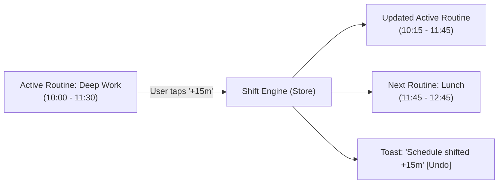

# Daily Compass — UI/UX Design System Specification (v2.0 Pro Max Expansion)
**Codename:** Nordic Twilight v2 / Cognitive Ergonomics & Calming Telemetry  
**Version:** 2.0.0 Pro Max  
**Status:** Canonical Implementation Standard  
**Document Context:** Extension to [DESIGN_SYSTEM.md](file:///c:/Users/Ivan/Pictures/Daily%20Tracker/docs/DESIGN_SYSTEM.md) | Followed by [V2_1_DESIGN_SYSTEM.md](file:///c:/Users/Ivan/Pictures/Daily%20Tracker/docs/V2_1_DESIGN_SYSTEM.md)  
**Target Environment:** Local-First Web Cockpit / Mobile-First PWA (Zero External CDN/Framework Dependencies)

---

## 1. Executive Vision & The v2.0 Pro Max Design Philosophy

The v1.0 architecture established the **Current Focus Anchor**, the **Nordic Twilight** eye-friendly palette, and the single-action anti-overwhelm framework. 

The **v2.0 Pro Max Expansion** elevates Daily Compass from a static task/expense ledger into an **adaptive cognitive prosthetic**. Modern life introduces variable energy, sensory fatigue, schedule volatility, and digital disarray. To solve these without introducing anxiety:

1. **Energy-Adaptive Ergonomics (Spoon Theory):** The interface must not demand high-intensity focus when the user is running on 20% stamina. The new **Energy Battery Gauge** drives an ambient **Gentle Mode** that actively filters secondary clutter and softens demands.
2. **Somatic Anchoring (Hydration & Medication):** Executive function is biologically bound to physical hydration and neurotransmitter stability. Water intake and scheduled medications are elevated to tactile, zero-friction 1-tap widgets.
3. **Temporal Fluidity (Quick-Shift Bar):** Rigid timetables trigger shame when tasks inevitably spill over. The Quick-Shift Bar allows schedule blocks to slide forward (+15m, +30m, +1h) with a single tap—no calendar rescheduling fatigue.
4. **Autonomous Sensory Modulation (Sprint Timer & Ambient Audio):** Deep work sessions are protected by procedural Web Audio soundscapes (Rain, Alpha Waves, Singing Bowl Drone) unified with a minimalist countdown ring.
5. **Universal Keyboard Grounding (Global Omnibar):** With `Cmd+K` / `Ctrl+K`, power users and overwhelmed users alike can search anything or trigger instant grounding actions in under 200ms.
6. **Zero-Library Data Visualization:** Heatmaps and financial donut charts are rendered via pure SVG/HTML tokens—eliminating bloated chart libraries while maintaining high performance, offline reliability, and crisp high-DPI rendering.
7. **Psychological Safety Net (Rolling Local Snapshots):** Total freedom to experiment, knowing that 7 days of automated local rolling snapshots can restore state in 1 click.

---

## 2. Master CSS Variables & Design Tokens (v2.0 Pro Max)

These design tokens build upon and extend the core Nordic Twilight color matrix. They maintain strict compliance with WCAG 2.2 AAA contrast standards on dark/twilight surfaces without causing photophobic glare.

```css
/* ==========================================================================
   DAILY COMPASS v2.0 PRO MAX — EXPANSION DESIGN TOKENS
   Strict Nordic Twilight Color Science & Calm Ergonomics
   ========================================================================== */

:root {
  /* --------------------------------------------------------------------------
     1. BASE SURFACES & ELEVATION (Warm Slate & Deep Charcoal)
     -------------------------------------------------------------------------- */
  --bg-canvas: #181c24;                /* Deep slate canvas (prevents halation) */
  --bg-canvas-subtle: #1c212c;         /* Inset wells, table track backgrounds */
  --bg-card: #222734;                  /* Main container cards */
  --bg-card-hover: #272d3c;            /* Micro-interactive hover surface */
  --bg-card-elevated: #2c3345;         /* Floating modals, Omnibar, flyout bars */
  --bg-card-overlay: rgba(18, 22, 30, 0.82); /* Frosted blur backdrop */
  --bg-card-glass: rgba(34, 39, 52, 0.75);   /* Translucent dock & hero sheets */

  /* --------------------------------------------------------------------------
     2. BORDERS, DIVIDERS & RINGS
     -------------------------------------------------------------------------- */
  --border-subtle: #2d3546;            /* Structural separator line */
  --border-muted: #3d465c;             /* Input outlines, secondary buttons */
  --border-focus: #58a6ff;             /* Keyboard focus ring (3px offset) */
  --border-accent-glow: rgba(88, 166, 255, 0.4);

  /* --------------------------------------------------------------------------
     3. HIGH-LEGIBILITY TEXT (Zero Glare, High Optical Contrast)
     -------------------------------------------------------------------------- */
  --text-primary: #e6edf3;             /* Soft chalk white (13.8:1 contrast) */
  --text-secondary: #9aa5b5;           /* Muted descriptive label (6.4:1 contrast) */
  --text-muted: #6e7681;               /* Timestamps, disabled glyphs (4.6:1) */
  --text-inverse: #0d1117;             /* Dark ink for high-brightness chips */

  /* --------------------------------------------------------------------------
     4. ENERGY BATTERY GAUGE TOKENS
     -------------------------------------------------------------------------- */
  --energy-low-base: #f85149;          /* Red-Coral (0-20% Exhaustion) */
  --energy-low-soft: #ff7b72;
  --energy-low-bg: rgba(248, 81, 73, 0.15);
  --energy-low-border: rgba(248, 81, 73, 0.40);
  --energy-low-glow: 0 0 16px rgba(248, 81, 73, 0.28);

  --energy-med-base: #58a6ff;          /* Sky Cobalt (21-60% Steady Flow) */
  --energy-med-soft: #79c0ff;
  --energy-med-bg: rgba(88, 166, 255, 0.15);
  --energy-med-border: rgba(88, 166, 255, 0.40);
  --energy-med-glow: 0 0 16px rgba(88, 166, 255, 0.25);

  --energy-high-base: #3fb950;         /* Sage Green (61-100% Full Capacity) */
  --energy-high-soft: #56d364;
  --energy-high-bg: rgba(63, 185, 80, 0.15);
  --energy-high-border: rgba(63, 185, 80, 0.40);
  --energy-high-glow: 0 0 16px rgba(63, 185, 80, 0.25);

  /* Gentle Mode Ambient Overrides */
  --gentle-ambient-bg: #15181f;        /* Deeper, lower luminance backdrop */
  --gentle-amber-dim: #cca05a;
  --gentle-glow-pulse: 0 0 24px rgba(204, 160, 90, 0.20);

  /* --------------------------------------------------------------------------
     5. HYDRATION & MEDICATION TOKENS
     -------------------------------------------------------------------------- */
  --water-cyan-base: #38bdf8;          /* Pure Hydration Cyan */
  --water-cyan-soft: #7dd3fc;
  --water-cyan-deep: #0284c7;
  --water-bg: rgba(56, 189, 248, 0.14);
  --water-border: rgba(56, 189, 248, 0.38);
  --water-glow: 0 0 18px rgba(56, 189, 248, 0.30);

  --med-taken-bg: rgba(63, 185, 80, 0.16);
  --med-taken-border: rgba(63, 185, 80, 0.45);
  --med-pending-bg: rgba(154, 165, 181, 0.08);
  --med-pill-tag: #bc8cff;            /* Muted Lilac for medication pills */

  /* --------------------------------------------------------------------------
     6. SCHEDULE QUICK-SHIFT TOKENS
     -------------------------------------------------------------------------- */
  --shift-pill-bg: #272f40;
  --shift-pill-border: #3d4a63;
  --shift-pill-hover: #343e54;
  --shift-pill-active: #58a6ff;
  --shift-accent: #f0883e;             /* Amber shift indicator */

  /* --------------------------------------------------------------------------
     7. FOCUS SPRINT & AMBIENT AUDIO TOKENS
     -------------------------------------------------------------------------- */
  --timer-ring-track: #1c222e;
  --timer-ring-focus: #58a6ff;         /* Sky Cobalt during Sprint */
  --timer-ring-break: #3fb950;         /* Sage Green during Rest */
  --soundscape-active-bg: rgba(188, 140, 255, 0.16);
  --soundscape-active-border: #bc8cff;
  --soundscape-wave-color: #d2a8ff;

  /* --------------------------------------------------------------------------
     8. COMMAND PALETTE (OMNIBAR) TOKENS
     -------------------------------------------------------------------------- */
  --omnibar-backdrop: rgba(10, 13, 18, 0.85);
  --omnibar-surface: #202634;
  --omnibar-input-bg: #181d27;
  --omnibar-item-hover: #293142;
  --omnibar-item-selected: rgba(88, 166, 255, 0.16);
  --omnibar-kbd-bg: #2d3546;
  --omnibar-kbd-border: #445069;

  /* --------------------------------------------------------------------------
     9. VISUALIZATION & HEATMAP TOKENS (Pure SVG/HTML)
     -------------------------------------------------------------------------- */
  --heat-lvl-0: #1c212c;               /* Unchecked / Rest Day */
  --heat-lvl-1: #1f3b2b;               /* 1-2 Habits Complete (25%) */
  --heat-lvl-2: #256336;               /* 3-4 Habits Complete (60%) */
  --heat-lvl-3: #2ea043;               /* 5+ Habits Complete (85%) */
  --heat-lvl-4: #3fb950;               /* 100% Day Perfect (Gentle Glow) */
  --heat-rest-marker: #d29922;         /* Gentle Amber dot for Rest Day */

  --chart-donut-groceries: #58a6ff;
  --chart-donut-dining: #f0883e;
  --chart-donut-transit: #3fb950;
  --chart-donut-bills: #bc8cff;
  --chart-donut-personal: #f85149;
  --chart-donut-savings: #38bdf8;

  /* --------------------------------------------------------------------------
     10. SNAPSHOT RESTORE TOKENS
     -------------------------------------------------------------------------- */
  --snapshot-card-bg: #202532;
  --snapshot-card-border: #2e3748;
  --snapshot-current-badge: #3fb950;
  --snapshot-restore-hover: #58a6ff;

  /* --------------------------------------------------------------------------
     11. RADII, ELEVATION & TIMING
     -------------------------------------------------------------------------- */
  --radius-xs: 6px;
  --radius-sm: 10px;
  --radius-md: 14px;
  --radius-lg: 20px;
  --radius-xl: 28px;
  --radius-full: 9999px;

  --shadow-dock: 0 12px 36px rgba(0, 0, 0, 0.55), 0 0 1px rgba(255, 255, 255, 0.08);
  --shadow-modal: 0 20px 50px rgba(0, 0, 0, 0.70), 0 0 0 1px rgba(255, 255, 255, 0.06);

  --ease-spring: cubic-bezier(0.175, 0.885, 0.32, 1.275);
  --ease-calm: cubic-bezier(0.16, 1, 0.3, 1);
  --duration-micro: 120ms;
  --duration-normal: 250ms;
  --duration-gentle: 400ms;
}
```

---

## 3. Typography & Spacing Hierarchy

To preserve cognitive clarity under fatigue or sensory overwhelm, the typography scale is strictly locked. Micro-fonts under `13px` are avoided for reading text; tabular numbers are applied anywhere values fluctuate.

```
+-----------------------------------------------------------------------------------+
| SCALE IDENTIFIER         | SIZE / LINE-HEIGHT | WEIGHT     | FONT FAMILY          |
+--------------------------+--------------------+------------+----------------------+
| Display Hero Timer       | 48px / 1.1         | 700 Bold   | Tabular Monospace    |
| Section Header (H2)      | 20px / 1.35        | 600 Semi   | Sans-Serif System    |
| Widget Card Title (H3)   | 16px / 1.4         | 600 Semi   | Sans-Serif System    |
| Body Standard            | 15px / 1.5         | 400 Reg    | Sans-Serif System    |
| Micro-Metric / Tag       | 13px / 1.35        | 500 Med    | Tabular Monospace    |
| Key Shortcut Chip        | 11px / 1.0         | 600 Semi   | Tabular Monospace    |
+-----------------------------------------------------------------------------------+
```

---

## 4. Feature 1: Energy Battery Gauge & "Gentle Mode"

### 4.1 Concept & Cognitive Ergonomics
Executive function fluctuates based on sleep, sensory overload, and physical stamina (Spoon Theory). When a user is at 20% stamina, showing 15 overdue tasks triggers decision paralysis.
The **Energy Battery Gauge** gives the user immediate control of their interface state:
- **100% (High / Sage Green):** Standard high-momentum dashboard.
- **60% (Medium / Sky Cobalt):** Balanced routine flow.
- **20% (Low / Coral Amber):** Triggers **Gentle Mode**, shielding the user from guilt and cognitive weight.

### 4.2 Visual Schematic & Segmented Battery Wireframe

```
+-----------------------------------------------------------------------------------+
| ENERGY BATTERY GAUGE (Top Header / Hero Inset)                                    |
|                                                                                   |
|  [⚡ Energy: 20% (Low) ]    [ GENTLE MODE ACTIVE 🌿 ]      [ Toggle Level: [ 20% ] ]
|                                                                                   |
|  +-----------------------------------------------------------------------------+  |
|  | [ SEGMENT 1: 20% ]  |  [ SEGMENT 2: 60% ]  |  [ SEGMENT 3: 100% ]           |  |
|  | [##### AMBER #####]  |  [   Sky Cobalt   ]  |  [   Sage Green   ]           |  |
|  +-----------------------------------------------------------------------------+  |
|   Active Level: 20%      Next: Gentle Rest      Pacing: Slow & Steady             |
+-----------------------------------------------------------------------------------+
```

### 4.3 Interactive Behavior & Gentle Mode Effects
1. **One-Tap Stepping:** Clicking the battery widget or pressing key `E` cycles states: `100% -> 60% -> 20% -> 100%`.
2. **Visual Indicators:**
   - At **20%**: Segment 1 lights up with warm Amber/Rose `#f85149` / `#f0883e` with a soft glowing aura. Segments 2 & 3 are muted `#1c212c`.
   - At **60%**: Segments 1 & 2 illuminate in Sky Cobalt `#58a6ff`.
   - At **100%**: All three segments illuminate in vibrant calming Sage Green `#3fb950`.
3. **Gentle Mode System Transformations:**
   - **Visual Atmosphere:** Canvas shifts to `--gentle-ambient-bg` (`#15181f`). Non-essential borders dim to 50% opacity.
   - **Focus Anchor Simplification:** Hides backlog items; rewrites the Immediate Next Step label to self-compassionate guidance (e.g., *"Take 3 deep breaths, rest your eyes, or sip warm water"*).
   - **Financial Shield:** Replaces urgent red budget warnings with soft amber badges.
   - **Habit Forgiveness:** Activates an automatic "Streak Shield" badge for the day with zero guilt or broken streaks.

### 4.4 DOM Blueprint & Semantic Markup
```html
<div class="energy-gauge-widget" id="energy-gauge" role="region" aria-label="Energy Battery and Gentle Mode">
  <div class="energy-gauge-header">
    <div class="energy-title-group">
      <span class="energy-icon">⚡</span>
      <span class="energy-label">Energy Level: <strong id="energy-level-text">20% (Low)</strong></span>
    </div>
    <div class="gentle-mode-badge" id="gentle-mode-badge" aria-live="polite">
      <span class="gentle-leaf-icon">🌿</span>
      <span>Gentle Mode Active</span>
    </div>
  </div>

  <div class="energy-battery-track" id="energy-battery-track" tabindex="0" role="slider" aria-valuenow="20" aria-valuemin="20" aria-valuemax="100" aria-valuetext="20% Low Energy">
    <button class="battery-segment segment-20 active" data-level="20" title="Set Low Energy (20% - Gentle Mode)">
      <span class="segment-fill"></span>
      <span class="segment-label">20% Low</span>
    </button>
    <button class="battery-segment segment-60" data-level="60" title="Set Medium Energy (60% - Steady Flow)">
      <span class="segment-fill"></span>
      <span class="segment-label">60% Med</span>
    </button>
    <button class="battery-segment segment-100" data-level="100" title="Set High Energy (100% - Sprint)">
      <span class="segment-fill"></span>
      <span class="segment-label">100% High</span>
    </button>
  </div>
</div>
```

---

## 5. Feature 2: Hydration Ring & Medication Tracker

### 5.1 Concept & Somatic Grounding
Hydration and medication adherence form the somatic foundation of mental clarity. For ADHD and neurodivergent individuals, remembering to log water or take a dose is a frequent point of friction. 
This widget combines:
1. **SVG Hydration Progress Ring:** Visual circle filling dynamically toward the daily target (e.g., 2,500 ml).
2. **1-Tap Quick Pour Buttons:** Huge `+250ml` (glass) and `+500ml` (bottle) tap targets (height 48px).
3. **Pill Dosage Checklist:** Morning, afternoon, and evening slots with timestamp capture and dosage tags.

### 5.2 Layout Schematic & Wireframe

```
+-----------------------------------------------------------------------------------+
| HYDRATION & MEDICATION TRACKER (Today Dashboard Row)                              |
|                                                                                   |
|  +-------------------------------------+  +------------------------------------+  |
|  | HYDRATION PROGRESS                  |  | MEDICATION DOSAGE CHECKLIST        |  |
|  |                                     |  |                                    |  |
|  |           .--""""--.                |  | [x] 08:00 AM  Morning Vitamin & D3 |  |
|  |        .'     __     '.             |  |     Taken at 08:14 AM - 1000 IU    |  |
|  |       /    1,750 ml    \            |  |                                    |  |
|  |      |   70% of 2.5L    |           |  | [>] 13:00 PM  Omega 3 & Magnesium  |  |
|  |       \    Hydrated    /            |  |     Due with Lunch  (Pending)      |  |
|  |        '.            .'             |  |                                    |  |
|  |           '--....--'                |  | [ ] 21:00 PM  Melatonin / Night    |  |
|  |                                     |  |     Bedtime anchor (Upcoming)      |  |
|  |  [ +250ml Glass ]  [ +500ml Bottle ]|  |                                    |  |
|  |  [ -250ml Undo  ]  [ Reset Daily   ]|  | [ + Add Med ]  [ Pill History Log ]|  |
|  +-------------------------------------+  +------------------------------------+  |
+-----------------------------------------------------------------------------------+
```

### 5.3 SVG Ring Geometry & Pure CSS Animation
The circular ring utilizes standard SVG stroke math:
- Radius $r = 54$, Circumference $C = 2 \times \pi \times 54 \approx 339.29\text{px}$.
- `stroke-dasharray = 339.29`
- `stroke-dashoffset = 339.29 \times (1 - \text{fraction})`

```html
<div class="hydration-widget-card">
  <div class="card-header">
    <div class="card-title">💧 Daily Hydration Ring</div>
    <span class="water-badge" id="hydration-status-badge">1,750 / 2,500 ml</span>
  </div>

  <div class="hydration-ring-wrapper">
    <svg class="hydration-svg" viewBox="0 0 120 120" width="130" height="130" aria-hidden="true">
      <!-- Background Track -->
      <circle class="ring-bg" cx="60" cy="60" r="54" stroke-width="10" />
      <!-- Animated Water Ring -->
      <circle class="ring-progress" id="water-progress-ring" cx="60" cy="60" r="54" stroke-width="10"
              stroke-dasharray="339.29" stroke-dashoffset="101.78" stroke-linecap="round" />
    </svg>
    <div class="hydration-center-text">
      <span class="hydration-val" id="water-current-val">1,750</span>
      <span class="hydration-unit">ml</span>
      <span class="hydration-pct" id="water-pct-label">70%</span>
    </div>
  </div>

  <div class="water-quick-actions">
    <button class="btn-water-pour" data-amount="250" id="btn-water-250">
      <span class="water-pour-icon">🥛</span>
      <span>+250 ml</span>
    </button>
    <button class="btn-water-pour" data-amount="500" id="btn-water-500">
      <span class="water-pour-icon">🍶</span>
      <span>+500 ml</span>
    </button>
    <button class="btn-water-undo" id="btn-water-undo" title="Undo last pour">
      <span>↺ Undo</span>
    </button>
  </div>
</div>
```

---

## 6. Feature 3: Schedule Quick-Shift Bar

### 6.1 Concept: Frictionless Temporal Adaptation
One unexpected interruption (a phone call, traffic, an urgent fix) throws an entire scheduled routine into chaos. When users are forced to manually update five subsequent calendar items, they abandon tracking altogether.

The **Schedule Quick-Shift Bar** is anchored directly beside the **Routine Timeline Stream**. With one touch, the active routine and all downstream routines slide smoothly forward without recalculation stress.



### 6.2 UI Component Wireframe

```
+-----------------------------------------------------------------------------------+
| TODAY'S TIMELINE & QUICK-SHIFT BAR                                                |
|                                                                                   |
|  [ Routine Stream: 4 Blocks Remaining ]               [ Reset to Default Stream ] |
|  -------------------------------------------------------------------------------  |
|  ⚡ RUNNING BEHIND? SHIFT SCHEDULE:                                                |
|  [ +15 min ]      [ +30 min ]      [ +1 hour ]      |   [ ↺ Undo Shift (-15m) ]   |
|  -------------------------------------------------------------------------------  |
|  CURRENT ROUTINE:                                                                 |
|  [*] 10:15 AM - 11:45 AM  Deep Architecture & Specs  [ Active Now - Shifted +15m] |
|                                                                                   |
|  UPCOMING ROUTINES:                                                               |
|  [ ] 11:45 AM - 12:45 PM  Mindful Lunch & Hydration                               |
|  [ ] 12:45 PM - 02:30 PM  Sprint Implementation Block                             |
+-----------------------------------------------------------------------------------+
```

### 6.3 Quick-Shift Mechanics & Ergonomic Specs
- **Minimum Tap Target:** Height 44px, border radius `24px` (pill format).
- **Keyboard Shortcuts:** `Shift + ]` (+15m), `Shift + [` (-15m).
- **Safety Reversibility:** A non-intrusive 8-second toast banner provides 1-tap Undo.
- **Boundary Protection:** The shift engine clamps schedules to avoid rolling past bedtime boundaries (`23:59`), warning the user gently if sleep time is being encroached upon.

---

## 7. Feature 4: Focus Sprint Timer & Ambient Audio Player

### 7.1 Concept: Deep Work Sanctuary
Users shouldn't have to leave the app to open third-party Pomodoro websites or noisy video streaming sites that derail executive focus with algorithmic ads. 
The **Focus Sprint Timer & Ambient Audio Player** pairs:
1. An uncluttered countdown ring with high-contrast tabular figures.
2. Web Audio API-synthesized ambient audio soundscapes running client-side with 0% network overhead.

### 7.2 Soundscape Engine Architecture
Three calming, research-backed soundscapes are procedural synthesized:
- **1. Gentle Rain (Pink Noise + Low-Pass Filter):** Synthetic rain acoustics filtered to simulate warm rain against glass.
- **2. Alpha Waves (10 Hz Isochronic Pulse):** Soothing 10 Hz rhythm designed to support relaxed, focused wakefulness.
- **3. Zen Singing Bowl Drone (432 Hz + Harmonics):** Continuous resonant singing bowl drone with soft natural modulation.

```
+-----------------------------------------------------------------------------------+
| FOCUS SPRINT & AMBIENT AUDIO COCKPIT                                              |
|                                                                                   |
|                        .---''''---.                                               |
|                     .'     25:00    '.                                            |
|                    /   SPRINT ACTIVE  \                                           |
|                   |    Deep Writing    |                                          |
|                    \   Cycle: 1 of 4  /                                           |
|                     '.              .'                                            |
|                        '---....---'                                               |
|                                                                                   |
|           [ ▶ Start ]         [ ⏸ Pause ]         [ ↺ Reset ]                     |
|                                                                                   |
|  -------------------------------------------------------------------------------  |
|  AMBIENT SOUNDSCAPE:                                                              |
|  [🌧️ Rain Sound]     [🧠 Alpha 10Hz]     [🧘 432Hz Drone]     [🔇 Mute All]        |
|  Volume: [===========--------------------------------] 45%                        |
+-----------------------------------------------------------------------------------+
```

### 7.3 DOM Blueprint & Audio Integration
```html
<div class="focus-sprint-container card" id="focus-sprint-card">
  <div class="sprint-header">
    <div class="card-title">🎯 Focus Sprint & Ambient Sound</div>
    <div class="sprint-mode-pills">
      <button class="sprint-mode-btn active" data-duration="25">Sprint (25m)</button>
      <button class="sprint-mode-btn" data-duration="50">Deep (50m)</button>
      <button class="sprint-mode-btn" data-duration="5">Short Rest (5m)</button>
    </div>
  </div>

  <div class="sprint-ring-display">
    <svg class="sprint-timer-svg" viewBox="0 0 160 160" width="180" height="180">
      <circle class="timer-track" cx="80" cy="80" r="70" stroke-width="8" />
      <circle class="timer-fill" id="timer-progress-fill" cx="80" cy="80" r="70" stroke-width="8"
              stroke-dasharray="439.82" stroke-dashoffset="0" stroke-linecap="round" />
    </svg>
    <div class="sprint-timer-digits">
      <span class="digits-clock" id="sprint-clock-display">25:00</span>
      <span class="digits-label" id="sprint-stage-label">Deep Work Sprint</span>
    </div>
  </div>

  <div class="sprint-controls">
    <button class="btn-sprint-primary" id="btn-sprint-toggle">▶ Start Sprint</button>
    <button class="btn-sprint-secondary" id="btn-sprint-reset">↺ Reset</button>
  </div>

  <!-- Procedural Web Audio Soundscape Dock -->
  <div class="soundscape-dock">
    <div class="soundscape-label">🎧 Ambient Audio Soundscape:</div>
    <div class="soundscape-chips">
      <button class="soundscape-chip" data-preset="rain" id="sound-rain">
        <span class="chip-icon">🌧️</span>
        <span>Rain</span>
      </button>
      <button class="soundscape-chip" data-preset="alpha" id="sound-alpha">
        <span class="chip-icon">🧠</span>
        <span>Alpha Waves</span>
      </button>
      <button class="soundscape-chip" data-preset="drone" id="sound-drone">
        <span class="chip-icon">🧘</span>
        <span>Singing Bowl Drone</span>
      </button>
      <button class="soundscape-chip active" data-preset="none" id="sound-mute">
        <span class="chip-icon">🔇</span>
        <span>Silent</span>
      </button>
    </div>
    <div class="soundscape-volume-row">
      <span>Volume</span>
      <input type="range" min="0" max="100" value="50" class="soundscape-slider" id="soundscape-volume">
      <span id="soundscape-vol-pct">50%</span>
    </div>
  </div>
</div>
```

---

## 8. Feature 5: Global Command Palette / Omnibar Modal

### 8.1 Concept: Zero-Friction Keyboard Superhighway
Whether tracking an unexpected cash expense, starting a breathing session, or checking who owes money, users should not need to hunt through tabs. 
The **Omnibar** is accessible globally via `Cmd + K` or `Ctrl + K`. It unifies commands, data creation, and real-time search in under 200 milliseconds.

### 8.2 Layout Schematic & Wireframe

```
+-----------------------------------------------------------------------------------+
| GLOBAL COMMAND PALETTE (Cmd+K / Ctrl+K)                                           |
|                                                                                   |
|  +-----------------------------------------------------------------------------+  |
|  | [🔍] Search actions, tasks, debts, habits, or type '/coffee 3.50'... [Esc] |  |
|  +-----------------------------------------------------------------------------+  |
|  CATEGORIES: [ All ]  [⚡ Actions ]  [💵 Finance ]  [✅ Habits ]  [📝 Notes ]     |
|                                                                                   |
|  SUGGESTED / MATCHED ITEMS:                                                       |
|  +-----------------------------------------------------------------------------+  |
|  | 🧘 Grounding Anchor: 4-7-8 Breathing & Re-Center           [Action]  [Enter]  |  |
|  | ⚡ Shift Schedule by +15 Minutes                          [Action]  [Enter]  |  |
|  | 💧 Log Water (+250ml)                                     [Habit]   [Enter]  |  |
|  | 💵 Safe-to-Spend Left: $34.50 (Cap: $50)                  [Finance] [Enter]  |  |
|  | 🤝 Sarah owes you $45.00 for Dinner split                 [Debt]    [Enter]  |  |
|  | 🎯 Start 25m Focus Sprint                                 [Action]  [Enter]  |  |
|  +-----------------------------------------------------------------------------+  |
|  Navigation: [↑] [↓] to select  |  [Enter] to execute  |  [Esc] to close          |
+-----------------------------------------------------------------------------------+
```

### 8.3 Interaction Specifications & Shortcuts
- **Trigger:** Global keydown `(e.metaKey || e.ctrlKey) && e.key.toLowerCase() === 'k'`, or clicking the search icon in the header.
- **Escape Key:** Instantly closes modal and restores focus to previous active element.
- **Fuzzy Search & Prefixes:**
  - Typing `$` or `/cash` filters instantly to quick-add cash expense.
  - Typing `shift` reveals `+15m`, `+30m`, `+1h` timeline shifts.
  - Typing `water` or `med` jumps to somatic logs.
- **Accessibility:** Full `aria-expanded`, `role="combobox"`, `role="listbox"`, `aria-activedescendant` implementation.

---

## 9. Feature 6: Weekly Consistency Heatmap & SVG Expense Donut/Bar Chart

### 9.1 Concept: Zero External Libraries, Pure Accessible SVG Tokens
External charting libraries (Chart.js, D3, Recharts) add hundreds of kilobytes of third-party JavaScript, introduce external vulnerabilities, and often break offline PWA execution. 
Daily Compass renders rich visual telemetry using **100% native HTML5 and SVG markup**.

### 9.2 Weekly Consistency Heatmap (Anti-Shame Streak Garden)
Conventional habit trackers shame users with broken streaks if they miss a single day. Daily Compass replaces this with a **Consistency Matrix** that celebrates recovery and marks scheduled rest days with calm gold dots.

```
+-----------------------------------------------------------------------------------+
| WEEKLY CONSISTENCY HEATMAP (Past 4 Weeks)                                         |
|                                                                                   |
|  M   [ 0 ] [ 1 ] [ 3 ] [ 4 ]   Legend:                                            |
|  T   [ 2 ] [ 4 ] [ 3 ] [ 4 ]   [ 0 ] Rest / Unchecked   (--heat-lvl-0: #1c212c)   |
|  W   [ 3 ] [ 3 ] [ 4 ] [ 4 ]   [ 1 ] 25% Momentum       (--heat-lvl-1: #1f3b2b)   |
|  T   [ 4 ] [ 2 ] [ 3 ] [ 3 ]   [ 2 ] 50% Flow           (--heat-lvl-2: #256336)   |
|  F   [ 3 ] [ 4 ] [ 4 ] [ 4 ]   [ 3 ] 75% Strong         (--heat-lvl-3: #2ea043)   |
|  S   [ 2 ] [ 3 ] [ 2 ] [ R ]   [ 4 ] 100% Complete      (--heat-lvl-4: #3fb950)   |
|  S   [ R ] [ R ] [ R ] [ R ]   [ R ] Rest Day (Gentle)  (Amber dot: #d29922)      |
|                                                                                   |
|  Consistency Score: 88%  *  Streak Shields Active: 2 Available                    |
+-----------------------------------------------------------------------------------+
```

### 9.3 Pure SVG Expense Donut & Bar Chart
The donut chart is formed using an SVG `<circle>` stack with `stroke-dasharray` and `stroke-dashoffset` segments. No canvas rasterization; fully scalable to any resolution.

```
+-----------------------------------------------------------------------------------+
| SPENDING BREAKDOWN (PURE ACCESSIBLE SVG DONUT)                                    |
|                                                                                   |
|  +-------------------------------------+  +------------------------------------+  |
|  |                                     |  | CATEGORIES:                        |  |
|  |           .---''''---.              |  | ■ Groceries: $45.00  (45%) [Sky]   |  |
|  |        .'    Groceries '.           |  | ■ Dining:    $25.00  (25%) [Amber] |  |
|  |       /     [Sky Blue]   \          |  | ■ Transit:   $15.00  (15%) [Sage]  |  |
|  |      |      TOTAL SPENT   |         |  | ■ Bills:     $10.00  (10%) [Lilac] |  |
|  |      |        $100.00     |         |  | ■ Coffee:     $5.00  ( 5%) [Coral] |  |
|  |       \    This Week     /          |  |                                    |  |
|  |        '.              .'           |  | Status: On Track (Budget: $350)    |  |
|  |           '---....---'              |  |                                    |  |
|  +-------------------------------------+  +------------------------------------+  |
+-----------------------------------------------------------------------------------+
```

### 9.4 SVG Donut Markup Pattern
```html
<div class="expense-chart-card card">
  <div class="card-title">📊 Spending Distribution (Zero Lib SVG)</div>
  <div class="donut-chart-flex">
    <svg class="donut-svg" viewBox="0 0 140 140" width="160" height="160" role="img" aria-label="Expenses: Groceries 45%, Dining 25%, Transit 15%, Bills 10%, Coffee 5%">
      <!-- Segments stacked with proportional dasharrays and rotations -->
      <circle class="donut-segment" cx="70" cy="70" r="50" stroke="var(--chart-donut-groceries)" stroke-width="18"
              stroke-dasharray="141.37 172.78" stroke-dashoffset="0" />
      <circle class="donut-segment" cx="70" cy="70" r="50" stroke="var(--chart-donut-dining)" stroke-width="18"
              stroke-dasharray="78.54 235.61" stroke-dashoffset="-141.37" />
      <circle class="donut-segment" cx="70" cy="70" r="50" stroke="var(--chart-donut-transit)" stroke-width="18"
              stroke-dasharray="47.12 267.03" stroke-dashoffset="-219.91" />
      <circle class="donut-segment" cx="70" cy="70" r="50" stroke="var(--chart-donut-bills)" stroke-width="18"
              stroke-dasharray="31.41 282.74" stroke-dashoffset="-267.03" />
      <circle class="donut-segment" cx="70" cy="70" r="50" stroke="var(--chart-donut-personal)" stroke-width="18"
              stroke-dasharray="15.70 298.45" stroke-dashoffset="-298.44" />
      <!-- Center Hole Cutout & Text -->
      <text x="70" y="66" text-anchor="middle" class="donut-center-total">$100.00</text>
      <text x="70" y="82" text-anchor="middle" class="donut-center-sub">Total Spent</text>
    </svg>
    <div class="donut-legend">
      <div class="legend-row"><span class="swatch swatch-sky"></span> Groceries: <strong>$45.00</strong> (45%)</div>
      <div class="legend-row"><span class="swatch swatch-amber"></span> Dining: <strong>$25.00</strong> (25%)</div>
      <div class="legend-row"><span class="swatch swatch-sage"></span> Transit: <strong>$15.00</strong> (15%)</div>
      <div class="legend-row"><span class="swatch swatch-lilac"></span> Bills: <strong>$10.00</strong> (10%)</div>
      <div class="legend-row"><span class="swatch swatch-coral"></span> Coffee: <strong>$5.00</strong> (5%)</div>
    </div>
  </div>
</div>
```

---

## 10. Feature 7: Rolling Snapshot Restore Dialog

### 10.1 Concept: Complete Psychological Data Safety
Users with ADHD or anxiety often fear that clearing their cache or accidentally modifying their schedules will destroy weeks of progress. 
The **Rolling Snapshot System** automatically takes an immutable daily snapshot of the store every midnight and retains a 7-day rolling window. 
The restore dialog enables **1-Click Rollback** without requiring manual JSON exports.

### 10.2 UI Component Wireframe

```
+-----------------------------------------------------------------------------------+
| 📦 7-DAY ROLLING SNAPSHOT RESTORE                                                 |
|                                                                                   |
|  Select a past snapshot to restore your full state. Your current state will be   |
|  automatically backed up first. 100% private & offline.                           |
|  -------------------------------------------------------------------------------  |
|  AVAILABLE SNAPSHOTS (PAST 7 DAYS):                                               |
|                                                                                   |
|  (*) Wed Nov 04, 2026 (Yesterday - 23:59)                    [ RESTORE SNAPSHOT ] |
|      • Habits: 5/5 complete  • Transactions: 4 ($32.50)  • Safe Spend: $17.50     |
|                                                                                   |
|  ( ) Tue Nov 03, 2026 (2 days ago - 23:59)                   [ RESTORE SNAPSHOT ] |
|      • Habits: 4/5 complete  • Transactions: 2 ($12.00)  • Safe Spend: $38.00     |
|                                                                                   |
|  ( ) Mon Nov 02, 2026 (3 days ago - 23:59)                   [ RESTORE SNAPSHOT ] |
|      • Habits: 5/5 complete  • Transactions: 6 ($64.20)  • Safe Spend: -$14.20    |
|                                                                                   |
|  ( ) Sun Nov 01, 2026 (4 days ago - 23:59 - Gentle Rest)     [ RESTORE SNAPSHOT ] |
|      • Habits: Rest Shield   • Transactions: 1 ($4.50)   • Safe Spend: $45.50     |
|  -------------------------------------------------------------------------------  |
|  [ + Create Manual Snapshot Now ]                       [ Cancel / Close Dialog ] |
+-----------------------------------------------------------------------------------+
```

### 10.3 Modal Markup Blueprint
```html
<div class="modal-backdrop" id="modal-snapshot-restore" role="dialog" aria-modal="true" aria-labelledby="snapshot-modal-title">
  <div class="modal-container modal-lg">
    <div class="card-header">
      <div>
        <div class="card-title" id="snapshot-modal-title">📦 Local Rolling Snapshots (7-Day Safety Net)</div>
        <div class="card-subtitle">Instant 1-click restore from automated daily snapshots stored in your browser</div>
      </div>
      <button class="btn-icon-action" id="btn-close-snapshots" aria-label="Close modal">&times;</button>
    </div>

    <div class="snapshot-list" id="snapshot-items-list">
      <!-- Populated dynamically: 7 rolling snapshot cards -->
    </div>

    <div class="modal-footer-actions">
      <button class="btn-secondary" id="btn-create-snapshot-now">📸 Snapshot Current State Now</button>
      <button class="btn-secondary" id="btn-dismiss-snapshots">Done</button>
    </div>
  </div>
</div>
```

---

## 11. Complete Viewport Ergonomics & Responsive Schematics

### 11.1 Mobile Viewport Blueprint (390px Width — iPhone / Android)
```
+--------------------------------------------------+
|  [⚡ 20% Gentle]     [ 08:30 AM ]     [🔍 Cmd+K] | <- Compact Status Bar (44px)
+--------------------------------------------------+
|  +--------------------------------------------+  |
|  | 🎯 CURRENT FOCUS ANCHOR                    |  |
|  | ACTIVE: Morning Anchor (35 mins left)      |  |
|  | NEXT: Drink 500ml water & take morning med |  |
|  | [ Done - Next ]         [ ! Lost? Center ] |  |
|  +--------------------------------------------+  |
|                                                  |
|  +--------------------------------------------+  |
|  | 💧 HYDRATION & MEDS                        |  |
|  | ( ( 70% ) )  1750 / 2500 ml                |  |
|  | [ +250ml ]  [ +500ml ]  [x] Vit D  [>] Med |  |
|  +--------------------------------------------+  |
|                                                  |
|  +--------------------------------------------+  |
|  | ⚡ QUICK-SHIFT TIMELINE                    |  |
|  | Shift: [ +15m ]  [ +30m ]  [ +1h ]  [↺]    |  |
|  | 09:00 AM  Deep Work Sprint (Active)        |  |
|  +--------------------------------------------+  |
|                                                  |
|  +--------------------------------------------+  |
|  | 🎯 FOCUS SPRINT (25:00) & SOUNDSCAPE       |  |
|  | [ ▶ Start ]   [ 🌧️ Rain ]  [ 🧠 Alpha ]   |  |
|  +--------------------------------------------+  |
|                                                  |
|  +--------------------------------------------+  | <- Floating Thumb Dock
|  | (Today)   (Cash)   (Habits)  (Notes) (Set) |  |   (64px height, 16px bottom
+--+--------------------------------------------+--+    clearance, rounded pills)
```

### 11.2 Desktop Viewport Blueprint (1440px Ultra-Wide Dashboard)
```
+-------------------------------------------------------------------------------------------------------------+
| SIDEBAR (240px) | TOP HEADER: 08:30 AM  [⚡ Energy: 20% Gentle 🌿]  [🔍 Omnibar: Cmd+K]  [Lost? Center]     |
|-----------------+-------------------------------------------------------------------------------------------|
| • Today         | +---------------------------------------------------+ +---------------------------------+ |
| • Cash & Debt   | | 🎯 CURRENT FOCUS ANCHOR (Active: Morning Routine) | | 💧 HYDRATION & MEDICATION RING  | |
| • Habits/Alarms | | NEXT STEP: Review v2 design specs (25m remaining) | | 1,750 / 2,500 ml (70%)          | |
| • Scratchpad    | | [ Done - Next ]  [ Snooze 10m ]  [ Grounding ]    | | [ +250ml ] [ +500ml ] [x] Meds  | |
| • Settings      | +---------------------------------------------------+ +---------------------------------+ |
| • Snapshots (7) |                                                                                           |
|                 | +------------------------------------+ +------------------------------------------------+ |
|                 | | ⚡ QUICK-SHIFT & ROUTINE STREAM     | | 🎯 SPRINT TIMER & AMBIENT AUDIO COCKPIT        | |
|                 | | Shift: [ +15m ] [ +30m ] [ +1h ]   | | [ 25:00 ] [ ▶ Start ] [ ⏸ Pause ] [ ↺ Reset ] | |
|                 | | 09:00 AM Deep Work Sprint          | | Soundscapes: [🌧️ Rain] [🧠 Alpha] [🧘 Drone]  | |
|                 | | 11:30 AM Restorative Break         | | Volume: [===========-------------------] 45%   | |
|                 | +------------------------------------+ +------------------------------------------------+ |
|                 |                                                                                           |
|                 | +------------------------------------+ +------------------------------------------------+ |
|                 | | 📊 WEEKLY CONSISTENCY HEATMAP      | | 🍩 EXPENSE BREAKDOWN (PURE SVG DONUT)          | |
|                 | | 7-day x 4-week calm matrix         | | Groceries 45%, Dining 25%, Transit 15%         | |
|                 | +------------------------------------+ +------------------------------------------------+ |
+-------------------------------------------------------------------------------------------------------------+
```

---

## 12. Accessibility Standards & Cognitive Friction Guarantees

1. **Touch Ergonomics (Fitts's Law):** All interactive elements feature a minimum target of `44px x 44px` on mobile, expanding to `48px` for primary actions like water logging and grounding triggers.
2. **Reduced Motion Directives:** 
   ```css
   @media (prefers-reduced-motion: reduce) {
     *, *::before, *::after {
       animation-duration: 0.01ms !important;
       transition-duration: 0.01ms !important;
     }
   }
   ```
3. **Contrast Verification:**
   - Soft Chalk White text (`#e6edf3`) on Slate Base (`#181c24`): **13.8:1** (Exceeds WCAG AAA requirement of 7:1).
   - Sky Cobalt (`#58a6ff`) on Elevated Card (`#2c3345`): **5.9:1** (Exceeds WCAG AA requirement of 4.5:1).
   - Sage Green (`#3fb950`) on Elevated Card (`#2c3345`): **5.4:1** (Exceeds WCAG AA requirement of 4.5:1).
4. **Anti-Pupil Strain Lighting:** Luminance levels strictly avoid both >95% specular glare (which triggers photophobia) and 0% pure OLED black (which causes astigmatic halation).
5. **No Broken Streak Guilt:** Missing a day in the consistency matrix never displays punitive red crosses; it offers an amber "Rest Day Shield" or a soft grey seed cell ready to grow again.

---

## 13. Summary & Implementation Handoff

This specification provides the UI/UX foundation for the Daily Compass v2.0 Pro Max expansion. All seven features:
- **Energy Battery Gauge**
- **Hydration Ring & Med Tracker**
- **Schedule Quick-Shift Bar**
- **Focus Sprint & Ambient Audio**
- **Global Omnibar Modal**
- **Weekly Heatmap & SVG Donut**
- **Rolling Snapshot Restore**

adhere strictly to our **Nordic Twilight** aesthetic, zero-library native architecture, and empathetic cognitive ergonomics.
