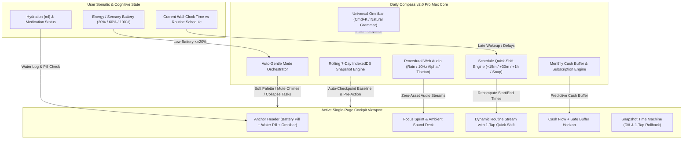
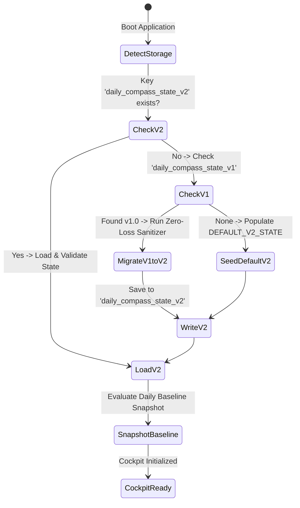
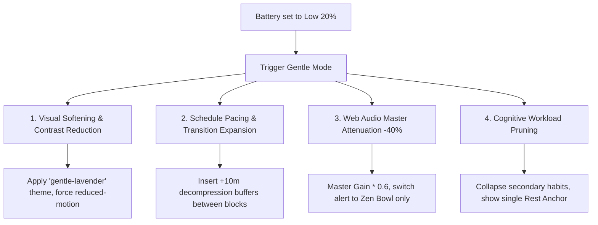
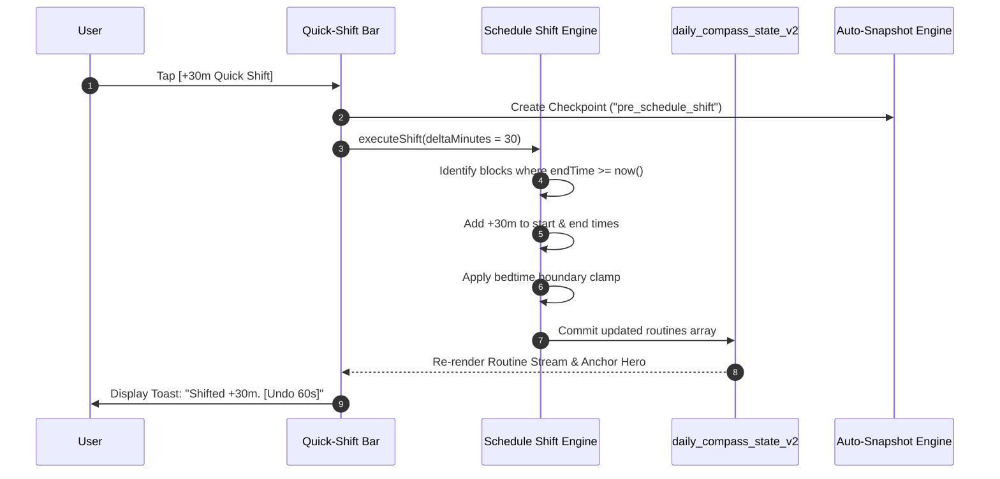
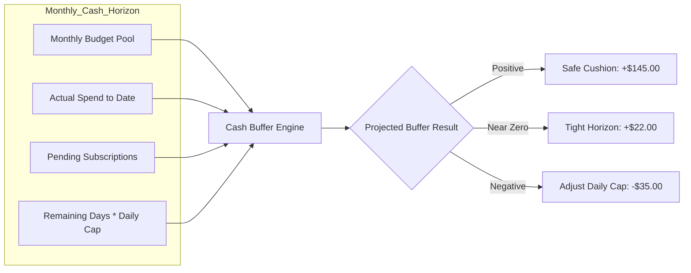
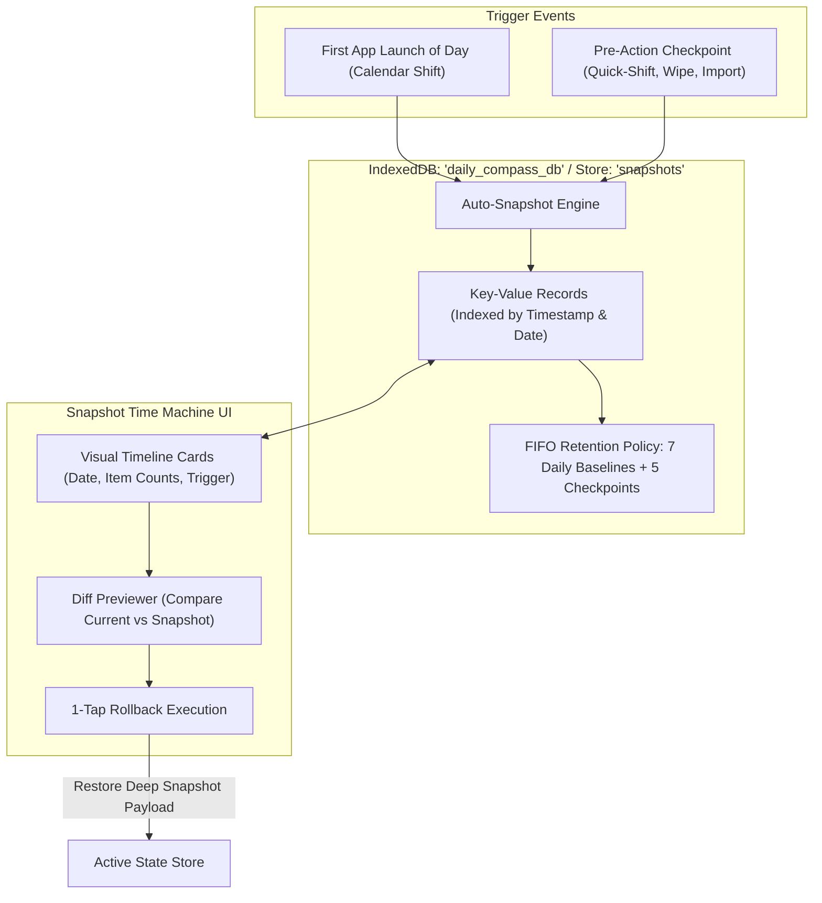

# 🧭 Daily Compass v2.0 Pro Max — Functional & Technical Specifications
# Next-Generation Cognitive Accessibility, Grounding Engines, & Sensory Cockpit

**Document Version:** 2.0.0-PRO-SPEC  
**Target Architecture:** Local-First Web Application / Offline Progressive Web App (PWA)  
**Engineering Paradigm:** Native Web Standards, Zero External Dependencies, Ponytail Simplicity  
**Target User Profile:** Individuals navigating executive dysfunction, ADHD, autism spectrum sensory sensitivity, chronic fatigue/burnout, time blindness, or anxiety paralysis.

---

## 1. Executive Vision & System Architecture

### 1.1 The v2.0 Paradigm Shift: Proactive Cognitive Scaffolding
In Daily Compass v1.0, the core foundation established an unshakeable ground truth: an ambient clock, routine blocks, safe-to-spend cash tracking, bilateral debts, micro-habits with streak shields, and a 4-7-8 grounding reset.

**Daily Compass v2.0 Pro Max** elevates this foundation into an **active, sympathetic cognitive prosthetic**. It recognizes that human capacity is not static:
1. **Biological Realities (Hydration & Meds):** Executive dysfunction causes involuntary physical neglect (forgetting water for 8 hours, agonizing over whether morning medication was taken).
2. **Dynamic Energy Capacities (Battery & Gentle Mode):** Energy fluctuates wildly. When internal batteries deplete to 20%, an interface should not demand 100% capacity; it must automatically soften, de-clutter, and protect the user.
3. **Temporal Resilience (Schedule Quick-Shift):** Life rarely follows a rigid timeline. Waking up 45 minutes late should never destroy a user's day; one tap must effortlessly realign remaining time.
4. **Autonomous Focus & Calming Acoustics (Procedural Soundscapes):** Eliminates external distractions via algorithmic Web Audio (Pink Noise rain, 10 Hz Alpha waves, Tibetan singing bowl drone) intertwined with a low-pressure Focus Sprint timer.
5. **Subscription Transparency & Cash Horizon (Buffer Projection):** Replaces recurring bill dread with automated end-of-month cash forecasting.
6. **Frictionless Omnipresent Control (Global Omnibar `Cmd+K`):** Any action, search, or capture executed in under 2 seconds without changing pages.
7. **Unconditional Psychological Safety (Rolling 7-Day Auto-Snapshots):** Eliminates fear of mistakes or accidental loss with automatic background IndexedDB checkpoints and 1-tap rollbacks.



---

## 2. Store Architecture & Migration: `daily_compass_state_v2`

### 2.1 State Subsystem Topology
The state store evolves from `daily_compass_state_v1` to `daily_compass_state_v2`. The persistence engine continues to prioritize local storage with transparent upgrade hooks and zero server dependencies.



### 2.2 Schema Evolution & Backward Compatibility
When migrating from v1.0 to v2.0, the schema sanitizer performs surgical, idempotent transformations:
- Existing `alarms`, `routines`, `habits`, `cashTransactions`, `debts`, `scratchpad`, and `settings` are completely preserved.
- New root keys are initialized with neurodivergent-friendly defaults:
  - `hydration`: `{ targetMl: 2200, currentMl: 0, lastLoggedAt: null, logs: [] }`
  - `medications`: Array of pre-seeded essential wellness items.
  - `battery`: `{ level: 60, sensoryDrainers: [], gentleModeActive: false, autoGentleTriggered: false }`
  - `subscriptions`: Array of recurring bills with auto-buffer calculations.
  - `focusSprint`: `{ active: false, mode: 'pomodoro', durationMinutes: 25, remainingSeconds: 1500, soundscape: 'pink-rain', ambientVolume: 0.5 }`
  - `snapshots`: IndexedDB-backed metadata registry.

---

## 3. Module Specification 1: Hydration & Daily Medication/Supplement Tracker

### 3.1 Cognitive Problem & Compassionate Design
- **Involuntary Dehydration:** Individuals with hyperfocus or executive dysfunction regularly lose interoceptive awareness of thirst until severe headaches or brain fog strike.
- **Medication Anxiety & Double-Dosing Paranoia:** A frequent source of acute anxiety is: *"Did I take my morning pill, or did I only think about taking it?"* Forgetting causes withdrawal or illness; accidental double-dosing can be medically dangerous.

### 3.2 Component Specifications

#### A. Hydration Water Tracker
1. **Visual Water Gauge:**
   - Soft animated SVG liquid reservoir indicating current level vs daily target (e.g. `1,250 / 2,200 ml` • `57%`).
   - Fill wave animates gently (0.5s cubic ease-out) without rapid flashing.
2. **Ultra-Low Tap Logging Bar (1 Tap):**
   - Quick pill buttons: `[+200ml Cup]`, `[+250ml Glass]`, `[+500ml Bottle]`, `[+750ml Flask]`.
   - Undo button: `[↶ -250ml]` accessible immediately if mis-tapped.
3. **Hourly Pacing Guidance (Anti-Guilt):**
   - Calculates target pace: $\text{Hourly Target} = \frac{\text{Target ml}}{14 \text{ waking hours}}$.
   - If behind pace, the badge displays a calm water drop icon and `"Soft sip suggestion"`—never an alarming red badge.
4. **Midnight Pacing Reset:**
   - Resets daily counter at local `00:00` or configurable wake-up hour. Historical totals are preserved in `dailyStats`.

#### B. Daily Medication & Supplement Checklist
1. **Medication Cards:**
   - Item Attributes: Name, dosage, category (`rx_medication`, `supplement`, `vitamin`, `prn_as_needed`), scheduled time window (`morning`, `noon`, `evening`, `bedtime`), food requirement tag (`with food`, `empty stomach`, `anytime`).
2. **Double-Dosing Safety Lock & Timestamp:**
   - Checking a pill immediately freezes the card with a locked checkmark and explicit confirmation:  
     `"✓ Taken today at 08:14 AM"`.
   - To prevent accidental toggling, unchecking requires a 2-second hold or confirmation modal (`"Mark as NOT taken?"`).
3. **Pre-Chime Reminder Sync:**
   - Integrates with the Web Audio chime engine. If an alarm or routine block corresponds to a medication window, a soft `gentle-triad` chime sounds with a visual pill notification card.

### 3.3 Formal JSON Schema: Hydration & Medication

```json
{
  "$schema": "https://json-schema.org/draft/2020-12/schema",
  "$id": "https://dailycompass.local/schemas/v2/hydration-medication.json",
  "title": "HydrationAndMedicationModule",
  "type": "object",
  "required": ["hydration", "medications"],
  "properties": {
    "hydration": {
      "type": "object",
      "required": ["targetMl", "currentMl", "lastLoggedAt", "quickPills", "history"],
      "properties": {
        "targetMl": { "type": "integer", "minimum": 500, "maximum": 6000, "default": 2200 },
        "currentMl": { "type": "integer", "minimum": 0, "default": 0 },
        "lastLoggedAt": { "type": ["string", "null"], "format": "date-time" },
        "quickPills": {
          "type": "array",
          "items": { "type": "integer" },
          "default": [200, 250, 500, 750]
        },
        "history": {
          "type": "array",
          "items": {
            "type": "object",
            "required": ["id", "timestamp", "amountMl"],
            "properties": {
              "id": { "type": "string", "format": "uuid" },
              "timestamp": { "type": "string", "format": "date-time" },
              "amountMl": { "type": "integer" }
            }
          }
        }
      }
    },
    "medications": {
      "type": "array",
      "items": {
        "type": "object",
        "required": ["id", "name", "dosage", "category", "timeWindow", "scheduledTime", "takenToday", "takenAt"],
        "properties": {
          "id": { "type": "string", "format": "uuid" },
          "name": { "type": "string", "minLength": 1, "maxLength": 80 },
          "dosage": { "type": "string", "maxLength": 40 },
          "category": {
            "type": "string",
            "enum": ["rx_medication", "supplement", "vitamin", "prn_as_needed"]
          },
          "timeWindow": {
            "type": "string",
            "enum": ["morning", "midday", "evening", "bedtime", "as_needed"]
          },
          "scheduledTime": {
            "type": "string",
            "pattern": "^([01]\\d|2[0-3]):([0-5]\\d)$"
          },
          "mealRequirement": {
            "type": "string",
            "enum": ["with_food", "before_food", "after_food", "anytime"],
            "default": "anytime"
          },
          "reminderMinutesBefore": { "type": "integer", "default": 5 },
          "takenToday": { "type": "boolean", "default": false },
          "takenAt": { "type": ["string", "null"], "format": "date-time" },
          "instructions": { "type": "string", "maxLength": 160, "default": "" }
        }
      }
    }
  }
}
```

---

## 4. Module Specification 2: Energy & Sensory Battery Gauge (with Auto-Gentle Mode)

### 4.1 The Autonomic Battery Model
Unlike standard productivity apps that assume constant 100% human throughput, Daily Compass introduces the **3-Tier Autonomic Energy & Sensory Battery**:
- **High (100%):** Strong executive energy, cognitive bandwidth clear, sensory input tolerated.
- **Medium (60%):** Baseline operational capacity; standard routines, moderate focus.
- **Low (20% - Spoon Depletion):** Sensory overload, emotional exhaustion, or physiological burnout.

```
       +-------------------------------------------------------+
       | [ 🔋 BATTERY: LOW (20%) ]  [ GENTLE MODE: ACTIVE 🌿 ] |
       +-------------------------------------------------------+
       | Sensory Drainers Active: [x] Noise  [x] Screen Fog    |
       | UI Response: Contrast softened | Chimes -40% | 1 Task |
       +-------------------------------------------------------+
```

### 4.2 Automatic Gentle Mode Orchestration Engine
When the user switches their battery to **Low (20%)**—either manually via the persistent gauge or through the Omnibar (`+bat low`)—the application immediately engages **Gentle Mode**:



#### Gentle Mode Behavioral Rules
1. **Visual Atmosphere:**
   - Shifts canvas to soft low-contrast twilight: `--bg-canvas: #161821`, `--text-primary: #d5dae2`.
   - Forces CSS `prefers-reduced-motion: reduce` behavior: disables second-tick animations, breathing glows, and sliding transitions.
2. **Audio Protection:**
   - Web Audio synthesizer clamps master output gain by 40% (`gainNode.gain = masterVolume * 0.6`).
   - Disables bright or abrupt presets (`attentive-bell`); all alerts route through the warm, resonant `zen-bowl` preset.
3. **Cognitive Workload Pruning:**
   - Routine blocks hide sub-step checklists and display a single **"Gentle Action"** (e.g. *"Drink water and lie down for 15 minutes"*).
   - Incomplete habits are placed in a safe **"Rest Forgiveness"** state; streaks are automatically shielded without user intervention.
4. **Compassionate Re-assurance Banner:**
   - Persistent message: *"Battery is Low (20%). Gentle Mode is protecting your day. No demands. Take what you need."*

### 4.3 Formal JSON Schema: Battery & Gentle Mode

```json
{
  "$schema": "https://json-schema.org/draft/2020-12/schema",
  "$id": "https://dailycompass.local/schemas/v2/energy-battery.json",
  "title": "EnergyBatteryModule",
  "type": "object",
  "required": ["batteryLevel", "sensoryDrainers", "gentleModeConfig", "lastUpdated"],
  "properties": {
    "batteryLevel": {
      "type": "integer",
      "enum": [20, 60, 100],
      "default": 60,
      "description": "20 = Low / Depleted, 60 = Medium / Baseline, 100 = High / Peak"
    },
    "sensoryDrainers": {
      "type": "array",
      "items": {
        "type": "string",
        "enum": ["noise_overload", "screen_fatigue", "social_drain", "physical_hunger", "brain_fog", "pain_flare"]
      },
      "uniqueItems": true
    },
    "gentleModeConfig": {
      "type": "object",
      "required": ["isActive", "autoTriggerOnLow", "dimVisuals", "attenuateAudioPercent", "expandRoutineBuffersMinutes"],
      "properties": {
        "isActive": { "type": "boolean", "default": false },
        "autoTriggerOnLow": { "type": "boolean", "default": true },
        "dimVisuals": { "type": "boolean", "default": true },
        "attenuateAudioPercent": { "type": "integer", "minimum": 10, "maximum": 80, "default": 40 },
        "expandRoutineBuffersMinutes": { "type": "integer", "minimum": 5, "maximum": 30, "default": 10 }
      }
    },
    "lastUpdated": { "type": "string", "format": "date-time" }
  }
}
```

---

## 5. Module Specification 3: Day Schedule Quick-Shift Engine

### 5.1 The Psychology of Schedule Derailment
A classic failure mode in ADHD and executive dysfunction is the **"All-or-Nothing Derailment Domino"**:
- An alarm was set for 07:30. The user woke up at 08:45.
- The morning block was missed.
- The user feels an overwhelming wave of guilt and confusion: *"The whole day is broken, so I might as well abandon everything."*

The **Day Schedule Quick-Shift Engine** converts this crisis into a single tap. It treats time as an elastic, compassionate medium rather than a concrete wall.

### 5.2 Functional Specifications
1. **One-Tap Quick-Shift Controls:**
   - Prominently situated in the Anchor header and Routine schedule stream:
     - `[+15m Quick Shift]`
     - `[+30m Quick Shift]`
     - `[+1h Quick Shift]`
     - `[⚡ Snap Remaining to Now]`
2. **Selective Chronological Shifting Algorithm:**
   - **Historical Integrity:** Does *not* alter routine blocks that have already ended prior to the current wall-clock minute. Completed micro-steps remain safely checked.
   - **Active & Future Blocks:** For the currently active block and all subsequent blocks:
     $$\text{startTime}_{\text{new}} = \text{startTime}_{\text{old}} + \Delta t$$
     $$\text{endTime}_{\text{new}} = \text{endTime}_{\text{old}} + \Delta t$$
3. **Bedtime & Sleep Boundary Protection:**
   - Each user profile defines a `hardBedtime` (e.g. `23:00`).
   - If a `+1h` shift would push the `Evening Wind-Down` past `hardBedtime`:
     - The engine automatically clamps the final block to `hardBedtime`.
     - Displays a gentle advisory pill: `"Remaining day shifted +1h (Evening routine condensed by 25m to protect your sleep)"`.
4. **60-Second Reversible Safety Net (Undo):**
   - After any quick-shift, an immediate toast notification appears:
     `"Shifted 4 remaining blocks by +30m. [↶ Undo (59s)]"`.
   - Tapping Undo restores the exact previous timestamps from the pre-action snapshot.



### 5.3 Formal JSON Schema: Schedule Shift

```json
{
  "$schema": "https://json-schema.org/draft/2020-12/schema",
  "$id": "https://dailycompass.local/schemas/v2/schedule-shift.json",
  "title": "ScheduleShiftPayload",
  "type": "object",
  "required": ["deltaMinutes", "snapToNow", "applyToActiveBlock", "preserveBedtimeBoundary", "timestamp"],
  "properties": {
    "deltaMinutes": { "type": "integer", "enum": [15, 30, 45, 60, 90, 120] },
    "snapToNow": { "type": "boolean", "default": false },
    "applyToActiveBlock": { "type": "boolean", "default": true },
    "preserveBedtimeBoundary": { "type": "boolean", "default": true },
    "hardBedtime": {
      "type": "string",
      "pattern": "^([01]\\d|2[0-3]):([0-5]\\d)$",
      "default": "23:00"
    },
    "timestamp": { "type": "string", "format": "date-time" },
    "audit": {
      "type": "object",
      "properties": {
        "shiftedRoutineIds": { "type": "array", "items": { "type": "string" } },
        "originalTimeSpans": {
          "type": "object",
          "additionalProperties": {
            "type": "object",
            "properties": { "start": { "type": "string" }, "end": { "type": "string" } }
          }
        }
      }
    }
  }
}
```

---

## 6. Module Specification 4: Web Audio Synthesized Ambient Soundscapes & Focus Sprint Timer

### 6.1 Algorithmic Audio Architecture (Zero External Assets)
In adherence to the Ponytail Simplicity and offline-first ethos, all soundscapes are 100% procedurally synthesized in real time via the native browser `AudioContext`. **Zero MP3 files, zero streaming bandwidth, zero CORS issues.**

```
                           Procedural Soundscape Generator
+---------------------+     +-----------------------+     +-------------------+
| Soundscape Source:  |     | Filters & Modulators: |     | Output Stage:     |
| - Pink Noise Buffer | --> | - BiQuad Lowpass/BP   | --> | - Stereo Panner   | --> [Master Gain]
| - Dual Sine (10 Hz) |     | - Slow LFO Amplitude  |     | - Focus Sprint    |     (Destination)
| - 432 Hz Drone Pack |     | - Multi-pole Resonator|     |   Fade Envelope   |
+---------------------+     +-----------------------+     +-------------------+
```

### 6.2 The Three Procedural Soundscape Presets

#### Preset 1: "Pink Noise Rain Simulation"
- **Scientific Foundation:** Pink noise exhibits an energy decay of $-3\text{ dB per octave}$ ($\frac{1}{f}$ power spectral density), closely replicating natural precipitation and masking distracting background speech frequencies.
- **Synthesis Recipe:**
  1. A 2-second looped floating-point `AudioBuffer` filled with mathematically filtered white noise using Paul Kellet’s 3-pole IIR filter algorithm:
     $$b_0 = 0.99886 \cdot b_0 + \text{white} \cdot 0.0555179$$
     $$b_1 = 0.99332 \cdot b_1 + \text{white} \cdot 0.0750759$$
     $$b_2 = 0.96900 \cdot b_2 + \text{white} \cdot 0.1538520$$
     $$\text{pink} = b_0 + b_1 + b_2 + \text{white} \cdot 0.5362$$
  2. Routed through a `BiquadFilterNode` (`bandpass`, $f_c = 850\text{ Hz}$, $Q = 0.8$).
  3. Modulated by a slow LFO sine oscillator ($0.08\text{ Hz}$) altering amplitude by $\pm 12\%$ to simulate organic wind gusts and rain surges.

#### Preset 2: "10 Hz Alpha Wave Binaural Generator"
- **Scientific Foundation:** When two pure tones of slightly differing frequencies are presented separately to each ear via stereo channels, the auditory cortex perceives a binaural beat at the difference frequency. A $10\text{ Hz}$ difference aligns with the **Alpha brainwave band** ($8\text{--}12\text{ Hz}$), associated with alert relaxation, calm focus, and reduced ADHD hyper-reactivity.
- **Synthesis Recipe:**
  1. **Left Channel Oscillator:** Pure sine wave at $200.0\text{ Hz}$, routed through a `StereoPannerNode(pan: -1.0)`.
  2. **Right Channel Oscillator:** Pure sine wave at $210.0\text{ Hz}$ ($\Delta f = 10.0\text{ Hz}$), routed through a `StereoPannerNode(pan: +1.0)`.
  3. Sub-bass warmth filter to remove any digital clipping; smooth 2.5s fade-in gain ramp to prevent acoustic shock.

#### Preset 3: "Tibetan Singing Bowl Continuous Drone"
- **Scientific Foundation:** Meditative harmonics centered on the natural $432\text{ Hz}$ and $108\text{ Hz}$ sacred ratios provide deep somatic grounding during acute anxiety spirals or heavy focus blocks.
- **Synthesis Recipe:**
  1. **Layer 1 (Fundamental Ohm):** Sine oscillator at $108.0\text{ Hz}$.
  2. **Layer 2 (Octave Harmonic):** Sine oscillator at $216.0\text{ Hz}$ with $+0.35\text{ Hz}$ detuning for acoustic warmth and beating.
  3. **Layer 3 (Singing Bowl Body):** Sine oscillator at $432.0\text{ Hz}$ passed through a high-Q bandpass filter ($Q = 4.0$).
  4. **Modulation:** A dual-stage LFO ($0.05\text{ Hz}$ and $0.12\text{ Hz}$) subtly cross-fades the harmonic levels, creating a living, breathing acoustic resonance.

### 6.3 Integrated Focus Sprint Timer
The sprint timer coordinates cognitive work blocks with ambient soundscapes:
- **Modes:**
  - `ADHD Micro-Sprint`: 15m Focus / 3m Micro-Break (ultra-low activation energy).
  - `Classic Pomodoro`: 25m Focus / 5m Rest.
  - `Deep Sprint`: 50m Focus / 10m Decompression.
- **Audio Lifecycle Integration:**
  - Starting the sprint smoothly fades in the chosen ambient soundscape over 2.0 seconds.
  - At $T=0$, the soundscape fades out over 1.5 seconds, sounds `Preset 2 (Gentle Triad Chime)`, and triggers the break counter.
  - No abrasive digital buzzer sounds.

### 6.4 Formal JSON Schema: Soundscapes & Focus Sprint

```json
{
  "$schema": "https://json-schema.org/draft/2020-12/schema",
  "$id": "https://dailycompass.local/schemas/v2/focus-soundscape.json",
  "title": "FocusSoundscapeModule",
  "type": "object",
  "required": ["focusSprint", "soundscapeConfig"],
  "properties": {
    "focusSprint": {
      "type": "object",
      "required": ["state", "mode", "durationMinutes", "breakMinutes", "elapsedSeconds", "completedSprintsToday"],
      "properties": {
        "state": {
          "type": "string",
          "enum": ["idle", "running", "paused", "break_running", "break_paused"]
        },
        "mode": {
          "type": "string",
          "enum": ["adhd_micro", "classic_pomodoro", "deep_sprint", "custom"]
        },
        "durationMinutes": { "type": "integer", "minimum": 1, "maximum": 120, "default": 25 },
        "breakMinutes": { "type": "integer", "minimum": 1, "maximum": 30, "default": 5 },
        "elapsedSeconds": { "type": "integer", "default": 0 },
        "completedSprintsToday": { "type": "integer", "default": 0 },
        "linkedRoutineBlockId": { "type": ["string", "null"] }
      }
    },
    "soundscapeConfig": {
      "type": "object",
      "required": ["activePreset", "volume", "autoPlayOnSprint"],
      "properties": {
        "activePreset": {
          "type": "string",
          "enum": ["pink-rain", "alpha-binaural", "tibetan-drone", "silence"],
          "default": "pink-rain"
        },
        "volume": { "type": "number", "minimum": 0, "maximum": 1, "default": 0.5 },
        "autoPlayOnSprint": { "type": "boolean", "default": true }
      }
    }
  }
}
```

---

## 7. Module Specification 5: Recurring Subscriptions & Monthly Cash Buffer Projection

### 7.1 Problem Statement: The Subscription Dread Cycle
People with executive dysfunction dread opening banking apps because numbers trigger financial shame. Recurring subscriptions renew silently, blindsiding users and destroying their daily spending cap.

### 7.2 Functional Specifications
1. **Recurring Subscription Ledger:**
   - Tracks fixed recurring obligations: Streaming, software tools, fitness, rent/utilities, cloud storage.
   - Entity Fields: Service name, icon/emoji, amount, frequency (`monthly`, `yearly`), renewal day of month (e.g. `14th`), active status.
   - **Imminent Due Badge:** Highlights subscriptions due within the next 3 days (`"⚡ Renews in 2 days"`).
   - **1-Tap "Log as Paid":** When a bill hits the user's account, tapping "Log Paid" automatically injects a verified expense transaction into Module 3's cash ledger with category `bills`.
2. **Predictive End-of-Month Cash Buffer Engine:**
   - Computes real-time solvency without complex accounting terms:

$$\text{Days Remaining in Month} = D_{\text{last\_day\_of\_month}} - D_{\text{current\_day}}$$
$$\text{Projected Daily Discretionary Spend} = \text{Days Remaining} \times \text{Daily Spending Cap}$$
$$\text{Pending Subscriptions Due This Month} = \sum_{s \in \text{Upcoming Unpaid}} \text{Amount}_s$$
$$\text{Projected End-of-Month Buffer} = \text{Monthly Budget Pool} - \text{Total Spent to Date} - \text{Pending Subscriptions} - \text{Projected Daily Discretionary Spend}$$

3. **Buffer Gauge Visual States:**
   - **Comfort Zone ($> +15\%$):** Calm Sage Green (`#3fb950`). Safe buffer intact.
   - **Tight Margin ($0 \le \text{Buffer} \le 15\%$):** Warm Amber (`#f0883e`). Suggests gentle pacing.
   - **Deficit Warning ($< 0$):** Soft Coral (`#f85149`). Non-punitive formula displays:  
     `"To finish the month balanced, your recommended daily cap is $32.00 (adjusted from $40.00)"`.



### 7.3 Formal JSON Schema: Subscriptions & Buffer Projection

```json
{
  "$schema": "https://json-schema.org/draft/2020-12/schema",
  "$id": "https://dailycompass.local/schemas/v2/subscriptions-cash-forecast.json",
  "title": "SubscriptionsAndCashForecastModule",
  "type": "object",
  "required": ["subscriptions", "forecastPreferences"],
  "properties": {
    "subscriptions": {
      "type": "array",
      "items": {
        "type": "object",
        "required": ["id", "title", "amount", "billingFrequency", "billingDayOfMonth", "category", "isActive"],
        "properties": {
          "id": { "type": "string", "format": "uuid" },
          "title": { "type": "string", "minLength": 1, "maxLength": 60 },
          "amount": { "type": "number", "minimum": 0.01 },
          "billingFrequency": { "type": "string", "enum": ["monthly", "yearly", "weekly"] },
          "billingDayOfMonth": { "type": "integer", "minimum": 1, "maximum": 31 },
          "category": { "type": "string", "default": "subscriptions" },
          "icon": { "type": "string", "default": "💡" },
          "isActive": { "type": "boolean", "default": true },
          "lastPaidDate": { "type": ["string", "null"], "format": "date" },
          "notes": { "type": "string", "default": "" }
        }
      }
    },
    "forecastPreferences": {
      "type": "object",
      "required": ["monthlyStartingPool", "cautionBufferThresholdPercent"],
      "properties": {
        "monthlyStartingPool": { "type": "number", "minimum": 0, "default": 1200 },
        "cautionBufferThresholdPercent": { "type": "integer", "default": 15 },
        "rolloverSurplus": { "type": "boolean", "default": false }
      }
    }
  }
}
```

---

## 8. Module Specification 6: Global Omnibar / Command Palette (`Cmd+K` / `Ctrl+K`)

### 8.1 Interaction Design & Instant Keyboard Access
Executive dysfunction creates friction whenever switching views requires visual scanning. The **Global Omnibar** provides a universal command center accessible from anywhere in the cockpit via:
- Keyboard Shortcut: `Cmd + K` (macOS) / `Ctrl + K` (Windows / Linux).
- Persistent Header Search Button: Tapping the Omnibar button in the sticky hero bar.

```
+-------------------------------------------------------------------------+
| > Type a command or search (e.g. '$ 12 coffee', '+h 500', '+shift 30')  |
+-------------------------------------------------------------------------+
| CONTEXTUAL SUGGESTIONS (Right Now):                                     |
| 1. 💧 Drink Water (+250ml)                                              |
| 2. ⚡ Quick Shift Day Schedule (+30 min)                                |
| 3. 🎯 Start Focus Sprint (25 min Pink Rain)                             |
| 4. 🔋 Set Battery Level (Low / Gentle Mode)                             |
| 5. 🧘 Grounding Centering (4-7-8 Breathing)                             |
+-------------------------------------------------------------------------+
```

### 8.2 Natural Grammar Command Prefixes (Instant Action Syntax)
The Omnibar parses commands using a high-speed, lightweight prefix grammar:

| Prefix / Pattern | Example Input | Execution Result |
| :--- | :--- | :--- |
| `$` or `+cash` | `$ 14 lunch salad` | Logs a `$14.00` expense under category `food` with note *"lunch salad"* in 1 step. |
| `+h` or `water` | `+h 500` or `water 500` | Adds `500ml` to today's hydration total. |
| `+pill` | `+pill vitamin` | Marks matching scheduled medication as taken right now. |
| `+shift` | `+shift 30` | Shifts remaining routine blocks forward by `+30 minutes`. |
| `+focus` | `+focus 25` | Instantly starts a 25-minute Focus Sprint with ambient audio. |
| `+bat` | `+bat low` | Sets energy battery to `Low (20%)` and activates Gentle Mode. |
| `+note` | `+note buy oat milk` | Dumps note to Scratchpad with timestamp. |
| `+zen` | `+zen` or `panic` | Opens the 4-7-8 Somatic Grounding Modal immediately. |
| `go [module]` | `go cash` or `go habits` | Switches active viewport to `#cash`, `#habits`, etc. |

### 8.3 Cross-Module Fuzzy Search Engine
If input does not match a command prefix, the Omnibar performs instant fuzzy token search across all active local stores:
- **Scratchpad Items:** Matches note contents and tags.
- **Routines & Steps:** Matches routine titles and checklist step items.
- **Habits:** Matches habit titles and icons.
- **Debts:** Matches counterparty names and notes.
- **Subscriptions:** Matches service names.

### 8.4 Keyboard Navigation & Cognitive Accessibility
- Keybindings: `ArrowDown` / `ArrowUp` to cycle through items; `Enter` to execute; `Escape` to close; `Tab` to autocomplete suggestion prefix.
- Screen Reader Accessibility: Full ARIA `combobox` role, `aria-expanded="true"`, `aria-activedescendant` synced with highlighted result item.

### 8.5 Formal JSON Schema: Omnibar Command & Context

```json
{
  "$schema": "https://json-schema.org/draft/2020-12/schema",
  "$id": "https://dailycompass.local/schemas/v2/omnibar-command.json",
  "title": "OmnibarCommandModule",
  "type": "object",
  "required": ["commandId", "title", "prefix", "category", "shortcut"],
  "properties": {
    "commandId": { "type": "string" },
    "title": { "type": "string" },
    "prefix": { "type": "string" },
    "category": {
      "type": "string",
      "enum": ["navigation", "quick_action", "cash", "wellness", "schedule", "focus", "grounding"]
    },
    "shortcut": { "type": "string" },
    "requiresArgument": { "type": "boolean", "default": false },
    "argumentPlaceholder": { "type": "string" }
  }
}
```

---

## 9. Module Specification 7: Rolling 7-Day Auto-Snapshot Recovery (IndexedDB Local Automated Backups)

### 9.1 The Fear of Accidental Destruction
A hidden barrier to habit tracker engagement is **irreversible error anxiety**:
*"What if I accidentally delete my routines?"*  
*"What if I make a mistake shifting the schedule and ruin my weekly plan?"*  
Manual JSON export is too tedious to perform after every session.

The **Rolling 7-Day Auto-Snapshot Recovery System** provides total, silent, zero-effort psychological safety.



### 9.2 Functional Architecture & Storage Mechanics
1. **Dedicated IndexedDB Store:**
   - Database name: `daily_compass_v2_db`
   - Object Store: `snapshots` (keyPath: `id`, indices: `timestamp`, `date`, `triggerType`).
2. **Automated Dual-Trigger Lifecycle:**
   - **Trigger A (Daily Rolling Baseline):** Automatically generated on the first session initialization of each calendar day (`YYYY-MM-DD`).
   - **Trigger B (Pre-Action Safety Checkpoint):** Generated automatically immediately before:
     - Schedule Quick-Shift (`pre_schedule_shift`)
     - Large habit/routine deletions or resets (`pre_routine_modify`)
     - JSON data import or overwrites (`pre_import_restore`)
     - Manual factory reset (`pre_wipe_safety`)
3. **FIFO Retention Rotation Policy:**
   - Stores up to **7 daily baseline snapshots** (1 per day for the last 7 days).
   - Stores up to **5 pre-action checkpoints**.
   - Total IndexedDB footprint: $\approx 1.2\text{--}2.5\text{ MB}$ (virtually unnoticeable compared to browser quotas of $>50\text{ MB}$).
   - Older records are automatically cleaned up in background via non-blocking asynchronous IDB transactions.
4. **Snapshot Time Machine UI:**
   - Accessible in Settings via `[Snapshot Time Machine / Rollback]`.
   - Cards display: Timestamp, trigger reason (`Daily Morning Baseline`, `Before Schedule Shift`), entity counts (Habits, Transactions, Debts, Routines).
   - **Diff Summary Modal:** Shows exact changes before rolling back (e.g. `+2 habits, -1 expense, routines +30m`).
   - **1-Click Rollback:** Immediately creates a final safety checkpoint of "Right Now", restores the historical snapshot state, broadcasts an update event to all UI modules, and sounds Preset 1 (`zen-bowl`). Zero page reload required.

### 9.3 Formal JSON Schema: Auto-Snapshot Record

```json
{
  "$schema": "https://json-schema.org/draft/2020-12/schema",
  "$id": "https://dailycompass.local/schemas/v2/auto-snapshot.json",
  "title": "AutoSnapshotRecord",
  "type": "object",
  "required": ["id", "timestamp", "date", "triggerType", "summary", "payload"],
  "properties": {
    "id": { "type": "string", "format": "uuid" },
    "timestamp": { "type": "string", "format": "date-time" },
    "date": { "type": "string", "format": "date" },
    "triggerType": {
      "type": "string",
      "enum": ["daily_baseline", "pre_schedule_shift", "pre_import_restore", "pre_routine_modify", "manual_checkpoint"]
    },
    "summary": {
      "type": "object",
      "required": ["routineCount", "transactionCount", "habitCount", "debtCount"],
      "properties": {
        "routineCount": { "type": "integer" },
        "transactionCount": { "type": "integer" },
        "habitCount": { "type": "integer" },
        "debtCount": { "type": "integer" },
        "waterMl": { "type": "integer" },
        "batteryLevel": { "type": "integer" }
      }
    },
    "payload": {
      "type": "object",
      "description": "Full deep snapshot of daily_compass_state_v2 at the exact checkpoint millisecond"
    }
  }
}
```

---

## 10. Unified v2.0 Full Backup & Export Schema (`FullBackupPayloadV2`)

```json
{
  "$schema": "https://json-schema.org/draft/2020-12/schema",
  "$id": "https://dailycompass.local/schemas/v2/full-backup-payload-v2.json",
  "title": "FullBackupPayloadV2",
  "type": "object",
  "required": [
    "schemaVersion",
    "exportTimestamp",
    "appSettings",
    "anchor",
    "alarms",
    "routines",
    "budgetConfig",
    "cashTransactions",
    "debtRecords",
    "habits",
    "scratchpadItems",
    "hydration",
    "medications",
    "batteryState",
    "focusSprint",
    "subscriptions"
  ],
  "properties": {
    "schemaVersion": { "type": "integer", "const": 2 },
    "exportTimestamp": { "type": "string", "format": "date-time" },
    "appSettings": {
      "type": "object",
      "required": ["timeFormat", "chimeVolume", "audioEnabled", "theme", "currencySymbol", "dailyBudgetCap"],
      "properties": {
        "timeFormat": { "type": "string", "enum": ["12h", "24h"], "default": "12h" },
        "chimeVolume": { "type": "number", "minimum": 0, "maximum": 1, "default": 0.7 },
        "audioEnabled": { "type": "boolean", "default": true },
        "theme": { "type": "string", "enum": ["calm-dark", "paper-light", "gentle-lavender"], "default": "calm-dark" },
        "currencySymbol": { "type": "string", "default": "$" },
        "dailyBudgetCap": { "type": "number", "default": 50 }
      }
    },
    "anchor": { "type": "object" },
    "alarms": { "type": "array" },
    "routines": { "type": "array" },
    "budgetConfig": { "type": "object" },
    "cashTransactions": { "type": "array" },
    "debtRecords": { "type": "array" },
    "habits": { "type": "array" },
    "scratchpadItems": { "type": "array" },
    "hydration": { "$ref": "https://dailycompass.local/schemas/v2/hydration-medication.json#/properties/hydration" },
    "medications": { "$ref": "https://dailycompass.local/schemas/v2/hydration-medication.json#/properties/medications" },
    "batteryState": { "$ref": "https://dailycompass.local/schemas/v2/energy-battery.json" },
    "focusSprint": { "$ref": "https://dailycompass.local/schemas/v2/focus-soundscape.json#/properties/focusSprint" },
    "subscriptions": { "$ref": "https://dailycompass.local/schemas/v2/subscriptions-cash-forecast.json#/properties/subscriptions" }
  }
}
```

---

## 11. UI/UX Component Wireframes & Ergonomic Blueprints

### 11.1 The Persistent Header & Cognitive Bar
```
+---------------------------------------------------------------------------------------------------------+
| [🧭 DAILY COMPASS]   14:28:05 Wed, Nov 5   [ 🔋 Battery: 60% ▾ ]   [ 💧 1,250ml + ]   [ 🔍 Cmd+K ]     |
| [ GENTLE MODE: OFF ]   [ ⚡ Quick-Shift: +15m | +30m | +1h ]   [ 🎯 Sprint: 25m ▶ ]   [ 🧘 Lost? Reset ]|
+---------------------------------------------------------------------------------------------------------+
| ACTIVE FOCUS: Deep Work Sprint 1 (Ends in 32m)                     NEXT UP: Sunshine Break & Meds       |
+---------------------------------------------------------------------------------------------------------+
```

### 11.2 Hydration & Medication Deck
```
+---------------------------------------------------------------------------------------------------------+
| 💧 HYDRATION COCKPIT                                 | 💊 DAILY MEDICATION & SUPPLEMENTS                |
| Goal: 2,200 ml   Current: 1,250 ml (57%)            |                                                  |
| [========================>                     ]    | [✓] 08:00 AM • Methylfolate 15mg (Taken 08:12am) |
| Pace: On Track (+100ml ahead of hourly baseline)    | [ ] 12:30 PM • Omega-3 & D3 2000IU [Take Now]    |
| Quick Log: [+200ml Cup] [+250ml] [+500ml] [↶ Undo]  | [ ] 21:00 PM • Magnesium Glycinate 400mg         |
+---------------------------------------------------------------------------------------------------------+
```

### 11.3 Focus Sprint & Ambient Sound Deck
```
+---------------------------------------------------------------------------------------------------------+
| 🎯 FOCUS SPRINT ENGINE                              | 🎧 PROCEDURAL AMBIENT SOUNDSCAPES                |
| Mode: [ADHD 15m] [Pomodoro 25m] [Deep 50m]          | [x] Pink Noise Rain   (Gentle broadband masking) |
|                                                     | [ ] 10 Hz Alpha Waves (Binaural focus tone)      |
|              [   21 : 44   ]                        | [ ] Tibetan Drone     (Grounding 432Hz harmonics)|
|                                                     | Volume: [====|=========] 50%                     |
|     [ ▶ Resume ]   [ ⏸ Pause ]   [ ⏹ Stop ]         | Auto-play during focus sprints: [ON]             |
+---------------------------------------------------------------------------------------------------------+
```

### 11.4 Subscriptions & End-of-Month Cash Forecast
```
+---------------------------------------------------------------------------------------------------------+
| 💡 RECURRING SUBSCRIPTIONS                          | 📊 END-OF-MONTH CASH BUFFER FORECAST             |
| • 🎵 Spotify Premium     $10.99  (Due in 3 days)    | Current Spent This Month:  $540.00               |
| • 💻 Cloud Storage       $2.99   (Due on 18th)      | Upcoming Subscriptions:    $28.97                |
| • 🏋️ Gym Membership     $45.00  (Due on 25th)      | Remaining Discretionary:   $480.00 (12d x $40/d) |
|                                                     | ------------------------------------------------ |
| [ + Add Subscription ]   [ 1-Tap Log Paid Bills ]   | Projected Month-End Cushion: +$151.03 (SAFE 🌿)  |
+---------------------------------------------------------------------------------------------------------+
```

### 11.5 Rolling Snapshot Time Machine Drawer
```
+---------------------------------------------------------------------------------------------------------+
| 🕰️ SNAPSHOT TIME MACHINE (Rolling 7-Day Local IDB Recovery)                                            |
| Automatic checkpoints are created daily and before major actions. No external server. Total peace.     |
|                                                                                                         |
| • TODAY 08:00 AM   [Daily Baseline]        (4 Routines, 8 Habits, $18.50 spent)    [Preview] [Rollback] |
| • YESTERDAY 14:15  [Pre-Schedule Shift]    (Shifted +30m applied)                  [Preview] [Rollback] |
| • YESTERDAY 08:00  [Daily Baseline]        (All systems nominal)                   [Preview] [Rollback] |
| • NOV 3 19:30      [Pre-Import Restore]    (Safety checkpoint before backup JSON)  [Preview] [Rollback] |
|                                                                                                         |
| [ 💾 Save Manual Snapshot Now ]   [ 📥 Export Snapshot Archive JSON ]                                   |
+---------------------------------------------------------------------------------------------------------+
```

---

## 12. Implementation Verification Matrix & Acceptance Criteria

| Feature Module | Verification Test Case | Expected Behavior & Acceptance Criteria |
| :--- | :--- | :--- |
| **Hydration & Meds** | Tap `+250ml Glass` | State updates `currentMl += 250`, progress bar updates with smooth animation, action recorded in IDB. |
| **Hydration & Meds** | Check Medication Checkbox | Pill marks `takenToday: true`, locks with exact timestamp `takenAt`, plays Preset 2 Gentle Triad chime. Unchecking requires confirmation. |
| **Battery & Gentle** | Set Battery to `Low (20%)` | Triggers Gentle Mode: UI theme dims, animations stop, master Web Audio volume drops by 40%, single gentle anchor task displayed. |
| **Schedule Quick-Shift** | Tap `+30m Quick Shift` | Active and upcoming routines shift start/end by +30m. Completed blocks remain unchanged. Bedtime clamped if past 23:00. Undo toast active for 60s. |
| **Web Audio Soundscapes** | Start Focus Sprint (Pink Rain) | Web Audio procedural pink noise generator starts with 2s fade-in. No external audio files requested. Zero 404s. |
| **Web Audio Soundscapes** | Sprint Timer Completes ($T=0$) | Soundscape fades out over 1.5s, Zen Bowl chime sounds, break timer begins smoothly. |
| **Subscriptions & Cash** | Evaluate Cash Buffer Forecast | Correctly calculates $B = \text{Pool} - \text{Spent} - \sum \text{Subs} - (\text{Days} \times \text{Cap})$. Color-codes Sage, Amber, or Coral. |
| **Universal Omnibar** | Press `Cmd+K` / `Ctrl+K` | Omnibar modal opens in $<100\text{ms}$ with keyboard focus. Typing `$ 15 coffee` and pressing Enter logs expense and closes palette. |
| **Auto-Snapshot Engine** | Daily Launch or Quick-Shift | Generates snapshot record in IndexedDB `snapshots` store. 7-day FIFO rotation retains latest records and purges expired entries. |
| **Auto-Snapshot Rollback** | Tap `Rollback` on historical snapshot | Restores exact application state cleanly without full page refresh. Recovers all routines, habits, and transactions. |

---
**End of Specification — Daily Compass v2.0 Pro Max**
